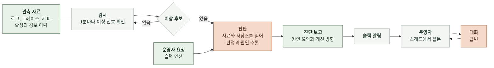

# 1. 배경

이 문서는 장애 진단 에이전트가 해결하려는 문제와 에이전트에 맡길 역할을 정한다.

 

### 1-1 도메인

관측은 서비스가 지금 어떻게 동작하는지를 밖에서 알아내는 일이다. 마냑은 다섯 가지 자료로 서비스를 관측한다.

| 자료 | 담는 것 | 저장 위치 |
|---|---|---|
| 로그 | 요청 완료, 외부 호출, 오류 같은 사건 한 건과 그 필드 | OpenSearch 로그 인덱스 |
| 트레이스 | 요청 하나가 서비스와 DB를 거치며 쓴 시간. 구간 하나를 스팬이라 부름 | OpenSearch 스팬 인덱스 |
| 지표 | 서비스, DB, 캐시, 로드밸런서의 1분 단위 수치(CPU, 메모리, 연결 수, 요청 수) | CloudWatch |
| 앱 지표 | 서비스가 직접 내보낸 내부 수치(실행기 활성 스레드 같은 값) | AMP |
| 확장과 경보 이력 | 오토스케일링이 태스크 수를 바꾼 기록과 경보 상태 변화 | Application Auto Scaling, CloudWatch 경보 |

마냑은 백엔드(manyak-server), AI 서버(manyak-ai), 알림 서버(manyak-notification)가 ECS 서비스로 돌고 PostgreSQL(RDS)과 Redis(ElastiCache)를 쓴다. 채팅 한 턴은 백엔드가 받아 턴 실행기에서 차례를 기다린 뒤 AI 서버를 호출하고 그 결과를 DB에 저장한다.

 

### 1-2 현재 업무와 문제

장애를 찾는 일은 사람이 한다. 운영자는 응답이 느리거나 실패한다는 신호를 보고 트레이스, 로그, 지표를 한 화면씩 열어 시각을 맞춰 대조한다. 부하 테스트에서 찾은 병목 네 건도 이 방식으로 찾았다.

| 병목 | 드러난 모습 | 원인 |
|---|---|---|
| 채팅 턴 큐 대기 | 동시 사용자 25명부터 턴 응답 p95 16초, 50명에서 48초 | 턴 실행기가 태스크당 4개만 동시에 실행해 나머지가 큐에서 대기 |
| 동시 턴 상한 재도달 | 동시 사용자 400명에서 큐 대기 p95 5~9초 | 동시 턴 상한 64에 닿았지만 CPU 기준 오토스케일링이라 백엔드가 늘어나지 않음 |
| AI 서버 CPU 포화 | AI 서버 CPU 평균 65~74%, 순간 100% | 평균이 확장 기준 70% 근처를 오르내려 3분 연속 초과 조건을 채우지 못해 확장 0회 |
| DB CPU 포화 | 동시 사용자 200명 혼합 부하에서 RDS CPU 82~90% | 스토리별 누적 턴을 매 요청 합산하는 쿼리가 채팅 수에 비례해 느려짐 |

이 방식에는 세 가지 문제가 있다.

- **오류가 없는 장애를 놓친다.** 채팅 턴 큐 대기는 오류 없이 지연만 25~68초로 늘었다. 오류를 모아 알리는 Sentry는 이 장애를 알리지 않는다.
- **확장 정책이 장애를 가린다.** 동시 턴 상한과 AI 서버 CPU 병목에서는 오토스케일링이 동작하지 않았고 경보도 울리지 않았다. 사람이 지표를 열어 보기 전까지 장애가 드러나지 않는다.
- **대조에 시간이 든다.** 진입 요청의 지연을 하위 스팬으로 나누고 자원 지표와 확장 이력을 같은 시각에 맞춰 보는 일을 매번 손으로 한다.

 

### 1-3 목적과 범위

장애 진단 에이전트는 운영 관측 자료를 하루 종일 감시하다가 장애를 스스로 찾아 어떤 문제가 어디서 났는지 요약하고 개선 방향을 슬랙으로 제안한다. 운영자는 대시보드를 열기 전에 근거가 붙은 보고를 받는다. 같은 슬랙 스레드에서 에이전트에게 되물을 수 있다. 운영자가 슬랙에서 에이전트를 불러 진단을 직접 시킬 수도 있다.

| 구분 | 내용 |
|---|---|
| 진입 경로 | 자동 감시: 코드가 이상 후보를 열면 진단해 채널에 보고함 운영자 요청: 운영자가 슬랙에서 봇을 멘션하면 그 요청으로 진단해 같은 스레드에 보고함 |
| 대상 서비스 | 마냑 서비스에 묶인 값은 코드에 두지 않고 설정으로 받아 설정만 바꾸면 다른 서비스에도 붙음 |
| 에이전트가 하는 일 | 이상 구간 탐지 장애인지 판정 영향 범위, 첫 이상 시각, 의심 구성 요소, 원인 가설, 근거, 제안 조치 보고 코드와 인프라 저장소를 읽어 원인이 된 코드와 설정의 위치를 찾기 슬랙 알림과 스레드 질문에 답하기 |
| 사람이 하는 일 | 보고 확인 스레드에서 질문 슬랙 멘션으로 진단 요청 조치를 정하고 실행하기 |
| 범위 밖 | 파일 수정 명령 실행 조치 실행 전 승인 절차 PR 생성 보관 자료를 다시 흘리는 재생 모드와 재생 벤치마크 채점 Sentry와 Langfuse 자료 오픈소스 공개 준비(영어 README, 라이선스, 프롬프트 영어판, 예시 데이터 정리) |

 

### 1-4 진단의 흐름과 주체

| 주체 | 누구인가 | 하는 일 |
|---|---|---|
| 운영자 | 마냑 백엔드 개발자. 장애 대응을 겸함 | 보고를 받아 스레드에서 물음. 슬랙 멘션으로 진단을 시킴. 조치를 정해 직접 실행함 |
| 에이전트 | 1단계: 운영자 PC의 상주 프로그램 2단계: 운영 ECS 클러스터의 상주 태스크 | 감시, 탐지, 진단, 보고, 대화 |
| 관측 저장소 | OpenSearch, CloudWatch, AMP | 에이전트가 읽기 전용으로 조회하는 운영 환경의 자료 |
| 슬랙 | 알림 채널 하나 | 보고 알림, 멘션 요청, 스레드 대화 |
| 코드 저장소 | manyak-server, manyak-ai, manyak-terraform | 진단과 대화 때 읽기 전용 사본으로 읽음 |

 

### 1-5 공통 용어

| 용어 | 의미 |
|---|---|
| 이상 신호 | 지연, 실패율, 오류 로그, 자원 사용률 중 하나가 정해진 조건을 넘은 1분 |
| 이상 후보 | 이상 신호가 이어져 코드가 진단을 요청한 구간. 장애인지는 아직 모름 |
| 운영자 요청 | 운영자가 슬랙에서 봇을 멘션해 보낸 진단 요청. 요청 문장과 요청 시각을 담음 |
| 진단 요청 | 이상 후보와 운영자 요청을 함께 부르는 말. 진단 한 건의 시작점 |
| 장애 | 사용자 요청이 지연 기준을 넘거나 실패한 구간 |
| 진입 스팬 | 외부 요청을 처음 받은 서비스의 스팬. 요청 한 건의 전체 시간 |
| 대기 스팬 | 요청이 실행 차례를 기다린 시간을 담은 스팬. 채팅 턴이 턴 실행기 큐에서 기다린 시간이 있음 |
| 구성 요소 | 장애 원인으로 지목할 수 있는 단위. 서비스, 서비스 안의 실행기, DB, 캐시, 로드밸런서, 오토스케일링 |
| 서비스 지도 | 설정 파일에 두는 구성 요소 목록. 구성 요소마다 로그와 스팬의 서비스 이름, 지표 차원, 저장소, 설정과 인프라 파일 위치를 적고 요청 경로별 지연 기준을 둠 |
| 설정 파일 | 자료 원천 위치, 필드 이름, 탐지 기준값, 서비스 지도, 저장소, 슬랙 채널, 모델과 한도처럼 대상 서비스와 운영 환경에 맞춰 바꾸는 값을 담은 파일 |
| MCP 서버 | 모델이 부르는 도구를 제공하는 별도 프로세스. 관측 저장소마다 그 저장소가 공식으로 내는 서버를 씀 |
| 진단 보고 | 진단 요청 하나에 대한 판정, 원인, 근거, 제안 조치 |
| 세션 | 진단 요청 하나에 대한 모델과의 대화 전체. 진단이 첫 턴이고 대화 턴이 이어짐 |
| 스레드 | 보고가 올라간 슬랙 메시지 아래의 대화. 세션 하나와 짝이 됨 |
| 대화 턴 | 운영자가 스레드에 쓴 메시지 하나에 에이전트가 같은 세션으로 답하는 단위 |
| 코드 사본 | 진단과 대화 때 읽으려고 받아 둔 코드와 인프라 저장소의 읽기 전용 복제본 |
