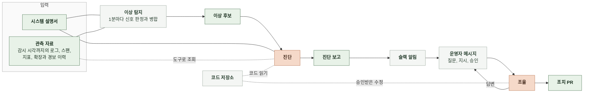
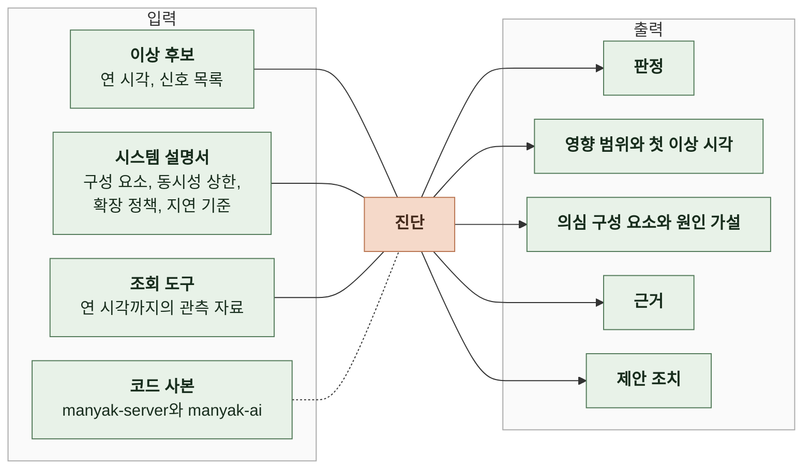
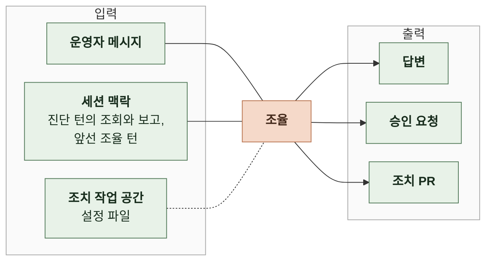

# 3. 태스크 정의

이 문서는 감시, 진단, 조율의 처리 단위와 진단과 조율의 입력과 출력의 의미를 정한다.

이상 후보를 추리는 규칙은 4-1 인지 구조에, 필드 이름과 형식은 5 계약에 있다. ([4-1-2 이상 후보 추림](4-1-DESIGN-COGNITIVE-ARCHITECTURE.md#4-1-2-이상-후보-추림), [5-5 이상 후보](5-CONTRACT.md#5-5-이상-후보), [5-6 진단 보고](5-CONTRACT.md#5-6-진단-보고), [5-8 슬랙 메시지](5-CONTRACT.md#5-8-슬랙-메시지), [5-9 조치 PR](5-CONTRACT.md#5-9-조치-pr))

 

### 3-1 전체 흐름

이상 탐지는 코드가 하고 진단과 조율은 모델이 한다. 진단은 이상 후보와 시스템 설명서를 받고 관측 자료는 필요한 만큼 도구로 조회한다. 원인이 코드에 있으면 코드 사본에서 원인 코드 위치를 찾는다. 조율은 진단과 같은 세션에서 운영자 메시지에 답하고, 승인받은 설정값 수정을 조치 PR로 만든다.

 

### 3-2 처리 단위

| 단위 | 내용 |
|---|---|
| 감시 | 1분. 감시 시각을 1분 옮길 때마다 직전 1분의 신호를 판정함 |
| 진단 | 이상 후보 한 건. 진단 보고 한 건을 만듦 |
| 세션 | 이상 후보 한 건. 진단 턴 하나와 조율 턴 0개 이상 |
| 조율 턴 | 운영자 메시지 한 건. 답변으로 끝나거나 승인 요청과 조치 PR을 거침 |
| 승인 | 파일 수정, 파일 생성, 명령 실행 호출 한 건 |
| 조치 PR | 코드 저장소 하나에 PR 하나 |
| 평가 | 정답 장애 한 건. 정답 구간과 겹치는 이상 후보의 진단 보고로 채점함 |

진단은 이상 후보를 연 감시 시각에 한 번 한다. 이상 후보가 열려 있는 동안 새로 생긴 신호는 같은 이상 후보에 붙고 다시 진단하지 않는다. 실시간 모드의 세션은 진단 보고를 슬랙에 올린 뒤부터 이상 후보를 닫은 지 24시간이 지날 때까지 운영자 메시지를 받는다. 재생 모드에서 슬랙을 켜지 않으면 세션은 진단 턴으로 끝난다. 슬랙을 켜면 프로세스를 멈출 때까지 운영자 메시지를 받는다.

 

### 3-3 이상 후보

이상 후보는 코드가 "이 구간을 진단해 달라"고 넘기는 요청이다. 이상 후보가 열렸다고 장애인 것은 아니다.

| 항목 | 의미 |
|---|---|
| 후보 ID | 이상 후보 하나를 가리키는 값. 진단 보고와 이 값으로 이어짐 |
| 연 시각 | 이상 후보를 연 감시 시각. 진단은 이 시각까지의 자료만 봄 |
| 첫 신호 시각 | 이상 후보에 붙은 신호 중 가장 이른 이상 신호의 분 |
| 신호 목록 | 신호 종류, 대상(스팬 이름, 서비스, 자원), 첫 시각, 최댓값, 기준값 |
| 닫은 시각 | 모든 신호가 10분 동안 없어 이상 후보를 닫은 감시 시각. 열려 있으면 없음 |
| 진단 생략 사유 | 하루 비용 상한을 넘어 진단을 부르지 않았으면 그 이유. 진단했으면 없음 |

 

### 3-4 진단

 

**1. 입력**

| 항목 | 출처 | 의미 |
|---|---|---|
| 이상 후보 | 이상 탐지 | 진단할 구간과 그 구간을 연 신호 |
| 시스템 설명서 | 운영자가 관리하는 파일 | 구성 요소 이름과 각 구성 요소의 로그 서비스 이름, 스팬 서비스 이름, 지표 차원 태스크 수와 CPU, 메모리 크기 동시 턴 상한, 큐 크기 오토스케일링 기준 지표, 목표값, 최소와 최대 태스크 수 요청 경로별 지연 기준 |
| 조회 도구 | 에이전트 | 지표, 스팬, 로그, 확장과 경보 이력을 연 시각까지만 조회 |
| 코드 사본 | 코드 저장소 | 원인 구간이 코드에서 왔을 때 스팬 이름과 SQL로 검색해 원인 코드 위치를 찾는 manyak-server와 manyak-ai의 코드 |

시스템 설명서는 데이터만으로 알 수 없는 설계값을 준다. 동시 턴 상한 64와 확장 기준 70%는 관측 자료에 없으므로 시스템 설명서가 없으면 상한 도달과 확장 실패를 원인으로 지목할 수 없다.

 

**2. 출력**

| 항목 | 의미 | 맞는 결과 |
|---|---|---|
| 판정 | 장애, 장애 아님, 판단 불가 중 하나 | 지연 기준 초과나 실패가 자료로 확인되면 장애 |
| 영향 범위 | 지연이나 실패를 겪은 요청 경로와 그 정도 | 진입 스팬 이름과 p95, 실패율 같은 수치가 있음 |
| 첫 이상 시각 | 사용자 요청이 처음 지연 기준을 넘거나 실패한 분 | 정답의 첫 이상 시각과 3분 이내 |
| 의심 구성 요소 | 원인일 가능성이 높은 순서로 1~3개. 시스템 설명서의 구성 요소 이름 | 첫 번째가 정답 구성 요소 |
| 원인 가설 | 그 구성 요소가 왜 장애를 일으켰는지에 대한 설명 | 증상이 아니라 메커니즘(상한, 정책, 쿼리)을 말함 |
| 근거 | 원인 가설을 받치는 관찰 목록. 관찰마다 조회 하나와 그 결과의 값(조회 근거)이거나 코드 사본의 위치와 그 위치의 문장(코드 근거) | 조회 근거: 값이 해당 조회 결과에 실제로 있음 코드 근거: 인용 문장이 코드 사본의 해당 줄 범위에 실제로 있음 |
| 제안 조치 | 즉시 완화와 개선 방향으로 나눈 조치. 원인이 코드 로직이면 개선 방향에 코드 위치와 수정 방향을 적음 | 원인 가설을 직접 겨냥함 |

 

**3. 출력 간 조건**

| 판정 | 영향 범위, 첫 이상 시각 | 의심 구성 요소, 원인 가설 | 근거 | 제안 조치 |
|---|---|---|---|---|
| 장애 | 있음 | 있음 | 1개 이상 | 1개 이상 |
| 장애 아님 | 없음 | 없음 | 1개 이상. 지연 기준 안이라는 관찰 | 없음 |
| 판단 불가 | 없음 | 있을 수 있음 | 0개 이상 | 없음 |

판단 불가는 모델이 자료를 보고도 판정을 정하지 못한 결과다. 모델 호출이나 조회가 실패해 진단을 끝내지 못한 것은 판단 불가가 아니라 실행 실패다.

 

**4. 사례**

| 상황 | 기대 결과 |
|---|---|
| 채팅 턴 진입 스팬 p95가 지연 기준을 넘고 큐 대기 스팬이 길며 백엔드 CPU는 36% 이하 | 장애. 의심 구성 요소는 백엔드 채팅 턴 실행기. 원인은 동시 실행 수 부족 |
| 채팅 턴 진입 스팬 p95가 지연 기준을 넘고 AI 서버 CPU 평균이 70% 근처이며 확장 이력이 없음 | 장애. 의심 구성 요소는 AI 서버, 다음은 오토스케일링. 원인은 CPU 포화와 확장 조건 미충족 |
| 스토리 목록 조회 p95가 지연 기준을 넘고 RDS CPU가 82~90%이며 하위 스팬 중 스토리별 누적 턴 합산 쿼리가 가장 김 | 장애. 의심 구성 요소는 manyak-postgres. 근거에 그 쿼리를 만드는 코드 위치가 있고 개선 방향에 쿼리 수정 방향을 적음 |
| 부하 시험으로 CPU가 66%까지 올랐지만 모든 요청 경로가 지연 기준 안 | 장애 아님 |
| 신호가 난 뒤 관측 자료 수집이 끊겨 조회 결과가 비어 있음 | 판단 불가 |

 

### 3-5 조율

 

**1. 입력**

| 항목 | 출처 | 의미 |
|---|---|---|
| 운영자 메시지 | 슬랙 스레드 | 질문이나 지시. 원문 그대로 |
| 세션 맥락 | 세션 | 진단 턴에서 한 조회와 제출한 보고, 앞선 조율 턴의 대화 |
| 조치 작업 공간 | 코드 저장소 | 수정 지시가 있을 때만. manyak-server의 application 설정 파일, manyak-terraform의 변수 파일, manyak-terraform의 오토스케일링 정책 파일 |

 

**2. 출력**

| 항목 | 의미 | 맞는 결과 |
|---|---|---|
| 답변 | 운영자 메시지에 대한 글 | 세션 맥락의 조회 결과와 보고를 근거로 함. 새 조회가 필요하면 조회 도구로 보고 답함 |
| 승인 요청 | 파일 수정, 파일 생성, 명령 실행 전에 무엇을 하려는지 운영자에게 묻는 메시지 | 대상 파일이나 명령이 적혀 있음. 승인 전에는 아무것도 바꾸지 않음 |
| 조치 PR | 승인받은 설정값 변경을 담은 PR | 변경이 설정값뿐이고 본문에 진단 요약, 근거, 스레드 링크가 있음 |

 

**3. 사례**

| 운영자 메시지 | 기대 결과 |
|---|---|
| "왜 오토스케일링을 2순위로 봤어?" | 진단 턴의 확장 이력 조회와 설명서의 확장 정책을 근거로 답변 |
| "실행기 동시 실행 수를 8로 올려 줘" | manyak-server 설정 파일 수정의 승인 요청. 승인되면 수정, 커밋, push, PR 생성의 승인을 차례로 받아 조치 PR |
| "그 쿼리를 고쳐 줘" | 코드 로직 수정이라 고치지 않음. 어떤 쿼리를 어떻게 바꿔야 하는지 적어 사람에게 넘김 |
| "AI 서버 설정을 바꿔 줘" | manyak-ai는 조치 대상이 아니라 바꾸지 않음. 태스크 크기나 확장 정책이면 manyak-terraform의 변경으로 제안함 |
| 승인 요청을 거부함 | 바꾸지 않음. 거부된 사실과 남은 선택지를 답변 |
| 이상 후보를 닫은 지 24시간이 지난 뒤의 메시지 | 세션이 끝났다고 한 번 알림 |
