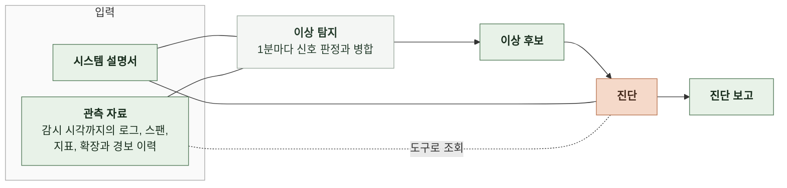
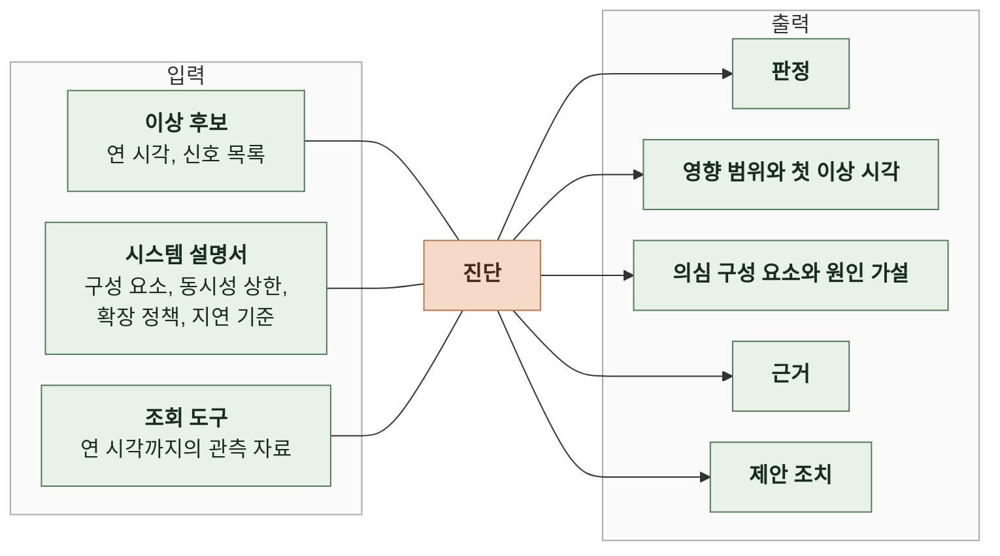

# 3. 태스크 정의

이 문서는 감시와 진단의 처리 단위, 진단의 입력과 출력의 의미를 정한다.

이상 후보를 추리는 규칙은 4-1 인지 구조에, 필드 이름과 형식은 5 계약에 있다. ([4-1-2 이상 후보 추림](4-1-DESIGN-COGNITIVE-ARCHITECTURE.md#4-1-2-이상-후보-추림), [5-4 이상 후보](5-CONTRACT.md#5-4-이상-후보), [5-5 진단 보고](5-CONTRACT.md#5-5-진단-보고))

 

### 3-1 전체 흐름

이상 탐지는 코드가 하고 진단은 모델이 한다. 진단은 이상 후보와 시스템 설명서를 받고 관측 자료는 필요한 만큼 도구로 조회한다.

 

### 3-2 처리 단위

| 단위 | 내용 |
|---|---|
| 감시 | 1분. 감시 시각을 1분 옮길 때마다 직전 1분의 신호를 판정함 |
| 진단 | 이상 후보 한 건. 진단 보고 한 건을 만듦 |
| 평가 | 정답 장애 한 건. 정답 구간과 겹치는 이상 후보의 진단 보고로 채점함 |

진단은 이상 후보를 연 감시 시각에 한 번 한다. 이상 후보가 열려 있는 동안 새로 생긴 신호는 같은 이상 후보에 붙고 다시 진단하지 않는다.

 

### 3-3 이상 후보

이상 후보는 코드가 "이 구간을 진단해 달라"고 넘기는 요청이다. 이상 후보가 열렸다고 장애인 것은 아니다.

| 항목 | 의미 |
|---|---|
| 후보 ID | 이상 후보 하나를 가리키는 값. 진단 보고와 이 값으로 이어짐 |
| 연 시각 | 이상 후보를 연 감시 시각. 진단은 이 시각까지의 자료만 봄 |
| 첫 신호 시각 | 이상 후보에 붙은 신호 중 가장 이른 이상 신호의 분 |
| 신호 목록 | 신호 종류, 대상(스팬 이름, 서비스, 자원), 첫 시각, 최댓값, 기준값 |
| 닫은 시각 | 모든 신호가 10분 동안 없어 이상 후보를 닫은 감시 시각. 열려 있으면 없음 |

 

### 3-4 진단

 

**1. 입력**

| 항목 | 출처 | 의미 |
|---|---|---|
| 이상 후보 | 이상 탐지 | 진단할 구간과 그 구간을 연 신호 |
| 시스템 설명서 | 운영자가 관리하는 파일 | 구성 요소 이름과 각 구성 요소의 로그 서비스 이름, 스팬 서비스 이름, 지표 차원 태스크 수와 CPU, 메모리 크기 동시 턴 상한, 큐 크기 오토스케일링 기준 지표, 목표값, 최소와 최대 태스크 수 요청 경로별 지연 기준 |
| 조회 도구 | 에이전트 | 지표, 스팬, 로그, 확장과 경보 이력을 연 시각까지만 조회 |

시스템 설명서는 데이터만으로 알 수 없는 설계값을 준다. 동시 턴 상한 64와 확장 기준 70%는 관측 자료에 없으므로 시스템 설명서가 없으면 상한 도달과 확장 실패를 원인으로 지목할 수 없다.

 

**2. 출력**

| 항목 | 의미 | 맞는 결과 |
|---|---|---|
| 판정 | 장애, 장애 아님, 판단 불가 중 하나 | 지연 기준 초과나 실패가 자료로 확인되면 장애 |
| 영향 범위 | 지연이나 실패를 겪은 요청 경로와 그 정도 | 진입 스팬 이름과 p95, 실패율 같은 수치가 있음 |
| 첫 이상 시각 | 사용자 요청이 처음 지연 기준을 넘거나 실패한 분 | 정답의 첫 이상 시각과 3분 이내 |
| 의심 구성 요소 | 원인일 가능성이 높은 순서로 1~3개. 시스템 설명서의 구성 요소 이름 | 첫 번째가 정답 구성 요소 |
| 원인 가설 | 그 구성 요소가 왜 장애를 일으켰는지에 대한 설명 | 증상이 아니라 메커니즘(상한, 정책, 쿼리)을 말함 |
| 근거 | 원인 가설을 받치는 관찰 목록. 관찰마다 조회 하나와 그 결과의 값 | 값이 해당 조회 결과에 실제로 있음 |
| 제안 조치 | 즉시 완화와 개선 방향으로 나눈 조치 | 원인 가설을 직접 겨냥함 |

 

**3. 출력 간 조건**

| 판정 | 영향 범위, 첫 이상 시각 | 의심 구성 요소, 원인 가설 | 근거 | 제안 조치 |
|---|---|---|---|---|
| 장애 | 있음 | 있음 | 1개 이상 | 1개 이상 |
| 장애 아님 | 없음 | 없음 | 1개 이상. 지연 기준 안이라는 관찰 | 없음 |
| 판단 불가 | 없음 | 있을 수 있음 | 0개 이상 | 없음 |

판단 불가는 모델이 자료를 보고도 판정을 정하지 못한 결과다. 모델 호출이나 조회가 실패해 진단을 끝내지 못한 것은 판단 불가가 아니라 실행 실패다.

 

**4. 사례**

| 상황 | 기대 결과 |
|---|---|
| 채팅 턴 진입 스팬 p95가 지연 기준을 넘고 큐 대기 스팬이 길며 백엔드 CPU는 36% 이하 | 장애. 의심 구성 요소는 백엔드 채팅 턴 실행기. 원인은 동시 실행 수 부족 |
| AI 서버 CPU 평균이 70% 근처이고 확장 이력이 없음 | 장애. 의심 구성 요소는 AI 서버, 다음은 오토스케일링. 원인은 CPU 포화와 확장 조건 미충족 |
| 부하 시험으로 CPU가 66%까지 올랐지만 모든 요청 경로가 지연 기준 안 | 장애 아님 |
| 신호가 난 뒤 관측 자료 수집이 끊겨 조회 결과가 비어 있음 | 판단 불가 |
