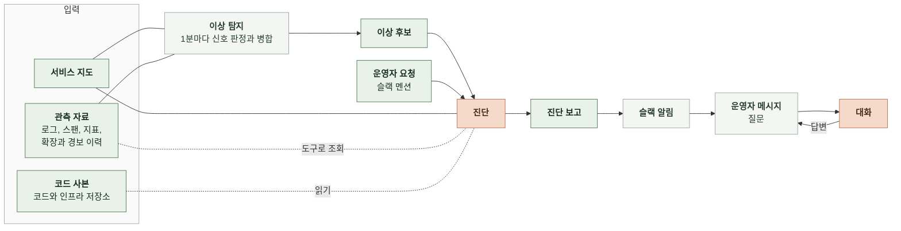
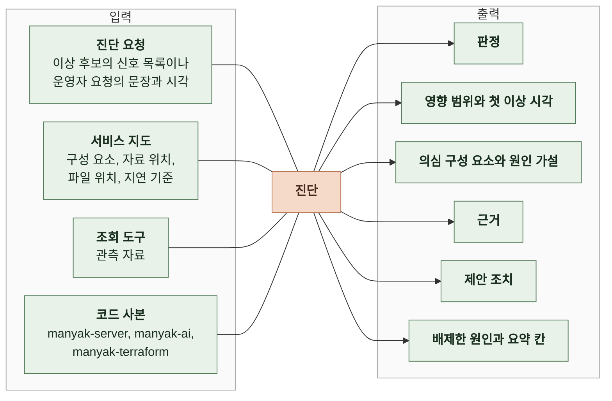
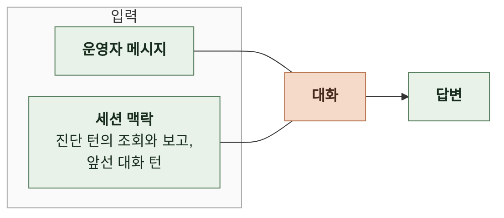

# 3. 태스크 정의

이 문서는 감시, 진단, 대화의 처리 단위와 진단과 대화의 입력과 출력의 의미를 정한다.

이상 후보를 추리는 규칙은 4-1 인지 구조에, 필드 이름과 형식은 5 계약에 있다. ([4-1-2 이상 후보 추림](4-1-DESIGN-COGNITIVE-ARCHITECTURE.md#4-1-2-이상-후보-추림), [5-5 이상 후보](5-CONTRACT.md#5-5-이상-후보), [5-6 운영자 요청](5-CONTRACT.md#5-6-운영자-요청), [5-7 진단 보고](5-CONTRACT.md#5-7-진단-보고), [5-9 슬랙 메시지](5-CONTRACT.md#5-9-슬랙-메시지))

 

### 3-1 전체 흐름

이상 탐지는 코드가 하고 진단과 대화는 모델이 한다. 진단은 진단 요청과 서비스 지도를 받고 관측 자료는 필요한 만큼 도구로 조회한다. 동시성 상한, 태스크 크기, 확장 정책은 코드 사본의 application 설정과 terraform에서 읽는다. 대화는 진단과 같은 세션에서 운영자 메시지에 답한다.

 

### 3-2 처리 단위

| 단위 | 내용 |
|---|---|
| 감시 | 1분. 1분마다 직전 1분의 신호를 판정함 |
| 진단 | 진단 요청 한 건. 진단 보고 한 건을 만듦 |
| 세션 | 진단 요청 한 건. 진단 턴 하나와 대화 턴 0개 이상 |
| 대화 턴 | 운영자 메시지 한 건. 답변 하나로 끝남 |

이상 후보는 연 시각에 한 번 진단한다. 이상 후보가 열려 있는 동안 새로 생긴 신호는 같은 이상 후보에 붙고 다시 진단하지 않는다. 운영자 요청은 멘션 메시지 하나마다 한 번 진단한다. 세션은 보고를 슬랙에 올린 뒤부터 운영자 메시지를 받는다. 이상 후보의 세션은 이상 후보를 닫은 지 24시간이 지나면 끝나고 운영자 요청의 세션은 보고를 올린 지 24시간이 지나면 끝난다.

 

### 3-3 이상 후보

이상 후보는 코드가 "이 구간을 진단해 달라"고 넘기는 요청이다. 이상 후보가 열렸다고 장애인 것은 아니다.

| 항목 | 의미 |
|---|---|
| 후보 ID | 이상 후보 하나를 가리키는 값. 진단 보고와 이 값으로 이어짐 |
| 연 시각 | 이상 후보를 연 시각 |
| 첫 신호 시각 | 이상 후보에 붙은 신호 중 가장 이른 이상 신호의 분 |
| 신호 목록 | 신호 종류, 대상(스팬 이름, 서비스, 자원), 첫 시각, 최댓값, 기준값 |
| 닫은 시각 | 모든 신호가 10분 동안 없어 이상 후보를 닫은 시각. 열려 있으면 없음 |
| 진단 생략 사유 | 하루 비용 상한을 넘어 진단을 부르지 않았으면 그 이유. 진단했으면 없음 |

 

### 3-4 운영자 요청

운영자 요청은 운영자가 "이걸 봐 달라"고 넘기는 요청이다. 탐지 규칙을 거치지 않고 바로 진단한다.

| 항목 | 의미 |
|---|---|
| 요청 ID | 운영자 요청 하나를 가리키는 값. 진단 보고와 이 값으로 이어짐 |
| 요청 문장 | 멘션 표기를 뺀 메시지 원문. 무엇이 언제 이상했는지에 대한 운영자의 말 |
| 요청 시각 | 멘션 메시지를 슬랙에 올린 시각 |
| 스레드 | 보고와 대화가 올라갈 슬랙 스레드 |
| 진단 생략 사유 | 하루 비용 상한을 넘어 진단을 부르지 않았으면 그 이유. 진단했으면 없음 |

 

### 3-5 진단

 

**1. 입력**

| 항목 | 출처 | 의미 |
|---|---|---|
| 진단 요청 | 이상 탐지나 슬랙 멘션 | 이상 후보: 진단할 구간과 그 구간을 연 신호 운영자 요청: 요청 문장과 요청 시각 |
| 서비스 지도 | 설정 파일 | 구성 요소 이름과 각 구성 요소의 로그 서비스 이름, 스팬 서비스 이름, 지표 차원 구성 요소를 담은 저장소와 설정과 인프라 파일의 위치 요청 경로별 지연 기준 |
| 조회 도구 | MCP 서버와 에이전트 | 로그, 스팬, 지표, 경보 이력, 확장 이력을 조회 |
| 코드 사본 | 코드 저장소 | 원인이 코드에서 왔을 때 스팬 이름과 SQL로 검색해 원인 코드 위치를 찾는 manyak-server와 manyak-ai의 코드 동시성 상한, 큐 크기, 태스크 크기, 확장 정책을 읽는 manyak-server의 application 설정과 manyak-terraform의 운영 정의 |

동시 턴 상한과 확장 기준 같은 설계값은 관측 자료에 없고 manyak-server의 application 설정과 manyak-terraform의 확장 정책에 있다. 코드 사본을 읽지 못하면 상한 도달과 확장 실패를 원인으로 지목할 수 없다.

 

**2. 출력**

| 항목 | 의미 | 맞는 결과 |
|---|---|---|
| 판정 | 장애, 장애 아님, 판단 불가 중 하나 | 지연 기준 초과나 실패가 자료로 확인되면 장애 |
| 영향 범위 | 지연이나 실패를 겪은 요청 경로와 그 정도 | 진입 스팬 이름과 p95, 실패율 같은 수치가 있음 |
| 첫 이상 시각 | 사용자 요청이 처음 지연 기준을 넘거나 실패한 분 | 분 단위 조회 결과에서 처음 기준을 넘은 분과 같음 |
| 의심 구성 요소 | 원인일 가능성이 높은 순서로 1~3개. 서비스 지도의 구성 요소 이름 | 증상이 드러난 곳이 아니라 원인을 맡은 구성 요소가 첫 번째 |
| 원인 가설 | 그 구성 요소가 왜 장애를 일으켰는지에 대한 설명 | 증상이 아니라 메커니즘(상한, 정책, 쿼리)을 말함 |
| 근거 | 원인 가설을 받치는 관찰 목록. 관찰마다 조회 하나와 그 결과의 값(조회 근거)이거나 코드 사본의 위치와 그 위치의 문장(코드 근거) | 조회 근거: 값이 해당 조회 결과에 실제로 있음 코드 근거: 인용 문장이 코드 사본의 해당 줄 범위에 실제로 있음 |
| 제안 조치 | 즉시 완화와 개선 방향으로 나눈 조치. 원인이 코드나 설정에 있으면 개선 방향에 그 위치와 수정 방향을 적음 | 원인 가설을 직접 겨냥함. 첫 항목이 가장 먼저 할 일 |
| 배제한 원인 | 조회로 정상임을 확인해 원인에서 뺀 것 | 반증 단계의 관찰과 맞음 |
| 요약 칸 | 슬랙 메시지에 그대로 보이는 짧은 글. 장애는 영향과 원인을 담고 그 밖의 판정은 확인한 범위와 주요 수치를 담음 | 칸마다 짧은 명사구이고 수치가 사람이 읽는 단위 |

 

**3. 출력 간 조건**

| 판정 | 영향 범위, 첫 이상 시각 | 의심 구성 요소, 원인 가설 | 근거 | 제안 조치 | 요약 칸 |
|---|---|---|---|---|---|
| 장애 | 있음 | 있음 | 1개 이상 | 1개 이상 | 영향과 원인 |
| 장애 아님 | 없음 | 없음 | 1개 이상. 지연 기준 안이라는 관찰 | 없음 | 확인한 범위와 주요 수치 |
| 판단 불가 | 없음 | 있을 수 있음 | 0개 이상 | 없음 | 확인한 범위와 주요 수치. 의심 구성 요소가 있으면 원인도 |

판단 불가는 모델이 자료를 보고도 판정을 정하지 못한 결과다. 모델 호출이 실패하거나 MCP 서버에 연결하지 못해 진단을 끝내지 못한 것은 판단 불가가 아니라 실행 실패다.

 

**4. 사례**

| 상황 | 기대 결과 |
|---|---|
| 채팅 턴 진입 스팬 p95가 지연 기준을 넘고 큐 대기 스팬이 길며 백엔드 CPU는 36% 이하 | 장애. 의심 구성 요소는 백엔드 채팅 턴 실행기. 원인은 동시 실행 수 부족. 근거에 동시 실행 수를 정한 코드 위치가 있음 |
| 채팅 턴 진입 스팬 p95가 지연 기준을 넘고 AI 서버의 llm.stream 스팬이 시간 대부분을 차지하며 큐 대기와 CPU에 여유가 있음 | 장애. 의심 구성 요소는 AI 서버. 원인은 외부 LLM 제공자의 응답 지연. 배제한 원인에 큐 대기와 CPU가 있음 |
| 채팅 턴 진입 스팬 p95가 지연 기준을 넘고 AI 서버 CPU 평균이 70% 근처이며 확장 이력이 없음 | 장애. 의심 구성 요소는 AI 서버, 다음은 오토스케일링. 원인은 CPU 포화와 확장 조건 미충족. 근거에 manyak-terraform의 확장 정책 위치가 있음 |
| 스토리 목록 조회 p95가 지연 기준을 넘고 RDS CPU가 82~90%이며 하위 스팬 중 스토리별 누적 턴 합산 쿼리가 가장 김 | 장애. 의심 구성 요소는 manyak-postgres. 근거에 그 쿼리를 만드는 코드 위치가 있고 개선 방향에 쿼리 수정 방향을 적음 |
| 부하 시험으로 CPU가 66%까지 올랐지만 모든 요청 경로가 지연 기준 안 | 장애 아님 |
| 운영자가 "방금 채팅 응답이 느렸는데 봐 줘"라고 멘션함 | 요청 시각 전후의 채팅 턴 진입 스팬부터 조회해 판정한 보고를 그 메시지의 스레드에 올림 |
| 신호가 난 뒤 관측 자료 수집이 끊겨 조회 결과가 비어 있음 | 판단 불가 |

 

### 3-6 대화

 

**1. 입력**

| 항목 | 출처 | 의미 |
|---|---|---|
| 운영자 메시지 | 슬랙 스레드 | 질문이나 지시. 원문 그대로 |
| 세션 맥락 | 세션 | 진단 턴에서 한 조회와 제출한 보고 앞선 대화 턴의 대화 |

 

**2. 출력**

| 항목 | 의미 | 맞는 결과 |
|---|---|---|
| 답변 | 운영자 메시지에 대한 글 | 세션 맥락의 조회 결과와 보고를 근거로 함. 새 조회가 필요하면 조회 도구와 코드 사본으로 보고 답함 조치 지시에는 바꾸지 않고 바꿀 위치와 방법을 적음 |

 

**3. 사례**

| 운영자 메시지 | 기대 결과 |
|---|---|
| "자세히 알려 줘" | 보고 요약의 영향, 원인 가설, 근거 전체와 검증 결과, 조치 전체를 풀어 쓴 답변 |
| "왜 오토스케일링을 2순위로 봤어?" | 진단 턴의 확장 이력 조회와 manyak-terraform의 확장 정책을 근거로 답변 |
| "지금은 회복됐어?" | 진입 스팬 지연을 새로 조회해 현재 p95와 지연 기준을 비교한 답변 |
| "실행기 동시 실행 수를 8로 올려 줘" | 바꾸지 않음. 어떤 저장소의 어떤 파일에서 어떤 값을 바꾸면 되는지와 예상 효과를 적은 답변 |
| "그 쿼리를 고쳐 줘" | 바꾸지 않음. 어떤 쿼리를 어떻게 바꿔야 하는지 적은 답변 |
| 세션이 끝난 뒤의 메시지 | 세션이 끝났다고 한 번 알림 |
