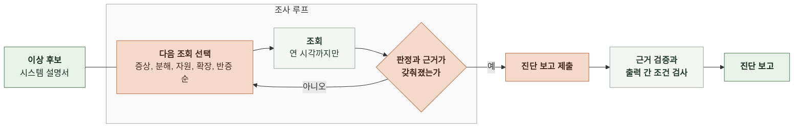

# 4-1 인지 구조 설계

이 문서는 이상 후보를 추리는 규칙과 진단이 자료를 골라 판단하고 끝내는 방식, 모델과 코드의 책임을 정한다.

입력과 출력의 의미는 3 태스크 정의에, 구성 요소 사이의 호출은 4-2 소프트웨어 설계에 있다. ([3-3 이상 후보](3-TASK-DEFINITION.md#3-3-이상-후보), [3-4 진단](3-TASK-DEFINITION.md#3-4-진단), [4-2 소프트웨어 설계](4-2-DESIGN-SOFTWARE-ARCHITECTURE.md))

 

### 4-1-1 접근과 근거

탐지는 규칙으로 하고 진단은 에이전트 루프로 한다.

| 방식 | 판단 | 이유 |
|---|---|---|
| 규칙만으로 탐지와 진단 | 탐지에만 사용 | 이상 여부는 기준값으로 가를 수 있음 원인은 상한 도달, 자원 포화, 확장 미동작처럼 장애마다 따라갈 조회가 달라 규칙으로 쓰면 장애 유형마다 규칙이 늘어남 |
| 코드가 자료를 모아 한 번 호출 | 사용 안 함 | 어떤 하위 스팬이나 쿼리를 볼지 미리 알 수 없어 모든 자료를 넣어야 함 하루치 스팬 수백만 건은 모델 입력에 들어가지 않음 |
| 에이전트 루프로 진단 | 사용 | 신호에서 출발해 필요한 조회만 골라 가설을 세우고 반증함 |
| 모델이 감시부터 진단까지 | 사용 안 함 | 1분마다 모델을 부르면 하루 1,440회 호출 놓친 장애의 이유를 규칙처럼 설명할 수 없음 |

 

### 4-1-2 이상 후보 추림

코드가 1분마다 직전 1분의 값으로 아래 신호를 판정한다. 같은 신호 종류와 대상이 최근 5분 중 3분 이상 조건을 넘으면 신호를 확정하고, 조건을 처음 넘은 분을 그 신호의 첫 시각으로 삼는다.

| 신호 | 보는 값 | 조건 |
|---|---|---|
| 진입 지연 | 진입 스팬 이름별 1분 p95 | 시스템 설명서의 해당 요청 경로 지연 기준 초과 그 분의 진입 스팬 20건 이상 |
| 대기 지연 | 대기 스팬 1분 p95 | 1초 이상 그 분의 대기 스팬 20건 이상 |
| 실패율 | 진입 스팬 중 오류 상태 비율 로드밸런서 응답 중 5xx 비율 | 1% 이상 그 분의 요청 20건 이상 |
| 오류 로그 | 서비스별 ERROR 레벨 로그 수 | 1분 10건 이상 |
| 자원 포화 | 서비스 CPU와 메모리 평균, RDS CPU, Redis 엔진 CPU | 70% 이상 |

| 상황 | 처리 |
|---|---|
| 신호가 확정됐고 열린 이상 후보가 없음 | 이상 후보를 열고 진단을 요청함 |
| 신호가 확정됐고 열린 이상 후보가 있음 | 열린 이상 후보의 신호 목록에 붙임. 진단을 다시 요청하지 않음 |
| 열린 이상 후보의 모든 신호가 10분 동안 조건을 넘지 않음 | 이상 후보를 닫음 |

진입 지연의 기준을 시스템 설명서에서 받으므로 과거 값으로 기준선을 만들지 않는다. 부하가 높아도 지연 기준 안이면 진입 지연 신호는 나지 않는다.

 

### 4-1-3 진단 전략

모델은 아래 순서로 조회를 고른다. 순서는 방향이며 앞 단계의 결과로 원인이 분명하면 다음 단계를 줄인다.

| 순서 | 단계 | 보는 것 | 알아내는 것 |
|---|---|---|---|
| 1 | 증상 | 진입 스팬 이름별 지연과 실패율 | 영향 범위, 첫 이상 시각 |
| 2 | 분해 | 영향받은 진입 스팬의 하위 스팬 이름별 시간과 DB 쿼리문별 시간 | 시간이 쌓인 곳(대기, 외부 호출, DB) |
| 3 | 자원 | 그곳을 맡은 구성 요소의 CPU, 메모리, 연결 수 | 자원이 찼는지, 여유가 있는데 막혔는지 |
| 4 | 확장 | 시스템 설명서의 확장 정책과 확장, 경보 이력 | 확장이 일어났는지, 안 일어났다면 어떤 조건 때문인지 |
| 5 | 반증 | 다른 구성 요소의 지연과 자원 | 다른 구성 요소가 정상이었다는 관찰 |

자원에 여유가 있는데 대기가 길면 상한이나 설정을 의심하고 시스템 설명서의 상한과 대조한다. 자원이 찼으면 확장 정책과 이력을 대조한다.

 

**조회 도구**

| 도구 | 돌려주는 것 | 묶는 기준 |
|---|---|---|
| 지표 조회 | 구성 요소 지표의 1분 값 | 구성 요소, 지표, 통계 |
| 스팬 집계 | 건수, p50, p95, 최댓값, 오류 수 | 스팬 이름, 서비스, 진입 스팬 이름, DB 쿼리문, 분 |
| 로그 집계 | 건수와 표본 메시지 최대 5개 | 서비스, 레벨, 사건 이름, 요청 경로, 상태 코드, 오류 코드, 분 |
| 확장과 경보 이력 | 태스크 수 변경과 경보 상태 변화 | 구성 요소 |
| 진단 보고 제출 | 없음. 진단을 끝냄 | |

모든 도구는 읽기 전용이다. 조회 구간의 끝은 이상 후보를 연 시각으로 잘린다. 도구 결과에는 조회 하나마다 번호가 붙고 근거는 이 번호로 조회를 가리킨다.

 

### 4-1-4 모델과 코드의 책임

| 일 | 담당 | 규칙 |
|---|---|---|
| 신호 판정, 이상 후보 열기와 닫기 | 코드 | 4-1-2의 규칙만 씀 |
| 조회 구간 자르기 | 코드 | 모델이 연 시각 이후를 요청해도 연 시각까지만 돌려줌 |
| 식별자 제거 | 코드 | 기기 식별자 해시, 세션 ID, 요청 ID를 도구 결과에서 뺌 |
| 조회 선택, 판정, 원인 추론, 조치 제안 | 모델 | 시스템 설명서의 구성 요소 이름으로만 지목함 |
| 근거 검증 | 코드 | 근거가 가리키는 조회가 이 진단에 있고 근거의 값이 그 조회 결과에 있으면 통과 통과하지 못한 근거는 지우지 않고 검증 실패로 표시함 |
| 출력 간 조건 검사 | 코드 | 3-4의 출력 간 조건을 어기면 위반 내용을 모델에 한 번 돌려보냄 다시 어기면 실행 실패 |

코드는 모델이 내지 않은 판정을 채우지 않는다. 예산 소진이나 형식 위반으로 진단이 끝나지 않으면 판단 불가로 바꾸지 않고 실행 실패로 남긴다.

 

### 4-1-5 상태와 종료

진단 사이에는 상태를 두지 않는다. 진단 하나는 이상 후보, 시스템 설명서, 그 진단에서 한 조회만 본다. 앞선 진단 보고는 입력에 넣지 않는다.

| 조건 | 처리 |
|---|---|
| 모델이 진단 보고를 제출함 | 근거 검증과 출력 간 조건 검사 후 종료 |
| 조회 25회를 씀 | 도구 없이 진단 보고를 제출하라고 한 번 요청함 |
| 시작 후 5분이 지남 | 진행 중인 호출을 끊고 실행 실패 |
| 마지막 요청에도 제출하지 않음 | 실행 실패 |
