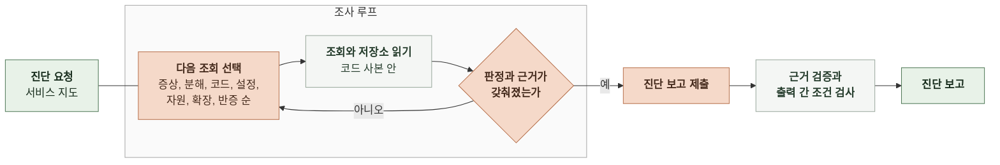

# 4-1 인지 구조 설계

이 문서는 이상 후보를 추리는 규칙과 진단이 자료와 저장소를 골라 판단하고 끝내는 방식, 모델과 코드의 책임을 정한다.

입력과 출력의 의미는 3 태스크 정의에, 구성 요소 사이의 호출은 4-2 소프트웨어 설계에 있다. ([3-3 이상 후보](3-TASK-DEFINITION.md#3-3-이상-후보), [3-4 운영자 요청](3-TASK-DEFINITION.md#3-4-운영자-요청), [3-5 진단](3-TASK-DEFINITION.md#3-5-진단), [4-2 소프트웨어 설계](4-2-DESIGN-SOFTWARE-ARCHITECTURE.md))

 

### 4-1-1 접근과 근거

탐지는 규칙으로 하고 진단은 에이전트 루프로 한다.

| 방식 | 판단 | 이유 |
|---|---|---|
| 규칙만으로 탐지와 진단 | 탐지에만 사용 | 이상 여부는 기준값으로 가를 수 있음 원인은 상한 도달, 자원 포화, 확장 미동작처럼 장애마다 따라갈 조회가 달라 규칙으로 쓰면 장애 유형마다 규칙이 늘어남 |
| 코드가 자료를 모아 한 번 호출 | 사용 안 함 | 어떤 하위 스팬이나 쿼리를 볼지 미리 알 수 없어 모든 자료를 넣어야 함 하루치 스팬 수백만 건은 모델 입력에 들어가지 않음 |
| 에이전트 루프로 진단 | 사용 | 신호나 운영자의 말에서 출발해 필요한 조회만 골라 가설을 세우고 반증함 |
| 모델이 감시부터 진단까지 | 사용 안 함 | 1분마다 모델을 부르면 하루 1,440회 호출 놓친 장애의 이유를 규칙처럼 설명할 수 없음 |

 

### 4-1-2 이상 후보 추림

코드가 1분마다 직전 1분의 값으로 아래 신호를 판정한다. 같은 신호 종류와 대상이 최근 5분 중 3분 이상 조건을 넘으면 신호를 확정하고 조건을 처음 넘은 분을 그 신호의 첫 시각으로 삼는다. 기준값, 확정 조건, 닫기 조건은 설정 파일로 바꿀 수 있다. 이 절의 값은 기본값이다.

| 신호 | 보는 값 | 조건 |
|---|---|---|
| 진입 지연 | 진입 스팬 이름별 1분 p95 | 서비스 지도의 해당 요청 경로 지연 기준 초과 그 분의 진입 스팬 20건 이상 |
| 대기 지연 | 대기 스팬 1분 p95. 대기 스팬은 설정에 이름을 적은 스팬 | 1초 이상 그 분의 대기 스팬 20건 이상 |
| 실패율 | 진입 스팬 중 오류 상태 비율 로드밸런서 응답 중 5xx 비율 | 1% 이상 그 분의 요청 20건 이상 |
| 오류 로그 | 서비스별 오류 수준 로그 수. 기본 수준 값은 ERROR | 1분 10건 이상 |
| 자원 포화 | 서비스 CPU와 메모리 평균, RDS CPU, Redis 엔진 CPU | 70% 이상 |

| 상황 | 처리 |
|---|---|
| 신호가 확정됐고 열린 이상 후보가 없음 | 이상 후보를 열고 진단을 요청함 |
| 위와 같은데 그날 비용이 하루 상한을 넘음 | 이상 후보를 열고 진단은 요청하지 않음. 진단 생략 사유를 남김 |
| 신호가 확정됐고 열린 이상 후보가 있음 | 열린 이상 후보의 신호 목록에 붙임. 진단을 다시 요청하지 않음 |
| 열린 이상 후보의 모든 신호가 10분 동안 조건을 넘지 않음 | 이상 후보를 닫음 |

진입 지연의 기준을 서비스 지도에서 받으므로 과거 값으로 기준선을 만들지 않는다. 부하가 높아도 지연 기준 안이면 진입 지연 신호는 나지 않는다. 운영자 요청은 이 규칙을 거치지 않고 바로 진단을 요청하며 하루 상한만 같이 적용한다.

 

### 4-1-3 진단 전략

모델은 아래 순서로 조회를 고른다. 순서는 방향이며 앞 단계의 결과로 원인이 분명하면 다음 단계를 줄인다. 운영자 요청은 요청 문장과 요청 시각으로 증상 단계의 조회 구간과 요청 경로를 정한다.

| 순서 | 단계 | 보는 것 | 알아내는 것 |
|---|---|---|---|
| 1 | 증상 | 진입 스팬 이름별 지연과 실패율 | 영향 범위, 첫 이상 시각 |
| 2 | 분해 | 영향받은 진입 스팬의 하위 스팬 이름별 시간과 DB 쿼리문별 시간 | 시간이 쌓인 곳(대기, 외부 호출, DB) |
| 3 | 코드 | 시간이 쌓인 곳이 코드에서 왔으면 그 스팬 이름과 SQL로 코드 사본을 검색한 결과 | 원인 코드 위치(실행기 설정, 쿼리를 만드는 코드) |
| 4 | 설정 | 서비스 지도가 가리키는 application 설정과 terraform 파일 | 동시성 상한, 큐 크기, 태스크 크기, 확장 정책의 값과 위치 |
| 5 | 자원 | 그곳을 맡은 구성 요소의 CPU, 메모리, 연결 수 | 자원이 찼는지, 여유가 있는데 막혔는지 |
| 6 | 확장 | 확장 이력과 경보 이력 | 확장이 일어났는지, 안 일어났다면 어떤 조건 때문인지 |
| 7 | 반증 | 다른 구성 요소의 지연과 자원 | 다른 구성 요소가 정상이었다는 관찰 |

인프라와 설정은 terraform과 application 설정 파일에서 읽어 관측 자료와 대조한다. 자원에 여유가 있는데 대기가 길면 상한을 의심하고 설정 단계에서 읽은 상한과 대조한다. 자원이 찼으면 terraform의 확장 정책과 확장 이력을 대조한다. 원인이 된 코드나 설정의 위치를 찾았으면 코드 근거로 남긴다. 원인이 코드 로직이나 설정값이면 개선 방향에 그 위치와 수정 방향을 적는다.

 

**조회 도구**

| 도구 | 돌려주는 것 | 출처 |
|---|---|---|
| 로그와 스팬 검색 | 인덱스 목록과 매핑, 집계 질의와 건수 질의의 결과 | OpenSearch 공식 MCP 서버 |
| 인프라 지표와 경보 | 구성 요소 지표의 시계열, 경보 상태와 경보 이력 | CloudWatch 공식 MCP 서버 |
| 앱 지표 | 서비스가 내보낸 지표의 PromQL 결과 | AMP용 공식 MCP 서버. 앱 지표가 AMP로 전송될 때만 |
| 확장 이력 | 태스크 수 변경 시각과 이유 | 에이전트가 직접 둔 도구 |
| 저장소 읽기 | 파일 내용, 이름과 문장의 검색 결과 | 코드 사본 |
| 진단 보고 제출 | 없음. 진단을 끝냄 | 에이전트가 직접 둔 도구 |

모델이 쓰는 도구는 모두 읽기 전용이다. 조회 도구의 결과에는 조회 하나마다 번호가 붙고 조회 근거는 이 번호로 조회를 가리킨다. 코드 근거는 저장소, 경로, 줄 범위, 인용 문장으로 코드 사본의 위치를 가리킨다. 저장소 읽기는 조회 횟수에 세지 않는다.

 

### 4-1-4 모델과 코드의 책임

| 일 | 담당 | 규칙 |
|---|---|---|
| 신호 판정, 이상 후보 열기와 닫기 | 코드 | 4-1-2의 규칙만 씀 |
| 운영 로그 원문과 식별자 차단 | OpenSearch 역할과 코드 | 에이전트의 읽기 사용자 역할이 FLS로 메시지 필드와 식별자 필드를 뺌 코드는 시작 때 그 필드가 조회 결과에 보이지 않는지 확인함 |
| 조회 선택, 판정, 원인 추론, 조치 제안 | 모델 | 서비스 지도의 구성 요소 이름으로만 지목함 |
| 조회 번호 부여 | 코드 | 조회 도구 결과마다 번호를 붙여 모델에 돌려주고 기록함 |
| 근거 검증 | 코드 | 조회 근거: 가리키는 조회가 이 진단에 있고 근거의 값이 그 조회 결과에 있으면 통과 코드 근거: 경로와 줄 범위가 코드 사본에 있고 인용 문장이 그 범위 안에 있으면 통과 통과하지 못한 근거는 지우지 않고 검증 실패로 표시함 |
| 출력 간 조건 검사 | 코드 | 3-5의 출력 간 조건을 어기면 위반 내용을 모델에 한 번 돌려보냄 다시 어기면 실행 실패 |
| 도구 범위 | 코드 | 읽기 도구만 노출함. 저장소 읽기는 코드 사본 안 경로만 실행함 |
| 대화 턴의 답변 | 모델 | 세션에 남은 조회 결과와 보고를 근거로 답함 조치 지시에는 바꾸지 않고 바꿀 위치와 방법을 적음 |

코드는 모델이 내지 않은 판정을 채우지 않는다. 예산 소진이나 형식 위반으로 진단이 끝나지 않으면 판단 불가로 바꾸지 않고 실행 실패로 남긴다.

 

### 4-1-5 상태와 종료

세션 사이에는 상태를 두지 않는다. 진단 턴은 진단 요청, 서비스 지도, 그 진단에서 한 조회와 저장소 읽기만 본다. 앞선 세션의 보고는 입력에 넣지 않는다. 세션 안에서는 진단 턴의 조회와 보고가 대화 턴의 맥락이 된다.

| 조건 | 처리 |
|---|---|
| 모델이 진단 보고를 제출함 | 근거 검증과 출력 간 조건 검사 후 진단 턴 종료. 세션은 열어 둠 |
| 조회 25회를 씀 | 도구 없이 진단 보고를 제출하라고 한 번 요청함 |
| 시작 후 5분이 지남 | 진행 중인 호출을 끊고 실행 실패 |
| 진단 턴 비용이 $0.20에 닿음 | 진행 중인 호출을 끊고 실행 실패 |
| 마지막 요청에도 제출하지 않음 | 실행 실패 |
| 운영자가 스레드에 메시지를 씀 | 같은 세션을 이어 대화 턴을 돌림 |
| 턴이 끝났을 때 세션 비용이 $2.00을 넘음 | 스레드에 알린 뒤 세션 종료 |
| 이상 후보를 닫은 뒤 24시간이 지남 | 그 세션 종료. 이후 메시지에는 종료됐다고 한 번 알림 |
| 운영자 요청의 보고를 올린 뒤 24시간이 지남 | 그 세션 종료. 이후 메시지에는 종료됐다고 한 번 알림 |

표의 횟수, 시간, 비용은 설정으로 바꿀 수 있는 기본값이다.
