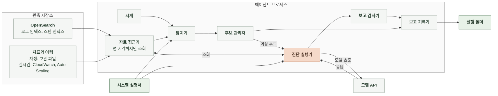

# 4-2 소프트웨어 설계

이 문서는 에이전트의 시스템 경계, 실행 모드, 구성 요소의 책임과 상태 관리를 정한다.

신호 규칙과 진단 전략은 4-1 인지 구조에, 자료 원천과 결과 파일의 형식은 5 계약에 있다. ([4-1-2 이상 후보 추림](4-1-DESIGN-COGNITIVE-ARCHITECTURE.md#4-1-2-이상-후보-추림), [4-1-3 진단 전략](4-1-DESIGN-COGNITIVE-ARCHITECTURE.md#4-1-3-진단-전략), [5-2 자료 원천](5-CONTRACT.md#5-2-자료-원천), [5-6 실행 폴더](5-CONTRACT.md#5-6-실행-폴더))

 

### 4-2-1 시스템 경계

에이전트는 개발자 PC에서 도는 명령줄 프로세스 하나다. 서버로 띄우지 않고 요청을 받는 입구도 없다. 관측 저장소에는 읽기 요청만 보낸다.

 

### 4-2-2 실행 모드

| 항목 | 재생 | 실시간 |
|---|---|---|
| 용도 | 평가와 회귀 확인 | loadtest 환경 시연 |
| 감시 구간 | 실행할 때 고른 보관 구간 | 실행한 시각부터 멈출 때까지 |
| 시계 | 구간 시작부터 1분씩 앞으로 옮김 진단하는 동안 멈춤 | 실제 시각. 1분마다 깨어남 진단하는 동안에도 감시를 계속함 |
| 로그, 스팬 | 보관 자료를 같은 인덱스 이름으로 다시 적재한 재생용 OpenSearch | loadtest 환경 OpenSearch |
| 지표, 확장과 경보 이력 | 보관 파일 | CloudWatch, Application Auto Scaling |
| 끝 | 구간 끝에 닿으면 열린 이상 후보를 닫지 않은 채 기록하고 종료 | 운영자가 멈춤 |

두 모드는 시계와 자료 접근기의 원천만 다르고 탐지기, 후보 관리자, 진단 실행기, 보고 검사기는 같은 코드를 쓴다. 평가는 재생 모드로 실행한 실행 폴더를 채점기가 읽어 채점하므로 운영과 평가가 같은 진단 코드와 프롬프트를 쓴다.

 

### 4-2-3 구성 요소

| 구성 요소 | 입력 | 출력 | 책임 | 하지 않는 일 |
|---|---|---|---|---|
| 시계 | 실행 모드, 구간 | 감시 시각 | 감시 시각을 1분씩 옮김 | 자료를 읽지 않음 |
| 자료 접근기 | 조회 요청, 상한 시각 | 집계 결과 | 원천별 조회를 같은 결과 형식으로 바꿈 상한 시각 이후 자료를 자름 식별자 필드를 뺌 | 쓰기 요청을 보내지 않음 |
| 탐지기 | 감시 시각, 시스템 설명서 | 확정 신호 | 직전 1분의 신호를 판정하고 최근 5분 기록으로 확정함 | 모델을 부르지 않음 |
| 후보 관리자 | 확정 신호 | 이상 후보 열기, 붙이기, 닫기 | 열린 이상 후보를 하나만 둠 | 진단 결과로 후보를 바꾸지 않음 |
| 진단 실행기 | 이상 후보, 시스템 설명서 | 제출된 진단 보고 | 모델 호출과 도구 실행 반복, 조회 번호 부여, 예산 관리 | 판정을 직접 정하지 않음 |
| 보고 검사기 | 제출된 진단 보고, 조회 기록 | 검사한 진단 보고 | 근거 검증, 출력 간 조건 검사, 위반 시 한 번 되돌림 | 근거를 지우거나 값을 고치지 않음 |
| 보고 기록기 | 이상 후보, 진단 보고, 조회 기록 | 실행 폴더의 파일 | 진단 하나가 끝날 때마다 바로 씀 | 앞선 보고를 고쳐 쓰지 않음. 닫은 시각만 후보 파일에 더함 |

 

### 4-2-4 상태와 자원

| 상태 | 위치 | 수명 |
|---|---|---|
| 신호의 최근 5분 판정 기록 | 탐지기 메모리 | 프로세스 |
| 열린 이상 후보 | 후보 관리자 메모리 | 프로세스. 다시 시작하면 열린 이상 후보 없이 시작함 |
| 진단 중 대화와 조회 기록 | 진단 실행기 메모리 | 진단 하나 |
| 이상 후보, 진단 보고, 조회 기록 | 실행 폴더 | 영구. 실행마다 새 폴더 |

진단은 한 번에 하나만 돈다. 열린 이상 후보가 하나뿐이라 동시에 두 진단이 생기지 않는다. OpenSearch와 CloudWatch 연결은 프로세스 시작 때 만들어 끝날 때까지 다시 쓴다.
