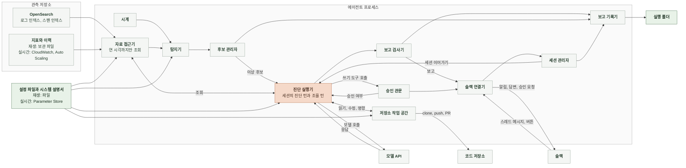

# 4-2 소프트웨어 설계

이 문서는 에이전트의 시스템 경계, 실행 모드, 구성 요소의 책임과 상태 관리를 정한다.

신호 규칙과 진단 전략은 4-1 인지 구조에, 설정 항목, 자료 원천, 결과 파일의 형식은 5 계약에 있다. ([4-1-2 이상 후보 추림](4-1-DESIGN-COGNITIVE-ARCHITECTURE.md#4-1-2-이상-후보-추림), [4-1-3 진단 전략](4-1-DESIGN-COGNITIVE-ARCHITECTURE.md#4-1-3-진단-전략), [5-2 설정 파일](5-CONTRACT.md#5-2-설정-파일), [5-3 자료 원천](5-CONTRACT.md#5-3-자료-원천), [5-7 실행 폴더](5-CONTRACT.md#5-7-실행-폴더), [5-8 슬랙 메시지](5-CONTRACT.md#5-8-슬랙-메시지))

 

### 4-2-1 시스템 경계

에이전트는 프로세스 하나다. 자료 원천 위치, 필드 이름, 탐지 기준값, 저장소, 채널처럼 대상 서비스에 묶인 값은 시작할 때 설정 파일과 시스템 설명서에서 받는다. 재생 모드는 운영자 PC의 명령줄 프로세스이고 실시간 모드는 운영 ECS 클러스터의 Fargate 태스크 하나다. 슬랙은 소켓 모드로 연결해 요청을 받는 공개 입구가 없다. 관측 저장소에는 읽기 요청만 보낸다. 코드 저장소에서는 코드 사본과 조치 작업 공간을 받는다. 코드 저장소에 보내는 쓰기는 조치 작업 공간의 브랜치 push와 PR 생성뿐이다.

 

### 4-2-2 실행 모드

| 항목 | 재생 | 실시간 |
|---|---|---|
| 용도 | 평가, 회귀 확인, 시연 | 운영 감시 |
| 실행 위치 | 운영자 PC 명령줄 | 운영 ECS 클러스터의 Fargate 태스크 하나 |
| 감시 구간 | 실행할 때 고른 보관 구간 | 실행한 시각부터 멈출 때까지 |
| 시계 | 구간 시작부터 1분씩 앞으로 옮김 진단하는 동안 멈춤 | 실제 시각. 1분마다 깨어남 진단하는 동안에도 감시를 계속함 |
| 로그, 스팬 | 보관 자료를 같은 인덱스 이름으로 다시 적재한 재생용 OpenSearch | 운영 OpenSearch |
| 지표, 확장과 경보 이력 | 보관 파일 | 운영 CloudWatch, Application Auto Scaling |
| 로그 표본 메시지 기본값 | 묶음마다 최대 5개 | 돌려주지 않음 |
| 코드 사본 | 실행 인자로 받은 구간 당시 커밋 | 진단 턴마다 설정에 적은 브랜치의 최신 커밋. 마냑은 운영에 배포되는 `main` |
| 슬랙 | 실행 인자로 켬. 켜면 알림, 스레드, 승인 버튼 | 알림, 스레드, 승인 버튼 |
| 세션 | 슬랙을 켜지 않으면 진단 턴으로 끝남 슬랙을 켜면 조율 턴을 이어 받음 | 진단 턴 뒤 조율 턴을 이어 받음 |
| 조치 작업 공간 | 슬랙을 켤 때만 있음 | 있음 |
| 하루 비용 상한 | 없음 | 있음 |
| 실행 폴더와 세션 파일 | 운영자 PC | 태스크의 임시 저장소 |
| 끝 | 구간 끝에 닿으면 열린 이상 후보를 닫지 않은 채 기록하고 감시를 멈춤 슬랙을 켜지 않았으면 바로 종료 슬랙을 켰으면 운영자가 멈출 때 종료 | 태스크가 멈출 때 |

두 모드는 위 표의 차이 밖에서 탐지기, 후보 관리자, 진단 실행기, 보고 검사기를 같은 코드로 쓴다. 평가는 재생 모드로 실행한 실행 폴더를 채점기가 읽어 채점하므로 운영과 평가가 같은 진단 코드와 프롬프트를 쓴다.

 

### 4-2-3 구성 요소

| 구성 요소 | 입력 | 출력 | 책임 | 하지 않는 일 |
|---|---|---|---|---|
| 시계 | 실행 모드, 구간 | 감시 시각 | 감시 시각을 1분씩 옮김 | 자료를 읽지 않음 |
| 자료 접근기 | 조회 요청, 상한 시각 | 집계 결과 | 설정의 인덱스 패턴과 필드 이름으로 질의함 원천별 조회를 같은 결과 형식으로 바꿈 상한 시각 이후 자료를 자름 식별자 필드를 뺌 | 쓰기 요청을 보내지 않음 |
| 탐지기 | 감시 시각, 시스템 설명서, 탐지 기준값 | 확정 신호 | 직전 1분의 신호를 판정하고 최근 5분 기록으로 확정함 | 모델을 부르지 않음 |
| 후보 관리자 | 확정 신호와 하루 비용 누적 | 이상 후보 열기, 붙이기, 닫기 | 열린 이상 후보를 하나만 둠 하루 비용 상한을 넘었으면 진단을 요청하지 않고 진단 생략 사유를 남김 | 진단 결과로 후보를 바꾸지 않음 |
| 진단 실행기 | 이상 후보, 시스템 설명서, 운영자 메시지 | 제출된 진단 보고, 조율 턴의 답변 | 세션을 열어 진단 턴을 돌리고 조율 턴을 같은 세션으로 이어 감 조회 번호 부여, 예산 관리, 세션과 하루 비용 누적 진단 턴 동안 코드 사본 밖 읽기, 파일 수정, 명령 실행을 거부함 | 판정을 직접 정하지 않음 |
| 보고 검사기 | 제출된 진단 보고, 조회 기록, 코드 사본 | 검사한 진단 보고 | 근거 검증, 출력 간 조건 검사, 위반 시 한 번 되돌림 | 근거를 지우거나 값을 고치지 않음 |
| 슬랙 연결기 | 검사한 진단 보고, 답변, 승인 요청, 슬랙 이벤트 | 알림과 스레드 게시, 운영자 메시지, 버튼 응답 | 보고를 알림 메시지로 바꿔 올리고 스레드를 엶 스레드 메시지와 버튼 응답을 받아 넘김 | 메시지 내용을 판단하지 않음 |
| 세션 관리자 | 이상 후보, 스레드 | 세션과 스레드의 짝 | 세션 ID와 스레드를 맺고 찾음 세션 종료 조건을 판정함 | 대화 내용을 바꾸지 않음 |
| 승인 관문 | 쓰기 도구 호출 | 승인 여부 | 호출 내용을 승인 요청으로 만들어 스레드에 올리고 응답을 기다림 응답과 시간 초과를 기록함 | 승인 없이 통과시키지 않음 |
| 저장소 작업 공간 | 코드 읽기 요청, 승인된 수정, 승인된 명령 | 파일 내용, 브랜치, PR | 코드 사본을 읽기 전용으로 받아 두고 모드에 맞는 커밋으로 맞춤 조치 작업 공간을 받아 두고 수정, 커밋, push, PR 생성을 실행함 | 코드 사본을 고치지 않음. 머지하지 않음. 기본 브랜치에 push하지 않음 |
| 보고 기록기 | 이상 후보, 진단 보고, 조회 기록, 세션, 승인, PR | 실행 폴더의 파일 | 사건이 끝날 때마다 바로 씀 | 앞선 기록을 고쳐 쓰지 않음. 닫은 시각만 후보와 세션 파일에 더함 |

 

### 4-2-4 상태와 자원

| 상태 | 위치 | 수명 |
|---|---|---|
| 신호의 최근 5분 판정 기록 | 탐지기 메모리 | 프로세스 |
| 열린 이상 후보 | 후보 관리자 메모리 | 프로세스. 다시 시작하면 열린 이상 후보 없이 시작함 |
| 하루 비용 누적 | 진단 실행기 메모리 | UTC 하루. 다시 시작하면 0부터 셈 |
| 진단 중 조회 기록 | 진단 실행기 메모리 | 진단 턴 하나 |
| 세션의 대화 | 세션 저장 경로의 파일 | 세션과 같음. 다시 시작한 프로세스는 이전 실행의 세션을 이어 받지 않음 |
| 세션과 스레드의 짝 | 세션 관리자 메모리와 실행 폴더 | 세션과 같음 |
| 승인 대기 | 승인 콜백 안의 대기 | 응답이 오거나 2시간이 지나거나 프로세스가 멈출 때까지 |
| 코드 사본과 조치 작업 공간 | 작업 폴더 | 프로세스 |
| 이상 후보, 진단 보고, 조회 기록, 세션, 승인, PR | 실행 폴더 | 실행마다 새 폴더. 재생은 운영자 PC에 남고 실시간은 태스크가 멈추면 사라짐 |

진단은 한 번에 하나만 돈다. 열린 이상 후보가 하나뿐이라 동시에 두 진단이 생기지 않는다. 조율 턴은 세션마다 차례로 처리하고 다른 세션의 조율 턴과는 동시에 돈다. OpenSearch, CloudWatch, 슬랙 연결은 프로세스 시작 때 만들어 끝날 때까지 다시 쓴다.
