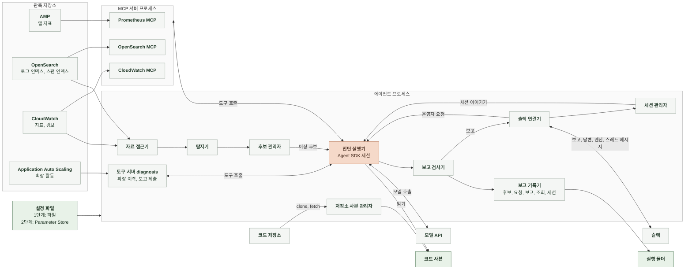

# 4-2 소프트웨어 설계

이 문서는 에이전트의 시스템 경계, 실행 단계, 구성 요소의 책임과 상태 관리를 정한다.

신호 규칙과 진단 전략은 4-1 인지 구조에, 설정 항목, 자료 원천, 결과 파일의 형식은 5 계약에 있다. ([4-1-2 이상 후보 추림](4-1-DESIGN-COGNITIVE-ARCHITECTURE.md#4-1-2-이상-후보-추림), [4-1-3 진단 전략](4-1-DESIGN-COGNITIVE-ARCHITECTURE.md#4-1-3-진단-전략), [5-2 설정 파일](5-CONTRACT.md#5-2-설정-파일), [5-3 자료 원천](5-CONTRACT.md#5-3-자료-원천), [5-8 실행 폴더](5-CONTRACT.md#5-8-실행-폴더), [5-9 슬랙 메시지](5-CONTRACT.md#5-9-슬랙-메시지))

 

### 4-2-1 시스템 경계

에이전트는 상주하는 프로세스 하나다. 자료 원천 위치, 필드 이름, 탐지 기준값, 서비스 지도, 저장소, 채널처럼 대상 서비스에 묶인 값은 시작할 때 설정 파일에서 받는다. 진단 실행기는 Agent SDK로 세션을 열고 SDK가 그 세션의 MCP 서버를 각자 별도 프로세스로 띄운다. 에이전트 루프는 SDK가 돌리고 에이전트는 루프를 직접 만들지 않는다. 슬랙은 소켓 모드로 연결해 요청을 받는 공개 입구가 없다. 관측 저장소에는 읽기 요청만 보낸다. 코드 저장소에서는 읽기 전용 사본만 받고 쓰기를 보내지 않는다.

 

### 4-2-2 실행 단계

| 항목 | 1단계 | 2단계 |
|---|---|---|
| 실행 위치 | 운영자 PC에서 상주 실행 | 운영 ECS 클러스터의 Fargate 태스크 하나 |
| 설정 파일 | 운영자 PC의 파일 | Parameter Store 파라미터 |
| 비밀값 | 운영자 PC의 비밀 파일 | Secrets Manager |
| AWS 자격 | 운영자 PC의 읽기 전용 역할 프로필 | 태스크 역할 |
| 실행 폴더와 세션 파일 | 운영자 PC | 태스크의 임시 저장소 |
| 끝 | 운영자가 멈출 때 | 태스크가 멈출 때 |

두 단계는 위 표의 차이 밖에서 같은 코드, 같은 프롬프트, 같은 운영 관측 자료를 쓴다. 단계를 바꾸는 조건은 7-4 배포가 정한다.

 

### 4-2-3 구성 요소

| 구성 요소 | 입력 | 출력 | 책임 | 하지 않는 일 |
|---|---|---|---|---|
| 자료 접근기 | 탐지 조회 요청 | 집계 결과 | 설정의 인덱스 패턴과 필드 이름으로 OpenSearch에 집계 질의를 보냄 CloudWatch 지표를 읽음 원천별 조회를 같은 결과 형식으로 바꿈 | 쓰기 요청을 보내지 않음. 모델 도구로 노출되지 않음 |
| 탐지기 | 현재 시각, 서비스 지도, 탐지 기준값 | 확정 신호 | 1분마다 직전 1분의 신호를 판정하고 최근 5분 기록으로 확정함 | 모델을 부르지 않음 |
| 후보 관리자 | 확정 신호와 하루 비용 누적 | 이상 후보 열기, 붙이기, 닫기 | 열린 이상 후보를 하나만 둠 하루 비용 상한을 넘었으면 진단을 요청하지 않고 진단 생략 사유를 남김 | 진단 결과로 후보를 바꾸지 않음 |
| 진단 실행기 | 진단 요청, 설정, 운영자 메시지 | 제출된 진단 보고, 대화 턴의 답변 | 진단 요청을 차례로 받아 세션을 열고 진단 턴을 돌린 뒤 대화 턴을 같은 세션으로 이어 감 조회 번호 부여, 예산 관리, 세션과 하루 비용 누적 저장소 읽기를 코드 사본 안으로 제한함 | 판정을 직접 정하지 않음 |
| 도구 서버 `diagnosis` | 확장 이력 조회, 제출된 보고 | 확장 활동 목록, 검사 결과 | 프로세스 안 MCP 서버로 확장 이력 도구와 보고 제출 도구를 둠 | 쓰기 요청을 보내지 않음 |
| 외부 MCP 서버 | 도구 호출 | 조회 결과 | OpenSearch, CloudWatch, AMP를 읽는 공식 서버. 각자 받은 읽기 자격으로만 질의함 | 에이전트 코드가 고치지 않음 |
| 보고 검사기 | 제출된 진단 보고, 조회 기록, 코드 사본 | 검사한 진단 보고 | 근거 검증, 출력 간 조건 검사, 위반 시 한 번 되돌림 | 근거를 지우거나 값을 고치지 않음 |
| 슬랙 연결기 | 검사한 진단 보고, 답변, 슬랙 이벤트 | 알림과 스레드 게시, 운영자 요청, 운영자 메시지 | 이상 후보의 보고를 채널에 올려 스레드를 엶 운영자 요청의 보고를 그 멘션의 스레드에 올림 멘션과 스레드 메시지를 받아 넘김 | 메시지 내용을 판단하지 않음 |
| 세션 관리자 | 진단 요청, 스레드 | 세션과 스레드의 짝 | 세션 ID와 스레드를 맺고 찾음 세션 종료 조건을 판정함 | 대화 내용을 바꾸지 않음 |
| 저장소 사본 관리자 | 설정의 저장소 목록 | 코드 사본 | 저장소를 읽기 전용으로 받아 두고 진단 세션을 열기 전에 설정의 브랜치 최신 커밋으로 맞춤 | 사본을 고치지 않음. 저장소에 쓰기를 보내지 않음 |
| 보고 기록기 | 진단 요청, 진단 보고, 조회 기록, 세션 | 실행 폴더의 파일 | 사건이 끝날 때마다 바로 씀 | 앞선 기록을 고쳐 쓰지 않음 |

 

### 4-2-4 상태와 자원

| 상태 | 위치 | 수명 |
|---|---|---|
| 신호의 최근 5분 판정 기록 | 탐지기 메모리 | 프로세스 |
| 열린 이상 후보 | 후보 관리자 메모리 | 프로세스. 다시 시작하면 열린 이상 후보 없이 시작함 |
| 진단 대기열 | 진단 실행기 메모리 | 프로세스. 다시 시작하면 비어 있음 |
| 하루 비용 누적 | 진단 실행기 메모리 | UTC 하루. 다시 시작하면 0부터 셈 |
| 진단 중 조회 기록 | 진단 실행기 메모리 | 진단 턴 하나 |
| 세션의 대화 | 세션 저장 경로의 파일 | 세션과 같음. 다시 시작한 프로세스는 이전 실행의 세션을 이어 받지 않음 |
| 세션과 스레드의 짝 | 세션 관리자 메모리와 실행 폴더 | 세션과 같음 |
| 코드 사본 | 작업 폴더 | 프로세스 |
| 진단 요청, 진단 보고, 조회 기록, 세션 | 실행 폴더 | 실행마다 새 폴더. 1단계는 운영자 PC에 남고 2단계는 태스크가 멈추면 사라짐 |

진단 턴은 한 번에 하나만 돈다. 진단 중에 들어온 진단 요청은 대기열에서 앞 진단이 끝나기를 기다린다. 대화 턴은 세션마다 차례로 처리하고 다른 세션의 대화 턴이나 진단 턴과는 동시에 돈다. OpenSearch, CloudWatch, 슬랙 연결은 프로세스 시작 때 만들어 끝날 때까지 다시 쓴다. MCP 서버 프로세스는 SDK 세션을 열 때 뜨고 닫을 때 끝난다.
