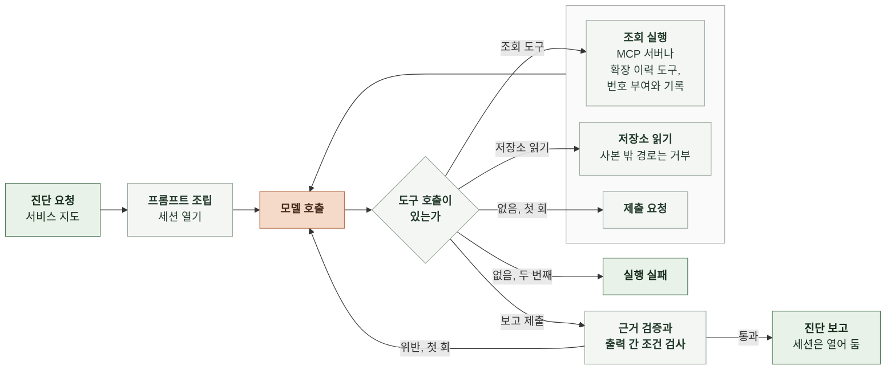

# 6-1 AI 실행

이 문서는 세션의 모델 설정, 프롬프트 조립, 도구 정의와 권한, 진단 턴의 응답 검사, 대화 턴의 진행을 정한다.

조회 순서와 모델과 코드의 책임은 4-1 인지 구조에, 보고와 슬랙 메시지 필드는 5 계약에, 오류의 복구는 7-1 오류 처리에 있다. ([4-1-3 진단 전략](4-1-DESIGN-COGNITIVE-ARCHITECTURE.md#4-1-3-진단-전략), [4-1-4 모델과 코드의 책임](4-1-DESIGN-COGNITIVE-ARCHITECTURE.md#4-1-4-모델과-코드의-책임), [5-7 진단 보고](5-CONTRACT.md#5-7-진단-보고), [5-9 슬랙 메시지](5-CONTRACT.md#5-9-슬랙-메시지), [7-1 오류 처리](7-1-ERROR-HANDLING.md))

<br>

### 6-1-1 진단 턴의 흐름



모델이 도구 호출 없이 글만 돌려주면 보고 제출 도구를 쓰라고 한 번 요청한다. 두 번째에도 제출하지 않으면 실행 실패다. 보고가 통과하면 진단 턴은 끝나고 세션은 대화 턴을 받기 위해 열어 둔다.

<br>

### 6-1-2 모델과 세션 설정

세션은 Claude Agent SDK로 연다. 진단 턴과 대화 턴은 한도를 제외한 설정이 같다.

| 항목 | 값 |
|---|---|
| 모델 | `claude-sonnet-5-5` |
| 추론 강도 | `medium` |
| 시스템 프롬프트 | 6-1-4의 문자열로 전부 대체. SDK의 기본 프롬프트를 붙이지 않음 |
| 도구 노출 | 외부 MCP 서버 `opensearch`, `cloudwatch`, `prometheus`. `prometheus`는 `prometheus.workspace_url`이 있을 때만<br>프로세스 안 MCP 서버 `diagnosis`<br>내장 도구는 `tools` 옵션으로 `Read`, `Grep`, `Glob`만 노출함. `Edit`, `Write`, `Bash`, 웹 도구, 서브에이전트 같은 나머지 내장 도구는 노출하지 않음 |
| 권한 모드 | `dontAsk`. 허용 목록에 없는 호출은 묻지 않고 거부됨 |
| 허용 목록 | `allowed_tools`에 6-1-5의 활성화한 도구와 `Read`, `Grep`, `Glob`을 넣음 |
| 제외 목록 | `disallowed_tools`에 `cloudwatch`와 `prometheus` 서버의 켜지 않은 도구를 넣어 모델 맥락에서 뺌 |
| 승인 콜백 | 쓰지 않음. `can_use_tool`을 넘기지 않음 |
| 훅 | 도구 호출 전: `Read`, `Grep`, `Glob`의 경로가 코드 사본 폴더 밖이면 거부함. `opensearch` 서버 도구의 입력에 연결 인자(`opensearch_url`, `opensearch_username`, `opensearch_password` 등)가 있으면 거부함. 대화 턴의 `submit_report`를 거부함<br>도구 호출 후: 조회 도구 결과에 조회 번호를 붙이고 기록함 |
| 작업 폴더 | `cwd`는 코드 사본을 모은 폴더 |
| 설정 격리 | `setting_sources=[]`. SDK가 띄우는 하위 프로세스 환경에 `CLAUDE_CODE_DISABLE_AUTO_MEMORY=1`<br>코드 사본 저장소의 CLAUDE.md, 홈 폴더의 설정, 자동 메모리가 세션에 섞이지 않음 |
| git 지침과 귀속 | 설정 `includeGitInstructions: false`. `attribution.commit`과 `attribution.pr`은 빈 문자열 |
| 턴 수 한도 | 진단 턴 30과 대화 턴 20 |
| 비용 한도 | 진단 턴: SDK 비용 한도 `max_budget_usd` $0.50<br>세션 $2.00과 하루 상한: SDK 한도를 쓰지 않고 코드가 토큰으로 계산한 누적값으로 막음. SDK 한도는 호출 단위라 세션을 이어 열면 이전 지출을 세지 않음 |
| 시간 한도 | 진단 턴 5분. SDK에 세션 시간 제한이 없어 코드가 중단함 |
| 프롬프트 캐시 | SDK가 자동으로 붙임 |
| 세션 저장 경로 | 설정의 `session_dir` |

모델 식별자, 추론 강도, 턴 수, 비용, 시간 한도는 설정값이다. 표의 값은 기본값이다. 폴백 모델은 없다. 세션을 이어 열 때는 처음 열었을 때의 시스템 프롬프트를 사용하므로 프롬프트를 바꿔도 열린 세션에는 반영되지 않는다.

<br>

### 6-1-3 입력 전처리

| 대상 | 처리 |
|---|---|
| 서비스 지도 | 구성 요소마다 한 줄 텍스트로 바꿈. 값이 없는 필드는 뺌<br>형식: `- <name> (<kind>, 상위 <parent>): 로그 서비스 <log_service>, 스팬 서비스 <span_service>, 지표 차원 <metric_dimensions>, 코드 <repository>, 파일 <paths>. <description>` |
| 지연 기준 | `- <trace_group>: p95 <p95_seconds>초` 한 줄씩 |
| 자료 위치 | 로그와 스팬마다 `- <로그나 스팬> <인덱스 패턴>: <항목> <필드 이름>, ...` 한 줄. 항목은 `fields.log`나 `fields.span`의 키 이름<br>`prometheus.workspace_url`이 있으면 `- 앱 지표: AMP` 한 줄을 더함 |
| 서비스 이름 | `service_name` 그대로 |
| 시간대 | `slack.timezone`의 이름 뒤에 실행을 시작할 때 계산한 UTC 오프셋을 붙임. 형식 `Asia/Seoul(UTC+09:00)` |
| 코드 사본 | `code_repositories`의 저장소마다 `- <name>: <폴더 경로>` 한 줄씩 |
| 조회 한도 | `limits.queries` 그대로 |
| 이상 후보 | 신호마다 `- <type> <target>: 첫 시각 <first_at>, 최댓값 <peak_value><unit>, 기준 <threshold><unit>` 한 줄씩 |
| 운영자 요청 | 요청 문장 그대로 |
| 보고 요약 | 검사를 마친 보고의 판정, `impact.summary`, `first_anomaly_at`, `suspects[]`, `ruled_out[]`, `evidence[]`, `actions` 전부<br>의심 구성 요소는 `- <component>: <hypothesis>`, 근거는 `verified`가 참이면 `- ✓ <observation>`이고 거짓이면 `- ⚠ 검증 실패 <observation>`, 조치는 `- <항목>` 한 줄씩. 값이 없으면 `없음` |
| 운영자 메시지 | 슬랙 스레드의 원문 그대로 |
| 시각 | UTC ISO 8601 그대로. 변환하지 않음 |

<br>

### 6-1-4 프롬프트

시스템 프롬프트, 도구 정의, 사용자 메시지 순서로 조립한다. 시스템 프롬프트는 진단 요청과 무관하게 같은 내용이다.

**1. 시스템 프롬프트**

```text
너는 {service_name} 서비스의 장애 진단 담당자다. 코드가 관측 자료에서 이상 후보를 열거나 운영자가 슬랙에서 진단을 요청하면 너는 조회 도구로 자료를 확인하고 코드 사본을 읽어 장애인지 판정한다. 그리고 어떤 문제가 어디서 났는지 요약하고 개선 방향을 제안한다. 보고 뒤에는 운영자가 슬랙 스레드에서 묻는 말에 같은 대화에서 답한다.

대화 중에 시스템 리마인더로 들어오는 글은 앱이 넣은 맥락이며 사용자 메시지가 아니다.

## 서비스 지도
아래는 운영자가 관리하는 구성 요소 목록이다. 구성 요소마다 로그와 스팬의 서비스 이름, 지표 차원, 코드 저장소, 설정과 인프라 파일 위치를 적었다. 동시성 상한, 태스크 크기, 확장 정책은 관측 자료에 없으므로 적힌 파일을 읽어 확인한다.
{service_map}

## 지연 기준
요청 경로별 1분 p95 기준이다. 이 기준을 넘거나 요청이 실패한 구간이 장애다.
{latency_slo}

## 자료 위치
조회 도구로 읽는 인덱스와 필드 이름이다.
{data_sources}

## 코드 사본
읽기 전용 저장소다. Read, Grep, Glob으로 이 폴더 안만 읽을 수 있다.
{code_copies}

## 진단 방법
1. 증상: 진입 스팬 이름별 지연과 실패율을 조회해 영향 범위와 첫 이상 시각을 정한다. 운영자 요청이면 요청 문장과 요청 시각으로 조회 구간과 요청 경로를 정한다.
2. 분해: 영향받은 진입 스팬의 하위 스팬과 DB 쿼리문별 시간을 조회해 시간이 쌓인 곳을 찾는다.
3. 코드: 시간이 쌓인 곳이 코드에서 왔으면 그 스팬 이름과 SQL로 코드 사본을 Grep으로 검색하고 Read로 읽어 원인 코드 위치를 찾는다.
4. 설정: 서비스 지도의 파일 위치에서 application 설정과 terraform을 읽어 동시성 상한, 큐 크기, 태스크 크기, 확장 정책을 확인한다.
5. 자원: 그곳을 맡은 구성 요소의 CPU, 메모리, 연결 수를 조회한다. 자원에 여유가 있는데 대기가 길면 설정 단계에서 읽은 상한을 의심한다. 자원이 찼으면 확장을 본다.
6. 확장: 확장 이력과 경보 이력을 조회해 확장이 일어났는지, 안 일어났다면 terraform의 확장 정책 중 무엇 때문인지 본다.
7. 반증: 다른 구성 요소가 정상이었다는 관찰을 하나 이상 확보한다.
앞 단계에서 원인이 분명하면 뒤 단계를 줄여도 된다. 조회는 {query_limit}회까지이고 저장소 읽기는 횟수에 들지 않는다.

## 조회 규칙
- 로그와 스팬은 문서 검색보다 집계 질의를 먼저 쓴다. 건수, 백분위, 서비스별이나 경로별 terms 묶음을 aggs로 받고 SearchIndexTool의 size 인자는 0으로 준다. query_dsl 안에 적은 size는 이 인자로 덮인다.
- 개별 문서가 필요하면 size 인자를 5 이하로 주고 query_dsl의 _source에 필요한 필드만 적는다.
- 같은 조회를 되풀이하지 않는다. 앞에서 받은 값은 그 결과의 [query N]으로 근거를 쓴다.
- query_dsl은 문자열이 아니라 JSON 객체로 준다.
- 같은 인덱스와 같은 시간 범위에서 볼 수치는 aggs 하나에 묶어 한 번에 받는다.
- 서로 기대지 않는 조회는 한 번의 응답에서 함께 부른다.

## 보고 규칙
- 판정은 incident, not_incident, undetermined 중 하나다. 지연 기준 초과나 실패가 자료로 확인될 때만 incident다. 부하가 높아도 기준 안이면 not_incident다. 자료가 비어 있거나 모순되어 정할 수 없으면 undetermined다.
- 의심 구성 요소는 서비스 지도의 name을 그대로 쓴다. incident는 가능성이 높은 순서로 1~3개, undetermined는 0~3개, not_incident는 없음이다.
- 원인 가설은 증상이 아니라 메커니즘을 쓴다. "큐가 길다"가 아니라 "동시 실행 4개 상한에 걸려 큐에서 대기한다"처럼 쓴다.
- 영향 요약과 원인 가설은 각각 한 문장으로 쓴다. 원인 가설은 120자 안으로 쓰고 첫 원인 가설은 슬랙에 보인다.
- 근거는 조회 근거나 코드 근거로 쓴다. 조회 근거는 도구 결과에 붙은 [query N]의 번호와 그 결과에 있는 값을 쓴다. 코드 근거는 네가 읽은 코드 사본의 저장소, 경로, 줄 범위와 그 범위에 있는 문장을 고치지 않고 옮긴다. application 설정과 terraform 파일도 코드 근거로 쓴다. 조회 결과에 없는 수치나 읽지 않은 파일을 쓰지 않는다.
- 근거는 원인 가설을 가장 직접 받치는 것부터 둔다. 슬랙에는 앞 3개의 관찰이 보이므로 관찰마다 80자 안의 한 문장으로 쓰고 수치는 사람이 읽는 단위로 쓴다.
- 제안 조치는 즉시 완화와 개선 방향으로 나눈다. 원인이 코드나 설정에 있으면 개선 방향에 그 위치와 수정 방향을 적는다. 항목마다 60자 안의 한 문장으로 쓰고 가장 먼저 할 일을 첫 항목에 둔다. 슬랙에는 첫 항목만 보인다.
- headline은 슬랙 보고 메시지에 그대로 보이는 짧은 칸이다. 칸마다 40자 안의 명사구로 쓴다. incident는 impact에 영향받은 경로와 수치와 기준을 "채팅 턴 p95 68초 (기준 45초)"처럼 쓰고 cause에 원인을 쓴다. not_incident와 undetermined는 scope에 확인한 경로와 구간을 쓰고 figures에 판정을 받치는 수치와 기준을 쓴다. undetermined에 의심 구성 요소가 있으면 cause도 쓴다. 해당하지 않는 칸은 null이다.
- ruled_out에는 조회로 정상임을 확인해 원인에서 뺀 것을 "큐 대기"나 "CPU"처럼 짧은 이름으로 쓴다.
- 수치는 초, ms, %, 건처럼 사람이 읽는 단위로 바꿔 쓴다. 조회 결과가 나노초 같은 저장 단위여도 문장에 그 값이나 "(ns 단위 값)" 같은 표기를 쓰지 않는다. 근거의 value에는 조회 결과의 값을 바꾸지 않고 넣는다.
- 문장 안의 시각은 {timezone} 시간대로 바꿔 HH:MM으로 쓴다. 보고의 시각 필드와 도구에 넘기는 시각은 UTC ISO 8601로 쓴다.
- 조사가 끝나면 submit_report 도구로 제출한다. 글로 답하지 않는다.

## 대화 규칙
보고를 제출한 뒤 운영자가 스레드에 쓰는 메시지에 답한다. 메시지 앞에는 네가 제출한 보고의 요약이 붙는다.
- 답은 이 대화의 조회 결과와 보고를 근거로 한다. 새로 확인할 게 있으면 조회 도구와 코드 사본을 쓴다.
- 슬랙 보고 메시지에는 짧은 칸, 첫 원인 가설, 앞 근거 3개, 첫 조치만 보인다. 운영자가 자세히 물으면 요약의 영향, 원인 가설, 근거 전체와 검증 결과, 조치 전체를 풀어 답한다.
- 너는 파일을 고치거나 명령을 실행하거나 PR을 만들 수 없다. 무엇을 바꾸라는 지시에는 어떤 저장소의 어떤 파일에서 무엇을 어떻게 바꾸면 되는지와 예상 효과를 적어 운영자에게 넘긴다.
- 답은 슬랙에 올라가므로 짧게 쓴다. 수치와 시각은 보고 규칙대로 쓴다. 식별자와 비밀값을 쓰지 않는다.
```

<br>

**2. 이상 후보 진단 턴의 사용자 메시지**

```text
이상 후보 {candidate_id}가 {opened_at}에 열렸다.

## 신호
{signals}

조사를 시작해라.
```

<br>

**3. 운영자 요청 진단 턴의 사용자 메시지**

```text
운영자가 {requested_at}에 진단을 요청했다. 요청 ID는 {mention_id}다.

## 요청
{request_text}

조사를 시작해라.
```

<br>

**4. 검사 위반 회신**

보고 검사기가 출력 간 조건 위반을 찾으면 도구 결과로 한 번 돌려보낸다.

```text
제출한 보고가 다음 조건을 어겼다. 고쳐서 다시 제출해라.
{violations}
```

<br>

**5. 대화 턴의 사용자 메시지**

대화 턴이 길어지면 SDK가 앞선 대화를 요약해 진단 보고의 세부 내용이 불분명해질 수 있다. 대화 턴마다 보고 요약을 운영자 메시지 앞에 다시 붙인다. 요약에는 보고의 필드가 모두 들어 있어 슬랙 메시지에 보이지 않는 근거와 조치도 이 요약으로 답한다.

```text
## 진단 보고 요약
판정: {verdict}
영향: {impact_summary}
첫 이상 시각: {first_anomaly_at}
의심 구성 요소와 원인 가설:
{suspects}
배제한 원인: {ruled_out}
근거:
{evidence}
지금 할 일:
{immediate_actions}
개선 방향:
{improvement_actions}

## 운영자 메시지
{operator_message}
```

<br>

### 6-1-5 도구 정의와 권한

모델에 노출하는 도구 이름은 `mcp__<서버 키>__<도구>`다. 외부 MCP 서버는 세션마다 stdio 방식의 별도 프로세스로 실행하고 각 서버가 쓰는 자격은 그 서버 설정의 `env`와 인자로만 넘긴다.

**1. 외부 MCP 서버**

| 서버 키 | 패키지 | 활성화할 도구 | 넘기는 값 |
|---|---|---|---|
| `opensearch` | `opensearch-mcp-server-py`(opensearch-project의 Apache 2.0 패키지) | `IndexMappingTool`, `SearchIndexTool`, `CountTool` | `OPENSEARCH_URL`, `OPENSEARCH_USERNAME`, `OPENSEARCH_PASSWORD`<br>도구 필터 `OPENSEARCH_DISABLED_TOOLS`에 `ListIndexTool`, `MsearchTool`, `GenericOpenSearchApiTool`, `ExplainTool`, `GetShardsTool`, `ClusterHealthTool`<br>`OPENSEARCH_SETTINGS_ALLOW_WRITE`는 `false` |
| `cloudwatch` | `awslabs.cloudwatch-mcp-server`(awslabs/mcp) | `get_metric_data`, `get_active_alarms`, `get_alarm_history` | AWS 지역과 읽기 전용 자격 |
| `prometheus` | `awslabs.prometheus-mcp-server`(awslabs/mcp) | `ExecuteQuery`, `ExecuteRangeQuery`, `ListMetrics` | 인자 `--url`에 `prometheus.workspace_url`과 `--region`에 `aws.region`<br>읽기 전용 자격 |

`cloudwatch` 서버의 CloudWatch Logs 도구는 메시지 원문을 FLS 없이 돌려줄 수 있어 켜지 않는다. `ListIndexTool`, `MsearchTool`, `get_metric_metadata`는 진단에 필요하지 않고 도구 정의만 진단마다 맥락에 들어가 켜지 않는다. 인덱스 패턴과 필드 이름은 시스템 프롬프트의 자료 위치로 받는다. `opensearch` 서버의 도구 필터는 서버 자체에서 도구를 제외하고 나머지 두 서버는 `disallowed_tools`로 뺀다.

<br>

**2. 에이전트 도구**

`diagnosis` 서버는 프로세스 안 MCP 서버다. 입력은 JSON Schema로 선언하고 시각 인자는 UTC ISO 8601 문자열이다.

| 도구 | 입력 | 결과 |
|---|---|---|
| `scaling_history` | `component`(서비스 지도의 서비스나 오토스케일링 name), `start`, `end` | 확장 활동 목록. 시각, 설명, 원인, 상태 |
| `submit_report` | 5-7 진단 보고에서 `usage`, `evidence[].verified`, `diagnosed_at`을 뺀 필드. 글자 상한은 스키마에 넣지 않음 | 통과하면 종료. 위반하면 6-1-4의 회신 |

`scaling_history`에는 읽기 전용 표시 `readOnlyHint`를 달아 SDK가 한 응답 안의 조회를 병렬로 실행할 수 있게 한다. 결과는 텍스트로 돌려준다. 결과가 비어 있으면 `결과 없음`으로 돌려주고 오류로 바꾸지 않는다.

<br>

**3. 조회 번호**

조회 도구는 외부 MCP 서버에서 활성화한 도구와 `scaling_history`다. 도구 호출 후 훅이 조회 도구 결과마다 세션 안에서 이어지는 번호를 올리고 `additionalContext`로 `[query 3]` 같은 번호를 결과에 덧붙인다. 같은 훅이 번호, 도구, 인자, 결과를 `queries/` 파일에 쓴다. 보고 검사기는 이 기록에서 근거의 값을 찾는다.

<br>

**4. 권한**

| 도구 | 진단 턴 | 대화 턴 | 허용 범위 |
|---|---|---|---|
| 외부 MCP 서버의 활성화한 도구 | 자동 허용 | 자동 허용 | 각 서버가 받은 읽기 자격의 범위 |
| `scaling_history` | 자동 허용 | 자동 허용 | |
| `submit_report` | 자동 허용 | 거부 | |
| `Read`, `Grep`, `Glob` | 자동 허용 | 자동 허용 | 코드 사본 폴더 안 |

표에 없는 도구는 노출하지 않는다. 거부와 범위 밖 경로는 도구 호출 전 훅이 판단한다. 거부는 도구 결과로 "이 턴에서는 쓸 수 없는 도구"라고 돌려주고 턴을 끊지 않는다.

<br>

### 6-1-6 응답 검사와 최종 출력

| 순서 | 검사 | 통과하지 못하면 |
|---|---|---|
| 1 | 제출 입력이 스키마에 맞음. 근거마다 `query_ref`와 `code_ref` 중 하나만 있음 | 실행 실패 |
| 2 | 3-5의 출력 간 조건 | 위반 목록을 회신. 두 번째 위반은 실행 실패 |
| 3 | 조회 근거: `query_ref`가 이 진단의 조회 번호이고 `value`가 그 결과에 있음<br>코드 근거: `path`가 `repo`의 코드 사본에 있고 `start_line`~`end_line`이 파일 줄 수 안임<br>앞뒤 공백을 뺀 `quote`가 그 범위의 줄을 이은 글에 그대로 들어 있음 | `verified`를 거짓으로 표시하고 보고는 그대로 둠 |

통과한 보고에 `diagnosed_at`과 `usage`를 더해 실행 폴더에 쓴다. `usage`의 입력과 출력 토큰은 SDK 결과 메시지의 사용량(`usage`)에서 읽고 비용은 토큰에 단가표를 곱한 값이다. SDK의 `total_cost_usd`는 추정치라 기록에 쓰지 않는다. 진단 턴의 메시지와 조회 기록은 `queries/` 파일에 남긴다.

<br>

### 6-1-7 대화 턴

| 단계 | 내용 |
|---|---|
| 시작 | 6-1-4의 형식으로 보고 요약을 앞에 붙인 운영자 메시지를 세션 ID로 이어 보냄 |
| 조회 | 조회 도구와 저장소 읽기는 진단 턴과 같음. 조회 번호는 세션 안에서 이어서 붙임 |
| 끝 | 모델의 마지막 글을 스레드에 올림. 세션 누적 비용을 갱신함 |

대화 턴에는 응답 검사가 없다. 모델이 작성한 글을 그대로 답변으로 사용한다.
