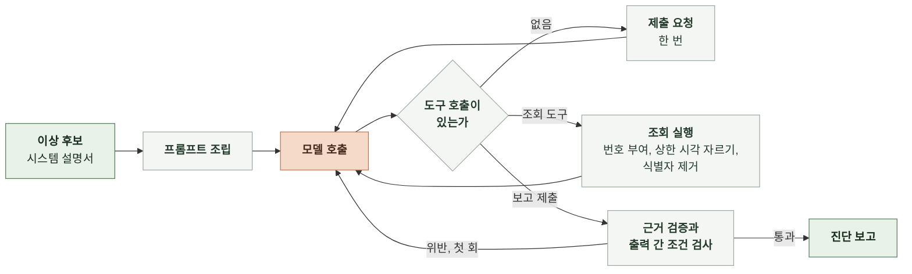

# 6-1 AI 실행

이 문서는 진단 한 건의 모델 설정, 프롬프트 조립, 도구 정의, 응답 검사와 최종 출력을 정한다.

조회 순서와 모델과 코드의 책임은 4-1 인지 구조에, 보고 필드는 5 계약에, 오류의 복구는 7-1 오류 처리에 있다. ([4-1-3 진단 전략](4-1-DESIGN-COGNITIVE-ARCHITECTURE.md#4-1-3-진단-전략), [4-1-4 모델과 코드의 책임](4-1-DESIGN-COGNITIVE-ARCHITECTURE.md#4-1-4-모델과-코드의-책임), [5-5 진단 보고](5-CONTRACT.md#5-5-진단-보고), [7-1 오류 처리](7-1-ERROR-HANDLING.md))

<br>

### 6-1-1 실행 흐름



모델이 도구 호출 없이 글만 돌려주면 보고 제출 도구를 쓰라고 한 번 요청한다. 두 번째에도 제출하지 않으면 실행 실패다.

<br>

### 6-1-2 모델과 호출 설정

| 항목 | 값 |
|---|---|
| 모델 | `claude-opus-5-5` |
| 추론 강도 | `medium` |
| 출력 토큰 한도 | 16,000 |
| 도구 선택 | 자동. 제출은 프롬프트 지시로 유도함 |
| 프롬프트 캐시 | 시스템 프롬프트와 도구 정의 뒤에 캐시 경계 하나 |
| 스트리밍 | 사용 안 함 |

모델 식별자와 추론 강도는 환경 변수로 바꿀 수 있다. 폴백 모델은 없다.

<br>

### 6-1-3 입력 전처리

| 대상 | 처리 |
|---|---|
| 시스템 설명서 | YAML을 읽어 구성 요소마다 한 줄 텍스트로 바꿈. 지표 차원처럼 모델이 쓰지 않는 필드는 뺌<br>형식: `- <name> (<kind>, 상위 <parent>): capacity ..., scaling ..., <description>` |
| 지연 기준 | `- <trace_group>: p95 <p95_seconds>초` 한 줄씩 |
| 이상 후보 | 신호마다 `- <type> <target>: 첫 시각 <first_at>, 최댓값 <peak_value><unit>, 기준 <threshold><unit>` 한 줄씩 |
| 시각 | UTC ISO 8601 그대로. 변환하지 않음 |

<br>

### 6-1-4 프롬프트

시스템 프롬프트, 도구 정의, 사용자 메시지 순서로 조립한다. 시스템 프롬프트는 이상 후보와 무관하게 같은 내용이라 캐시된다.

**1. 시스템 프롬프트**

```text
너는 마냑 서비스의 장애 진단 담당자다. 코드가 관측 자료에서 이상 후보를 열면 너는 조회 도구로 자료를 확인해 장애인지 판정하고 원인과 조치를 보고한다.

## 시스템 설명서
아래는 운영자가 관리하는 구성 요소와 설계값이다. 동시성 상한, 확장 정책, 지연 기준은 관측 자료에 없으므로 이 설명서로 대조한다.
{system_description}

## 지연 기준
요청 경로별 1분 p95 기준이다. 이 기준을 넘거나 요청이 실패한 구간이 장애다.
{latency_slo}

## 진단 방법
1. 증상: 진입 스팬 이름별 지연과 실패율을 조회해 영향 범위와 첫 이상 시각을 정한다.
2. 분해: 영향받은 진입 스팬의 하위 스팬과 DB 쿼리문별 시간을 조회해 시간이 쌓인 곳을 찾는다.
3. 자원: 그곳을 맡은 구성 요소의 CPU, 메모리, 연결 수를 조회한다. 자원에 여유가 있는데 대기가 길면 설명서의 상한을 의심한다. 자원이 찼으면 확장을 본다.
4. 확장: 확장과 경보 이력을 조회해 확장이 일어났는지, 안 일어났다면 설명서의 조건 중 무엇 때문인지 본다.
5. 반증: 다른 구성 요소가 정상이었다는 관찰을 하나 이상 확보한다.
앞 단계에서 원인이 분명하면 뒤 단계를 줄여도 된다. 조회는 25회까지다.

## 보고 규칙
- 판정은 incident, not_incident, undetermined 중 하나다. 지연 기준 초과나 실패가 자료로 확인될 때만 incident다. 부하가 높아도 기준 안이면 not_incident다. 자료가 비어 있거나 모순되어 정할 수 없으면 undetermined다.
- 의심 구성 요소는 설명서의 name을 그대로 쓴다. 가능성이 높은 순서로 1~3개다.
- 원인 가설은 증상이 아니라 메커니즘을 쓴다. "큐가 길다"가 아니라 "동시 실행 4개 상한에 걸려 큐에서 대기한다"처럼 쓴다.
- 근거는 네가 한 조회의 번호와 그 결과에 있는 값만 쓴다. 조회 결과에 없는 수치를 쓰지 않는다.
- 제안 조치는 즉시 완화와 개선 방향으로 나눈다. 조치를 실행하지 않는다.
- 조사가 끝나면 submit_report 도구로 제출한다. 글로 답하지 않는다.
```

<br>

**2. 사용자 메시지**

```text
이상 후보 {candidate_id}가 {opened_at}에 열렸다. 조회할 수 있는 자료는 이 시각까지다.

## 신호
{signals}

조사를 시작해라.
```

<br>

**3. 검사 위반 회신**

보고 검사기가 출력 간 조건 위반을 찾으면 도구 결과로 한 번 돌려보낸다.

```text
제출한 보고가 다음 조건을 어겼다. 고쳐서 다시 제출해라.
{violations}
```

<br>

### 6-1-5 도구 정의

도구 입력은 엄격 모드로 선언해 모델이 스키마 밖 값을 보내지 못하게 한다. 시각 인자는 UTC ISO 8601 문자열이고 `end`가 이상 후보를 연 시각보다 뒤면 코드가 연 시각으로 자른다.

| 도구 | 입력 | 결과 |
|---|---|---|
| `query_metrics` | `component`(설명서의 name), `metric`, `stat`(`Average`, `Maximum`, `Sum`, `p95`), `start`, `end` | 분 단위 `[시각, 값]` 목록 |
| `aggregate_spans` | `group_by`(`name`, `service`, `trace_group`, `db_query`, `minute` 중 1~2개), `filter`(선택. `service`, `name`, `trace_group`, `entry_only`), `start`, `end` | 묶음마다 건수, p50, p95, 최댓값(초), 오류 수. 상위 30개 |
| `aggregate_logs` | `group_by`(`service`, `level`, `event_name`, `endpoint`, `status_code`, `error_code`, `minute` 중 1~2개), `filter`(선택. `service`, `level`, `event_name`), `start`, `end` | 묶음마다 건수와 표본 메시지 최대 5개. 상위 30개 |
| `scaling_history` | `component`, `start`, `end` | 확장 활동과 경보 상태 변화 목록 |
| `submit_report` | 5-5 진단 보고에서 `usage`, `evidence[].verified`, `diagnosed_at`을 뺀 필드 | 통과하면 종료. 위반하면 6-1-4의 회신 |

도구 결과 맨 앞에는 코드가 붙인 조회 번호가 `[query 3]`처럼 들어간다. 결과가 비어 있으면 `결과 없음`으로 돌려주고 오류로 바꾸지 않는다.

<br>

### 6-1-6 응답 검사와 최종 출력

| 순서 | 검사 | 통과하지 못하면 |
|---|---|---|
| 1 | 제출 입력이 스키마에 맞음 | 엄격 모드라 발생하지 않음. 발생하면 실행 실패 |
| 2 | 3-4의 출력 간 조건 | 위반 목록을 회신. 두 번째 위반은 실행 실패 |
| 3 | 근거마다 `query_ref`가 이 진단의 조회 번호이고 `value`가 그 결과에 있음 | `verified`를 거짓으로 표시하고 보고는 그대로 둠 |

통과한 보고에 `diagnosed_at`과 `usage`를 더해 실행 폴더에 쓴다. 대화 전체와 조회 기록은 `queries/` 파일에 남긴다.
