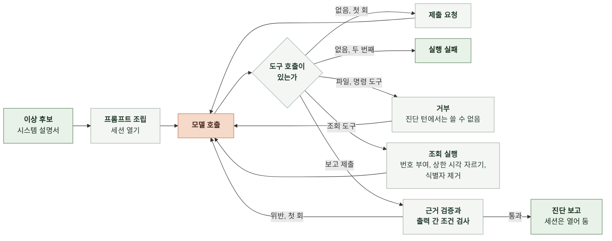

# 6-1 AI 실행

이 문서는 세션의 모델 설정, 프롬프트 조립, 도구 정의와 권한, 진단 턴의 응답 검사, 조율 턴의 진행을 정한다.

조회 순서와 모델과 코드의 책임은 4-1 인지 구조에, 보고와 슬랙 메시지 필드는 5 계약에, 오류의 복구는 7-1 오류 처리에 있다. ([4-1-3 진단 전략](4-1-DESIGN-COGNITIVE-ARCHITECTURE.md#4-1-3-진단-전략), [4-1-4 모델과 코드의 책임](4-1-DESIGN-COGNITIVE-ARCHITECTURE.md#4-1-4-모델과-코드의-책임), [5-5 진단 보고](5-CONTRACT.md#5-5-진단-보고), [5-7 슬랙 메시지](5-CONTRACT.md#5-7-슬랙-메시지), [7-1 오류 처리](7-1-ERROR-HANDLING.md))

<br>

### 6-1-1 진단 턴의 흐름



모델이 도구 호출 없이 글만 돌려주면 보고 제출 도구를 쓰라고 한 번 요청한다. 두 번째에도 제출하지 않으면 실행 실패다. 보고가 통과하면 진단 턴은 끝나고 세션은 조율 턴을 받기 위해 열어 둔다.

<br>

### 6-1-2 모델과 세션 설정

세션은 Claude Agent SDK로 연다. 진단 턴과 조율 턴은 같은 세션 설정을 쓴다.

| 항목 | 값 |
|---|---|
| 모델 | `claude-opus-5-5` |
| 추론 강도 | `medium` |
| 시스템 프롬프트 | 6-1-4의 문자열로 전부 대체. SDK의 기본 프롬프트를 붙이지 않음 |
| 도구 | 조회 도구 5개를 담은 프로세스 안 MCP 서버 `diagnosis`<br>내장 도구 `Read`, `Grep`, `Glob`, `Edit`, `Write`, `Bash` |
| 권한 | 6-1-5의 권한 표. 승인이 필요한 도구는 승인 관문의 콜백이 결정함 |
| 훅 | 도구 호출 전: 진단 턴 동안 내장 도구를 거부함<br>도구 호출 후: 조회 번호와 결과를 기록함 |
| 턴 수 한도 | 진단 턴 30, 조율 턴 20 |
| 세션 비용 한도 | $2.00. SDK의 비용 추정으로 중단하고 기록은 6-1-6의 계산값을 씀 |
| 프롬프트 캐시 | SDK가 자동으로 붙임 |
| 세션 저장 경로 | 환경 변수. 실시간 모드는 영속 볼륨 |

모델 식별자와 추론 강도는 환경 변수로 바꿀 수 있다. 폴백 모델은 없다. 재생 모드는 슬랙이 없으므로 내장 도구를 넣지 않고 진단 턴으로 세션을 끝낸다.

<br>

### 6-1-3 입력 전처리

| 대상 | 처리 |
|---|---|
| 시스템 설명서 | YAML을 읽어 구성 요소마다 한 줄 텍스트로 바꿈. 지표 차원처럼 모델이 쓰지 않는 필드는 뺌<br>형식: `- <name> (<kind>, 상위 <parent>): capacity ..., scaling ..., <description>` |
| 지연 기준 | `- <trace_group>: p95 <p95_seconds>초` 한 줄씩 |
| 이상 후보 | 신호마다 `- <type> <target>: 첫 시각 <first_at>, 최댓값 <peak_value><unit>, 기준 <threshold><unit>` 한 줄씩 |
| 운영자 메시지 | 슬랙 스레드의 원문 그대로 |
| 시각 | UTC ISO 8601 그대로. 변환하지 않음 |

<br>

### 6-1-4 프롬프트

시스템 프롬프트, 도구 정의, 사용자 메시지 순서로 조립한다. 시스템 프롬프트는 이상 후보와 무관하게 같은 내용이다.

**1. 시스템 프롬프트**

```text
너는 마냑 서비스의 장애 진단 담당자다. 코드가 관측 자료에서 이상 후보를 열면 너는 조회 도구로 자료를 확인해 장애인지 판정하고 원인과 조치를 보고한다. 보고 뒤에는 운영자가 슬랙 스레드에서 묻거나 시키는 일에 같은 대화에서 답한다.

## 시스템 설명서
아래는 운영자가 관리하는 구성 요소와 설계값이다. 동시성 상한, 확장 정책, 지연 기준은 관측 자료에 없으므로 이 설명서로 대조한다.
{system_description}

## 지연 기준
요청 경로별 1분 p95 기준이다. 이 기준을 넘거나 요청이 실패한 구간이 장애다.
{latency_slo}

## 진단 방법
1. 증상: 진입 스팬 이름별 지연과 실패율을 조회해 영향 범위와 첫 이상 시각을 정한다.
2. 분해: 영향받은 진입 스팬의 하위 스팬과 DB 쿼리문별 시간을 조회해 시간이 쌓인 곳을 찾는다.
3. 자원: 그곳을 맡은 구성 요소의 CPU, 메모리, 연결 수를 조회한다. 자원에 여유가 있는데 대기가 길면 설명서의 상한을 의심한다. 자원이 찼으면 확장을 본다.
4. 확장: 확장과 경보 이력을 조회해 확장이 일어났는지, 안 일어났다면 설명서의 조건 중 무엇 때문인지 본다.
5. 반증: 다른 구성 요소가 정상이었다는 관찰을 하나 이상 확보한다.
앞 단계에서 원인이 분명하면 뒤 단계를 줄여도 된다. 조회는 25회까지다. 보고를 제출하기 전에는 파일과 명령 도구를 쓰지 않는다.

## 보고 규칙
- 판정은 incident, not_incident, undetermined 중 하나다. 지연 기준 초과나 실패가 자료로 확인될 때만 incident다. 부하가 높아도 기준 안이면 not_incident다. 자료가 비어 있거나 모순되어 정할 수 없으면 undetermined다.
- 의심 구성 요소는 설명서의 name을 그대로 쓴다. incident는 가능성이 높은 순서로 1~3개, undetermined는 0~3개, not_incident는 없음이다.
- 원인 가설은 증상이 아니라 메커니즘을 쓴다. "큐가 길다"가 아니라 "동시 실행 4개 상한에 걸려 큐에서 대기한다"처럼 쓴다.
- 근거는 네가 한 조회의 번호와 그 결과에 있는 값만 쓴다. 조회 결과에 없는 수치를 쓰지 않는다.
- 제안 조치는 즉시 완화와 개선 방향으로 나눈다. 조치를 실행하지 않는다.
- 조사가 끝나면 submit_report 도구로 제출한다. 글로 답하지 않는다.

## 조율 규칙
보고를 제출한 뒤 운영자가 스레드에 쓰는 메시지에 답한다.
- 답은 이 대화의 조회 결과와 보고를 근거로 한다. 새로 확인할 게 있으면 조회 도구를 쓴다.
- 저장소를 고치라는 지시는 설정값 변경만 한다. 대상은 manyak-server와 manyak-ai의 application 설정, manyak-terraform의 변수와 오토스케일링 정책이다. 코드 로직을 고쳐야 하면 고치지 않고 어떤 파일의 무엇을 어떻게 바꿔야 하는지 적어 운영자에게 넘긴다.
- 파일 수정, 파일 생성, 명령 실행은 호출마다 운영자 승인을 받는다. 거부되면 다른 방법으로 우회하지 말고 거부된 사실과 남은 선택지를 적는다.
- 수정은 새 브랜치에 커밋하고 push한 뒤 PR을 연다. PR 본문에 진단 요약, 근거, 변경 내용과 이유, 스레드 링크, 보고 파일 ID를 넣는다. 머지하지 않는다.
- 답은 슬랙에 올라가므로 짧게 쓴다. 식별자와 비밀값을 쓰지 않는다.
```

<br>

**2. 진단 턴의 사용자 메시지**

```text
이상 후보 {candidate_id}가 {opened_at}에 열렸다. 조회할 수 있는 자료는 이 시각까지다.

## 신호
{signals}

조사를 시작해라.
```

<br>

**3. 검사 위반 회신**

보고 검사기가 출력 간 조건 위반을 찾으면 도구 결과로 한 번 돌려보낸다.

```text
제출한 보고가 다음 조건을 어겼다. 고쳐서 다시 제출해라.
{violations}
```

<br>

**4. 조율 턴의 사용자 메시지**

운영자 메시지 원문을 그대로 보낸다. 세션에 앞선 대화가 있으므로 이상 후보나 보고를 다시 붙이지 않는다.

<br>

### 6-1-5 도구 정의와 권한

조회 도구와 제출 도구는 프로세스 안 MCP 서버 `diagnosis`에 둔다. 모델이 보는 이름은 `mcp__diagnosis__<도구>`다. 입력은 JSON Schema로 선언한다. 시각 인자는 UTC ISO 8601 문자열이고 `end`가 이상 후보를 연 시각보다 뒤면 코드가 연 시각으로 자른다.

| 도구 | 입력 | 결과 |
|---|---|---|
| `query_metrics` | `component`(설명서의 name), `metric`, `stat`(`Average`, `Maximum`, `Sum`, `p95`), `start`, `end` | 분 단위 `[시각, 값]` 목록 |
| `aggregate_spans` | `group_by`(`name`, `service`, `trace_group`, `db_query`, `minute` 중 1~2개), `filter`(선택. `service`, `name`, `trace_group`, `entry_only`), `start`, `end` | 묶음마다 건수, p50, p95, 최댓값(초), 오류 수. 상위 30개 |
| `aggregate_logs` | `group_by`(`service`, `level`, `event_name`, `endpoint`, `status_code`, `error_code`, `minute` 중 1~2개), `filter`(선택. `service`, `level`, `event_name`), `start`, `end` | 묶음마다 건수와 표본 메시지 최대 5개. 상위 30개 |
| `scaling_history` | `component`, `start`, `end` | 확장 활동과 경보 상태 변화 목록 |
| `submit_report` | 5-5 진단 보고에서 `usage`, `evidence[].verified`, `diagnosed_at`을 뺀 필드 | 통과하면 종료. 위반하면 6-1-4의 회신 |

도구 결과 맨 앞에는 코드가 붙인 조회 번호가 `[query 3]`처럼 들어간다. 결과가 비어 있으면 `결과 없음`으로 돌려주고 오류로 바꾸지 않는다.

| 도구 | 진단 턴 | 조율 턴 | 허용 범위 |
|---|---|---|---|
| `diagnosis` 서버의 조회 도구 4개 | 자동 허용 | 자동 허용 | 상한 시각까지의 관측 자료 |
| `submit_report` | 자동 허용 | 거부 | |
| `Read`, `Grep`, `Glob` | 거부 | 자동 허용 | 저장소 작업 공간 안 |
| `Edit`, `Write` | 거부 | 운영자 승인 | 저장소 작업 공간 안 |
| `Bash` | 거부 | 운영자 승인 | 저장소 작업 공간을 현재 폴더로 실행. 환경에 관측 자격 없음 |

거부는 도구 결과로 "이 턴에서는 쓸 수 없는 도구"라고 돌려주고 턴을 끊지 않는다.

<br>

### 6-1-6 응답 검사와 최종 출력

| 순서 | 검사 | 통과하지 못하면 |
|---|---|---|
| 1 | 제출 입력이 스키마에 맞음 | 실행 실패 |
| 2 | 3-4의 출력 간 조건 | 위반 목록을 회신. 두 번째 위반은 실행 실패 |
| 3 | 근거마다 `query_ref`가 이 진단의 조회 번호이고 `value`가 그 결과에 있음 | `verified`를 거짓으로 표시하고 보고는 그대로 둠 |

통과한 보고에 `diagnosed_at`과 `usage`를 더해 실행 폴더에 쓴다. `usage`의 토큰은 SDK 결과 메시지의 사용량이고 비용은 토큰에 단가표를 곱한 값이다. SDK의 비용 추정값은 쓰지 않는다. 진단 턴의 메시지와 조회 기록은 `queries/` 파일에 남긴다.

<br>

### 6-1-7 조율 턴

| 단계 | 내용 |
|---|---|
| 시작 | 스레드의 운영자 메시지를 세션 ID로 이어 보냄 |
| 조회 | 조회 도구는 진단 턴과 같은 상한 시각으로 실행함. 조회 번호는 세션 안에서 이어서 붙임 |
| 쓰기 도구 | `Edit`, `Write`, `Bash` 호출마다 승인 관문이 승인 메시지를 올리고 응답을 기다림. 승인이면 실행, 거부와 2시간 초과면 거부를 도구 결과로 돌려줌 |
| 끝 | 모델의 마지막 글을 스레드에 올림. 세션 누적 비용을 갱신함 |
| PR | 조율 턴 안에서 PR 생성 명령이 성공하면 PR 주소를 기록하고 스레드에 올림 |

조율 턴에는 응답 검사가 없다. 모델의 글이 그대로 답변이다.
