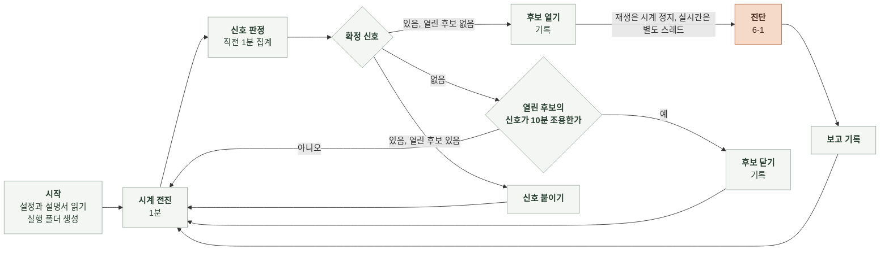

# 6-2 소프트웨어 구현

이 문서는 에이전트의 실행 흐름, 자료 준비와 변환, 조회 구현, 결과 저장과 공통 구현 규칙을 정한다.

구성 요소의 책임은 4-2 소프트웨어 설계에, 자료 원천의 필드는 5 계약에, 모델 호출은 6-1 AI 실행에 있다. ([4-2-3 구성 요소](4-2-DESIGN-SOFTWARE-ARCHITECTURE.md#4-2-3-구성-요소), [5-2 자료 원천](5-CONTRACT.md#5-2-자료-원천), [6-1-5 도구 정의](6-1-AI-EXECUTION.md#6-1-5-도구-정의))

에이전트는 별도 저장소 `manyak-diagnosis`의 Python 명령줄 프로그램이다. 모델 호출은 Anthropic SDK의 도구 실행기로 하고 OpenSearch는 HTTP 클라이언트로, CloudWatch와 Application Auto Scaling은 AWS SDK로 읽는다.

 

### 6-2-1 실행 흐름

재생 모드는 구간 끝에서 멈추고 실시간 모드는 종료 신호를 받을 때까지 돈다. 재생 모드에서 진단하는 동안 시계는 멈추고, 실시간 모드에서는 진단을 같은 프로세스의 별도 스레드로 돌려 감시를 이어 간다.

 

### 6-2-2 자료 준비

**1. 재생용 OpenSearch**

| 단계 | 내용 |
|---|---|
| 기동 | Docker로 OpenSearch 단일 노드. 보안 플러그인은 켠 채 관리자 비밀번호를 환경 변수로 줌 |
| 적재 | 보관한 gzip NDJSON을 줄 단위로 읽어 벌크 색인. 인덱스 이름은 보관 당시 이름 그대로 |
| 매핑 | 로그는 `@timestamp`를 날짜로, 스팬은 `startTime`과 `endTime`을 날짜로, `durationInNanos`를 정수로, 묶음에 쓰는 문자열 필드는 keyword로 둠 |
| 확인 | 인덱스별 문서 수가 내보낼 때의 건수와 같은지 비교 |

**2. 지표와 이력 파일**

보관 파일을 시작 때 메모리에 올린다. 지표는 `label`을 키로 시각 오름차순 목록으로 두고, 확장 활동과 경보 이력은 시각 오름차순 목록으로 둔다.

 

### 6-2-3 조회 구현

조회는 모두 상한 시각을 받는다. 상한 시각은 재생 모드에서는 감시 시각, 진단 중에는 이상 후보를 연 시각이다.

| 조회 | 재생 | 실시간 |
|---|---|---|
| 스팬 집계 | 스팬 인덱스에 `startTime` 범위와 필터를 걸고 묶음 필드별 terms 집계 안에 건수, `durationInNanos` 백분위(50, 95, 100), `status.code`가 2인 건수를 둠. 결과의 나노초는 초로 바꿈 | 같음. 대상이 loadtest OpenSearch |
| 로그 집계 | 로그 인덱스에 `@timestamp` 범위와 필터를 걸고 terms 집계 안에 건수와 `message` 상위 5건 | 같음 |
| 지표 조회 | 메모리의 목록에서 범위를 잘라 돌려줌 | 지표 조회 API를 1분 주기로 호출 |
| 확장과 경보 이력 | 메모리의 목록에서 범위를 잘라 돌려줌 | 확장 활동과 경보 이력 API 호출 |

| 변환 | 규칙 |
|---|---|
| 구성 요소 이름 → 조회 조건 | 시스템 설명서의 `log_service`, `span_service`, `metric_dimensions`로 바꿈. 없는 필드를 요구하는 조회는 `결과 없음` |
| 진입 스팬 | `parentSpanId`가 비어 있는 스팬 |
| 식별자 제거 | 로그 표본 메시지에서 `device_id_hash`, `session_id`, `request_id` 값을 뺌. 원본 필드는 조회 자체에서 요청하지 않음 |
| 결과 크기 | 묶음은 건수 내림차순 상위 30개. 지표는 범위를 1시간으로 자름 |

탐지기도 같은 조회를 쓴다. 탐지기는 직전 1분만 범위로 잡고 진입 스팬 이름별, 대기 스팬, 서비스별 ERROR, 구성 요소별 자원 지표를 한 번에 가져온다.

 

### 6-2-4 진단 실행

| 단계 | 내용 |
|---|---|
| 조립 | 6-1의 전처리와 프롬프트로 시스템 프롬프트와 사용자 메시지를 만듦 |
| 루프 | SDK 도구 실행기에 조회 도구 네 개와 제출 도구를 넘김. 도구 함수가 상한 시각을 닫힌 변수로 들고 있음 |
| 조회 기록 | 도구 함수가 호출될 때마다 번호를 올리고 인자와 결과를 `queries/` 파일에 바로 씀 |
| 제출 | 제출 도구 함수가 보고 검사기를 부름. 위반이면 회신 문자열을 도구 결과로 돌려주고 루프를 계속함. 통과면 보고를 보관하고 루프 종료를 표시함 |
| 예산 | 조회 25회째 결과 뒤에 제출 요청 문자열을 붙임. 시작 후 5분이 지나면 루프를 끊음 |
| 사용량 | 루프가 돌려준 메시지마다 입력, 출력, 캐시 읽기 토큰을 더하고 단가표로 비용을 계산함 |

제출 도구는 모델 쪽에서 보면 결과를 돌려주는 보통 도구다. 종료는 도구 함수가 세운 표시를 루프 밖에서 보고 결정한다.

 

### 6-2-5 결과 저장

| 파일 | 쓰는 방식 |
|---|---|
| `run.json` | 시작 때 한 번. 프롬프트 해시는 시스템 프롬프트 원문의 SHA-256 |
| `candidates.jsonl` | 열 때 한 줄 추가. 신호가 붙거나 최댓값이 바뀔 때, 닫을 때, 열린 채 실행이 끝날 때 같은 ID의 현재 상태를 한 줄 추가 |
| `reports/<candidate_id>.json` | 진단 끝에 한 번 |
| `queries/<candidate_id>.jsonl` | 모델 메시지와 조회마다 한 줄 추가 |
| `failures.jsonl` | 실행 실패 때 한 줄 추가 |

파일은 추가만 하고 고쳐 쓰지 않는다. 같은 `candidate_id`의 보고가 이미 있으면 덮어쓰지 않고 실행 실패로 기록한다.

 

### 6-2-6 공통 규칙

| 규칙 | 내용 |
|---|---|
| 읽기 전용 | OpenSearch는 검색 API만 호출함. AWS 자격 증명은 읽기 권한만 가진 것을 씀 |
| 비밀값 | 환경 변수로만 받음. 로그, 실행 폴더, 예외 메시지에 쓰지 않음 |
| 시각 | 내부는 UTC `datetime`. 파일에는 ISO 8601 문자열 |
| 설정 | 모델, 추론 강도, 예산은 환경 변수로 바꿀 수 있음. 바뀐 값은 `run.json`에 남김 |
| 실패 전파 | 조회와 모델 호출의 예외는 진단 실행기까지 올려 실행 실패로 기록함. 코드가 판정을 대신 만들지 않음 |
| 운영과 평가 공유 | 채점기는 실행 폴더만 읽음. 진단 코드를 평가용으로 복제하지 않음 |
