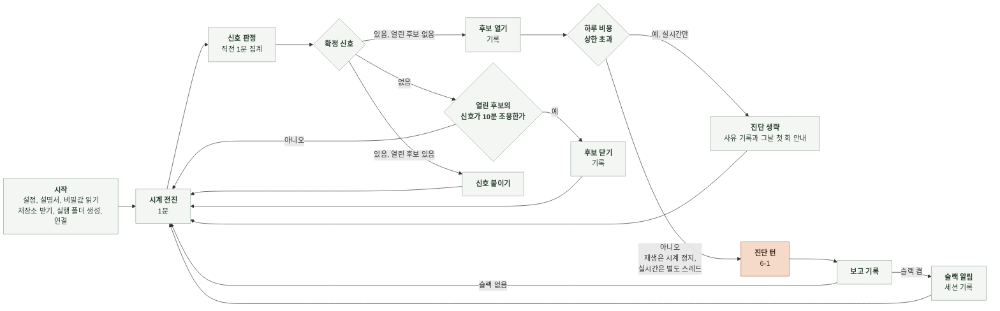
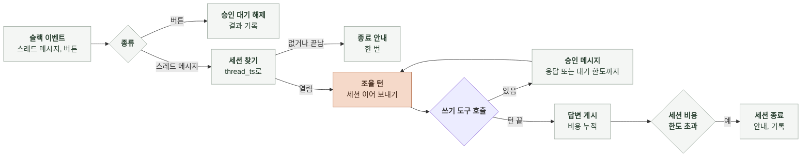

# 6-2 소프트웨어 구현

이 문서는 에이전트의 실행 흐름, 설정 읽기와 시작 검사, 자료 준비와 변환, 조회 구현, 세션과 슬랙 처리, 저장소 작업, 결과 저장과 공통 구현 규칙을 정한다.

구성 요소의 책임은 4-2 소프트웨어 설계에, 설정 항목, 자료 원천, 파일 형식은 5 계약에, 모델 호출과 도구 권한은 6-1 AI 실행에 있다. ([4-2-3 구성 요소](4-2-DESIGN-SOFTWARE-ARCHITECTURE.md#4-2-3-구성-요소), [5-2 설정 파일](5-CONTRACT.md#5-2-설정-파일), [5-3 자료 원천](5-CONTRACT.md#5-3-자료-원천), [5-7 실행 폴더](5-CONTRACT.md#5-7-실행-폴더), [6-1-2 모델과 세션 설정](6-1-AI-EXECUTION.md#6-1-2-모델과-세션-설정), [6-1-5 도구 정의와 권한](6-1-AI-EXECUTION.md#6-1-5-도구-정의와-권한))

에이전트는 별도 저장소 `manyak-diagnosis`의 Python 프로그램이다. 모델 호출은 Claude Agent SDK의 `ClaudeSDKClient`로 연 세션으로 한다. Python SDK에서 권한 콜백을 쓰려면 스트리밍 입력이 필요해서 한 번 묻고 끝나는 호출 방식은 쓰지 않는다. 조회 도구는 같은 프로세스 안의 MCP 서버로 등록한다. OpenSearch는 HTTP 클라이언트로, CloudWatch, Application Auto Scaling, Secrets Manager, Parameter Store는 AWS SDK로 읽는다. 슬랙은 소켓 모드 클라이언트로, 코드 저장소는 git과 GitHub API로 다룬다.

 

### 6-2-1 실행 흐름

재생 모드는 구간 끝에서 감시를 멈춘다. 슬랙을 켜지 않았으면 바로 끝난다. 슬랙을 켰으면 운영자가 멈출 때까지 슬랙 이벤트를 받는다. 실시간 모드는 종료 신호를 받을 때까지 돈다. 재생 모드에서 진단하는 동안 시계는 멈추고, 실시간 모드에서는 진단을 같은 프로세스의 별도 스레드로 돌려 감시를 이어 간다. 슬랙을 켠 실행은 감시 루프와 별개로 슬랙 이벤트를 받는 루프를 돌린다(6-2-6).

 

### 6-2-2 설정 읽기와 시작 검사

| 순서 | 단계 | 할 일 | 검사 |
|---|---|---|---|
| 1 | 위치 확인 | 환경 변수에서 설정 위치 `DIAG_CONFIG`와 비밀값 출처 `DIAG_SECRET_ID`, `DIAG_SECRETS_FILE`을 읽음 | 설정 위치가 있음 비밀값 출처가 정확히 하나 |
| 2 | 설정 파일 | 위치가 `ssm:`이면 Parameter Store 파라미터 값을 YAML로 읽음 그 밖에는 파일을 YAML로 읽음 Parameter Store를 부르는 지역은 `DIAG_AWS_REGION`이나 코드 기본값 | 읽을 수 있음 최상위가 YAML 객체임 5-2와 5-3 표에 없는 키가 없음 |
| 3 | 덮어쓰기 | `DIAG_`로 시작하는 환경 변수를 5-2의 이름 규칙으로 키에 대응시켜 값을 바꿈. 1단계의 세 변수는 건너뜀 | 대응하는 키가 있음 키의 타입으로 바뀜 |
| 4 | 기본값 | 값이 없는 키에 코드 기본값을 채움. `log_samples`의 기본값은 실행 모드로 정함 | |
| 5 | 필수 항목 | 5-2 표에서 필수인 항목과 실행 조건에 따라 필수인 항목을 확인함 | 빠진 항목이 없음 |
| 6 | 시스템 설명서 | `system_description` 위치에서 YAML을 읽음. 위치 형식은 2단계와 같음 | 5-4의 필수 필드가 있음 |
| 7 | 비밀값 | 출처에서 비밀값을 읽어 코드의 변수에 둠 | 읽을 수 있음 실행에 필요한 키가 있음 |

검사에 걸리면 시작 검사 실패다. 설정은 시작 때 한 번 읽고 실행 중에 다시 읽지 않는다. 적용한 설정 값과 덮어쓴 환경 변수 이름은 실행 폴더를 만들 때 `run.json`에 쓴다.

 

### 6-2-3 자료 준비

**1. 재생용 OpenSearch**

| 단계 | 내용 |
|---|---|
| 기동 | Docker로 OpenSearch 단일 노드. 보안 플러그인은 켠 채 관리자 비밀번호를 환경 변수로 줌 |
| 적재 | 보관한 gzip NDJSON을 줄 단위로 읽어 벌크 색인. 인덱스 이름은 보관 당시 이름 그대로 |
| 매핑 | 로그는 `fields.log.timestamp`를 날짜로, 스팬은 `fields.span.start_time`과 `fields.span.end_time`을 날짜로, `fields.span.duration`을 정수로, 묶음에 쓰는 문자열 필드는 keyword로 둠 |
| 확인 | 인덱스별 문서 수가 내보낼 때의 건수와 같은지 비교 |

**2. 지표와 이력 파일**

보관 파일을 시작 때 메모리에 올린다. 지표는 `label`을 키로 시각 오름차순 목록으로 두고, 확장 활동과 경보 이력은 시각 오름차순 목록으로 둔다.

 

### 6-2-4 조회 구현

조회는 모두 상한 시각을 받는다. 상한 시각은 재생 모드에서는 감시 시각, 세션 안에서는 이상 후보를 연 시각이다.

| 조회 | 재생 | 실시간 |
|---|---|---|
| 스팬 집계 | 스팬 인덱스에 `fields.span.start_time` 범위와 필터를 걸고 묶음 필드별 terms 집계 안에 건수, `fields.span.duration` 백분위(50, 95, 100), `fields.span.status_code`가 2인 건수를 둠. 결과는 `fields.span.duration_unit`에 맞춰 초로 바꿈 | 같음. 대상이 운영 OpenSearch이고 읽기 전용 사용자로 질의함 |
| 로그 집계 | 로그 인덱스에 `fields.log.timestamp` 범위와 필터를 걸고 terms 집계 안에 건수를 둠 `log_samples`가 참이면 `fields.log.message` 상위 5건을 더함 `log_samples`가 거짓이면 그 필드를 질의에서 요청하지 않음 | 같음 |
| 지표 조회 | 메모리의 목록에서 범위를 잘라 돌려줌 | 운영 CloudWatch 지표 조회 API를 1분 주기로 호출 |
| 확장과 경보 이력 | 메모리의 목록에서 범위를 잘라 돌려줌 | 운영 확장 활동과 경보 이력 API 호출 |

| 변환 | 규칙 |
|---|---|
| 구성 요소 이름 → 조회 조건 | 시스템 설명서의 `log_service`, `span_service`, `metric_dimensions`로 바꿈. 없는 필드를 요구하는 조회는 `결과 없음` |
| 진입 스팬 | `fields.span.parent_span_id`가 비어 있는 스팬 |
| 대기 스팬 | 이름이 `detection.queue_spans`에 있는 스팬 |
| 식별자 제거 | `redact_fields`에 적은 필드의 값을 로그 표본 메시지에서 뺌. 그 필드는 조회 자체에서 요청하지 않음 |
| 결과 크기 | 묶음은 건수 내림차순 상위 30개. 지표는 범위를 1시간으로 자름 |

탐지기도 같은 조회를 쓴다. 탐지기는 직전 1분만 범위로 잡고 진입 스팬 이름별, 대기 스팬, 서비스별 ERROR, 구성 요소별 자원 지표를 한 번에 가져온다.

 

### 6-2-5 진단 턴

| 단계 | 내용 |
|---|---|
| 시작 조건 | 실시간 모드에서 그날 하루 비용 누적이 상한 이상이면 진단 턴을 열지 않음. `skip_reason`을 채운 후보 줄을 쓰고 그날 첫 생략이면 채널 안내를 올림 |
| 코드 사본 | 실시간 모드는 진단 턴을 열기 전에 코드 사본을 최신으로 맞춤(6-2-7) |
| 세션 열기 | 6-1-2의 설정으로 `ClaudeSDKClient`를 만듦. 진단 턴 클라이언트에만 SDK 비용 한도를 걺. 조회 도구 함수가 상한 시각을 닫힌 변수로 들고 있음. 세션 저장 경로는 `session_dir` |
| 조립 | 6-1의 전처리와 프롬프트로 시스템 프롬프트와 첫 사용자 메시지를 만듦 |
| 턴 전 훅 | 보고가 제출되기 전이면 `Read`, `Grep`, `Glob`은 코드 사본 안 경로만 통과시키고 `Edit`, `Write`, `Bash`는 거부함. 거부 이유를 도구 결과로 돌려줌 |
| 조회 기록 | 조회 도구 함수가 호출될 때마다 번호를 올리고 인자와 결과를 `queries/` 파일에 바로 씀 |
| 제출 | 제출 도구 함수가 보고 검사기를 부름. 보고 검사기는 코드 근거를 코드 사본의 파일로 확인함. 위반이면 회신 문자열을 도구 결과로 돌려주고 턴을 계속함. 통과면 보고를 보관하고 제출됐다는 표시를 세움 |
| 예산 | `limits.queries`번째 조회 결과 뒤에 제출 요청 문자열을 붙임 시작 후 `limits.diagnosis_seconds`가 지나면 코드가 클라이언트를 중단시킴 SDK가 비용 한도 도달로 끝나면 실행 실패 |
| 사용량 | 결과 메시지의 `usage`에서 입력, 출력, 캐시 읽기 토큰을 읽고 단가표로 비용을 계산함. 비용을 하루 누적에 더함 |
| 세션 ID | 결과 메시지의 세션 ID를 보관해 슬랙 알림과 함께 `sessions.jsonl`에 씀 |

제출 도구는 모델 쪽에서 보면 결과를 돌려주는 보통 도구다. 모델이 제출 뒤에도 글을 이어 쓰면 그 글은 버리고 보고만 쓴다.

 

### 6-2-6 슬랙과 조율 턴

| 처리 | 내용 |
|---|---|
| 알림 | 보고 기록 직후 5-8의 알림 메시지를 채널에 올리고 응답의 `thread_ts`를 세션 ID와 함께 `sessions.jsonl`에 씀 |
| 스레드 메시지 | 봇 사용자 ID의 메시지는 버림. 사람 메시지는 `thread_ts`로 세션을 찾아 6-1-4 형식의 조율 턴 사용자 메시지로 보냄 |
| 조율 턴 열기 | 세션 ID로 이어 여는 `ClaudeSDKClient`를 만듦. SDK 비용 한도는 걸지 않음 |
| 세션 없음 | `sessions.jsonl`에 짝이 없거나 `closed_at`이 있으면 종료 안내를 한 번 올리고 같은 스레드의 다음 메시지는 무시함 |
| 승인 콜백 | `can_use_tool` 콜백 안에서 5-8의 승인 메시지를 스레드에 올리고 버튼 응답을 기다림. 응답이나 `limits.approval_wait_seconds` 초과로 결정이 나면 `approvals.jsonl`에 쓰고 허용 또는 거부를 돌려줌 결정을 미루는 `defer` 응답은 쓰지 않음. 대기는 콜백 안에만 있어 프로세스가 다시 시작하면 사라짐 대기 중인 승인이 없는 버튼 응답은 무시함 |
| 답변 | 결과 메시지의 글을 스레드에 올림. 비어 있으면 올리지 않음 |
| 비용 | 턴이 끝날 때 결과 메시지의 사용량으로 계산한 비용을 세션 누적과 하루 누적에 더하고 `sessions.jsonl`에 씀. 세션 누적이 `limits.session_usd`를 넘으면 종료 안내를 올리고 `closed_at`을 씀 |
| 세션 수명 | 실시간: 후보 관리자가 이상 후보를 닫은 시각에서 `limits.session_lifetime_hours`가 지나면 세션 관리자가 `closed_at`을 씀 재생: 프로세스를 멈출 때 열린 세션에 `closed_at`을 씀 |
| 다시 시작 | 다시 시작한 프로세스는 이전 실행의 세션, 세션과 스레드의 짝, 승인 대기를 이어 받지 않음. 열려 있던 스레드에 안내를 올리지 않고 그 스레드의 다음 메시지는 세션 없음으로 처리함 |

조율 턴은 세션마다 차례로 돈다. 같은 스레드에 메시지가 연달아 오면 앞 턴이 끝난 뒤 다음 메시지를 보낸다.

 

### 6-2-7 저장소 작업 공간

| 단계 | 내용 |
|---|---|
| 코드 사본 | 시작 때 `code_repositories`의 저장소를 `clone_url`에서 작업 폴더로 받고 파일을 읽기 전용으로 둠 재생: 실행 인자로 받은 구간 당시 커밋으로 맞춤 실시간: 진단 턴을 열기 전에 `branch`를 받아 최신 커밋으로 맞춤 |
| 조치 작업 공간 | 슬랙을 켠 실행에서 시작 때 `action_repositories`의 저장소를 작업 폴더에 받음. 조율 턴이 시작할 때 `default_branch`를 최신으로 맞춤 |
| 브랜치와 PR | 모델이 브랜치 생성, 커밋, push, PR 생성을 `Bash`로 함. PR 생성 명령이 성공하면 출력의 PR 주소를 `actions.jsonl`에 쓰고 스레드에 올림 |
| 보호 | 도구 호출 전 훅이 `Bash` 명령을 해석해 그 저장소의 `default_branch`로의 push와 머지 명령을 승인 메시지 없이 거부함. SDK 권한 규칙은 명령 글자를 그대로 비교해 같은 명령의 다른 표기를 놓치므로 이 판단에 쓰지 않음 |

 

### 6-2-8 결과 저장

| 파일 | 쓰는 방식 |
|---|---|
| `run.json` | 시작 때 한 번. 프롬프트 해시는 시스템 프롬프트 원문의 SHA-256 |
| `candidates.jsonl` | 열 때 한 줄 추가. 진단을 생략할 때, 신호가 붙거나 최댓값이 바뀔 때, 닫을 때, 열린 채 실행이 끝날 때 같은 ID의 현재 상태를 한 줄 추가 |
| `reports/<candidate_id>.json` | 진단 끝에 한 번 |
| `queries/<candidate_id>.jsonl` | 진단 턴의 모델 메시지와 조회마다 한 줄 추가. 조율 턴의 조회도 번호를 이어 한 줄 추가 |
| `failures.jsonl` | 실행 실패 때 한 줄 추가. 실시간 모드는 같은 내용을 표준 출력에도 한 줄로 씀 |
| `sessions.jsonl` | 알림을 올릴 때, 비용이 갱신될 때, 세션을 끝낼 때 같은 세션의 현재 상태를 한 줄 추가 |
| `approvals.jsonl` | 승인 결정마다 한 줄 추가 |
| `actions.jsonl` | PR 생성마다 한 줄 추가 |

파일은 추가만 하고 고쳐 쓰지 않는다. 같은 `candidate_id`의 보고가 이미 있으면 덮어쓰지 않고 실행 실패로 기록한다. 조율 턴의 대화 전체는 SDK 세션 파일에 있고 실행 폴더에 복사하지 않는다.

 

### 6-2-9 공통 규칙

| 규칙 | 내용 |
|---|---|
| 관측 읽기 전용 | OpenSearch는 검색 API만 호출함. 실시간 모드는 운영 OpenSearch의 읽기 전용 사용자와 읽기 권한만 가진 태스크 역할을 씀 |
| 비밀값 | 출처가 Secrets Manager면 시작 때 비밀 하나를 읽음 출처가 비밀 파일이면 시작 때 그 파일을 읽음 출처는 실행 모드와 무관함 읽은 값은 코드의 변수로만 들고 프로세스 환경 변수에 두지 않음 로그, 실행 폴더, 스레드, 예외 메시지에 쓰지 않음 |
| AWS 자격 | 실시간 모드는 태스크 역할 자격을 씀. 시작 때 AWS 클라이언트가 자격을 한 번 받은 뒤 ECS가 넣어 주는 자격 주소 변수 `AWS_CONTAINER_CREDENTIALS_RELATIVE_URI`를 프로세스 환경에서 지움. 클라이언트는 받아 둔 주소로 자격을 갱신함 |
| 하위 프로세스 환경 | SDK의 `env` 옵션은 상속한 프로세스 환경 위에 병합되므로 관측 자격은 처음부터 프로세스 환경에 두지 않음 `env`로 더하는 값은 모델 API 키, GitHub 토큰, git 사용자 설정, `CLAUDE_CODE_DISABLE_AUTO_MEMORY=1` `Bash`는 이 환경을 물려받으므로 모델 API 키도 보임. `Bash`는 호출마다 운영자 승인을 거침 |
| 저장소 쓰기 범위 | `action_repositories`의 저장소에 브랜치 push와 PR 생성만. `code_repositories`에만 있는 저장소는 읽기만. 토큰도 이 범위로 한정함 |
| 시각 | 내부는 UTC `datetime`. 파일에는 ISO 8601 문자열 |
| 실패 전파 | 조회와 모델 호출의 예외는 진단 실행기까지 올려 실행 실패로 기록함. 코드가 판정을 대신 만들지 않음 |
| 운영과 평가 공유 | 채점기는 실행 폴더만 읽음. 진단 코드를 평가용으로 복제하지 않음 |
