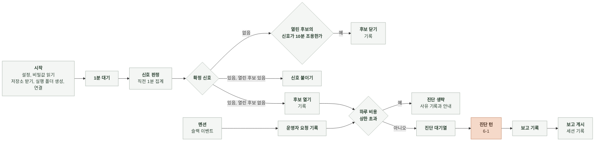
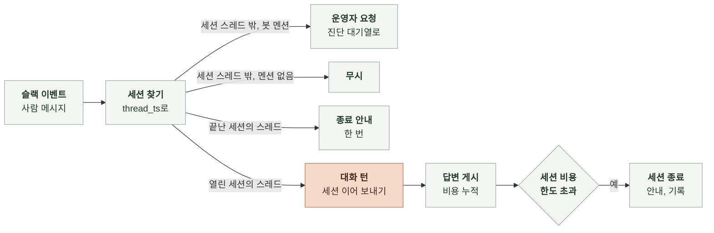

# 6-2 소프트웨어 구현

이 문서는 에이전트의 실행 흐름, 설정 읽기와 시작 검사, 탐지 조회, MCP 서버 실행, 세션과 슬랙 처리, 저장소 사본, 결과 저장과 공통 구현 규칙을 정한다.

구성 요소의 책임은 4-2 소프트웨어 설계에, 설정 항목, 자료 원천, 파일 형식은 5 계약에, 모델 호출과 도구 권한은 6-1 AI 실행에 있다. ([4-2-3 구성 요소](4-2-DESIGN-SOFTWARE-ARCHITECTURE.md#4-2-3-구성-요소), [5-2 설정 파일](5-CONTRACT.md#5-2-설정-파일), [5-3 자료 원천](5-CONTRACT.md#5-3-자료-원천), [5-8 실행 폴더](5-CONTRACT.md#5-8-실행-폴더), [6-1-2 모델과 세션 설정](6-1-AI-EXECUTION.md#6-1-2-모델과-세션-설정), [6-1-5 도구 정의와 권한](6-1-AI-EXECUTION.md#6-1-5-도구-정의와-권한))

에이전트는 별도 저장소 `manyak-diagnosis`의 Python 프로그램이다. 모델 호출은 Claude Agent SDK의 `ClaudeSDKClient`로 연 세션으로 하고 같은 세션에 대화 턴을 이어 보낸다. 외부 MCP 서버는 각 패키지의 고정 버전을 stdio 서버로 등록하고 확장 이력 도구와 보고 제출 도구는 같은 프로세스 안의 MCP 서버로 등록한다. 탐지기의 OpenSearch 질의는 HTTP 클라이언트로, CloudWatch, Application Auto Scaling, Secrets Manager, Parameter Store는 AWS SDK로 읽는다. 슬랙은 소켓 모드 클라이언트로, 코드 저장소는 git으로 다룬다.

 

### 6-2-1 실행 흐름

감시 루프는 1분마다 `1분 대기`부터 다시 돈다. 슬랙 이벤트 루프는 감시 루프와 별개로 돌고 멘션과 스레드 메시지를 받는다(6-2-6). 진단 턴은 대기열에서 하나씩 꺼내 별도 작업으로 돌리므로 진단하는 동안에도 감시와 슬랙 이벤트 처리를 이어 간다. 종료 신호를 받으면 열린 이상 후보를 기록하고 끝난다.

 

### 6-2-2 설정 읽기와 시작 검사

| 순서 | 단계 | 할 일 | 검사 |
|---|---|---|---|
| 1 | 위치 확인 | 환경 변수에서 설정 위치 `DIAG_CONFIG`와 비밀값 출처 `DIAG_SECRET_ID`, `DIAG_SECRETS_FILE`을 읽음 | 설정 위치가 있음 비밀값 출처가 정확히 하나 |
| 2 | 설정 파일 | 위치가 `ssm:`이면 Parameter Store 파라미터 값을 YAML로 읽음 그 밖에는 파일을 YAML로 읽음 Parameter Store를 부르는 지역과 프로필은 `DIAG_AWS_REGION`, `DIAG_AWS_PROFILE`이나 코드 기본값 | 읽을 수 있음 최상위가 YAML 객체임 5-2, 5-3, 5-4 표에 없는 키가 없음 |
| 3 | 덮어쓰기 | `DIAG_`로 시작하는 환경 변수를 5-2의 이름 규칙으로 키에 대응시켜 값을 바꿈. 1단계의 세 변수는 건너뜀 | 대응하는 키가 있음 키의 타입으로 바뀜 |
| 4 | 기본값 | 값이 없는 키에 코드 기본값을 채움 | |
| 5 | 필수 항목 | 5-2와 5-4 표에서 필수인 항목을 확인함 | 빠진 항목이 없음 |
| 6 | 서비스 지도 | 구성 요소 이름의 중복과 저장소 이름을 확인함 | 이름이 겹치지 않음 `repository`와 `paths[]`의 저장소 이름이 `code_repositories`에 있음 |
| 7 | 비밀값 | 출처에서 비밀값을 읽어 코드의 변수에 둠 | 읽을 수 있음 실행에 필요한 키가 있음 |
| 8 | 식별자 차단 | 읽기 사용자로 로그 인덱스와 스팬 인덱스를 최근 문서 하나씩 검색함 | `redact_fields`의 필드가 결과에 없음 |

검사에 걸리면 시작 검사 실패다. 설정은 시작 때 한 번 읽고 실행 중에 다시 읽지 않는다. 적용한 설정 값과 덮어쓴 환경 변수 이름은 실행 폴더를 만들 때 `run.json`에 쓴다.

 

### 6-2-3 탐지 조회와 확장 이력

탐지기와 `scaling_history`는 자료 접근기로 직접 조회한다. 모델이 고르는 조회는 MCP 서버가 하므로 이 절의 질의를 거치지 않는다.

| 조회 | 구현 |
|---|---|
| 스팬 집계 | 스팬 인덱스에 `fields.span.start_time` 범위와 필터를 걸고 묶음 필드별 terms 집계 안에 건수, `fields.span.duration` 백분위(50, 95, 100), `fields.span.status_code`가 2인 건수를 둠. 결과는 `fields.span.duration_unit`에 맞춰 초로 바꿈 |
| 로그 집계 | 로그 인덱스에 `fields.log.timestamp` 범위와 필터를 걸고 terms 집계 안에 건수를 둠 |
| 지표 조회 | CloudWatch 지표 조회 API를 1분 주기로 호출함 |
| 확장 활동 | Application Auto Scaling의 확장 활동 조회 API를 ECS 서비스 대상으로 호출함 |

| 변환 | 규칙 |
|---|---|
| 구성 요소 이름 → 조회 조건 | 서비스 지도의 `log_service`, `span_service`, `metric_dimensions`로 바꿈. 없는 필드를 요구하는 조회는 `결과 없음` |
| 확장 대상 | 서비스는 자기 `metric_dimensions`의 `ClusterName`과 `ServiceName`으로, 오토스케일링은 `parent` 서비스의 값으로 `service/<ClusterName>/<ServiceName>`을 만듦 |
| 진입 스팬 | `fields.span.parent_span_id`가 비어 있는 스팬 |
| 대기 스팬 | 이름이 `detection.queue_spans`에 있는 스팬 |
| 결과 크기 | 묶음은 건수 내림차순 상위 30개 |

탐지기는 직전 1분만 범위로 잡고 진입 스팬 이름별, 대기 스팬, 서비스별 ERROR, 구성 요소별 자원 지표를 한 번에 가져온다.

 

### 6-2-4 MCP 서버 실행

| 항목 | 내용 |
|---|---|
| 등록 | 세션 옵션의 `mcp_servers`에 6-1-5의 서버를 stdio 설정(`command`, `args`, `env`)으로 넣음. `prometheus.workspace_url`이 비어 있으면 `prometheus`를 넣지 않음 |
| 실행 명령 | 각 패키지를 `uvx`로 고정 버전을 지정해 실행함. 버전은 `run.json`에 남김 |
| `opensearch` 환경 | 주소, 읽기 사용자, 비밀번호, 도구 필터, 쓰기 금지 값만 넣음 |
| AWS 서버 환경 | 지역과 자격을 얻는 값만 넣음. 1단계는 `AWS_PROFILE`에 `aws.profile`, 2단계는 ECS가 준 태스크 역할 자격 주소 변수 `AWS_CONTAINER_CREDENTIALS_RELATIVE_URI` |
| 연결 확인 | 세션의 init 메시지에서 등록한 서버의 상태를 봄. 하나라도 `failed`나 `needs-auth`면 진단을 시작하지 않음(7-1) |

 

### 6-2-5 진단 턴

| 단계 | 내용 |
|---|---|
| 시작 조건 | 그날 하루 비용 누적이 상한 이상이면 진단 턴을 열지 않음. `skip_reason`을 채운 요청 줄을 쓰고 5-9의 생략 안내를 올림 |
| 코드 사본 | 진단 턴을 열기 전에 코드 사본을 최신으로 맞춤(6-2-7) |
| 세션 열기 | 6-1-2의 설정으로 `ClaudeSDKClient`를 만듦. 진단 턴 클라이언트에만 SDK 비용 한도를 걺. 세션 저장 경로는 `session_dir` |
| 조립 | 6-1의 전처리와 프롬프트로 시스템 프롬프트와 첫 사용자 메시지를 만듦. 사용자 메시지는 진단 요청의 종류에 맞는 형식 |
| 도구 호출 전 훅 | `Read`, `Grep`, `Glob`의 경로를 실제 경로로 풀어 코드 사본 폴더 안인지 봄. 밖이면 거부함 `opensearch` 서버 도구 입력에 연결 인자가 있으면 거부함 거부 이유를 도구 결과로 돌려줌 |
| 도구 호출 후 훅 | 조회 도구 결과마다 번호를 올리고 결과에 번호를 덧붙임. 번호, 도구, 인자, 결과를 `queries/` 파일에 바로 씀 |
| 제출 | 제출 도구 함수가 보고 검사기를 부름. 보고 검사기는 조회 근거를 `queries/` 기록으로, 코드 근거를 코드 사본의 파일로 확인함. 위반이면 회신 문자열을 도구 결과로 돌려주고 턴을 계속함. 통과면 보고를 보관하고 제출됐다는 표시를 세움 |
| 예산 | `limits.queries`번째 조회 결과 뒤에 제출 요청 문자열을 붙임 시작 후 `limits.diagnosis_seconds`가 지나면 코드가 클라이언트를 중단시킴 SDK가 비용 한도 도달로 끝나면 실행 실패 |
| 사용량 | 결과 메시지의 `usage`에서 입력, 출력, 캐시 읽기 토큰을 읽고 단가표로 비용을 계산함. 비용을 하루 누적에 더함 |
| 세션 ID | 결과 메시지의 세션 ID를 보관해 보고 게시와 함께 `sessions.jsonl`에 씀 |

제출 도구는 모델 쪽에서 보면 결과를 돌려주는 보통 도구다. 모델이 제출 뒤에도 글을 이어 쓰면 그 글은 버리고 보고만 쓴다.

 

### 6-2-6 슬랙과 대화 턴

| 처리 | 내용 |
|---|---|
| 이벤트 | 봇 사용자 ID의 메시지와 `slack.channel` 밖의 메시지는 버림. 사람 메시지의 스레드 키는 스레드 안이면 스레드의 첫 메시지 타임스탬프, 아니면 그 메시지의 타임스탬프 |
| 운영자 요청 | 세션 스레드 밖의 멘션이면 `mentions.jsonl`에 한 줄 쓰고 진단 대기열에 넣음 |
| 보고 게시 | 이상 후보의 보고는 채널에 새 메시지로, 운영자 요청의 보고는 그 스레드에 답글로 올림. 게시 응답의 스레드 키를 세션 ID와 함께 `sessions.jsonl`에 씀 |
| 대화 턴 열기 | 세션 ID로 이어 여는 `ClaudeSDKClient`를 만듦. SDK 비용 한도는 걸지 않음. 6-1-4 형식의 대화 턴 사용자 메시지를 보냄 |
| 끝난 세션 | `sessions.jsonl`의 그 스레드 줄에 `closed_at`이 있으면 종료 안내를 한 번 올리고 같은 스레드의 다음 메시지는 무시함 |
| 답변 | 결과 메시지의 글을 스레드에 올림. 비어 있으면 올리지 않음 |
| 비용 | 턴이 끝날 때 결과 메시지의 사용량으로 계산한 비용을 세션 누적과 하루 누적에 더하고 `sessions.jsonl`에 씀. 세션 누적이 `limits.session_usd`를 넘으면 종료 안내를 올리고 `closed_at`을 씀 |
| 세션 수명 | 이상 후보는 후보 관리자가 닫은 시각에서, 운영자 요청은 보고를 올린 시각에서 `limits.session_lifetime_hours`가 지나면 세션 관리자가 `closed_at`을 씀 |
| 다시 시작 | 다시 시작한 프로세스는 이전 실행의 세션, 세션과 스레드의 짝, 진단 대기열을 이어 받지 않음. 열려 있던 스레드에 안내를 올리지 않고 그 스레드의 다음 메시지는 세션 스레드 밖의 메시지로 처리함 |

대화 턴은 세션마다 차례로 돈다. 같은 스레드에 메시지가 연달아 오면 앞 턴이 끝난 뒤 다음 메시지를 보낸다.

 

### 6-2-7 저장소 사본

| 단계 | 내용 |
|---|---|
| 받기 | 시작 때 `code_repositories`의 저장소를 `clone_url`에서 작업 폴더로 받고 파일을 읽기 전용으로 둠. 비공개 저장소는 읽기 전용 토큰을 git 자격으로만 씀 |
| 갱신 | 진단 턴을 열기 전에 `branch`를 받아 최신 커밋으로 맞춤. 대화 턴은 진단 턴의 커밋을 그대로 씀 |

 

### 6-2-8 결과 저장

| 파일 | 쓰는 방식 |
|---|---|
| `run.json` | 시작 때 한 번. 프롬프트 해시는 시스템 프롬프트 원문의 SHA-256 |
| `candidates.jsonl` | 열 때 한 줄 추가. 진단을 생략할 때, 신호가 붙거나 최댓값이 바뀔 때, 닫을 때, 열린 채 실행이 끝날 때 같은 ID의 현재 상태를 한 줄 추가 |
| `mentions.jsonl` | 멘션을 받을 때 한 줄. 진단을 생략하면 같은 ID의 현재 상태를 한 줄 추가 |
| `reports/<diagnosis_id>.json` | 진단 끝에 한 번 |
| `queries/<diagnosis_id>.jsonl` | 진단 턴의 모델 메시지와 조회마다 한 줄 추가. 대화 턴의 조회도 번호를 이어 한 줄 추가 |
| `failures.jsonl` | 실행 실패 때 한 줄 추가. 같은 내용을 표준 출력에도 한 줄로 씀 |
| `sessions.jsonl` | 보고를 올릴 때, 비용이 갱신될 때, 세션을 끝낼 때 같은 세션의 현재 상태를 한 줄 추가 |

파일은 추가만 하고 고쳐 쓰지 않는다. 같은 `diagnosis_id`의 보고가 이미 있으면 덮어쓰지 않고 실행 실패로 기록한다. 대화 턴의 대화 전체는 SDK 세션 파일에 있고 실행 폴더에 복사하지 않는다.

 

### 6-2-9 공통 규칙

| 규칙 | 내용 |
|---|---|
| 관측 읽기 전용 | 탐지기는 OpenSearch 검색 API만 호출함. 탐지기와 MCP 서버 모두 에이전트용 읽기 전용 사용자와 읽기 권한만 가진 AWS 자격을 씀 |
| 비밀값 | 출처가 Secrets Manager면 시작 때 비밀 하나를 읽음 출처가 비밀 파일이면 시작 때 그 파일을 읽음 출처는 실행 단계와 무관함 읽은 값은 코드의 변수로만 들고 프로세스 환경 변수에 두지 않음 로그, 실행 폴더, 스레드, 예외 메시지에 쓰지 않음 |
| 하위 프로세스 환경 | SDK의 `env` 옵션은 상속한 프로세스 환경 위에 병합됨. `env`로 더하는 값은 모델 API 키와 `CLAUDE_CODE_DISABLE_AUTO_MEMORY=1`뿐 OpenSearch 비밀번호는 `opensearch` 서버 설정의 `env`에만 넣음 읽기 전용 저장소 토큰과 슬랙 토큰은 어느 하위 프로세스에도 넘기지 않음 |
| 저장소 읽기 범위 | `code_repositories`의 저장소를 받고 갱신만 함. push와 PR 생성을 하지 않음 |
| 시각 | 내부는 UTC `datetime`. 파일에는 ISO 8601 문자열 |
| 실패 전파 | 모델 호출의 예외와 MCP 서버 연결 실패는 진단 실행기까지 올려 실행 실패로 기록함. 코드가 판정을 대신 만들지 않음 |
