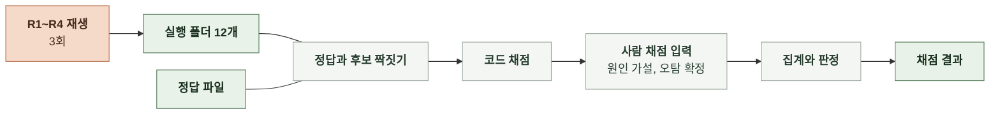

# 6-5 AI 평가 구현

이 문서는 채점기가 실행 폴더와 정답 파일을 읽어 채점, 집계, 판정하고 저장하는 흐름을 정한다.

채점 기준은 6-4 평가 방법에, 실행 폴더의 파일은 5 계약에 있다. ([6-4-4 채점](6-4-AI-EVALUATION-METHOD.md#6-4-4-채점), [6-4-6 합격 판정](6-4-AI-EVALUATION-METHOD.md#6-4-6-합격-판정), [5-6 실행 폴더](5-CONTRACT.md#5-6-실행-폴더))

 

### 6-5-1 평가 흐름

재생 실행은 운영과 같은 진단 코드를 재생 모드로 돌린 것이다. 채점기는 재생 실행을 다시 하지 않고 실행 폴더만 읽는다.

 

### 6-5-2 입력

| 입력 | 내용 |
|---|---|
| 실행 폴더 | 회차와 구간마다 하나. `run.json`의 모드가 재생이 아니면 거부 |
| 정답 파일 | 정답 하나에 6-4-3의 항목. 사람 채점 결과는 같은 파일의 `human` 항목에 회차별로 둠 |
| 회차 묶음 | 실행 폴더 12개를 회차 번호와 구간 ID로 묶는 목록 |

정답은 채점에만 쓰고 재생 실행의 입력에 넣지 않는다.

 

### 6-5-3 채점 단계

| 순서 | 단계 | 내용 |
|---|---|---|
| 1 | 짝짓기 | 정답마다 같은 구간의 `candidates.jsonl`에서 장애 구간과 1분 이상 겹치는 후보를 찾아 가장 먼저 연 것을 고름. 없으면 놓침 |
| 2 | 보고 읽기 | 짝지은 후보의 `reports/` 파일을 읽음. 없고 `failures.jsonl`에 있으면 실행 실패로 놓침. 둘 다 없으면 채점 실패 |
| 3 | 코드 채점 | 6-4-4의 코드 지표를 정답마다 계산. 시간과 비용은 구간의 모든 보고와 실행 실패에서 계산 |
| 4 | 오탐 후보 | 어떤 정답과도 겹치지 않는 `incident` 보고 목록 |
| 5 | 사람 채점 대기 | 정답 파일의 `human`에 해당 회차 점수가 없으면 판정 불가로 멈추고 채점 대상 목록을 출력 |
| 6 | 집계 | 회차별 값과 6-4-5의 규칙(품질은 가장 나쁜 값, 시간과 비용은 최대) |
| 7 | 판정 | 6-4-6 |

 

### 6-5-4 출력

채점 결과는 채점을 돌린 시각 이름의 폴더에 쓴다.

| 파일 | 내용 |
|---|---|
| `scores.json` | 회차별, 정답별 지표값과 집계값, 판정 |
| `matches.json` | 정답과 후보의 짝, 놓침과 실행 실패 사유 |
| `false_positives.json` | 오탐 후보 목록과 사람 확정 결과 |
| `inputs.json` | 실행 폴더 경로, `run.json`의 모델과 프롬프트 해시, 정답 파일 해시, 채점기 버전 |

모델과 프롬프트 해시가 회차끼리 다르면 같은 조합의 평가가 아니므로 채점을 거부한다.

 

### 6-5-5 결과 재사용

| 상황 | 처리 |
|---|---|
| 사람 채점만 추가됨 | 같은 실행 폴더로 다시 채점. 코드 지표는 같고 사람 지표만 채워짐 |
| 채점기 규칙이 바뀜 | 다시 채점하고 `inputs.json`의 채점기 버전으로 구분 |
| 재생 회차 하나가 무효 | 그 회차를 뺀 묶음으로는 판정 불가. 다시 실행한 폴더로 바꿔 채점 |
