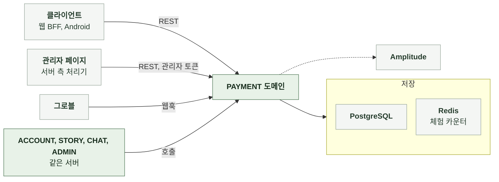

# 3-1 소프트웨어 구조

이 문서는 PAYMENT 도메인 백엔드의 개요, 배경과 목표, 품질 속성, 배포 단위, 모듈 구조, 의존 방향, 도메인 모델을 정한다.

테이블과 컬럼은 DB 스키마에, 코딩 규칙은 컨벤션에, 연산별 처리 순서는 처리 흐름에 있다. ([3-2 DB 스키마](3-2-DB-SCHEMA.md), [3-3 컨벤션](3-3-CONVENTIONS.md), [4-1 처리 흐름](4-1-PIPELINES.md))

 

### 3-1-1 개요

PAYMENT 도메인은 서버 애플리케이션의 내부 패키지다. 별도 프로세스로 실행하지 않는다. 같은 서버의 다른 도메인과는 서비스 호출로 연결한다. 결제 제공자와는 웹훅 수신으로 연결한다.

| 외부 시스템 | 역할 | 연결 방식 |
|---|---|---|
| 클라이언트 | 잔액과 내역 조회, 출석, 충전 주문 | REST |
| 관리자 페이지 | 정책값 변경 및 회원별 지급과 회수 | 관리자 토큰을 사용한 서버 측 처리기의 REST 호출 |
| 그로블 | 결제 완료와 환불 통지 | 서명된 웹훅 수신 |
| PostgreSQL | 지갑, 원장, 로트, 정책 오버라이드, 주문, 환불 표식 | JDBC |
| Redis | 체험 카운터 | Lettuce |
| Amplitude | 서버 분석 이벤트 | HTTP API |

 

### 3-1-2 배경과 목표

| 배경 | 설계 목표 |
|---|---|
| 재화는 돈과 연결되므로 잔액이 왜 그 값인지 설명할 수 있어야 함 | 모든 증감을 불변 원장에 기록하고 잔액은 원장과 로트에서 계산 환불과 회수도 행 추가 |
| AI 처리는 실패할 수 있고 실패 뒤 환불 코드가 실행되지 못할 수 있음 | 처리 전 선차감과 실패 시 환불을 기본으로 두고 대사 배치가 유실 환불을 보정 |
| 보상이 무기한 쌓이면 재방문 유인이 없고 미사용 잔액이 부채가 됨 | 보상은 30일, 구매는 5년 뒤 만료 만료가 가까운 로트부터 소진해 사용자가 손해 보지 않음 |
| 같은 보상 요청이 재시도와 동시 요청으로 반복됨 | 결정적 멱등 키와 원장 유니크 제약으로 1회만 적립 |
| 가입하면 남은 무료 체험이 사라져 가입을 꺼리게 됨 | 가입 시 기기 사용량을 계정 카운터로 옮기고 회원도 체험을 먼저 소진 |
| 이벤트로 수치를 잠깐 바꾸면 종료를 사람의 기억에 맡기게 됨 | 종료 시각을 가진 오버라이드로 자동 복귀 |
| 웹훅은 재전송되고 순서가 바뀌며 헤더는 위조될 수 있음 | 서명된 본문의 이벤트 ID를 멱등 키로 쓰고 주문 상태와 환불 표식으로 순서 역전에 대응 |
| 보상 오류나 장애 보상으로 운영자가 이프를 직접 넣어 주려면 원장을 우회하는 SQL뿐이었음 | 관리자 지급과 회수를 원장 사유로 두어 같은 적립과 차감 연산을 거치고 멱등 키와 감사 로그를 남김 |
| 정책값 오버라이드를 저장소에서 직접 고치면 자릿수 오타와 모르는 키가 적재 때에야 드러남 | 관리자 API가 저장 전에 키와 범위를 검증하고 적재 시 제외 규칙은 그대로 유지 |

 

### 3-1-3 품질 속성

| 속성 | 기준 | 보장 방법 |
|---|---|---|
| 원장 정합 | 잔액 캐시가 원장 합계와 같고 음수가 되지 않음 | 지갑 행 잠금 안에서 원장, 로트, 잔액을 한 트랜잭션에 기록 기록 전에 잔액 부족 여부 판정 |
| 적립 1회성 | 같은 멱등 키는 한 번만 적립 | 잠금 전 확인, 잠금 뒤 재확인, 원장 유니크 제약 |
| 환불 정확성 | 차감 금액과 환불 금액이 같고 초과 환불이 없음 | 호출자가 정책값을 한 번만 읽어 양쪽에 전달 대사는 부족분만 발행 |
| 결제 신뢰 | 검증되지 않은 통지로 적립하지 않음 | 웹훅 서명과 시각 검증 |
| 가용성 | 체험 카운터와 정책 저장소 장애가 이프 사용을 막지 않음 | 회원 체험 예약 실패는 이프 차감으로 진행 정책 적재 실패는 직전 스냅샷 유지 |
| 비밀값 격리 | 웹훅 시크릿을 저장소, 로그, 오류 보고에 기록하지 않음 | 설정에서만 읽고 검증 실패는 고정 문구로 응답 |
| 관측 작업의 실패 격리 | 분석 이벤트 발행 실패로 요청이 실패하지 않음 | 예외를 요청에 전파하지 않음 |
| 운영 안전 | 잘못된 정책값으로 서비스 요청 처리가 실패하지 않음 | 모르는 키와 범위 밖 값은 무시하고 경고 기록 저장소 제약으로 자릿수 오타 차단 |

 

### 3-1-4 배포 단위

PAYMENT는 다른 도메인의 백엔드와 하나의 서버 이미지에 포함된다. 따로 배포하지 않는다. 대사 배치와 정책 갱신은 같은 프로세스의 스케줄러가 실행한다.

 

### 3-1-5 모듈 구조

지갑 서비스가 적립, 차감, 회수, 대사 환불의 연산을 맡는다. 다른 구성 요소는 사유와 자격을 정해 지갑 서비스의 연산을 호출한다.

| 구성 요소 | 입력 | 출력 | 책임 |
|---|---|---|---|
| API 계층 | HTTP 요청 | HTTP 응답 | 형식 검증, 요청자 식별, 상태 코드 |
| 지갑 서비스 | 회원, 금액, 사유, 멱등 키, 참조 | 적립 결과, 차감 결과, 잔액 | 지갑 잠금, 원장과 로트 기록, 만료 정리, 월 상한 판정, 잔액 계산 |
| 지갑 생성 | 회원 | 지갑 | 독립 트랜잭션으로 첫 지갑 생성 |
| 정책 서비스 | 정책 키 | 현재 유효값 | 기본값과 오버라이드 스냅샷 보관, 종료 시각 판정, 전체 수치 동시 계산 |
| 정책 갱신 스케줄러 | 없음 | 없음 | 주기적으로 오버라이드 스냅샷 재적재 |
| 정책 오버라이드 관리 | 관리자, 정책 키, 값, 종료 시각, 사유 | 오버라이드 행 | 키와 범위 검증, 행 기록과 삭제, 감사 기록 호출 |
| 관리자 지급과 회수 | 관리자, 회원, 금액, 멱등 키, 사유 | 적립 또는 회수 결과와 잔액 | 조정 행 삽입으로 멱등 판정, 요청 일치 검사, 지갑 서비스 호출, 부족분 판정, 결과 기록, 감사 기록 호출 |
| 출석 보상 | 회원 | 적립 결과 | 보상 신원과 KST 날짜로 멱등 키 생성, 당일 수령 여부 조회 |
| 체험 한도 | 기기 식별자 또는 회원, 카운터 종류 | 예약 성공 여부, 사용량 | 카운터 키 조립, 원자적 예약과 복원, 가입 시 스냅샷, 기기 헤더 검증 |
| 이용내역 | 회원, 분류, 페이지 크기, 커서 | 항목 목록과 다음 커서 | 원장 페이지 조회, 제목과 만료일 배치 해석 |
| 커서 봉인 | 정렬 위치 | 불투명 문자열 | 커서 암호화와 복호화 |
| 주문 | 회원, 상품 ID | 주문과 결제창 주소 | 상품 조회, 대기 주문 생성, 본인 주문 조회 |
| 그로블 웹훅 검증 | 원본 본문, 서명 헤더 | 처리 결과 | 시크릿 확인, 시각 검증, 서명 비교, 본문 해석, 지표 기록 |
| 그로블 이벤트 처리 | 이벤트 본문 | 처리 결과 | 환불 표식 잠금, 완료 적립, 환불 회수, 순서 역전 처리 |
| 선차감 대사 | 없음 | 조회한 그룹 수와 발행한 환불 수 | 차감이 멈춘 그룹 조회, 완료 수 판정, 부족분 환불 요청 |
| 대사 스케줄러 | 없음 | 없음 | 고정 지연으로 대사 실행, 예외 격리 |

 

### 3-1-6 의존 방향

| 방향 | 규칙 |
|---|---|
| API 계층 → 서비스 | API 계층은 서비스만 호출 저장 계층과 Redis를 직접 호출하지 않음 |
| 보상, 주문, 결제 → 지갑 서비스 | 적립과 회수는 지갑 서비스의 연산만 사용 원장과 로트를 직접 쓰지 않음 |
| 지갑 서비스 → 지갑 생성 | 첫 지갑 생성만 독립 트랜잭션 빈에 위임 |
| 소비 경로 → 정책 서비스 | 정책값은 메모리 스냅샷에서 읽음 요청 트랜잭션 안에서 저장소를 조회하지 않음 |
| PAYMENT → ACCOUNT | 보상 신원 조회, 계정 상태 검사, 체험 스냅샷 완료 시각 기록, 관리자 지급 대상 회원 조회 |
| PAYMENT → ADMIN | 관리자 요청자와 변경 감사 기록 |
| ADMIN → PAYMENT | 잔액, 완료와 환불 주문 조회, 지급과 소진 집계 |
| PAYMENT → STORY, CHAT | 이용내역의 제목 해석과 대사의 완료 수 판정에 채팅, 간편 제작 진행, 스토리 저장 계층 조회 |
| ACCOUNT, STORY, CHAT → PAYMENT | 적립, 차감, 환불, 체험 예약과 복원, 체험 스냅샷, 잔액과 출석 조회, 월 보상 횟수, 정책값 |

 

### 3-1-7 도메인 모델

| 모델 | 하위 데이터 | 설계 의도 |
|---|---|---|
| 지갑 | 로트 | 회원당 하나 잔액은 원장 합계의 캐시. 지갑이 잠금 단위 |
| 원장 행 | 없음 | 부호 있는 증감과 사유, 참조, 멱등 키 추가만 하고 수정하지 않음 |
| 로트 | 없음 | 적립 1건의 원금과 남은 수량, 만료 시각 소진과 만료로 남은 수량만 감소 |
| 정책 오버라이드 | 없음 | 기본값과 다르게 적용할 값만 보관 종료 시각에 기본값으로 자동 복귀 |
| 주문 | 적립 원장 행 참조 | 생성 시점의 가격과 총량을 고정 외부에는 공개 식별자만 노출 |
| 관리자 조정 | 원장 행 참조 | 멱등 키 단위로 요청과 처리 결과를 고정 적용액 0도 한 행이라 재요청이 같은 결과를 받음 |
| 관리자 조정 | 원장 행 참조 | 멱등 키 단위로 요청과 처리 결과를 고정 적용액 0도 한 행이라 재요청이 같은 결과를 받음 |
| 환불 표식 | 없음 | 제공자 거래 식별자 단위 잠금과 선도착 환불 보관을 겸함 |
| 체험 카운터 | 없음 | 기기 또는 계정과 카운터 종류별 사용 횟수 |

 

| 판정 | 의미 |
|---|---|
| 활성 로트 | 잔여가 0보다 크고 만료되지 않은 로트 잔액은 활성 로트 잔여의 합 |
| 소진 순서 | 만료 시각 오름차순으로 소진하고 같으면 먼저 적립된 로트부터 소진. 무기한 로트는 마지막 |
| 주문 상태 | `PENDING`, `COMPLETED`, `REFUNDED` 적립은 완료 처리에서만 생기고 환불 뒤에도 적립 참조를 유지 선도착 환불을 소비한 주문만 적립 없음 대기에서 환불로 바로 가는 전이는 선도착 환불을 소비한 완료 처리뿐 |
| 차감 그룹 | 회원, 참조 종류, 참조 대상이 같은 소모 행의 묶음 대사는 그룹의 차감 수와 완료 수를 대조 |
| 보상 신원 | 재가입 계정이면 최초 계정, 아니면 자기 자신 계정 도메인이 정함 |
