# 4-1 처리 흐름

이 문서는 PAYMENT 도메인의 요청 수신부터 응답까지의 처리 단계와 다른 도메인이 호출하는 연산의 처리 단계를 정한다.

요청 필드, 응답 필드와 실패 응답은 계약에, 로트 수명과 배치 주기, 복구 규칙은 오류 처리에, 잠금과 멱등은 동시성에 있다. ([4-2 계약](4-2-CONTRACT.md), [5-3 오류 처리](5-3-ERROR-HANDLING.md), [5-2 동시성](5-2-CONCURRENCY.md))

 

### 4-1-1 공통 처리

모든 요청은 상관관계 필터에서 요청 ID를 받는다. 이어서 보안 필터가 경로의 인증 수준에 따라 요청자를 정한다. 상품 목록, 정책값 조회, 체험 조회는 토큰이 없어도 처리한다. 유효한 토큰이 있으면 회원으로 식별하고 탈퇴 계정은 거절한다. 그로블 웹훅은 토큰을 읽지 않고 서명으로 인증한다. 그 외 경로는 토큰이 없거나 무효이면 거절한다.

충전 주문 생성과 출석 보상은 처리 전에 계정 상태를 읽어 정지 계정의 요청을 거절한다. 조회는 정지 계정도 처리한다.

정책값은 메모리 스냅샷에서 읽는다. 한 요청 안에서 차감과 환불, 양쪽 적립처럼 같은 값을 두 번 써야 하는 경로는 요청 시작 때 한 번만 읽어 재사용한다.

잔액을 바꾸는 모든 연산은 지갑 행에 비관적 쓰기 잠금을 건 뒤 원장, 로트, 잔액을 한 트랜잭션에 기록한다. 잠금 순서는 환불 표식, 주문, 지갑, 로트 순이다.

흐름도에서 Redis, AI 서버, 다른 도메인을 호출하는 단계는 주황색이다.

 

### 4-1-2 적립

보상, 구매, 요청 내 환불은 같은 적립 연산을 쓴다. 호출자가 금액, 사유, 멱등 키, 참조를 정한다.

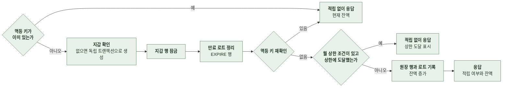

- 로트의 만료 시각은 사유로 정한다. 구매는 적립 시점부터 5년, 그 외 보상과 환불은 30일이다.
- 월 상한 판정은 잠금 안에서 집계한다. 집계 조건은 사유, 기간, 멱등 키의 접두부와 접미부 패턴이다. 초대자 월 상한은 초대자 역할의 키 패턴에 해당하는 행만 센다. 집계 단위는 보상 신원이다.
- 잠금 전 멱등 확인은 이미 처리된 재시도를 잠금 없이 통과시키는 빠른 경로다. 동시 요청은 잠금 뒤 재확인과 원장 유니크 제약이 막는다.
- 지갑 생성의 유니크 위반은 독립 트랜잭션 안에서 처리한다. 바깥 트랜잭션은 이미 있는 지갑을 잠근다.

 

### 4-1-3 차감

간편 제작과 채팅은 차감 연산을 선차감에 쓴다. 채팅은 턴과 이미지를 항목 목록으로 한 번에 넘긴다.

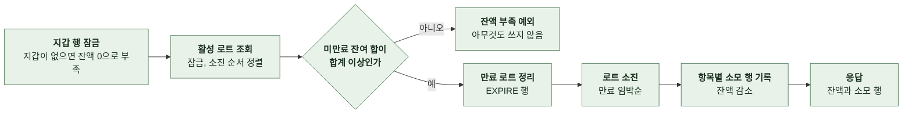

- 부족 판정은 만료 정리보다 먼저 한다. 부족한 차감이 같은 트랜잭션의 만료 정리를 롤백시켜 만료분을 반복 처리하는 것을 막는다.
- 소모 행에는 멱등 키가 없다. 재시도마다 실제로 차감된다. 호출자는 시도별 환불 키로 각 차감과 환불을 연결한다.
- 응답의 소모 행은 호출자가 환불 키 `refund:charge:{소모 행 ID}`를 만드는 데 쓴다.

 

### 4-1-4 체험 예약, 복원, 스냅샷

체험 카운터는 Redis의 정수다. 사용 횟수를 쌓는 값이며 남은 횟수는 한도에서 뺀 파생값이다. 예약은 "한도 미만이면 1 증가"를 원자적 스크립트로 실행한다. 복원은 카운터가 0 아래로 내려가지 않도록 감소시킨다.

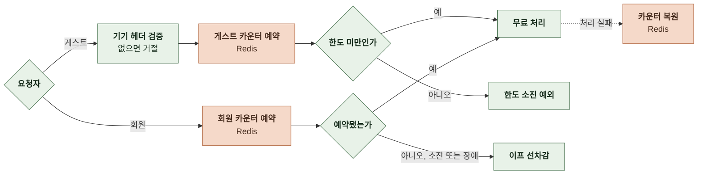

| 연산 | 처리 |
|---|---|
| 게스트 예약 | 기기 헤더가 없거나 공백이면 거절 한도 소진이면 앱 코드를 가진 예외 성공하면 복원에 쓸 기기 식별자 반환 |
| 회원 예약 | 계정 카운터로 판정 Redis 장애는 예약 실패로 보고 이프 차감으로 진행 |
| 복원 | 게스트는 기기 카운터, 회원은 계정 카운터를 1 감소 회원 복원의 Redis 장애 예외는 전파하지 않고 실패를 반환 |
| 스냅샷 | 계정 도메인이 로그인 시 요청 간편 제작, 채팅 턴, 채팅 이미지 카운터에 기기 사용량을 값이 없을 때만 기록 기기 식별자가 없으면 한도값을 기록해 소진 상태로 시작 사용 이력이 없는 카운터는 기록하지 않아 체험 한도 전량이 남음 Redis 장애면 미완료를 반환하고 계정 도메인이 다음 로그인에 재시도 |

 

### 4-1-5 소모와 환불

간편 제작과 채팅 도메인이 과금 연산을 호출하는 순서다. 과금과 환불의 시점은 각 도메인이 정한다. PAYMENT는 연산을 제공한다.

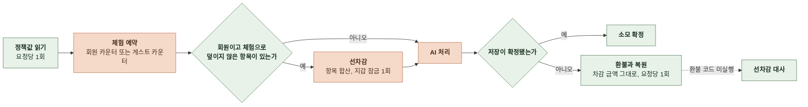

| 호출 도메인 | 참조 | 환불 키 |
|---|---|---|
| 간편 제작 | `STORY`, 간편 제작 진행 ID | `refund:story:{차감 시도별 UUID}` |
| 채팅 턴 | `CHAT`, 채팅 내부 ID | `refund:charge:{소모 행 ID}` 체험으로 처리된 턴은 `refund:chatturn:{요청별 UUID}` |
| 채팅 이미지 | `CHAT_IMAGE`, 채팅 내부 ID | `refund:charge:{소모 행 ID}` |

- 잔액 부족과 한도 소진은 AI 처리를 시작하기 전에 예외로 드러난다. 호출 도메인이 동기 응답으로 변환한다.
- 환불은 차감 때 쓴 금액으로 한다. 환불 시점에 정책값을 다시 읽지 않는다.
- 체험으로 처리된 요청이 실패하면 이프를 환불하지 않고 카운터를 복원한다.

 

### 4-1-6 상품 목록 조회

- 저장소를 조회하지 않는다. 결제창 주소는 응답에 포함하지 않는다.

 

### 4-1-7 정책값 조회와 스냅샷 갱신

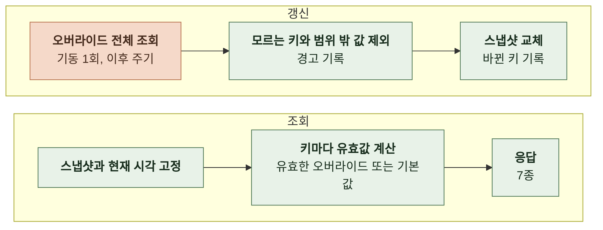

- 한 응답의 7종은 같은 스냅샷과 같은 시각으로 계산한다. 키마다 따로 읽으면 갱신이 끼어들어 옛 값과 새 값이 섞인다.
- 종료 시각은 읽는 시점에 판정한다. 갱신 주기를 기다리지 않고 즉시 기본값으로 돌아간다.
- 갱신에 실패하면 직전 스냅샷을 유지한다. 기동 시 첫 적재가 실패하면 기본값으로 시작한다.
- 기본값이 최솟값 미만이면 기동에 실패한다. 기본값을 대체할 값이 없기 때문이다.

 

### 4-1-8 체험 사용량 조회

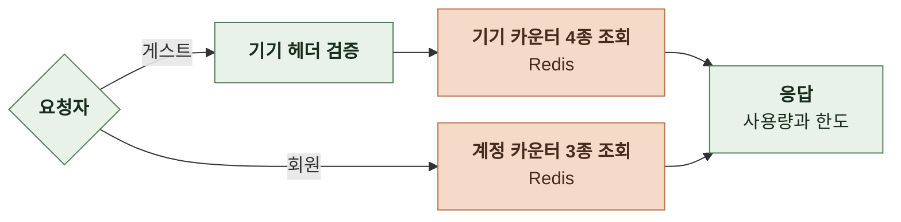

- 회원의 스토리라인 생성은 사용량 0과 한도 없음으로 응답한다.
- 카운터가 없으면 사용량 0이다. Redis 조회 실패는 0으로 바꾸지 않고 서버 오류로 응답한다. 소진한 체험을 화면에 다시 제공하지 않기 위해서다.

 

### 4-1-9 잔액 조회

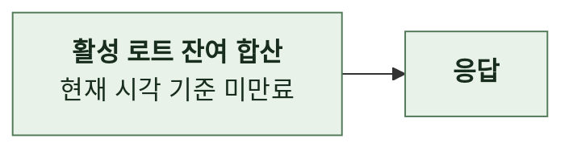

- 잔액은 지갑의 캐시 값이 아니라 로트 합이다. 아직 만료 행으로 정리되지 않은 만료 로트도 제외한다. 세션 조회의 잔액도 같은 방식으로 계산한다.

 

### 4-1-10 출석 보상

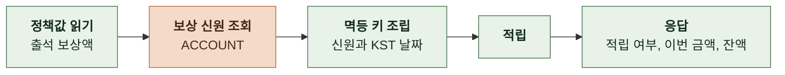

- 멱등 키는 `attendance:{보상 신원}:{KST 날짜}`다. 오늘 이미 받았으면 적립 없이 금액 0으로 응답한다.
- 세션 조회의 당일 출석 여부는 같은 키의 존재만 확인하고 적립하지 않는다.
- 응답 뒤 출석 이벤트를 발행한다.

 

### 4-1-11 이용내역 조회

| 항목 | 규칙 |
|---|---|
| 정렬 | 기록 시각 내림차순, 같으면 내부 ID 내림차순 |
| 커서 | 마지막 항목의 기록 시각과 내부 ID를 AES-GCM으로 봉인한 문자열 시각은 초와 나노초로 보존 키는 접근 토큰 대칭키에서 용도 문자열로 파생 |
| 다음 페이지 판정 | 페이지 크기보다 한 건 더 조회해 초과분이 있을 때만 커서 발급 |
| 분류 | 사유를 소모, 획득, 소멸의 세 가지로 분류 환불과 구매는 획득, 만료와 결제 환불 회수는 소멸 |
| 제목 | 채팅 참조는 채팅에서 스토리를 찾음. 간편 제작 참조는 진행에서 스토리를 찾음 요청자가 지금 읽을 수 있는 스토리는 현재 제목, 아니면 마지막 공개 스냅샷의 제목 삭제된 스토리와 보상, 만료, 회수 행은 제목 없음 |
| 만료일 | 획득 행은 그 적립이 만든 로트의 만료 시각, 만료 행은 회수된 로트의 만료 시각 |
| 조회 횟수 | 제목과 만료일은 페이지 단위 배치 조회 |

 

### 4-1-12 웹 충전 주문 생성

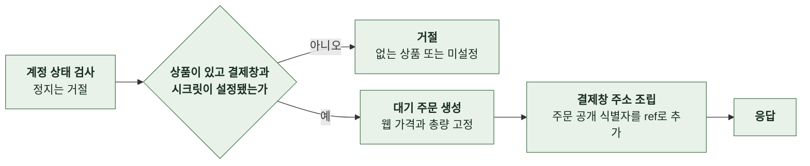

- 주문 생성만으로 적립하지 않는다. 결제를 마치지 않은 대기 주문은 삭제하지 않아 계속 쌓인다.
- 커밋 뒤 주문 이벤트를 발행한다.

 

### 4-1-13 주문 조회

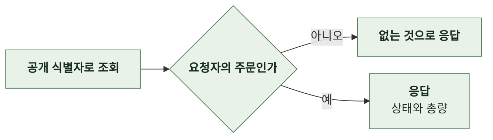

- 없는 주문과 타인의 주문을 같은 결과로 응답한다. 클라이언트는 결제 복귀 뒤 완료 상태를 확인할 때까지 이 조회를 반복한다.

 

### 4-1-14 그로블 웹훅 수신

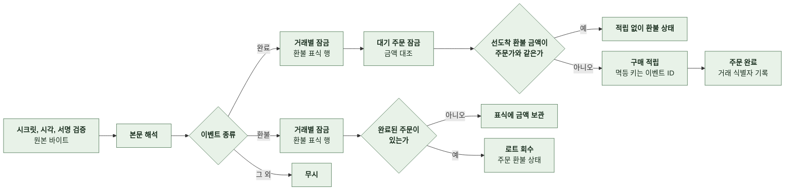

| 단계 | 처리 |
|---|---|
| 검증 | 시크릿이 비어 있으면 처리 불가로 응답 타임스탬프는 현재 시각 기준 앞뒤 5분 안 서명은 `{타임스탬프}.{원본 본문}`의 HMAC-SHA256을 현재 서명 또는 이전 서명과 상수 시간 비교 검증 전에는 본문을 해석하지 않음 |
| 완료 | 판매자 참조가 주문 공개 식별자 참조 없음, 형식 오류, 주문 없음, 금액 불일치, 거래 식별자 오류, 이벤트 ID 오류는 무시 대기 상태가 아닌 주문은 무시 적립 뒤 멱등 키의 원장 행이 이 주문의 것인지 확인하고 아니면 무시 |
| 환불 | 거래 식별자로 주문 조회 부분 환불과 금액 불일치는 무시 완료 상태가 아닌 주문은 무시 주문이 없으면 표식에 첫 환불 금액만 보관 |
| 표식 | 처리 끝에 삭제 완료 처리가 주문을 찾지 못하거나 금액 오류로 끝나면 먼저 도착한 환불 금액은 남기고 잠금용 행만 정리 |
| 응답 | 처리와 무시 모두 성공으로 응답 결과는 지표에 기록 |
| 이벤트 | 적립과 회수가 커밋된 뒤 주문 소유자 기준으로 구매와 환불 이벤트 발행 |

 

### 4-1-15 선차감 대사

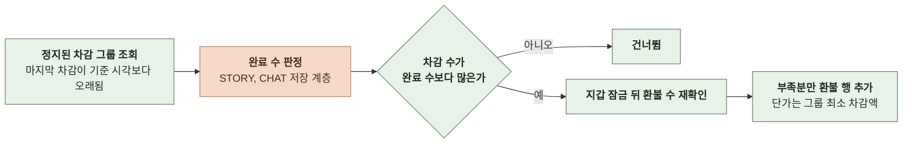

| 항목 | 규칙 |
|---|---|
| 대상 사유 | 간편 제작 소모와 채팅 턴 소모 채팅 이미지는 턴 저장 트랜잭션이 환불하므로 제외 |
| 그룹 | 회원, 참조 종류, 참조 대상이 같은 소모 행 |
| 완료 수 | 채팅은 저장된 턴 수와 완료된 재생성 수의 합 간편 제작은 진행이 완성 상태면 1, 아니면 0 참조 대상이 없거나 지원하지 않는 종류면 환불하지 않음 |
| 환불 수 | 차감 수에서 완료 수를 뺀 값에서 이미 있는 환불 수를 뺀 만큼만 발행 |
| 단가 | 그룹의 최소 차감액 정책값 변경으로 단가가 섞인 그룹은 차액만큼 덜 돌려줌. 경고 기록 |
| 격리 | 그룹별 실패는 다음 실행에서 재시도 실제로 환불한 실행만 결과 기록 |
