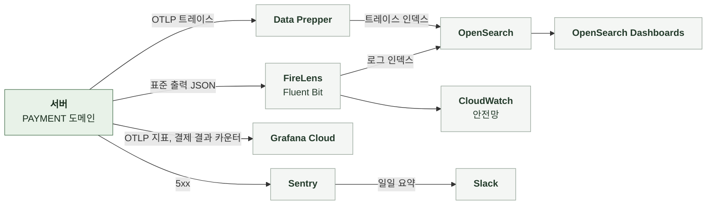

# 5-4 관측

이 문서는 PAYMENT 도메인의 관측 스택, 요청을 추적할 식별자, 구조화 로그 이벤트, 오류 확인 위치, 지표, 트레이스, 알림, 수집 조건, 분석 이벤트를 정한다.

비밀값과 개인정보 취급 규칙은 보안에, 오류 로그 수준은 오류 처리에 있다. ([5-1-7 비밀값과 개인정보](5-1-SECURITY.md#5-1-7-비밀값과-개인정보), [5-3-8 로그와 Sentry](5-3-ERROR-HANDLING.md#5-3-8-로그와-sentry))

<br>

### 5-4-1 관측 스택



<br>

### 5-4-2 상관관계 식별자

상관관계 필터는 모든 요청의 MDC에 다음 값을 기록한다. 로그와 Sentry는 같은 식별자 값을 사용한다.

| MDC 필드 | 값 | 규칙 |
|---|---|---|
| `request_id` | `req_` + UUID | 요청 헤더 값을 쓰고 없으면 생성<br>응답 헤더로 반환 |
| `session_id` | `X-Manyak-Session-Id` | 없으면 `unknown` |
| `device_id_hash` | `device_hash_` + SHA-256(pepper + 원본) 앞 16자 | 원본은 저장하지 않음 |
| `sentry_event_id` | Sentry 이벤트 ID | 5xx를 Sentry로 보낸 요청만 |
| `traceId`, `spanId` | 현재 스팬 | 트레이스 전송을 비활성화해도 생성해 로그에 포함 |

| 식별자 | 기록 위치 | 연결 대상 |
|---|---|---|
| `request_id` | 로그 MDC, Sentry 태그 | 한 요청의 로그 |
| 회원 내부 ID | 대사 로그 `user_id`, 체험 Redis 장애 WARN | 회원 |
| 주문 내부 ID | 웹훅 경고, 회수 부족분 WARN | 주문 |
| 차감 그룹 | 대사 로그 `ref_type`, `ref_id` | 소모 행 묶음 |
| 웹훅 멱등 키 | 수신 DEBUG | 그로블 전송 1건<br>검증에는 쓰지 않음 |

배치는 요청과 별개로 실행하므로 요청 ID가 없다. 스케줄러 로그는 이벤트 이름과 그룹 식별자로 찾는다.

<br>

### 5-4-3 구조화 로그 이벤트

구조화 로그는 `event_name`을 맨 앞에 둔 JSON 형식으로 INFO 수준에 기록한다. 이벤트 이름은 snake_case다. `prod`, `dev`, `jsonlog` 프로파일에서만 JSON 형식을 쓴다. 그 외에는 콘솔 패턴을 쓴다. JSON에는 `service=manyak-server`가 포함된다. 인코더는 MDC 값을 최상위 필드에 기록한다.

| 단위 | 기록 시점과 이름 | 기록 내용 |
|---|---|---|
| 모든 API 요청 | 응답 종료<br>`api_request_completed`, 5xx는 `api_request_failed` | `endpoint`, `http_method`, `status_code`, `duration_ms`<br>실패 시 예외 클래스 이름 또는 상태 이름을 `error_code`로 추가 |
| 정책 기동 적재 | 기동 직후<br>평문 INFO `credit_policy_effective` | 7종의 현재 유효값 |
| 정책 변경 | 갱신에서 값이 바뀐 키<br>평문 INFO `credit_policy_changed` | `key`, `from`, `to`<br>종료 시각 만료도 다음 갱신에서 드러남 |
| 정책 적재 실패 | 갱신 실패<br>평문 WARN `credit_policy_load_failed` | 예외 |
| 정책 오버라이드 제외 | 갱신마다 한 번<br>평문 WARN `credit_policy_override_unknown_key`, `credit_policy_override_rejected` | `key`, `amount`, 유효한 키 목록 또는 `minimum`과 기본값 |
| 대사 보정 | 환불을 발행한 실행<br>`credit_reconciliation_refunded` | `groups_scanned`, `refunds_emitted` |
| 대사 실행 실패 | 실행 전체 예외<br>`credit_reconciliation_failed` | `error` |
| 대사 그룹 실패 | 그룹 처리 예외<br>`credit_reconciliation_group_failed` | `user_id`, `ref_type`, `ref_id`, `error` |
| 혼합 단가 환불 | 단가가 섞인 그룹에 실제 환불<br>WARN `credit_reconciliation_mixed_unit_amount` | `user_id`, `ref_type`, `ref_id`, `min_unit_amount`, `max_unit_amount`, `refunds_emitted` |
| 웹훅 수신 | 서명 검증 뒤<br>평문 DEBUG | 이벤트 종류, 멱등 키 헤더 |
| 웹훅 무시 | 본문 불일치<br>평문 WARN | 무시 사유 |
| 역순 환불 금액 불일치 | 완료 처리<br>평문 WARN | 주문 내부 ID |
| 구매 환불 회수 부족분 | 회수<br>평문 WARN | 적립 행 ID, 부족 수량 |
| Google 구매 거부 | 테스트 구매, 미지원 유형<br>평문 WARN | 사유 |
| Google 환불 대사 실패 | 조회 실패, 건별 회수 실패<br>평문 WARN | 고정 문구 |
| 체험 Redis 장애 | 회원 예약, 복원, 스냅샷<br>평문 WARN | 회원 내부 ID, 카운터, 예외 |

<details>
<summary><b>예시: 대사 보정 로그 1줄</b></summary>

<br>

예시에는 가상 값을 썼다. 로그 프레임워크가 붙이는 필드는 생략했다.

```json
{"@timestamp":"2026-10-16T01:23:45.678Z","message":"event_name=credit_reconciliation_refunded, groups_scanned=3, refunds_emitted=1","level":"INFO","traceId":"4bf92f3577b34da6a3ce929d0e0e4736","spanId":"00f067aa0ba902b7","event_name":"credit_reconciliation_refunded","groups_scanned":3,"refunds_emitted":1,"service":"manyak-server"}
```

</details>

<br>

### 5-4-4 오류 확인

| 기능 | 오류 조회 위치 |
|---|---|
| 그로블 결제 | 지표 `manyak.payment.groble.webhook`의 `result` 분포<br>웹훅 무시 WARN의 사유 |
| Google Play 결제 | 지표 `manyak.payment.google.purchase`의 `result` 분포<br>Sentry `endpoint=/api/v1/users/me/credits/purchases/google` |
| 결제 환불 | 지표 `manyak.payment.google.voided`<br>회수 부족분 WARN |
| 선차감과 환불 | 대사 로그 `credit_reconciliation_refunded`가 반복되면 호출 도메인의 환불 경로 점검<br>혼합 단가 WARN |
| 정책값 | 기동 로그 `credit_policy_effective`, 변경 로그, 오버라이드 제외 WARN |
| 체험 | Redis 장애 WARN<br>요청 로그의 `/api/v1/users/me/trials` 500 비율 |
| 잔액과 내역 | 요청 로그의 `/api/v1/users/me/credits/transactions` 400 비율 |

<br>

### 5-4-5 지표

| 지표 | 종류와 태그 | 의미 |
|---|---|---|
| `manyak.payment.groble.webhook` | Counter<br>`result` = `completed`, `refunded`, `marked`, `ignored`, `invalid` | 웹훅 처리 결과<br>`invalid`는 검증 실패 |
| `manyak.payment.google.purchase` | Counter<br>`result` = `completed`, `duplicate`, `rejected`, `error` | 구매 검증 결과<br>`rejected`는 4xx, `error`는 5xx |
| `manyak.payment.google.voided` | Counter<br>`result` = `reversed`, `ignored` | 무효 구매 회수 결과 |
| `http.server.requests` | Timer<br>`uri`, `method`, `status`, `outcome` | 이프 경로의 요청률, 오류율, 응답 시간 |

| 항목 | 기준과 제한 |
|---|---|
| 전송 여부 | 지표 전송을 켠 환경에서만 Grafana Cloud로 전송 |
| 전송 주기 | 60초 간격 |
| 카운트 시점 | 트랜잭션 커밋 뒤<br>롤백된 처리는 세지 않음 |

<br>

### 5-4-6 트레이스

| 항목 | 내용 |
|---|---|
| 활성화와 표본 | 환경 변수로 켜며 기본값은 비활성 |
| 스팬 | HTTP 요청 스팬의 하위에 JDBC(QUERY만, 바인딩 값 제외), Redis 스팬<br>Google Play 호출은 HTTP 클라이언트 스팬 |
| 제외 | actuator 요청, Spring Security 내부 관측, 요청 밖의 루트 DB와 Redis 관측은 노이즈 필터가 제외<br>스케줄러의 DB 접근도 요청과 별개이므로 제외 |

<br>

### 5-4-7 알림

| 항목 | 기준 |
|---|---|
| 정기 보고 | 매일 오전 10시(KST), 지난 24시간 동안 발생한 운영 Sentry 오류 요약 |
| PAYMENT에서 수집하는 오류 | 500 예상하지 못한 예외, Google 처리 중 예외, 게스트 체험 Redis 장애로 인한 500<br>4xx 거절, 웹훅 무시, 대사 보정, 정책 제외는 Sentry에 없어 보고에 포함되지 않음 |
| 지표 기반 알림 | PAYMENT 전용 규칙 없음 |

<br>

### 5-4-8 수집 조건과 실패 처리

**1. 데이터 범위**

| 데이터 | 현재 기록 방식 |
|---|---|
| 구매 토큰, 웹훅 시크릿, 서비스 계정 자격 증명 | 로그, Sentry, 지표에 기록하지 않음 |
| 웹훅 본문 | 기록하지 않음<br>이벤트 종류와 무시 사유만 기록 |
| 그로블 거래 식별자, 이벤트 ID | 로그에 기록하지 않음 |
| 디바이스 ID | 해시만 기록 |
| 금액 | 대사 로그의 단가와 회수 부족분은 기록 |
| Sentry 요청 필드 | 기본 수집<br>Google 구매 요청 본문에는 토큰이 있으나 5xx 캡처는 원인 예외를 제거한 고정 문구 예외만 보냄 |
| Sentry 이벤트 | 5xx만 캡처<br>기본 개인정보 수집 비활성화 |

<br>

**2. 수집 실패**

| 상황 | 처리 |
|---|---|
| 지표 전송 실패 | SDK로 배치 전송<br>실패분은 유실 |
| Sentry 캡처 실패 | SDK 내부에서 처리<br>DSN 없는 환경은 no-op |
| 대사 결과 로그 | 환불이 없는 실행은 기록하지 않음<br>기록이 없다는 것은 보정할 것이 없었다는 뜻 |
| 미수집과 누락 | 수집 비활성화, 기록 실패, 전송 유실을 구분<br>기록이 없다는 이유만으로 결제가 없었다고 판단하지 않음 |

<br>

### 5-4-9 분석 이벤트

PAYMENT에는 서버 분석 이벤트가 없다. 결제와 환불은 지표와 주문 상태로 확인한다. 보상 적립은 원장과 계정 도메인의 로그인과 초대 이벤트로 확인한다.
