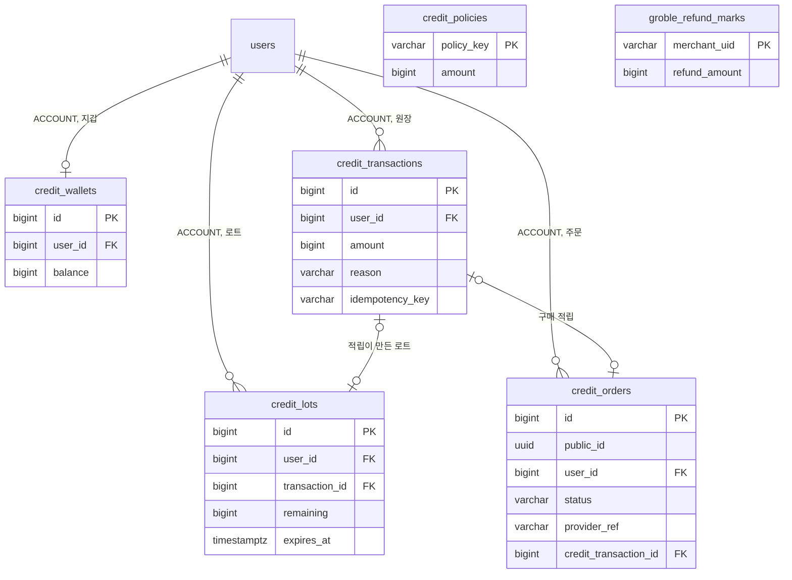

# DB 스키마

이 문서는 PAYMENT 도메인이 관리하는 PostgreSQL 테이블의 컬럼, 제약, 인덱스, Redis 키와 데이터 수명을 정한다.

다른 도메인의 테이블에서는 PAYMENT 도메인이 참조하거나 기록하는 컬럼만 설명한다.

입력값의 검증 규칙은 보안에, 잠금 순서와 멱등 키는 동시성에, 로트 수명은 오류 처리에 있다. ([입력 검증](SECURITY.md#입력-검증), [동시성](CONCURRENCY.md), [재시도와 시간 한도](ERROR-HANDLING.md#재시도와-시간-한도))

 

### 공통 규칙

| 규칙 | 내용 |
|---|---|
| 식별자 | 내부 PK는 `bigint` 자동 증가 주문은 외부 노출용 `public_id uuid`를 따로 둠 원장과 로트의 내부 ID는 응답에 노출하지 않음 |
| 시각 | `timestamp with time zone` `created_at`의 기본값은 `now()`이며 아래 표에서는 표시하지 않음 |
| 삭제 | 원장, 로트, 주문은 삭제 경로 없음 환불 표식은 처리가 끝나면 물리 삭제 |
| FK | 지갑, 원장, 로트는 회원 삭제 시 함께 삭제(`ON DELETE CASCADE`) 주문은 연쇄 삭제 없음 회원 행은 탈퇴해도 남으므로 실제 연쇄 삭제는 일어나지 않음 |
| 금액 | 모든 금액은 `bigint`, 단위는 이프 또는 원 |

 

### 관계도

관계도는 데이터 묶음별 소유 관계를 보여준다. 각 상자에는 식별과 연결에 쓰는 컬럼만 표시한다. 전체 컬럼은 아래 표에서 정의한다. 다른 도메인의 테이블은 관계 라벨에 도메인을 적고 컬럼을 생략한다.

 

### 지갑

**`credit_wallets`**

회원당 한 행이다. 첫 적립 때 만든다.

| 컬럼 | 타입 | 제약 | 의미 |
|---|---|---|---|
| `id` | bigint | PK | |
| `user_id` | bigint | NOT NULL, FK `users.id` CASCADE, UNIQUE | |
| `balance` | bigint | NOT NULL, 기본 0, CHECK `>= 0` | 원장 합계의 캐시 만료된 로트가 정리되기 전에는 잔액 조회 값보다 클 수 있음 |
| `updated_at` | timestamptz | NOT NULL | |

 

### 원장

**`credit_transactions`**

이프 증감 1건당 한 행이다. 추가만 하고 수정하지 않는다.

| 컬럼 | 타입 | 제약 | 의미 |
|---|---|---|---|
| `id` | bigint | PK | 이용내역 정렬의 2차 키 |
| `user_id` | bigint | NOT NULL, FK `users.id` CASCADE | |
| `amount` | bigint | NOT NULL, CHECK `<> 0` | 부호 있는 증감 적립, 환불, 구매는 양수. 소모, 만료, 회수는 음수 |
| `reason` | varchar(30) | NOT NULL, CHECK 아래 목록 | 증감 사유 |
| `ref_type` | varchar(30) | | 참조 종류 아래 목록 |
| `ref_id` | bigint | | 참조 대상의 내부 ID |
| `idempotency_key` | varchar(255) | UNIQUE | 보상, 구매, 요청 안 환불, 채팅 턴 차감의 대사 환불의 멱등 키 소모, 만료, 회수, 그룹 단위 대사 환불은 NULL |

| 인덱스 | 컬럼 |
|---|---|
| `idx_credit_transactions_user` | `user_id` |
| `idx_credit_transactions_ref` | `user_id`, `ref_type`, `ref_id` |
| `idx_credit_transactions_user_history` | `user_id`, `created_at DESC`, `id DESC` |
| `idx_credit_transactions_chat_turn_created` | `id` WHERE `ref_type = 'CHAT_TURN'` |

| `reason` | 부호 | 의미 |
|---|---|---|
| `SIGNUP_REWARD` | `+` | 가입 보상 |
| `INVITE_REWARD` | `+` | 초대 보상, 초대자와 제출자 각각 |
| `ATTENDANCE_REWARD` | `+` | 출석 보상 |
| `PURCHASE` | `+` | 구매 적립 |
| `REFUND` | `+` | 선차감의 환불 |
| `STORY_CREATION` | `-` | 간편 제작 소모 |
| `CHAT_TURN` | `-` | 채팅 턴 소모, 재생성 포함 금액은 그 턴의 모델 가격이라 같은 채팅 안에서 섞일 수 있음 |
| `CHAT_IMAGE` | `-` | 채팅 이미지 소모 |
| `EXPIRE` | `-` | 로트 만료 회수 |
| `PURCHASE_REVERSAL` | `-` | 결제 환불 회수 |

| `ref_type` | `ref_id` | 쓰는 행 |
|---|---|---|
| `STORY` | 간편 제작 진행의 내부 ID | 간편 제작 소모와 그 환불 |
| `CHAT_TURN` | 채팅의 내부 ID | 저장 시 차감 연결을 기록하는 코드의 채팅 턴 소모와 그 환불 행 단위 대사의 대상 |
| `CHAT` | 채팅의 내부 ID | 차감 연결을 기록하지 않던 코드의 채팅 턴 소모와 그 환불 새 행은 생기지 않고 그룹 단위 대사의 대상 |
| `CHAT_IMAGE` | 채팅의 내부 ID | 채팅 이미지 소모와 그 환불 |
| `CREDIT_LOT` | 로트의 내부 ID | 만료 회수 |
| `CREDIT_ORDER` | 주문의 내부 ID | 구매 적립과 결제 환불 회수 |

 

### 로트

**`credit_lots`**

양수 원장 행 1건마다 한 행이다.

| 컬럼 | 타입 | 제약 | 의미 |
|---|---|---|---|
| `id` | bigint | PK | |
| `user_id` | bigint | NOT NULL, FK `users.id` CASCADE | |
| `transaction_id` | bigint | FK `credit_transactions.id` | 이 로트를 만든 적립 행 로트 도입 전 잔액을 승계한 로트는 NULL |
| `original_amount` | bigint | NOT NULL, CHECK `> 0` | 적립 당시 금액 |
| `remaining` | bigint | NOT NULL, CHECK `0 이상, original_amount 이하` | 소진과 만료로 줄어드는 남은 수량 |
| `expires_at` | timestamptz | | 만료 시각 NULL은 무기한인 승계 로트 |

| 인덱스 | 컬럼 |
|---|---|
| `idx_credit_lots_user_active` | `user_id`, `expires_at` WHERE `remaining > 0` |
| `idx_credit_lots_transaction` | `transaction_id` |

 

### 정책 오버라이드

**`credit_policies`**

기본값과 다르게 적용할 정책값만 담는다. 행이 없으면 기본값을 적용한다. 운영자가 직접 기록한다.

| 컬럼 | 타입 | 제약 | 의미 |
|---|---|---|---|
| `policy_key` | varchar(50) | PK | 정책 키 목록은 정책값 조회의 키와 같음 |
| `amount` | bigint | NOT NULL, CHECK `0 이상 10000 이하` | 적용할 값 상한으로 자릿수 오타 방지 |
| `effective_until` | timestamptz | | 이 시각이 지나면 기본값으로 복귀 NULL은 상시 적용 |
| `updated_at` | timestamptz | NOT NULL | |

| `policy_key` | 의미 | 최솟값 |
|---|---|---|
| `signup_reward` | 가입 보상 | 1 |
| `invite_reward` | 초대 보상 | 1 |
| `invite_monthly_cap` | 초대자 월 상한 횟수 | 0 |
| `attendance_reward` | 출석 보상 | 1 |
| `story_creation_cost` | 간편 제작 소모 | 1 |
| `chat_image_cost` | 채팅 이미지 소모 | 0 |

채팅 턴 소모는 정책 키가 아니다. 목록에 없는 키의 행은 갱신 때 무시하고 경고를 남긴다.

 

### 주문

**`credit_orders`**

결제 1건당 한 행이다. 생성 시점의 가격과 총량을 고정한다.

| 컬럼 | 타입 | 제약 | 의미 |
|---|---|---|---|
| `id` | bigint | PK | |
| `public_id` | uuid | NOT NULL, UNIQUE | 외부 노출 식별자 |
| `user_id` | bigint | NOT NULL, FK `users.id` | |
| `product_id` | varchar(32) | NOT NULL | 상품 ID |
| `provider` | varchar(20) | NOT NULL, CHECK `GROBLE` | |
| `status` | varchar(20) | NOT NULL, CHECK `PENDING` `COMPLETED` `REFUNDED` | |
| `price_krw` | bigint | NOT NULL | 생성 시점의 가격 |
| `credit_amount` | bigint | NOT NULL | 생성 시점의 총량 |
| `provider_ref` | varchar(255) | UNIQUE | 그로블 거래 식별자 완료 때 채움 |
| `credit_transaction_id` | bigint | FK `credit_transactions.id` | 구매 적립 행 적립 없이 환불 상태가 된 주문은 NULL |
| `completed_at` | timestamptz | | |
| `refunded_at` | timestamptz | | |
| `reversal_shortfall` | bigint | | 회수 때 이미 소진돼 돌려받지 못한 수량 NULL은 회수 전, 0은 전량 회수 |

| 인덱스 | 컬럼 |
|---|---|
| `idx_credit_orders_user_created_at` | `user_id`, `created_at DESC` |

 

### 환불 표식

**`groble_refund_marks`**

그로블 거래 식별자 단위의 잠금 행이다. 완료보다 먼저 도착한 전체 환불의 금액을 완료 처리 때까지 보관한다.

| 컬럼 | 타입 | 제약 | 의미 |
|---|---|---|---|
| `merchant_uid` | varchar(255) | PK | 그로블 거래 식별자 |
| `refund_amount` | bigint | | 완료보다 먼저 도착한 전체 환불의 금액 NULL은 잠금용 행 |

 

### 참조하는 다른 도메인의 컬럼

| 테이블 | 컬럼 | PAYMENT가 하는 일 |
|---|---|---|
| `users` | `reward_identity_user_id` | 출석 보상의 멱등 키에 사용 NULL이면 `id` |
| `users` | `member_trial_seeded_at` | 체험 스냅샷 완료 시각 계정 도메인이 기록하고 PAYMENT는 스냅샷 완료 여부를 반환 |
| `users` | status | 충전과 출석 보상 전 계정 상태 검사 |
| `story_chats` | `current_turn`, `regenerated_count`, `story_id` | 참조 종류 `CHAT`인 채팅 턴 차감의 대사 완료 수 판정, 이용내역 제목 해석 |
| `story_messages`, `story_message_versions` | `credit_transaction_id` | 채팅 턴 차감 행이 저장된 턴에 연결됐는지 판정 |
| `chat_models` | `code`, `turn_cost` | 정책값 응답의 `chatTurnCost`에 라이트(`LITE`)의 가격을 실음 |
| `story_creation_sessions` | `status`, `story_id` | 대사의 완료 수 판정, 이용내역 제목 해석 |
| `stories` | 제목, 기본 주인공 이름, 삭제 시각, 공개 스냅샷 | 이용내역 제목 해석 |

 

### Redis 키

체험 카운터는 사용 횟수를 담는 정수 문자열이다. 기기 해시는 pepper를 더한 SHA-256 해시다.

| 키 | 값 | 삭제 |
|---|---|---|
| `guest_trial:{기기 해시}:{카운터}` | 사용 횟수 | 없음 |
| `member_trial:{userId}:{카운터}` | 사용 횟수 가입 시 기기 사용량 또는 한도값으로 초기화 | 없음 |

| 카운터 | 대상 | 회원 공유 |
|---|---|---|
| `storyline_generation` | 스토리라인 생성과 재생성 | 아니오, 회원은 무료 |
| `story_creation` | 간편 제작 | 예 |
| `chat_turn` | 채팅 턴과 재생성 | 예 |
| `chat_image` | 채팅 이미지 | 예 |

 

### 데이터 수명

| 데이터 | 삭제 |
|---|---|
| 지갑, 원장, 로트 | 없음 |
| 주문 | 없음 |
| 환불 표식 | 잠금용 행은 처리 트랜잭션 끝에 삭제 완료보다 먼저 온 환불 금액이 있는 행은 주문과 맞는 완료 처리까지 보존 |
| 정책 오버라이드 | 운영자가 삭제 |
| 체험 카운터 | 없음 |
