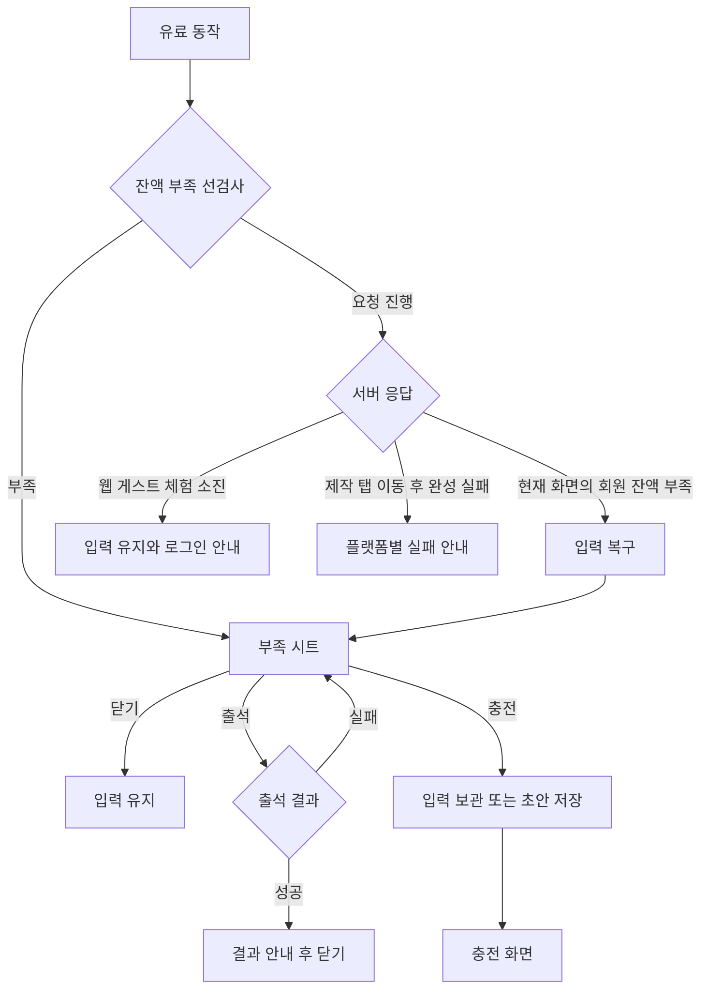

# 3-2 화면 흐름

 

### 3-2-1 출석과 내역

| 시작 | 조작 | 결과 |
|---|---|---|
| 무료 충전 | 출석 하기 | 요청 중 잠금. 성공하면 결과 안내와 잔액 갱신, 출석 완료로 변경 |
| 출석 완료 | 재진입 | 완료 상태 유지, 추가 적립 없음 |
| 출석 실패 | 다시 누르기 | 새 요청 가능 |
| 무료 충전 | 친구 초대 선택 | 초대 코드 화면 |
| 내역 | 목록 끝 도달 | 다음 페이지 추가. 실패하면 기존 목록 아래 재시도 |
| 내역 | 빈 결과 | 빈 상태 표시 |

 

### 3-2-2 부족 안내

선검사와 입력 보존 조건을 적용한다. ([2-2-5 이프 부족과 입력 보존](2-2-REQUIREMENTS.md#2-2-5-이프-부족과-입력-보존))
