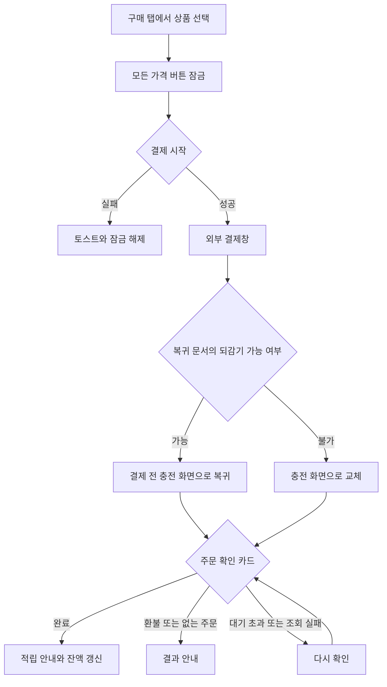

# 3-2 화면 흐름: 웹

 

### 3-2-1 결제와 복귀

| 이동 | 결과 |
|---|---|
| 결제 복귀 후 헤더 뒤로가기 | 아래 기록이 있으면 다른 문서의 기록이어도 뒤로 이동. 결제 전 진입 화면으로 복귀 |
| 주소나 알림으로 충전에 직접 진입 | 아래 기록이 없으면 헤더 뒤로가기는 `/my`로 교체 |
| 결과 카드 닫기 | 카드 제거 |
| 브라우저 뒤로가기로 결제 전 문서 복원 | 가격 버튼 잠금 해제 |

 

### 3-2-2 부족 시트에서 충전

| 시작 | 이동 순서 | 뒤로가기 |
|---|---|---|
| 채팅방 | 시트의 히스토리 항목 소비, 입력 보관, 충전 화면 추가 | 채팅방과 입력 복원 |
| 간편 제작 | 초안 저장, 시트 항목 소비, 퍼널을 충전으로 교체 | 퍼널 이전 화면. 제작 탭 초안 카드에서 재개 |

시트의 출석과 닫기는 공통 흐름을 적용한다. ([공통 3-2-2](../3-2-INTERACTION-FLOWS.md#3-2-2-부족-안내), [2-2-3](2-2-REQUIREMENTS.md#2-2-3-부족-시트와-복귀))
