```mermaid
%%{init: {"themeVariables": {"fontSize": "18px"}, "flowchart": {"curve": "basis", "htmlLabels": true, "nodeSpacing": 24, "rankSpacing": 48}}}%%
flowchart LR
    I[" "] -->|스토리라인 요청| A["<b>스토리 서비스</b><br/>입력 분해"]
    A -->|"장르와 인물 정보"| B["<b>프롬프트 조립기</b><br/>프롬프트 조립"]
    B -->|"작성 규칙과 입력 프롬프트"| C["<b>공통 LLM 호출</b><br/>모델 호출"]
    C -->|"생성 본문과 호출 사용량"| D["<b>스토리 서비스</b><br/>파싱과 보완, 출력 조립"]
    D -->|스토리라인 응답| O[" "]
    classDef code fill:#F4F6F4,stroke:#9BA99E,color:#253C2C
    class A,B,C,D code
    style I fill:none,stroke:none
    style O fill:none,stroke:none
```

```mermaid
%%{init: {"themeVariables": {"fontSize": "18px"}, "flowchart": {"curve": "basis", "htmlLabels": true, "nodeSpacing": 24, "rankSpacing": 48}}}%%
flowchart LR
    I[" "] -->|컴파일 요청| A["<b>스토리 서비스</b><br/>입력 분해"]
    A -->|줄거리·장르·인물·로어북| B["<b>프롬프트 조립기</b><br/>프롬프트 조립"]
    B -->|"프롬프트와 버전"| C["<b>공통 LLM 호출</b><br/>모델 호출"]
    C -->|"생성 본문과 호출 사용량"| D["<b>스토리 서비스</b><br/>파싱과 명세 검사<br/>이미지 생성"]
    D -->|"검증한 명세와 썸네일 결과"| E["<b>출력 변환 모듈</b><br/>출력 변환"]
    E -->|컴파일 응답| F["<b>스토리 서비스</b><br/>인물 이미지·메타 추가"]
    F -->|컴파일 응답| O[" "]
    classDef data fill:#E8F2E8,stroke:#527A59,color:#182D1D
    classDef task fill:#F5D9C9,stroke:#B97450,color:#452B1D
    classDef code fill:#F4F6F4,stroke:#9BA99E,color:#253C2C
    class A,B,C,D,E,F code
    style I fill:none,stroke:none
    style O fill:none,stroke:none
```

```mermaid
%%{init: {"themeVariables": {"fontSize": "18px"}, "flowchart": {"curve": "basis", "htmlLabels": true, "nodeSpacing": 24, "rankSpacing": 48}}}%%
flowchart LR
    I[" "] -->|"인물 카드와 장르"| A["<b>프롬프트 조립기</b><br/>프롬프트 조립"]
    A -->|프롬프트| B["<b>공통 이미지 호출</b><br/>이미지 호출"]
    B -->|이미지 결과| C["<b>이미지 생성 모듈</b><br/>결과 수집"]
    C -->|"인물별 생성 결과"| D["<b>스토리 서비스</b><br/>출력 변환"]
    D -->|"인물별 이미지 출력"| O[" "]
    classDef data fill:#E8F2E8,stroke:#527A59,color:#182D1D
    classDef task fill:#F5D9C9,stroke:#B97450,color:#452B1D
    classDef code fill:#F4F6F4,stroke:#9BA99E,color:#253C2C
    class A,B,C,D code
    style I fill:none,stroke:none
    style O fill:none,stroke:none
```

```mermaid
%%{init: {"themeVariables": {"fontSize": "18px"}, "flowchart": {"curve": "basis", "htmlLabels": true, "nodeSpacing": 24, "rankSpacing": 48}}}%%
flowchart LR
    I[" "] -->|"인물 카드 목록과 장르"| A["<b>프롬프트 조립기</b><br/>프롬프트 조립"]
    A -->|프롬프트| B["<b>공통 이미지 호출</b><br/>이미지 호출"]
    B -->|이미지 결과| C["<b>이미지 생성 모듈</b><br/>결과 수집"]
    C -->|"썸네일 생성 결과"| D["<b>스토리 서비스</b><br/>출력 변환"]
    D -->|"썸네일 출력"| O[" "]
    classDef data fill:#E8F2E8,stroke:#527A59,color:#182D1D
    classDef task fill:#F5D9C9,stroke:#B97450,color:#452B1D
    classDef code fill:#F4F6F4,stroke:#9BA99E,color:#253C2C
    class A,B,C,D code
    style I fill:none,stroke:none
    style O fill:none,stroke:none
```

# 6-2 소프트웨어 구현

간편 제작의 구성 요소, 데이터 변환 책임과 구현 규칙을 정한다.

외부 필드와 제약은 계약에서, 생성과 보완 조건은 AI 실행에서 정한다. ([5 계약](5-CONTRACT.md), [6-1 AI 실행](6-1-AI-EXECUTION.md))

 

### 6-2-1 구성 요소

| 구성 요소 | 책임과 사용 범위 |
|---|---|
| 라우터 | 스토리라인과 컴파일 요청 전달, 요청 관측 |
| 입출력 스키마 | 요청과 내부 명세 검증, 응답 형식 정의 |
| 스토리 서비스 | 생성, 검사, 보완과 최종 출력 조립 |
| 프롬프트 조립기 | 스토리라인, 컴파일과 이미지의 입력 조립 |
| 공통 LLM 호출 | 공급자 선택, 텍스트 호출과 사용량 수집   채팅과 공유 |
| 공통 이미지 호출 | 용도별 설정 적용과 공급자 호출   채팅의 실시간 이미지와 공유 |
| 이미지 생성 모듈 | 인물 이미지와 썸네일의 실행 및 결과 수집 |
| 출력 변환 모듈 | 검증한 스토리 명세를 마크다운과 구조화된 응답으로 변환 |
| 설정과 관측 | 설정 로딩, 호출 기록과 오류 보고 |

 

### 6-2-2 스토리라인 생성

**처리 흐름**

 

**담당과 변환 책임**

| 담당 | 책임 |
|---|---|
| 입출력 스키마 | 요청 정규화와 입력 검증 |
| 라우터 | 요청 관측 시작과 스토리 서비스 호출 |
| 프롬프트 조립기 | 최초 생성과 보완의 프롬프트 및 템플릿 버전 제공 |
| 공통 LLM 호출 | 생성 본문과 호출별 사용량 반환 |
| 스토리 서비스 | 본문 파싱, 후보 검사와 보완 조정, 결과 병합과 응답 메타 조립 |

검사 순서, 보완 입력과 병합 조건은 스토리라인 실행에서 정한다. ([6-1-1 스토리라인](6-1-AI-EXECUTION.md#6-1-1-스토리라인))
응답 필드와 메타 집계 기준은 계약에서 정한다. ([5-2 스토리라인 요청과 결과](5-CONTRACT.md#5-2-스토리라인-요청과-결과), [5-5 요청 헤더와 메타데이터](5-CONTRACT.md#5-5-요청-헤더와-메타데이터))

 

### 6-2-3 컴파일

**처리 흐름**

 

**담당과 변환 책임**

| 담당 | 책임 |
|---|---|
| 입출력 스키마 | 요청과 보완을 마친 내부 명세 검증 |
| 라우터 | 요청 관측 시작과 스토리 서비스 호출 |
| 프롬프트 조립기 | 공급자에 맞는 생성과 보완 프롬프트 및 템플릿 버전 제공 |
| 공통 LLM 호출 | 생성 본문과 호출별 사용량 반환 |
| 스토리 서비스 | 본문 파싱, 입력 인물 연결, 보완과 명세 검증 조정, 이미지 생성 요청과 최종 응답 조립 |
| 이미지 생성 모듈 | 인물 이미지와 썸네일의 생성 결과 수집 |
| 출력 변환 모듈 | 검증한 명세와 실제 썸네일 결과를 마크다운 및 구조화된 응답으로 변환 |

 

**구현 경계**

| 대상 | 규칙 |
|---|---|
| 동시 실행 | 스토리 서비스가 인물 이미지와 썸네일 생성을 동시에 요청한다. |
| 출력 조립 | 출력 변환 모듈이 구성한 응답에 스토리 서비스가 인물 이미지와 호출 메타를 추가한다. |

입력값 복원, 병합과 명세 검증 조건은 컴파일 실행에서 정한다. ([6-1-2 컴파일](6-1-AI-EXECUTION.md#6-1-2-컴파일))
외부 필드와 제약은 컴파일 계약에서 정한다. ([5-3 컴파일 요청과 결과](5-CONTRACT.md#5-3-컴파일-요청과-결과))

 

### 6-2-4 인물 이미지 생성

**처리 흐름**

 

**담당과 변환 책임**

| 담당 | 책임 |
|---|---|
| 스토리 서비스 | 검증한 인물 카드와 장르 전달, 이미지 바이너리의 Base64 변환과 외부 오류 코드 구성 |
| 프롬프트 조립기 | 인물별 이미지 입력 구성 |
| 공통 이미지 호출 | 이미지 공급자 호출과 결과 반환 |
| 이미지 생성 모듈 | 인물별 실행, 생략 판단과 결과 수집 |

 

**구현 경계**

| 대상 | 규칙 |
|---|---|
| 동시 호출 | 이미지 생성 모듈이 인물 이미지의 동시 호출을 최대 5개로 제한한다. 완료 순서와 관계없이 입력 인물 순서로 결과를 수집한다. |
| 오류 전달 | 이미지 생성 모듈은 인물별 일반 실패를 결과로 수집한다. 묶음 실행의 예상하지 못한 예외는 미완료 작업을 취소한 뒤 스토리 서비스로 전달한다. |
| 실패 변환 | 스토리 서비스가 부분 실패 출력과 오류 보고를 담당한다. |

외형에 따른 생성 조건은 인물 이미지 실행에서, 실패 출력과 취소 처리는 오류 처리에서 정한다. ([6-1-3 인물 이미지](6-1-AI-EXECUTION.md#6-1-3-인물-이미지), [7-1-2 오류별 처리](7-1-ERROR-HANDLING.md#7-1-2-오류별-처리), [7-1-5 실패 출력](7-1-ERROR-HANDLING.md#7-1-5-실패-출력))

 

### 6-2-5 썸네일 생성

**처리 흐름**

 

**담당과 변환 책임**

| 담당 | 책임 |
|---|---|
| 스토리 서비스 | 검증한 인물 카드 전체와 장르 전달, 이미지 바이너리의 Base64 변환과 외부 오류 코드 구성 |
| 프롬프트 조립기 | 표지 인물 선택과 이미지 입력 구성 |
| 공통 이미지 호출 | 이미지 공급자 호출과 결과 반환 |
| 이미지 생성 모듈 | 썸네일 실행과 결과 수집 |

썸네일 생성은 인물 이미지의 동시 호출 제한과 별도로 실행한다.

표지 인물 선택과 생성 조건은 썸네일 실행에서 정한다. ([6-1-4 썸네일](6-1-AI-EXECUTION.md#6-1-4-썸네일))
출력 필드와 실패 변환은 계약 및 오류 처리에서 정한다. ([5-3 컴파일 요청과 결과](5-CONTRACT.md#5-3-컴파일-요청과-결과), [7-1-2 오류별 처리](7-1-ERROR-HANDLING.md#7-1-2-오류별-처리))

 

### 6-2-6 공통 구현 규칙

| 대상 | 규칙 |
|---|---|
| 역할 분리 | 라우터는 입력과 출력을 연결하고 서비스는 생성 흐름을 조합한다. 프롬프트 조립과 출력 변환은 각각의 모듈에서 처리한다. |
| 모델 호출 | 서비스는 공통 호출 모듈을 사용한다. 공급자 SDK는 어댑터에서만 사용하고 모델 등록부는 공통 호출 모듈에서 접근한다. |
| 이름과 타입 | 구현 저장소의 스타일 가이드를 따른다. 함수의 입력과 출력에 타입을 명시한다. 외부 입출력은 스키마 모델로, 공급자 호출은 공용 타입으로 다룬다. |
| 비동기 | 라우터와 외부 호출을 기다리는 함수는 비동기로 작성한다. 프롬프트 조립, 파싱과 형식 검사는 동기로 작성한다. |
| 설정 | 공통 설정 객체에서 호출 시점의 모델 설정을 읽는다. 서비스에서 환경 변수를 직접 읽거나 키와 주소를 하드코딩하지 않는다. |
| 호출 한도 | 스토리 서비스와 이미지 생성 모듈은 공통 호출 모듈에 제한 시간을 명시한다. 재생성과 보완 한도는 오류 처리에서 정한다. ([7-1-3 재시도와 시간 한도](7-1-ERROR-HANDLING.md#7-1-3-재시도와-시간-한도)) |
| 오류 구분 | 전송 오류, 출력 형식 오류와 설정 오류를 구분한다. 코드 결함을 모델 호출 실패로 바꾸지 않고 취소는 상위 호출로 전파한다. 이미지의 부분 실패 변환은 스토리 서비스에서 처리한다. |
| 출력 구성 | 생성 결과를 검사한 뒤 출력 모델로 변환한다. 사용량과 모델명 등 호출 메타는 실제 호출 결과로 구성한다. |
| 로그와 오류 보고 | 공통 로그와 오류 보고 함수를 사용한다. Sentry에 프롬프트와 출력 원문을 보내지 않는다. |
| 프롬프트 변경 | 템플릿은 LF 줄바꿈으로 저장한다. 내용을 변경하면 `version`과 `updated`를 함께 갱신한다. |
| 실행 코드 공유 | 평가용 생성 로직을 복제하지 않고 운영의 생성 코드를 재사용한다. 평가 CLI는 현재 미구현이다. ([6-5 AI 평가 구현](6-5-AI-EVALUATION-IMPLEMENTATION.md)) |
| 테스트 경계 | 테스트에서는 외부 모델 호출과 관측 함수를 대체한다. 실제 모델 호출 검증과 구분한다. ([7-2-1 테스트 범위](7-2-TEST-CASES.md#7-2-1-테스트-범위)) |

 

**공통 LLM 호출의 입력과 출력**

| 데이터 | 내용과 처리 |
|---|---|
| 호출 요청 | 모델, 역할별 메시지, 출력 토큰 한도, 남은 호출 시간, 생성 온도와 JSON 출력 설정 |
| 메시지 | 작성 규칙과 입력 프롬프트를 `system`, `user` 순서로 전달 |
| 호출 결과 | 생성 본문, 실제 모델과 공급자, 호출별 사용량 |
| 본문 검증 | 스토리 서비스가 생성 본문을 파싱하고 태스크별 형식을 검사 |
| 모델명 누락 | 응답에 모델명이 없으면 요청에 사용한 모델명 적용 |
| 사용량 누락 | 입력과 출력 사용량을 각각 알 수 없음으로 유지하고 0과 구분 |
| 캐시 사용량 | 진단용으로 구분하며 전체 입력 사용량에 다시 더하지 않음 |
