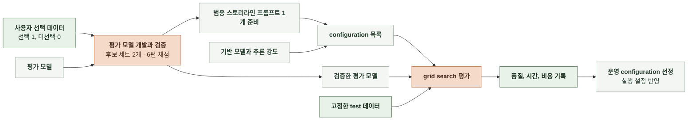

# 6-3 AI 정렬

스토리라인의 오프라인 평가와 운영 모델 선정 기준을 정한다.

 

### 6-3-1 스토리라인 생성

사용자가 재미있다고 느껴 선택하고 싶은 스토리라인을 생성한다. 기반 모델과 추론 강도(effort)의 조합을 configuration으로 정의한다.

 

**1. 비교 설정**

| 항목 | 비교 범위 |
|---|---|
| 기반 모델과 추론 강도 | 아래 표의 기반 모델과 지원 effort 조합 |
| 스토리라인 프롬프트 | 특정 모델에 맞추지 않은 범용 프롬프트 1개로 고정 |
| 평가 모델 | 사용자 선택 데이터로 검증한 평가 모델   grid search 중 모델, 프롬프트와 채점 기준 고정 |
| 데이터 | 모든 configuration에 동일한 test 데이터 사용 |
| 품질 | 요청별 후보 3편의 최고 점수를 우선 비교하고 평균 점수도 함께 확인 |
| 시간과 비용 | 스토리라인 생성 요청 1건 기준으로 비교   평가 모델 호출 시간과 비용은 생성 시간과 비용에서 분리 |

| 공급자 | 기반 모델 | `none` | `low` | `medium` | `high` |
|---|---|---|---|---|---|
| Anthropic | `claude-haiku-5-5` | O | O | O | O |
| Anthropic | `claude-sonnet-5-5` | X | O | O | O |
| Anthropic | `claude-opus-5-5` | X | O | O | O |
| Alibaba | `qwen3.8-max` | X | O | O | O |
| Alibaba | `qwen3.8-flash` | O | O | O | O |
| Z.ai | `glm-5.2` | O | X | X | O |
| Moonshot | `kimi-k3` | X | O | X | O |
| DeepSeek | `deepseek-flash` | O | O | X | O |
| OpenAI | `gpt-6-luna` | O | O | O | O |
| OpenAI | `gpt-6.1-sol` | X | O | O | O |
| OpenAI | `gpt-5.6-terra` | O | O | O | O |
| Google | `gemini-3.8-flash` | X | O | O | O |

 

**2. 평가 모델 준비**

| 항목 | 기준 |
|---|---|
| 평가 방식 | LLM-as-a-judge 방식으로 평가 모델 사용   후보 세트 2개(6편)를 함께 채점하고 회차별로 독립 호출 |
| 입력 | 후보 세트 2개에 속한 스토리라인 본문 6편과 후보별 식별자   정답 라벨은 제외 |
| 출력 | 입력한 후보 6편 각각의 점수 |
| 추천 추가 정보 | 선택 후 확인하는 정보이므로 평가 입력에서 제외 |
| 선택 완료 사례 | 같은 생성 요청의 후보 3편을 묶어 보관   선택된 후보는 `label = 1`, 나머지는 `label = 0` |
| 재생성 사례 | 평가 데이터셋에서 제외   재미없어서 재생성한 것으로 간주하고 평가 기준의 패턴 후보를 찾을 때만 참고 |
| 이탈 사례 | 평가 데이터셋에서 제외 |
| 일치 판정 | 회차마다 각 후보 세트 안에서 `label = 1`인 후보가 단독 최고점이면 일치   동점을 포함해 다른 후보의 점수가 높거나 같으면 불일치 |

 

**3. 평가 순서**

1. 데이터 분포를 확인해 개발과 검증 데이터를 나눈다.
2. train으로 평가 기준과 프롬프트를 수정한다. train 일치율이 기존 버전보다 높을 때만 후보를 test에서 평가하고, 두 데이터셋의 일치율이 모두 높아야 채택한다. 일치율 계산과 미완료 처리는 평가 방법에서 정한다. ([6-4-1 스토리라인 생성](6-4-AI-EVALUATION-METHOD.md#6-4-1-스토리라인-생성))
3. 평가 모델 검증 후 범용 스토리라인 프롬프트를 준비한다.
4. 스토리라인 프롬프트를 고정하고 기반 모델과 지원하는 effort로 configuration을 구성한다.
5. 각 configuration으로 후보 3편을 생성하고 검증한 평가 모델로 후보 세트 2개(6편)씩 함께 채점한다. 실제 호출 모델 ID와 호출 설정을 기록한다.
6. 품질, 생성 시간과 비용을 표와 그래프로 비교해 운영 configuration을 선정한다. 선정 근거를 기록하고 실행 설정에 반영한다.

 

**4. 개선 대상**

| 대상 | 확인 자료 | 확인할 문제 |
|---|---|---|
| 스토리라인 재미 | 평가 모델 평가 결과와 개발용 사례 | 낮은 점수를 받은 후보에서 반복되는 문제 |
| 평가 기준의 패턴 후보 | 재생성된 스토리라인 사례 | 사용자가 선택하지 않고 재생성한 후보들의 공통 특성 |
| 스토리라인 생성 실패 | 생성 실행 기록과 오류 로그 | 요청이 실패한 원인 |
| 생성 시간 | 생성 실행의 시간 기록 | 생성 요청의 지연 |
| 생성 비용 | 생성 호출의 사용량 | 입력과 출력 토큰 사용량과 모델 단가 |

 

**5. 개선 방법**

| 문제 | 개선 방법 |
|---|---|
| 평가 모델 점수와 사용자 선택이 일치하지 않음 | train 선택 사례에서 평가 기준과 평가 모델 프롬프트 수정   train과 test 일치율이 모두 기존 버전보다 높을 때만 채택 |
| 스토리라인 재미 점수가 낮음 | 스토리라인 프롬프트 수정   생성 모델과 추론 강도 교체 |
| 생성이 느리거나 비쌈 | 스토리라인 프롬프트 길이 축소   생성 모델과 추론 강도 교체 |

 

### 6-3-5 공통 개선 규칙

| 대상 | 규칙 |
|---|---|
| 모델 학습 | 직접 학습하지 않음 |
| 파인튜닝 | 추가 학습으로 가중치를 조정하지 않음 |
| 에이전트 도입 | 성능 개선을 위한 에이전트 구조를 도입하지 않음 |
| 모델 서빙 | 오픈소스 모델을 직접 배포해 서빙하지 않음 |
| 파이프라인 구조 | 스토리라인 생성의 호출 단계를 추가하거나 분리하지 않음 |
