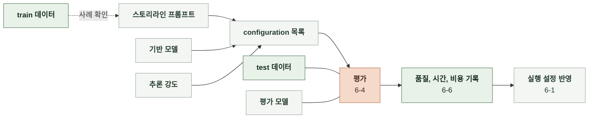

# 6-3 AI 정렬

스토리라인의 오프라인 평가와 운영 모델 선정 기준을 정한다.

 

### 6-3-1 스토리라인 생성

사용자가 재미있다고 느껴 선택하고 싶은 스토리라인을 생성한다. 기반 모델과 추론 강도(effort)의 조합을 configuration으로 정의한다.

 

**1. 비교 설정**

| 항목 | 비교 범위 |
|---|---|
| 기반 모델 | 아래 기반 모델 목록 |
| 프롬프트 | `prompt/story/STORYLINES-TEMPLATE.md` |
| 추론 강도 | `none`, `low`, `medium`, `high` |
| 데이터 | test 데이터셋 |

| 공급자 | 기반 모델 | `none` | `low` | `medium` | `high` |
|---|---|---|---|---|---|
| Anthropic | `claude-haiku-5-5` | O | O | O | O |
| Anthropic | `claude-sonnet-5-5` | X | O | O | O |
| Anthropic | `claude-opus-5-5` | X | O | O | O |
| Alibaba | `qwen3.8-max` | X | O | O | O |
| Alibaba | `qwen3.8-flash` | O | O | O | O |
| Z.ai | `glm-5.2` | O | X | X | O |
| Moonshot | `kimi-k3` | X | O | X | O |
| DeepSeek | `deepseek-flash` | O | O | X | O |
| OpenAI | `gpt-6-luna` | O | O | O | O |
| OpenAI | `gpt-6.1-sol` | X | O | O | O |
| OpenAI | `gpt-5.6-terra` | O | O | O | O |
| OpenAI | `gpt-6.1-terra` | O | O | O | O |
| Google | `gemini-3.8-flash` | X | O | O | O |

 

**2. 평가 순서**

1. 사용자 선택 데이터로 평가 모델을 검증하고 스토리라인 프롬프트를 준비한다. ([6-4 AI 평가 방법](6-4-AI-EVALUATION-METHOD.md))
2. 고정한 프롬프트에서 기반 모델과 지원하는 effort로 configuration을 구성한다.
3. 각 configuration으로 스토리라인을 생성하고 채점한다. configuration별 실제 호출 모델 ID와 호출 설정을 기록한다. ([6-4 AI 평가 방법](6-4-AI-EVALUATION-METHOD.md))
4. configuration별 설정과 품질, 시간, 비용을 표와 그래프로 비교해 운영 configuration을 선정하고 실행 설정에 반영한다. ([6-6 AI 성능 보고](6-6-AI-PERFORMANCE-REPORT.md))

 

**3. 개선 대상**

| 대상 | 확인 자료 | 확인할 문제 |
|---|---|---|
| 스토리라인 재미 | 평가 모델 평가 결과와 개발용 사례 | 낮은 점수를 받은 후보에서 반복되는 문제 |
| 평가 기준의 패턴 후보 | 재생성된 스토리라인 사례 | 사용자가 선택하지 않고 재생성한 후보들의 공통 특성 |
| 스토리라인 생성 실패 | 생성 실행 기록과 오류 로그 | 요청이 실패한 원인 |
| 생성 시간 | 생성 실행의 시간 기록 | 생성 요청의 지연 |
| 생성 비용 | 생성 호출의 사용량 | 입력과 출력 토큰 사용량과 모델 단가 |

 

**4. 개선 방법**

| 문제 | 개선 방법 |
|---|---|
| 평가 모델 점수와 사용자 선택이 일치하지 않음 | train 선택 사례에서 평가 기준과 평가 모델 프롬프트 수정   test 검증 후 실험 기준에 따라 채택 여부 판단 |
| 스토리라인 재미 점수가 낮음 | 스토리라인 프롬프트 수정   생성 모델과 추론 강도 교체 |
| 생성이 느리거나 비쌈 | 스토리라인 프롬프트 길이 축소   생성 모델과 추론 강도 교체 |

 

### 6-3-2 공통 개선 규칙

| 대상 | 규칙 |
|---|---|
| 모델 학습 | 직접 학습하지 않음 |
| 파인튜닝 | 추가 학습으로 가중치를 조정하지 않음 |
| 에이전트 도입 | 성능 개선을 위한 에이전트 구조를 도입하지 않음 |
| 모델 서빙 | 오픈소스 모델을 직접 배포해 서빙하지 않음 |
| 파이프라인 구조 | 스토리라인 생성의 호출 단계를 추가하거나 분리하지 않음 |
