# 6-4 AI 평가 방법

사용자 선택으로 평가 모델을 검증하고, 스토리라인 생성 모델의 품질, 출력 안정성, 시간과 비용을 비교한다.

<br>

### 6-4-1 스토리라인 생성

**1. 평가 범위**

| 구분 | 평가 모델 검증 | 생성 모델 평가 |
|---|---|---|
| 목적 | 점수 순위가 사용자 선택과 일치하는지 확인 | 운영에 사용할 모델과 추론 강도 선정 |
| 대상 | 사용자가 선택한 기록이 있는 스토리라인 후보 | 고정한 스토리라인 프롬프트에서 configuration별로 생성한 후보 |
| 평가 단위 | 같은 요청에서 생성된 후보 3편과 사용자 선택 | 생성 요청 1건의 후보 3편 |
| 채점 단위 | 후보 세트 2개(스토리라인 본문 6편)를 함께 채점 | 후보 세트 2개(스토리라인 본문 6편)를 함께 채점 |
| 결과 | 사용자 선택과 점수 순위의 일치 여부 | 후보별 점수, 요청별 최고 점수와 평균 점수, 출력 실패율, 생성 시간과 비용 |

<br>

**2. 데이터셋 구성**

| 사례 | 사용 방법 |
|---|---|
| 선택 완료 | 같은 생성 요청의 후보 3편과 사용자 선택을 평가 데이터셋에 포함 |
| 선택 없이 재생성 | 해당 후보 세트는 평가 데이터셋에서 제외 <br> 이후 생성된 후보 세트에 사용자 선택이 있으면 선택 완료 사례로 포함 |
| 이탈 | 평가 데이터셋에서 제외 |

| 항목 | train | test |
|---|---|---|
| 확정 규모 | 후보 세트 170개, 후보 510편 | 후보 세트 30개, 후보 90편 |
| 구성 | 선택 완료 사례의 생성 입력, 후보 본문과 선택 라벨 | 선택 완료 사례의 생성 입력, 후보 본문과 선택 라벨 |
| 평가 모델 | 평가 기준과 평가 모델 프롬프트 개발 | 사용자 선택과 점수 순위의 일치 여부 검증 |
| 생성 모델 | 스토리라인 프롬프트를 개선할 때 사례 확인 | 장르 태그, 주인공과 주변 인물 정보를 생성 입력으로 사용 <br> grid search를 실행하고 configuration 비교 |
| 변경 | 개발 과정에서 사례 추가 가능 | configuration 비교 중 고정 |

<details>
<summary><b>train 데이터셋 분포</b></summary>

<table>
<tr>
<td>

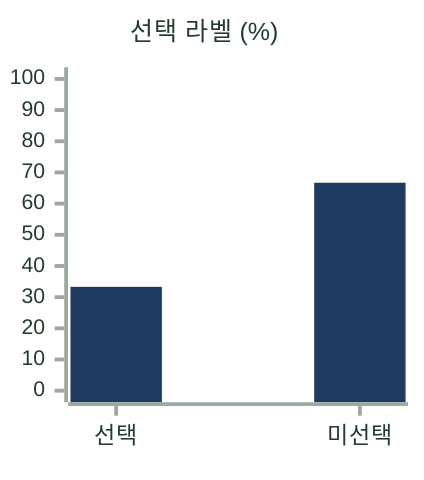

</td>
<td>

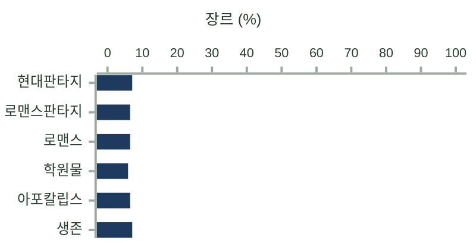

</td>
</tr>
<tr>
<td>

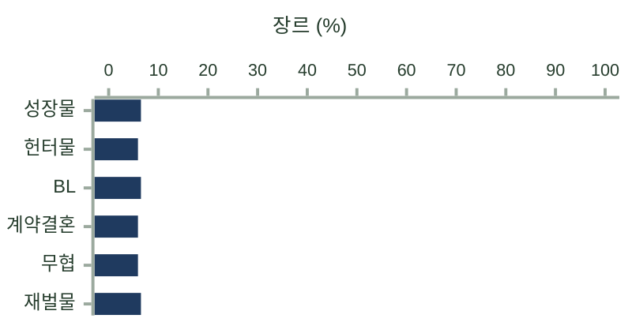

</td>
<td>

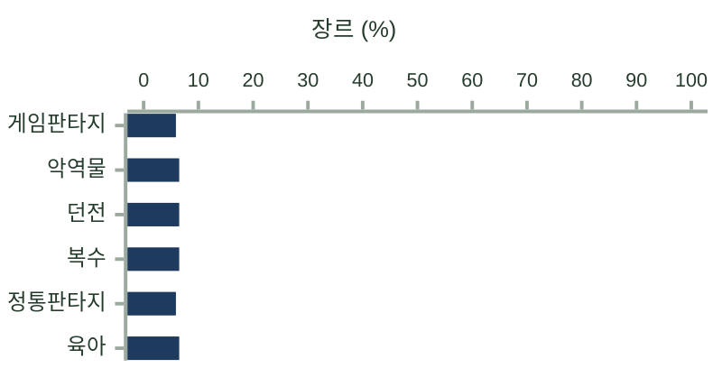

</td>
</tr>
<tr>
<td>

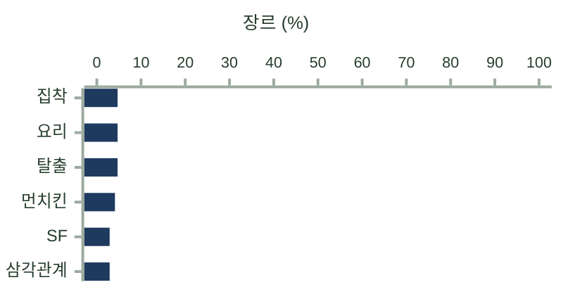

</td>
<td>

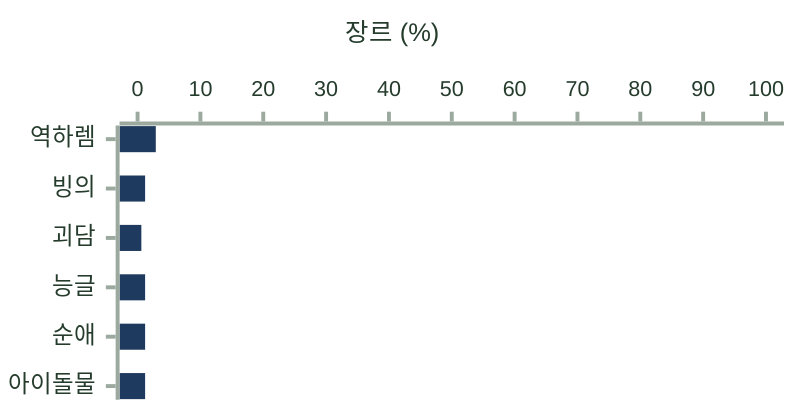

</td>
</tr>
<tr>
<td>

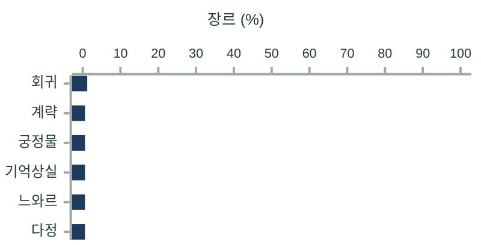

</td>
<td>

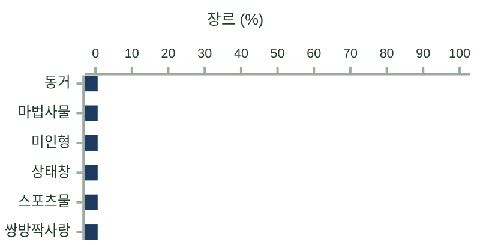

</td>
</tr>
<tr>
<td>

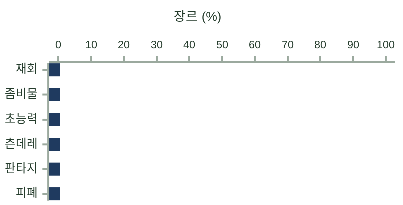

</td>
<td>

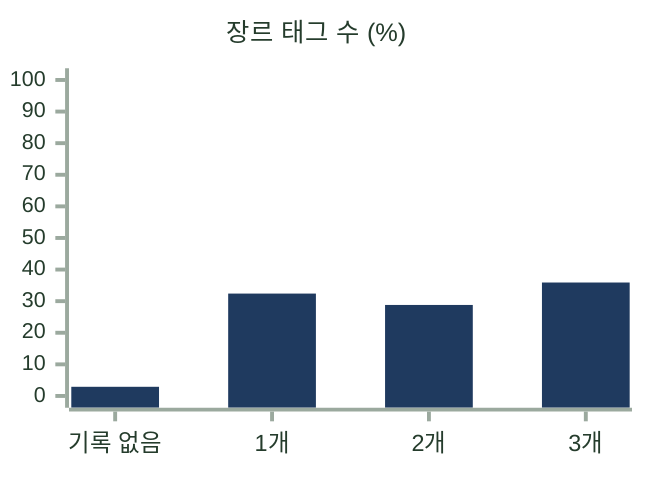

</td>
</tr>
<tr>
<td>

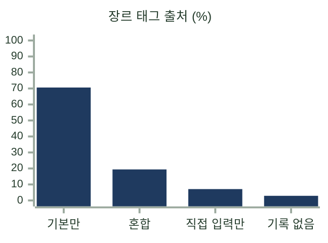

</td>
<td>

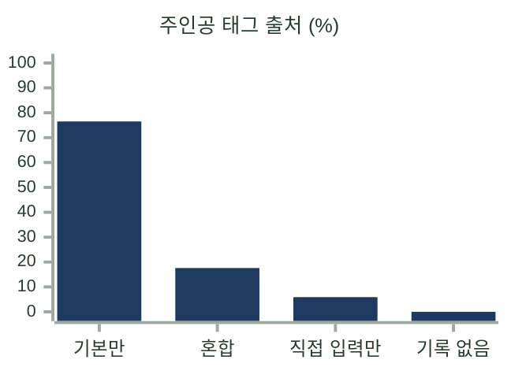

</td>
</tr>
<tr>
<td>

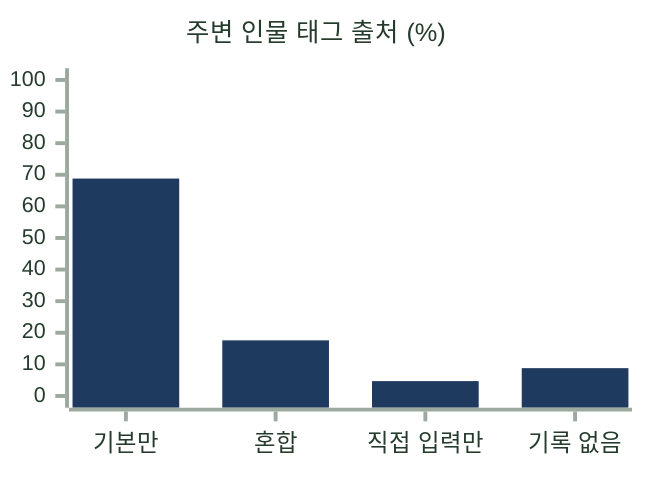

</td>
<td>

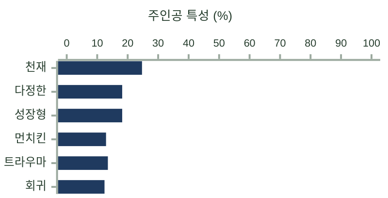

</td>
</tr>
<tr>
<td>

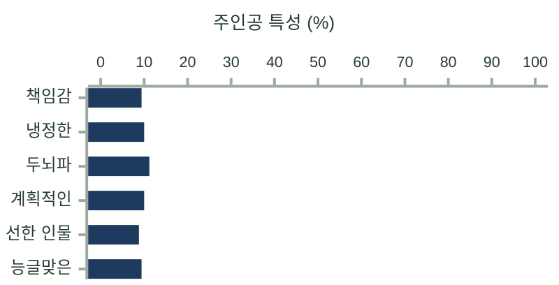

</td>
<td>

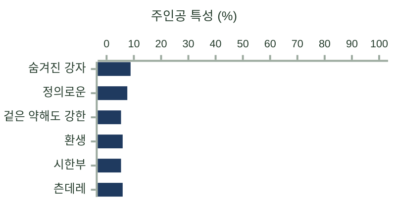

</td>
</tr>
<tr>
<td>

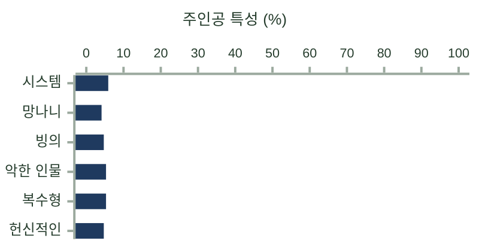

</td>
<td>

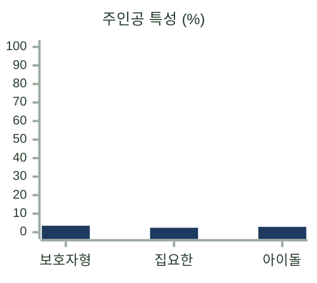

</td>
</tr>
<tr>
<td>

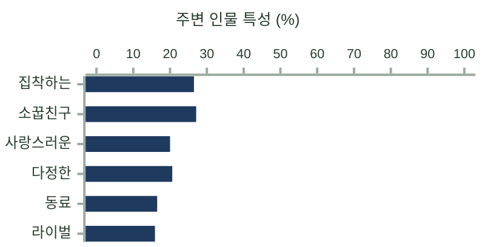

</td>
<td>

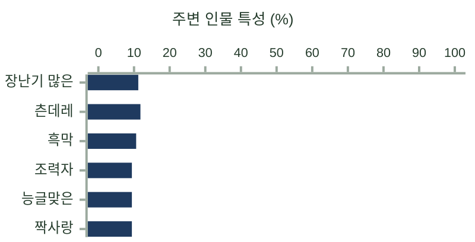

</td>
</tr>
<tr>
<td>

```mermaid
%%{init: {"theme": "base", "xyChart": {"width": 400, "height": 204, "titleFontSize": 13, "xAxis": {"labelFontSize": 12}, "yAxis": {"labelFontSize": 11, "showTitle": false}}, "themeVariables": {"xyChart": {"backgroundColor": "#FFFFFF", "titleColor": "#253C2C", "xAxisLabelColor": "#253C2C", "xAxisLineColor": "#9BA99E", "xAxisTickColor": "#9BA99E", "yAxisLabelColor": "#253C2C", "yAxisLineColor": "#9BA99E", "yAxisTickColor": "#9BA99E", "plotColorPalette": "#1F3A5F"}}}}%%
xychart-beta horizontal
    title "주변 인물 특성 (%)"
    x-axis ["까칠한", "비밀스러운", "충성스러운", "가족", "연인", "수상한"]
    y-axis 0 --> 100
    bar [8.8, 7.1, 8.2, 7.6, 7.6, 5.3]
```

</td>
<td>

```mermaid
%%{init: {"theme": "base", "xyChart": {"width": 400, "height": 204, "titleFontSize": 13, "xAxis": {"labelFontSize": 12}, "yAxis": {"labelFontSize": 11, "showTitle": false}}, "themeVariables": {"xyChart": {"backgroundColor": "#FFFFFF", "titleColor": "#253C2C", "xAxisLabelColor": "#253C2C", "xAxisLineColor": "#9BA99E", "xAxisTickColor": "#9BA99E", "yAxisLabelColor": "#253C2C", "yAxisLineColor": "#9BA99E", "yAxisTickColor": "#9BA99E", "plotColorPalette": "#1F3A5F"}}}}%%
xychart-beta horizontal
    title "주변 인물 특성 (%)"
    x-axis ["후회하는", "귀족", "스승", "천재", "호위무사", "초월자"]
    y-axis 0 --> 100
    bar [6.5, 5.9, 5.3, 6.5, 6.5, 4.7]
```

</td>
</tr>
<tr>
<td>

```mermaid
%%{init: {"theme": "base", "xyChart": {"width": 400, "height": 180, "titleFontSize": 13, "xAxis": {"labelFontSize": 12}, "yAxis": {"labelFontSize": 11, "showTitle": false}}, "themeVariables": {"xyChart": {"backgroundColor": "#FFFFFF", "titleColor": "#253C2C", "xAxisLabelColor": "#253C2C", "xAxisLineColor": "#9BA99E", "xAxisTickColor": "#9BA99E", "yAxisLabelColor": "#253C2C", "yAxisLineColor": "#9BA99E", "yAxisTickColor": "#9BA99E", "plotColorPalette": "#1F3A5F"}}}}%%
xychart-beta horizontal
    title "주변 인물 수 (%)"
    x-axis ["0명", "1명", "2~3명", "4~5명", "기록 없음"]
    y-axis 0 --> 100
    bar [0.0, 22.9, 7.1, 5.3, 64.7]
```

</td>
<td>

```mermaid
%%{init: {"theme": "base", "xyChart": {"width": 212, "height": 240, "titleFontSize": 13, "xAxis": {"labelFontSize": 12}, "yAxis": {"labelFontSize": 11, "showTitle": false}}, "themeVariables": {"xyChart": {"backgroundColor": "#FFFFFF", "titleColor": "#253C2C", "xAxisLabelColor": "#253C2C", "xAxisLineColor": "#9BA99E", "xAxisTickColor": "#9BA99E", "yAxisLabelColor": "#253C2C", "yAxisLineColor": "#9BA99E", "yAxisTickColor": "#9BA99E", "plotColorPalette": "#1F3A5F"}}}}%%
xychart-beta
    title "인물 기록 (%)"
    x-axis ["기록 있음", "기록 없음"]
    y-axis 0 --> 100
    bar [35.3, 64.7]
```

</td>
</tr>
<tr>
<td>

```mermaid
%%{init: {"theme": "base", "xyChart": {"width": 268, "height": 240, "titleFontSize": 13, "xAxis": {"labelFontSize": 12}, "yAxis": {"labelFontSize": 11, "showTitle": false}}, "themeVariables": {"xyChart": {"backgroundColor": "#FFFFFF", "titleColor": "#253C2C", "xAxisLabelColor": "#253C2C", "xAxisLineColor": "#9BA99E", "xAxisTickColor": "#9BA99E", "yAxisLabelColor": "#253C2C", "yAxisLineColor": "#9BA99E", "yAxisTickColor": "#9BA99E", "plotColorPalette": "#1F3A5F"}}}}%%
xychart-beta
    title "주인공 정보 지정 (%)"
    x-axis ["이름 지정", "성별 지정", "특징 지정"]
    y-axis 0 --> 100
    bar [66.7, 81.7, 100.0]
```

</td>
<td>

```mermaid
%%{init: {"theme": "base", "xyChart": {"width": 268, "height": 240, "titleFontSize": 13, "xAxis": {"labelFontSize": 12}, "yAxis": {"labelFontSize": 11, "showTitle": false}}, "themeVariables": {"xyChart": {"backgroundColor": "#FFFFFF", "titleColor": "#253C2C", "xAxisLabelColor": "#253C2C", "xAxisLineColor": "#9BA99E", "xAxisTickColor": "#9BA99E", "yAxisLabelColor": "#253C2C", "yAxisLineColor": "#9BA99E", "yAxisTickColor": "#9BA99E", "plotColorPalette": "#1F3A5F"}}}}%%
xychart-beta
    title "주변 인물 정보 지정 (%)"
    x-axis ["이름 지정", "성별 지정", "특징 지정"]
    y-axis 0 --> 100
    bar [52.3, 77.5, 86.5]
```

</td>
</tr>
<tr>
<td>

```mermaid
%%{init: {"theme": "base", "xyChart": {"width": 268, "height": 240, "titleFontSize": 13, "xAxis": {"labelFontSize": 12}, "yAxis": {"labelFontSize": 11, "showTitle": false}}, "themeVariables": {"xyChart": {"backgroundColor": "#FFFFFF", "titleColor": "#253C2C", "xAxisLabelColor": "#253C2C", "xAxisLineColor": "#9BA99E", "xAxisTickColor": "#9BA99E", "yAxisLabelColor": "#253C2C", "yAxisLineColor": "#9BA99E", "yAxisTickColor": "#9BA99E", "plotColorPalette": "#1F3A5F"}}}}%%
xychart-beta
    title "후보 세트 평균 길이 (%)"
    x-axis ["짧음", "중간", "긺"]
    y-axis 0 --> 100
    bar [10.0, 80.0, 10.0]
```

</td>
<td>

```mermaid
%%{init: {"theme": "base", "xyChart": {"width": 268, "height": 240, "titleFontSize": 13, "xAxis": {"labelFontSize": 12}, "yAxis": {"labelFontSize": 11, "showTitle": false}}, "themeVariables": {"xyChart": {"backgroundColor": "#FFFFFF", "titleColor": "#253C2C", "xAxisLabelColor": "#253C2C", "xAxisLineColor": "#9BA99E", "xAxisTickColor": "#9BA99E", "yAxisLabelColor": "#253C2C", "yAxisLineColor": "#9BA99E", "yAxisTickColor": "#9BA99E", "plotColorPalette": "#1F3A5F"}}}}%%
xychart-beta
    title "선택 위치 (%)"
    x-axis ["1번", "2번", "3번"]
    y-axis 0 --> 100
    bar [33.5, 33.5, 32.9]
```

</td>
</tr>
<tr>
<td>

```mermaid
%%{init: {"theme": "base", "xyChart": {"width": 400, "height": 180, "titleFontSize": 13, "xAxis": {"labelFontSize": 12}, "yAxis": {"labelFontSize": 11, "showTitle": false}}, "themeVariables": {"xyChart": {"backgroundColor": "#FFFFFF", "titleColor": "#253C2C", "xAxisLabelColor": "#253C2C", "xAxisLineColor": "#9BA99E", "xAxisTickColor": "#9BA99E", "yAxisLabelColor": "#253C2C", "yAxisLineColor": "#9BA99E", "yAxisTickColor": "#9BA99E", "plotColorPalette": "#1F3A5F"}}}}%%
xychart-beta horizontal
    title "생성 시기 (%)"
    x-axis ["2026-06", "2026-07", "2026-08", "2026-09", "2026-10"]
    y-axis 0 --> 100
    bar [4.7, 56.5, 13.5, 5.9, 19.4]
```

</td>
<td></td>
</tr>
</table>

</details>

<details>
<summary><b>test 데이터셋 분포</b></summary>

<table>
<tr>
<td>

```mermaid
%%{init: {"theme": "base", "xyChart": {"width": 212, "height": 240, "titleFontSize": 13, "xAxis": {"labelFontSize": 12}, "yAxis": {"labelFontSize": 11, "showTitle": false}}, "themeVariables": {"xyChart": {"backgroundColor": "#FFFFFF", "titleColor": "#253C2C", "xAxisLabelColor": "#253C2C", "xAxisLineColor": "#9BA99E", "xAxisTickColor": "#9BA99E", "yAxisLabelColor": "#253C2C", "yAxisLineColor": "#9BA99E", "yAxisTickColor": "#9BA99E", "plotColorPalette": "#1F3A5F"}}}}%%
xychart-beta
    title "선택 라벨 (%)"
    x-axis ["선택", "미선택"]
    y-axis 0 --> 100
    bar [33.3, 66.7]
```

</td>
<td>

```mermaid
%%{init: {"theme": "base", "xyChart": {"width": 400, "height": 204, "titleFontSize": 13, "xAxis": {"labelFontSize": 12}, "yAxis": {"labelFontSize": 11, "showTitle": false}}, "themeVariables": {"xyChart": {"backgroundColor": "#FFFFFF", "titleColor": "#253C2C", "xAxisLabelColor": "#253C2C", "xAxisLineColor": "#9BA99E", "xAxisTickColor": "#9BA99E", "yAxisLabelColor": "#253C2C", "yAxisLineColor": "#9BA99E", "yAxisTickColor": "#9BA99E", "plotColorPalette": "#1F3A5F"}}}}%%
xychart-beta horizontal
    title "장르 (%)"
    x-axis ["현대판타지", "로맨스판타지", "로맨스", "학원물", "아포칼립스", "생존"]
    y-axis 0 --> 100
    bar [3.3, 6.7, 6.7, 10.0, 6.7, 3.3]
```

</td>
</tr>
<tr>
<td>

```mermaid
%%{init: {"theme": "base", "xyChart": {"width": 400, "height": 204, "titleFontSize": 13, "xAxis": {"labelFontSize": 12}, "yAxis": {"labelFontSize": 11, "showTitle": false}}, "themeVariables": {"xyChart": {"backgroundColor": "#FFFFFF", "titleColor": "#253C2C", "xAxisLabelColor": "#253C2C", "xAxisLineColor": "#9BA99E", "xAxisTickColor": "#9BA99E", "yAxisLabelColor": "#253C2C", "yAxisLineColor": "#9BA99E", "yAxisTickColor": "#9BA99E", "plotColorPalette": "#1F3A5F"}}}}%%
xychart-beta horizontal
    title "장르 (%)"
    x-axis ["성장물", "헌터물", "BL", "계약결혼", "무협", "재벌물"]
    y-axis 0 --> 100
    bar [6.7, 10.0, 6.7, 10.0, 10.0, 6.7]
```

</td>
<td>

```mermaid
%%{init: {"theme": "base", "xyChart": {"width": 400, "height": 204, "titleFontSize": 13, "xAxis": {"labelFontSize": 12}, "yAxis": {"labelFontSize": 11, "showTitle": false}}, "themeVariables": {"xyChart": {"backgroundColor": "#FFFFFF", "titleColor": "#253C2C", "xAxisLabelColor": "#253C2C", "xAxisLineColor": "#9BA99E", "xAxisTickColor": "#9BA99E", "yAxisLabelColor": "#253C2C", "yAxisLineColor": "#9BA99E", "yAxisTickColor": "#9BA99E", "plotColorPalette": "#1F3A5F"}}}}%%
xychart-beta horizontal
    title "장르 (%)"
    x-axis ["게임판타지", "악역물", "던전", "복수", "정통판타지", "육아"]
    y-axis 0 --> 100
    bar [10.0, 6.7, 6.7, 6.7, 10.0, 6.7]
```

</td>
</tr>
<tr>
<td>

```mermaid
%%{init: {"theme": "base", "xyChart": {"width": 400, "height": 204, "titleFontSize": 13, "xAxis": {"labelFontSize": 12}, "yAxis": {"labelFontSize": 11, "showTitle": false}}, "themeVariables": {"xyChart": {"backgroundColor": "#FFFFFF", "titleColor": "#253C2C", "xAxisLabelColor": "#253C2C", "xAxisLineColor": "#9BA99E", "xAxisTickColor": "#9BA99E", "yAxisLabelColor": "#253C2C", "yAxisLineColor": "#9BA99E", "yAxisTickColor": "#9BA99E", "plotColorPalette": "#1F3A5F"}}}}%%
xychart-beta horizontal
    title "장르 (%)"
    x-axis ["집착", "요리", "탈출", "먼치킨", "SF", "삼각관계"]
    y-axis 0 --> 100
    bar [3.3, 3.3, 3.3, 3.3, 3.3, 3.3]
```

</td>
<td>

```mermaid
%%{init: {"theme": "base", "xyChart": {"width": 400, "height": 204, "titleFontSize": 13, "xAxis": {"labelFontSize": 12}, "yAxis": {"labelFontSize": 11, "showTitle": false}}, "themeVariables": {"xyChart": {"backgroundColor": "#FFFFFF", "titleColor": "#253C2C", "xAxisLabelColor": "#253C2C", "xAxisLineColor": "#9BA99E", "xAxisTickColor": "#9BA99E", "yAxisLabelColor": "#253C2C", "yAxisLineColor": "#9BA99E", "yAxisTickColor": "#9BA99E", "plotColorPalette": "#1F3A5F"}}}}%%
xychart-beta horizontal
    title "장르 (%)"
    x-axis ["역하렘", "빙의", "괴담", "능글", "순애", "아이돌물"]
    y-axis 0 --> 100
    bar [3.3, 3.3, 3.3, 0.0, 0.0, 0.0]
```

</td>
</tr>
<tr>
<td>

```mermaid
%%{init: {"theme": "base", "xyChart": {"width": 400, "height": 204, "titleFontSize": 13, "xAxis": {"labelFontSize": 12}, "yAxis": {"labelFontSize": 11, "showTitle": false}}, "themeVariables": {"xyChart": {"backgroundColor": "#FFFFFF", "titleColor": "#253C2C", "xAxisLabelColor": "#253C2C", "xAxisLineColor": "#9BA99E", "xAxisTickColor": "#9BA99E", "yAxisLabelColor": "#253C2C", "yAxisLineColor": "#9BA99E", "yAxisTickColor": "#9BA99E", "plotColorPalette": "#1F3A5F"}}}}%%
xychart-beta horizontal
    title "장르 (%)"
    x-axis ["회귀", "계략", "궁정물", "기억상실", "느와르", "다정"]
    y-axis 0 --> 100
    bar [0.0, 0.0, 0.0, 0.0, 0.0, 0.0]
```

</td>
<td>

```mermaid
%%{init: {"theme": "base", "xyChart": {"width": 400, "height": 204, "titleFontSize": 13, "xAxis": {"labelFontSize": 12}, "yAxis": {"labelFontSize": 11, "showTitle": false}}, "themeVariables": {"xyChart": {"backgroundColor": "#FFFFFF", "titleColor": "#253C2C", "xAxisLabelColor": "#253C2C", "xAxisLineColor": "#9BA99E", "xAxisTickColor": "#9BA99E", "yAxisLabelColor": "#253C2C", "yAxisLineColor": "#9BA99E", "yAxisTickColor": "#9BA99E", "plotColorPalette": "#1F3A5F"}}}}%%
xychart-beta horizontal
    title "장르 (%)"
    x-axis ["동거", "마법사물", "미인형", "상태창", "스포츠물", "쌍방짝사랑"]
    y-axis 0 --> 100
    bar [0.0, 0.0, 0.0, 0.0, 0.0, 0.0]
```

</td>
</tr>
<tr>
<td>

```mermaid
%%{init: {"theme": "base", "xyChart": {"width": 400, "height": 204, "titleFontSize": 13, "xAxis": {"labelFontSize": 12}, "yAxis": {"labelFontSize": 11, "showTitle": false}}, "themeVariables": {"xyChart": {"backgroundColor": "#FFFFFF", "titleColor": "#253C2C", "xAxisLabelColor": "#253C2C", "xAxisLineColor": "#9BA99E", "xAxisTickColor": "#9BA99E", "yAxisLabelColor": "#253C2C", "yAxisLineColor": "#9BA99E", "yAxisTickColor": "#9BA99E", "plotColorPalette": "#1F3A5F"}}}}%%
xychart-beta horizontal
    title "장르 (%)"
    x-axis ["재회", "좀비물", "초능력", "츤데레", "판타지", "피폐"]
    y-axis 0 --> 100
    bar [0.0, 0.0, 0.0, 0.0, 0.0, 0.0]
```

</td>
<td>

```mermaid
%%{init: {"theme": "base", "xyChart": {"width": 324, "height": 240, "titleFontSize": 13, "xAxis": {"labelFontSize": 12}, "yAxis": {"labelFontSize": 11, "showTitle": false}}, "themeVariables": {"xyChart": {"backgroundColor": "#FFFFFF", "titleColor": "#253C2C", "xAxisLabelColor": "#253C2C", "xAxisLineColor": "#9BA99E", "xAxisTickColor": "#9BA99E", "yAxisLabelColor": "#253C2C", "yAxisLineColor": "#9BA99E", "yAxisTickColor": "#9BA99E", "plotColorPalette": "#1F3A5F"}}}}%%
xychart-beta
    title "장르 태그 수 (%)"
    x-axis ["기록 없음", "1개", "2개", "3개"]
    y-axis 0 --> 100
    bar [3.3, 33.3, 43.3, 20.0]
```

</td>
</tr>
<tr>
<td>

```mermaid
%%{init: {"theme": "base", "xyChart": {"width": 324, "height": 240, "titleFontSize": 13, "xAxis": {"labelFontSize": 12}, "yAxis": {"labelFontSize": 11, "showTitle": false}}, "themeVariables": {"xyChart": {"backgroundColor": "#FFFFFF", "titleColor": "#253C2C", "xAxisLabelColor": "#253C2C", "xAxisLineColor": "#9BA99E", "xAxisTickColor": "#9BA99E", "yAxisLabelColor": "#253C2C", "yAxisLineColor": "#9BA99E", "yAxisTickColor": "#9BA99E", "plotColorPalette": "#1F3A5F"}}}}%%
xychart-beta
    title "장르 태그 출처 (%)"
    x-axis ["기본만", "혼합", "직접 입력만", "기록 없음"]
    y-axis 0 --> 100
    bar [80.0, 10.0, 6.7, 3.3]
```

</td>
<td>

```mermaid
%%{init: {"theme": "base", "xyChart": {"width": 324, "height": 240, "titleFontSize": 13, "xAxis": {"labelFontSize": 12}, "yAxis": {"labelFontSize": 11, "showTitle": false}}, "themeVariables": {"xyChart": {"backgroundColor": "#FFFFFF", "titleColor": "#253C2C", "xAxisLabelColor": "#253C2C", "xAxisLineColor": "#9BA99E", "xAxisTickColor": "#9BA99E", "yAxisLabelColor": "#253C2C", "yAxisLineColor": "#9BA99E", "yAxisTickColor": "#9BA99E", "plotColorPalette": "#1F3A5F"}}}}%%
xychart-beta
    title "주인공 태그 출처 (%)"
    x-axis ["기본만", "혼합", "직접 입력만", "기록 없음"]
    y-axis 0 --> 100
    bar [83.3, 6.7, 10.0, 0.0]
```

</td>
</tr>
<tr>
<td>

```mermaid
%%{init: {"theme": "base", "xyChart": {"width": 324, "height": 240, "titleFontSize": 13, "xAxis": {"labelFontSize": 12}, "yAxis": {"labelFontSize": 11, "showTitle": false}}, "themeVariables": {"xyChart": {"backgroundColor": "#FFFFFF", "titleColor": "#253C2C", "xAxisLabelColor": "#253C2C", "xAxisLineColor": "#9BA99E", "xAxisTickColor": "#9BA99E", "yAxisLabelColor": "#253C2C", "yAxisLineColor": "#9BA99E", "yAxisTickColor": "#9BA99E", "plotColorPalette": "#1F3A5F"}}}}%%
xychart-beta
    title "주변 인물 태그 출처 (%)"
    x-axis ["기본만", "혼합", "직접 입력만", "기록 없음"]
    y-axis 0 --> 100
    bar [76.7, 16.7, 0.0, 6.7]
```

</td>
<td>

```mermaid
%%{init: {"theme": "base", "xyChart": {"width": 400, "height": 204, "titleFontSize": 13, "xAxis": {"labelFontSize": 12}, "yAxis": {"labelFontSize": 11, "showTitle": false}}, "themeVariables": {"xyChart": {"backgroundColor": "#FFFFFF", "titleColor": "#253C2C", "xAxisLabelColor": "#253C2C", "xAxisLineColor": "#9BA99E", "xAxisTickColor": "#9BA99E", "yAxisLabelColor": "#253C2C", "yAxisLineColor": "#9BA99E", "yAxisTickColor": "#9BA99E", "plotColorPalette": "#1F3A5F"}}}}%%
xychart-beta horizontal
    title "주인공 특성 (%)"
    x-axis ["천재", "다정한", "성장형", "먼치킨", "트라우마", "회귀"]
    y-axis 0 --> 100
    bar [16.7, 20.0, 23.3, 16.7, 20.0, 16.7]
```

</td>
</tr>
<tr>
<td>

```mermaid
%%{init: {"theme": "base", "xyChart": {"width": 400, "height": 204, "titleFontSize": 13, "xAxis": {"labelFontSize": 12}, "yAxis": {"labelFontSize": 11, "showTitle": false}}, "themeVariables": {"xyChart": {"backgroundColor": "#FFFFFF", "titleColor": "#253C2C", "xAxisLabelColor": "#253C2C", "xAxisLineColor": "#9BA99E", "xAxisTickColor": "#9BA99E", "yAxisLabelColor": "#253C2C", "yAxisLineColor": "#9BA99E", "yAxisTickColor": "#9BA99E", "plotColorPalette": "#1F3A5F"}}}}%%
xychart-beta horizontal
    title "주인공 특성 (%)"
    x-axis ["책임감", "냉정한", "두뇌파", "계획적인", "선한 인물", "능글맞은"]
    y-axis 0 --> 100
    bar [13.3, 13.3, 13.3, 10.0, 6.7, 6.7]
```

</td>
<td>

```mermaid
%%{init: {"theme": "base", "xyChart": {"width": 400, "height": 204, "titleFontSize": 13, "xAxis": {"labelFontSize": 12}, "yAxis": {"labelFontSize": 11, "showTitle": false}}, "themeVariables": {"xyChart": {"backgroundColor": "#FFFFFF", "titleColor": "#253C2C", "xAxisLabelColor": "#253C2C", "xAxisLineColor": "#9BA99E", "xAxisTickColor": "#9BA99E", "yAxisLabelColor": "#253C2C", "yAxisLineColor": "#9BA99E", "yAxisTickColor": "#9BA99E", "plotColorPalette": "#1F3A5F"}}}}%%
xychart-beta horizontal
    title "주인공 특성 (%)"
    x-axis ["숨겨진 강자", "정의로운", "겉은 약해도 강한", "환생", "시한부", "츤데레"]
    y-axis 0 --> 100
    bar [0.0, 3.3, 3.3, 6.7, 6.7, 3.3]
```

</td>
</tr>
<tr>
<td>

```mermaid
%%{init: {"theme": "base", "xyChart": {"width": 400, "height": 204, "titleFontSize": 13, "xAxis": {"labelFontSize": 12}, "yAxis": {"labelFontSize": 11, "showTitle": false}}, "themeVariables": {"xyChart": {"backgroundColor": "#FFFFFF", "titleColor": "#253C2C", "xAxisLabelColor": "#253C2C", "xAxisLineColor": "#9BA99E", "xAxisTickColor": "#9BA99E", "yAxisLabelColor": "#253C2C", "yAxisLineColor": "#9BA99E", "yAxisTickColor": "#9BA99E", "plotColorPalette": "#1F3A5F"}}}}%%
xychart-beta horizontal
    title "주인공 특성 (%)"
    x-axis ["시스템", "망나니", "빙의", "악한 인물", "복수형", "헌신적인"]
    y-axis 0 --> 100
    bar [3.3, 6.7, 3.3, 3.3, 0.0, 0.0]
```

</td>
<td>

```mermaid
%%{init: {"theme": "base", "xyChart": {"width": 268, "height": 240, "titleFontSize": 13, "xAxis": {"labelFontSize": 12}, "yAxis": {"labelFontSize": 11, "showTitle": false}}, "themeVariables": {"xyChart": {"backgroundColor": "#FFFFFF", "titleColor": "#253C2C", "xAxisLabelColor": "#253C2C", "xAxisLineColor": "#9BA99E", "xAxisTickColor": "#9BA99E", "yAxisLabelColor": "#253C2C", "yAxisLineColor": "#9BA99E", "yAxisTickColor": "#9BA99E", "plotColorPalette": "#1F3A5F"}}}}%%
xychart-beta
    title "주인공 특성 (%)"
    x-axis ["보호자형", "집요한", "아이돌"]
    y-axis 0 --> 100
    bar [3.3, 3.3, 0.0]
```

</td>
</tr>
<tr>
<td>

```mermaid
%%{init: {"theme": "base", "xyChart": {"width": 400, "height": 204, "titleFontSize": 13, "xAxis": {"labelFontSize": 12}, "yAxis": {"labelFontSize": 11, "showTitle": false}}, "themeVariables": {"xyChart": {"backgroundColor": "#FFFFFF", "titleColor": "#253C2C", "xAxisLabelColor": "#253C2C", "xAxisLineColor": "#9BA99E", "xAxisTickColor": "#9BA99E", "yAxisLabelColor": "#253C2C", "yAxisLineColor": "#9BA99E", "yAxisTickColor": "#9BA99E", "plotColorPalette": "#1F3A5F"}}}}%%
xychart-beta horizontal
    title "주변 인물 특성 (%)"
    x-axis ["집착하는", "소꿉친구", "사랑스러운", "다정한", "동료", "라이벌"]
    y-axis 0 --> 100
    bar [16.7, 20.0, 16.7, 16.7, 13.3, 13.3]
```

</td>
<td>

```mermaid
%%{init: {"theme": "base", "xyChart": {"width": 400, "height": 204, "titleFontSize": 13, "xAxis": {"labelFontSize": 12}, "yAxis": {"labelFontSize": 11, "showTitle": false}}, "themeVariables": {"xyChart": {"backgroundColor": "#FFFFFF", "titleColor": "#253C2C", "xAxisLabelColor": "#253C2C", "xAxisLineColor": "#9BA99E", "xAxisTickColor": "#9BA99E", "yAxisLabelColor": "#253C2C", "yAxisLineColor": "#9BA99E", "yAxisTickColor": "#9BA99E", "plotColorPalette": "#1F3A5F"}}}}%%
xychart-beta horizontal
    title "주변 인물 특성 (%)"
    x-axis ["장난기 많은", "츤데레", "흑막", "조력자", "능글맞은", "짝사랑"]
    y-axis 0 --> 100
    bar [16.7, 13.3, 6.7, 16.7, 16.7, 13.3]
```

</td>
</tr>
<tr>
<td>

```mermaid
%%{init: {"theme": "base", "xyChart": {"width": 400, "height": 204, "titleFontSize": 13, "xAxis": {"labelFontSize": 12}, "yAxis": {"labelFontSize": 11, "showTitle": false}}, "themeVariables": {"xyChart": {"backgroundColor": "#FFFFFF", "titleColor": "#253C2C", "xAxisLabelColor": "#253C2C", "xAxisLineColor": "#9BA99E", "xAxisTickColor": "#9BA99E", "yAxisLabelColor": "#253C2C", "yAxisLineColor": "#9BA99E", "yAxisTickColor": "#9BA99E", "plotColorPalette": "#1F3A5F"}}}}%%
xychart-beta horizontal
    title "주변 인물 특성 (%)"
    x-axis ["까칠한", "비밀스러운", "충성스러운", "가족", "연인", "수상한"]
    y-axis 0 --> 100
    bar [0.0, 16.7, 10.0, 10.0, 3.3, 6.7]
```

</td>
<td>

```mermaid
%%{init: {"theme": "base", "xyChart": {"width": 400, "height": 204, "titleFontSize": 13, "xAxis": {"labelFontSize": 12}, "yAxis": {"labelFontSize": 11, "showTitle": false}}, "themeVariables": {"xyChart": {"backgroundColor": "#FFFFFF", "titleColor": "#253C2C", "xAxisLabelColor": "#253C2C", "xAxisLineColor": "#9BA99E", "xAxisTickColor": "#9BA99E", "yAxisLabelColor": "#253C2C", "yAxisLineColor": "#9BA99E", "yAxisTickColor": "#9BA99E", "plotColorPalette": "#1F3A5F"}}}}%%
xychart-beta horizontal
    title "주변 인물 특성 (%)"
    x-axis ["후회하는", "귀족", "스승", "천재", "호위무사", "초월자"]
    y-axis 0 --> 100
    bar [10.0, 3.3, 3.3, 3.3, 6.7, 3.3]
```

</td>
</tr>
<tr>
<td>

```mermaid
%%{init: {"theme": "base", "xyChart": {"width": 400, "height": 180, "titleFontSize": 13, "xAxis": {"labelFontSize": 12}, "yAxis": {"labelFontSize": 11, "showTitle": false}}, "themeVariables": {"xyChart": {"backgroundColor": "#FFFFFF", "titleColor": "#253C2C", "xAxisLabelColor": "#253C2C", "xAxisLineColor": "#9BA99E", "xAxisTickColor": "#9BA99E", "yAxisLabelColor": "#253C2C", "yAxisLineColor": "#9BA99E", "yAxisTickColor": "#9BA99E", "plotColorPalette": "#1F3A5F"}}}}%%
xychart-beta horizontal
    title "주변 인물 수 (%)"
    x-axis ["0명", "1명", "2~3명", "4~5명", "기록 없음"]
    y-axis 0 --> 100
    bar [0.0, 23.3, 16.7, 0.0, 60.0]
```

</td>
<td>

```mermaid
%%{init: {"theme": "base", "xyChart": {"width": 212, "height": 240, "titleFontSize": 13, "xAxis": {"labelFontSize": 12}, "yAxis": {"labelFontSize": 11, "showTitle": false}}, "themeVariables": {"xyChart": {"backgroundColor": "#FFFFFF", "titleColor": "#253C2C", "xAxisLabelColor": "#253C2C", "xAxisLineColor": "#9BA99E", "xAxisTickColor": "#9BA99E", "yAxisLabelColor": "#253C2C", "yAxisLineColor": "#9BA99E", "yAxisTickColor": "#9BA99E", "plotColorPalette": "#1F3A5F"}}}}%%
xychart-beta
    title "인물 기록 (%)"
    x-axis ["기록 있음", "기록 없음"]
    y-axis 0 --> 100
    bar [40.0, 60.0]
```

</td>
</tr>
<tr>
<td>

```mermaid
%%{init: {"theme": "base", "xyChart": {"width": 268, "height": 240, "titleFontSize": 13, "xAxis": {"labelFontSize": 12}, "yAxis": {"labelFontSize": 11, "showTitle": false}}, "themeVariables": {"xyChart": {"backgroundColor": "#FFFFFF", "titleColor": "#253C2C", "xAxisLabelColor": "#253C2C", "xAxisLineColor": "#9BA99E", "xAxisTickColor": "#9BA99E", "yAxisLabelColor": "#253C2C", "yAxisLineColor": "#9BA99E", "yAxisTickColor": "#9BA99E", "plotColorPalette": "#1F3A5F"}}}}%%
xychart-beta
    title "주인공 정보 지정 (%)"
    x-axis ["이름 지정", "성별 지정", "특징 지정"]
    y-axis 0 --> 100
    bar [75.0, 75.0, 100.0]
```

</td>
<td>

```mermaid
%%{init: {"theme": "base", "xyChart": {"width": 268, "height": 240, "titleFontSize": 13, "xAxis": {"labelFontSize": 12}, "yAxis": {"labelFontSize": 11, "showTitle": false}}, "themeVariables": {"xyChart": {"backgroundColor": "#FFFFFF", "titleColor": "#253C2C", "xAxisLabelColor": "#253C2C", "xAxisLineColor": "#9BA99E", "xAxisTickColor": "#9BA99E", "yAxisLabelColor": "#253C2C", "yAxisLineColor": "#9BA99E", "yAxisTickColor": "#9BA99E", "plotColorPalette": "#1F3A5F"}}}}%%
xychart-beta
    title "주변 인물 정보 지정 (%)"
    x-axis ["이름 지정", "성별 지정", "특징 지정"]
    y-axis 0 --> 100
    bar [61.1, 77.8, 83.3]
```

</td>
</tr>
<tr>
<td>

```mermaid
%%{init: {"theme": "base", "xyChart": {"width": 268, "height": 240, "titleFontSize": 13, "xAxis": {"labelFontSize": 12}, "yAxis": {"labelFontSize": 11, "showTitle": false}}, "themeVariables": {"xyChart": {"backgroundColor": "#FFFFFF", "titleColor": "#253C2C", "xAxisLabelColor": "#253C2C", "xAxisLineColor": "#9BA99E", "xAxisTickColor": "#9BA99E", "yAxisLabelColor": "#253C2C", "yAxisLineColor": "#9BA99E", "yAxisTickColor": "#9BA99E", "plotColorPalette": "#1F3A5F"}}}}%%
xychart-beta
    title "후보 세트 평균 길이 (%)"
    x-axis ["짧음", "중간", "긺"]
    y-axis 0 --> 100
    bar [10.0, 80.0, 10.0]
```

</td>
<td>

```mermaid
%%{init: {"theme": "base", "xyChart": {"width": 268, "height": 240, "titleFontSize": 13, "xAxis": {"labelFontSize": 12}, "yAxis": {"labelFontSize": 11, "showTitle": false}}, "themeVariables": {"xyChart": {"backgroundColor": "#FFFFFF", "titleColor": "#253C2C", "xAxisLabelColor": "#253C2C", "xAxisLineColor": "#9BA99E", "xAxisTickColor": "#9BA99E", "yAxisLabelColor": "#253C2C", "yAxisLineColor": "#9BA99E", "yAxisTickColor": "#9BA99E", "plotColorPalette": "#1F3A5F"}}}}%%
xychart-beta
    title "선택 위치 (%)"
    x-axis ["1번", "2번", "3번"]
    y-axis 0 --> 100
    bar [33.3, 33.3, 33.3]
```

</td>
</tr>
<tr>
<td>

```mermaid
%%{init: {"theme": "base", "xyChart": {"width": 400, "height": 180, "titleFontSize": 13, "xAxis": {"labelFontSize": 12}, "yAxis": {"labelFontSize": 11, "showTitle": false}}, "themeVariables": {"xyChart": {"backgroundColor": "#FFFFFF", "titleColor": "#253C2C", "xAxisLabelColor": "#253C2C", "xAxisLineColor": "#9BA99E", "xAxisTickColor": "#9BA99E", "yAxisLabelColor": "#253C2C", "yAxisLineColor": "#9BA99E", "yAxisTickColor": "#9BA99E", "plotColorPalette": "#1F3A5F"}}}}%%
xychart-beta horizontal
    title "생성 시기 (%)"
    x-axis ["2026-06", "2026-07", "2026-08", "2026-09", "2026-10"]
    y-axis 0 --> 100
    bar [0.0, 56.7, 16.7, 10.0, 16.7]
```

</td>
<td></td>
</tr>
</table>

</details>

<br>

**3. 평가 모델**

```mermaid
%%{init: {"flowchart": {"curve": "basis", "htmlLabels": true, "nodeSpacing": 24, "rankSpacing": 48}}}%%
flowchart LR
    P["<b>평가 모델 프롬프트</b><br/>평가 기준과 채점 지시"] --- J["<b>평가 모델</b><br/>gpt-6-astra · high<br/>후보 세트당 독립 호출 3회"]
    S["<b>후보 세트 2개 · 본문 6편</b><br/>후보별 sample_id"] --- J
    J --> O["<b>호출 1회당 JSON 채점 결과 6개</b><br/>results 배열<br/>sample_id: 후보 식별자<br/>score: 0~100점 정수<br/>reason: 채점 이유<br/>evidence: 본문 근거 문자열"]
    classDef data fill:#E8F2E8,stroke:#527A59,color:#182D1D
    classDef task fill:#F5D9C9,stroke:#B97450,color:#452B1D
    class P,S,O data
    class J task
```

| 항목 | 내용 |
|---|---|
| 평가 모델 | `gpt-6-astra` |
| 추론 강도 | `high` |
| 방식 | LLM-as-a-judge |
| 채점 질문 | 사용자가 재미있다고 느껴 선택하고 싶은 스토리라인인가 |
| 점수 기준 | 0~100점을 구간으로 나누어 선택하고 싶은 정도의 기준 정의 <br> 각 비교 실행 중에는 버전별 기준 고정 |

<br>

**평가 모델 일치율 측정**

```mermaid
%%{init: {"flowchart": {"curve": "linear", "htmlLabels": true, "nodeSpacing": 24, "rankSpacing": 40}}}%%
flowchart LR
    D["<b>고정 데이터셋</b><br/>train 또는 test<br/>후보 세트 2개 · 본문 6편"] --- J
    P["<b>평가 프롬프트</b><br/>비교할 버전"] --- J
    J["<b>평가 모델</b><br/>모델과 추론 강도 고정<br/>후보 세트당 독립 채점 3회"] --> V
    L["<b>사용자 선택 라벨</b><br/>선택 1, 미선택 0"] --> V
    V["<b>회차별 일치 판정</b><br/>각 후보 세트에서 선택 후보가<br/>단독 최고점이면 일치<br/>동점 또는 낮은 점수면 불일치"] --> R
    R["<b>회차별 일치율</b><br/>일치 후보 세트 수 ÷ 채점 완료 후보 세트 수<br/>미완료 수 별도 집계<br/>분모가 0이면 null"] -->|전체 3회 완료| F
    R -->|미완료| U
    F["<b>최종 일치율</b><br/>회차별 일치율 3개의 평균"]
    U["<b>판정 보류</b><br/>최종 일치율 null"]
    classDef data fill:#E8F2E8,stroke:#527A59,color:#182D1D
    classDef task fill:#F5D9C9,stroke:#B97450,color:#452B1D
    classDef check fill:#F4F6F4,stroke:#9BA99E,color:#253C2C
    class D,P,L,F,U data
    class J task
    class V,R check
```

<br>

| 항목 | 기준 |
|---|---|
| 호출 방식 | 호출당 후보 세트 2개(6편) 입력 <br> 각 후보 세트의 3회 채점은 순차 실행하며 회차마다 독립 호출 <br> 각 후보 세트 안에서 후보 제시 순서는 회차마다 한 칸씩 순환 <br> 이전 회차의 채점 결과와 사용자 선택 라벨은 전달하지 않음 |
| test 분리 | 오케스트레이션 AI에 test 본문, 라벨, 점수와 기각 사유를 전달하지 않음 <br> 별도 실행기가 test 평가와 채택 판정 수행 |

<br>

**평가 모델 개선 사이클**

```mermaid
%%{init: {"flowchart": {"curve": "basis", "htmlLabels": true, "nodeSpacing": 24, "rankSpacing": 48}}}%%
flowchart LR
    A["<b>평가 모델 프롬프트 수정</b>"] --> B["<b>train 평가</b><br/>후보 세트당 독립 호출 3회"]
    B --> C["<b>기존 버전의 train 일치율과 비교</b>"]
    C -->|상승| D["<b>test 평가</b><br/>같은 수정본 사용"]
    C -->|같거나 하락| F["<b>수정본 기각</b><br/>기존 버전 유지"]
    D --> G["<b>기존 버전의 test 일치율과 비교</b>"]
    G -->|상승| E["<b>정식 버전 채택</b><br/>즉시 종료"]
    G -->|같거나 하락| F
    F -->|5사이클 미만| A
    F -->|5사이클 도달| H["<b>종료</b><br/>기존 버전 유지"]
    classDef data fill:#E8F2E8,stroke:#527A59,color:#182D1D
    classDef task fill:#F5D9C9,stroke:#B97450,color:#452B1D
    classDef check fill:#F4F6F4,stroke:#9BA99E,color:#253C2C
    class A,B,D task
    class C,G check
    class E,F,H data
```

| 항목 | 기준 |
|---|---|
| 개선 입력 | 정식 프롬프트, train 데이터와 채점 피드백, `failed-ideas.md` |
| 수정 범위 | 후보 프롬프트의 `<criteria>` 내부만 수정 |
| 실패 기록 | train에서 기각된 아이디어와 기준, 후보의 일치율을 `failed-ideas.md`에 기록 |

<br>

**autoresearch 설정**

| 항목 | 설정값 |
|---|---|
| 오케스트레이션 AI 모델 | `gpt-6-astra`, 추론 강도 `xhigh` |
| 최대 개선 사이클 수 | 5회 |
| 전체 모델 호출 한도 | 재시도 포함 1,600회 |
| 호출 타임아웃 | 5분 |
| 실패 시 최대 재시도 횟수 | 3회 |
| 동시 채점 호출 수 | 3개(후보 세트 6개, 총 18편) |

<br>

**4. 평가 지표**

| 지표 | 측정 방법 | 용도 |
|---|---|---|
| 요청별 최고 점수 | 후보별 3회 채점 평균 중 최댓값 | 선택하고 싶은 후보 한 편을 생성하는 성능 비교 |
| 요청별 평균 점수 | 후보별 3회 채점 평균의 합 ÷ 3 | 후보 전체의 품질 확인 |
| 생성 시간 | 스토리라인 생성 요청 1건의 소요 시간 | configuration별 생성 지연 비교 |
| 생성 비용 | 스토리라인 생성 요청 1건의 모델 호출 비용 | configuration별 비용 비교 |
| 최초 JSON 파싱 실패율 | 최초 출력 중 JSON 파싱에 실패한 요청 수 ÷ 최초 출력 검사에 도달한 요청 수 | 재생성으로 가려지는 JSON 오류 비교 |
| 최초 구조 검증 실패율 | 최초 출력 중 JSON 파싱은 성공했으나 구조 검증에 실패한 요청 수 ÷ 최초 출력 검사에 도달한 요청 수 | 후보 수, 추천 정보 수와 필드 형식 오류 비교 |
| 형식 오류 복구율 | 최초 파싱 또는 구조 검증 실패 후 전체 재생성으로 형식 검사를 통과한 요청 수 ÷ 최초 파싱 또는 구조 검증 실패 요청 수 | 운영 복구의 효과 확인 |
| 최종 요청 실패율 | 운영 생성 코드가 최종 실패로 종료한 요청 수 ÷ 성공 또는 실패로 종료한 생성 요청 수 | 복구를 포함한 생성 안정성 비교 |

<br>

**5. 출력 안정성의 판정과 집계**

| 항목 | 판정과 집계 기준 |
|---|---|
| 형식 검사 | 운영 전처리 후 파싱과 구조 검증 결과로 판정함. ([6-1-1 스토리라인](6-1-AI-EXECUTION.md#6-1-1-스토리라인)) |
| 호출 실패 | 출력 검사 전 실패는 형식 실패율의 분모에서 제외하고 별도 집계함 <br> 최종 실패로 종료한 요청은 최종 요청 실패율에 포함함 |
| 복구 기록 | 복구 후에도 최초 실패 기록 유지 <br> 최초 생성, 재생성, 인물 보완과 병합 결과를 구분해 검사함 <br> 형식 복구 여부와 최종 요청 성공 여부를 별도 기록함 |
| 품질 점수 | 생성에 성공하고 후보 3편의 채점을 모두 완료한 요청만 집계함 <br> 생성 실패와 채점 실패는 0점으로 대체하지 않고 별도 집계함 |
| 시간과 비용 | 실패, 재생성과 인물 보완 호출 포함 <br> 성공 요청과 실패 요청을 구분해 집계함 |
| 표본과 누락 | configuration별 분자, 분모, 미실행과 중단 건수 표시 <br> 분모가 0이거나 검사 기록이 없으면 측정 불가 |
| 목표 비교 | 평가 데이터셋의 결과와 운영 실측을 구분해 실패율 목표와 비교함 ([2-2-2 핵심 지표 요약](2-2-OPERATION-REQUIREMENTS.md#2-2-2-핵심-지표-요약)) |
