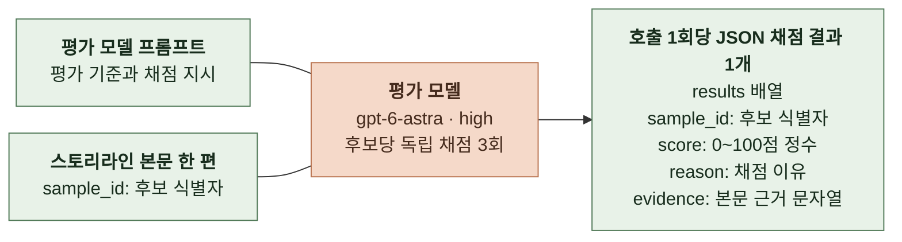
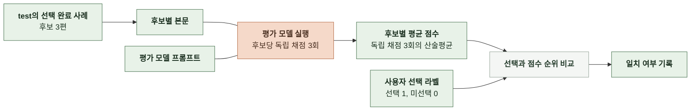
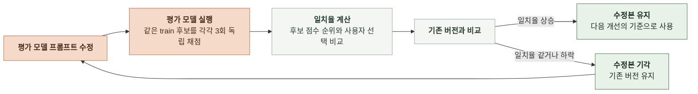

# 6-4 AI 평가 방법

사용자 선택으로 평가 모델을 검증하고, 스토리라인 생성 모델의 품질, 출력 안정성, 시간과 비용을 비교한다.

 

### 6-4-1 스토리라인 생성

**1. 평가 범위**

| 구분 | 평가 모델 검증 | 생성 모델 평가 |
|---|---|---|
| 목적 | 점수 순위가 사용자 선택과 일치하는지 확인 | 운영에 사용할 모델과 추론 강도 선정 |
| 대상 | 사용자가 선택한 기록이 있는 스토리라인 후보 | 고정한 스토리라인 프롬프트에서 configuration별로 생성한 후보 |
| 평가 단위 | 같은 요청에서 생성된 후보 3편과 사용자 선택 | 생성 요청 1건의 후보 3편 |
| 채점 단위 | 스토리라인 본문 한 편 | 스토리라인 본문 한 편 |
| 결과 | 사용자 선택과 점수 순위의 일치 여부 | 후보별 점수, 요청별 최고 점수와 평균 점수, 출력 실패율, 생성 시간과 비용 |

 

**2. 데이터셋 구성**

| 사례 | 사용 방법 |
|---|---|
| 선택 완료 | 같은 생성 요청의 후보 3편과 사용자 선택을 평가 데이터셋에 포함 |
| 재생성 | 평가 데이터셋에서 제외   재미없어서 재생성한 것으로 간주하고 평가 기준의 패턴 후보를 찾을 때만 참고 |
| 이탈 | 평가 데이터셋에서 제외 |

| 항목 | train | test |
|---|---|---|
| 구성 | 선택 완료 사례의 생성 입력, 후보 본문과 선택 라벨 | 선택 완료 사례의 생성 입력, 후보 본문과 선택 라벨 |
| 평가 모델 | 평가 기준과 평가 모델 프롬프트 개발 | 사용자 선택과 점수 순위의 일치 여부 검증 |
| 생성 모델 | 스토리라인 프롬프트를 개선할 때 사례 확인 | 장르 태그, 주인공과 주변 인물 정보를 생성 입력으로 사용   grid search를 실행하고 configuration 비교 |
| 변경 | 개발 과정에서 사례 추가 가능 | configuration 비교 중 고정 |

 

**3. 평가 모델**

| 항목 | 내용 |
|---|---|
| 평가 모델 | `gpt-6-astra` |
| 추론 강도 | `high` |
| 방식 | LLM-as-a-judge |
| 채점 질문 | 사용자가 재미있다고 느껴 선택하고 싶은 스토리라인인가 |
| 입력 | 스토리라인 본문 한 편과 `sample_id`(결과 연결용 후보 식별자) |
| 출력 | 호출 1회당 JSON의 `results` 배열에 채점 결과 1개   `sample_id`, `score`(0~100점 정수), `reason`(채점 이유 문자열), `evidence`(판단을 뒷받침하는 본문의 문장이나 구간을 담은 문자열) |
| 점수 기준 | 0~100점을 구간으로 나누어 선택하고 싶은 정도의 기준 정의   각 비교 실행 중에는 버전별 기준 고정 |
| 호출 방식 | 같은 후보 한 편을 독립 채점 3회   다른 후보의 본문과 점수, 사용자 선택 라벨은 전달하지 않음 |
| 추천 추가 정보 | 사용자가 후보 선택 후 확인하는 정보이므로 채점 입력에서 제외 |
| 개선 방법 | train에서 사용자 선택과 점수 순위가 어긋나는 사례를 확인해 평가 기준과 평가 모델 프롬프트 수정 |
| 검증 방법 | test에서 사용자 선택과 점수 순위 비교 |
| 모델 학습 | 가중치 학습과 파인튜닝 없이 프롬프트로 개선 |

 

**평가 모델 검증 흐름**

| 항목 | 기준 |
|---|---|
| 라벨 | 선택된 후보는 `label = 1`, 나머지 두 후보는 `label = 0` |
| 후보 점수 | 독립 채점 3회의 산술평균   순위 비교 전 반올림하지 않음 |
| 일치 | `label = 1`인 후보의 평균 점수가 다른 두 후보보다 모두 높음 |
| 불일치 | `label = 0`인 후보 중 하나라도 선택된 후보보다 평균 점수가 높거나 같음   공동 1위도 불일치 |
| 일치율 | 일치한 요청 수 ÷ 비교한 전체 요청 수 |
| 비교 조건 | 기존 버전과 수정본에 같은 데이터, 평가 모델, 추론 강도와 반복 횟수 적용 |

 

**평가 모델 개선 루프**

 

**4. 평가 지표**

| 지표 | 측정 방법 | 용도 |
|---|---|---|
| 요청별 최고 점수 | 후보별 3회 채점 평균 중 최댓값 | 선택하고 싶은 후보 한 편을 생성하는 성능 비교 |
| 요청별 평균 점수 | 후보별 3회 채점 평균의 합 ÷ 3 | 후보 전체의 품질 확인 |
| 생성 시간 | 스토리라인 생성 요청 1건의 소요 시간 | configuration별 생성 지연 비교 |
| 생성 비용 | 스토리라인 생성 요청 1건의 모델 호출 비용 | configuration별 비용 비교 |
| 최초 JSON 파싱 실패율 | 최초 출력 중 JSON 파싱에 실패한 요청 수 ÷ 최초 출력 검사에 도달한 요청 수 | 재생성으로 가려지는 JSON 오류 비교 |
| 최초 구조 검증 실패율 | 최초 출력 중 JSON 파싱은 성공했으나 구조 검증에 실패한 요청 수 ÷ 최초 출력 검사에 도달한 요청 수 | 후보 수, 추천 정보 수와 필드 형식 오류 비교 |
| 형식 오류 복구율 | 최초 파싱 또는 구조 검증 실패 후 전체 재생성으로 형식 검사를 통과한 요청 수 ÷ 최초 파싱 또는 구조 검증 실패 요청 수 | 운영 복구의 효과 확인 |
| 최종 요청 실패율 | 운영 생성 코드가 최종 실패로 종료한 요청 수 ÷ 성공 또는 실패로 종료한 생성 요청 수 | 복구를 포함한 생성 안정성 비교 |

 

**5. 출력 안정성의 판정과 집계**

형식 판정은 운영의 파싱과 검증 결과를 사용한다. ([6-1-1 스토리라인](6-1-AI-EXECUTION.md#6-1-1-스토리라인))

| 항목 | 기준 |
|---|---|
| JSON 파싱 실패 | 코드 펜스 제거 등 운영 전처리 후 JSON으로 읽을 수 없는 출력   빈 본문 포함 |
| 구조 검증 실패 | JSON으로 읽었으나 객체 형태, 후보 수, 추천 정보 수, 필드 타입이나 줄거리 필수값 검사를 통과하지 못한 출력 |
| 호출 실패 | 시간 초과와 공급자 오류처럼 출력 검사에 도달하지 못한 실패   JSON 파싱과 구조 검증 실패율의 분모에서 제외하고 별도 건수 표시   최종 실패로 종료하면 최종 요청 실패율에 포함 |
| 복구 구분 | 최초 출력의 실패는 복구 성공 뒤에도 유지   형식 복구 후 인물 보완 단계에서 실패하면 형식 복구 성공과 최종 요청 실패를 각각 기록 |
| 호출별 진단 | 최초 생성, 전체 재생성, 인물 보완을 구분해 파싱과 구조 검증 결과 기록   보완 출력은 해당 보완 형식으로 검사하고 병합 후 검사 결과도 구분 |
| 품질 점수 | 최종 생성 성공 후 후보 3편이 모두 채점된 요청만 최고 점수와 평균 점수 집계   생성 실패와 채점 실패를 점수 0으로 대체하지 않고 각각 건수 표시 |
| 시간과 비용 | 실패한 요청과 전체 재생성, 인물 보완 호출을 포함   성공과 실패 요청을 구분해 집계 |
| 표본과 누락 | configuration별 각 비율의 분자와 분모, 미실행과 중단 건수 표시   분모가 0이거나 검사 기록이 없으면 0% 대신 측정 불가로 표시 |
| 목표값 | 최종 요청 실패율은 운영 요구사항의 목표 1% 이하, 상한 5%와 비교하되 평가 데이터셋의 결과와 운영 실측을 구분 ([2-2-2 핵심 지표 요약](2-2-OPERATION-REQUIREMENTS.md#2-2-2-핵심-지표-요약)) |
