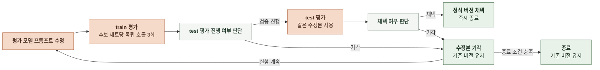

# AI 평가 구현

### 공통 실행 구조

구현 위치는 `manyak-ai/evaluation/storyline/`이다.

| 항목 | 구현 |
|---|---|
| 진입점 | `train.py`에서 실행 모드와 configuration 설정   `eval.py`에서 데이터 검사, 생성, 채점과 저장 실행 |
| 호출 클라이언트 | `evaluation/common/judge.py`로 평가 모델 호출   `evaluation/common/request_audit.py`로 공급자 요청 기록 |
| 실행 제어 | 기본 실행과 `--plan`은 모델 호출 없이 계획 확인   `--check-data`는 데이터 검사, `--confirm-live`는 실제 호출 |
| 실행 식별 | `--run-id`로 실행 구분   파일 잠금으로 동일 실행의 중복 실행 차단 |
| 저장과 복구 | 결과와 백업을 저장하고 유효한 최신 저장본으로 복구   복구 불가 또는 같은 저장 순번의 내용 충돌 시 새 호출 없이 중단 |
| 재개 | 같은 실행 ID로 성공 결과를 재사용하고 미완료 대상만 실행   입력, 프롬프트와 평가 조건이 달라지면 재개 거부 |
| 평가 기준 | 호출 구성과 집계 방법 적용 ([스토리라인 생성](AI-EVALUATION-METHOD.md#스토리라인-생성)) |

 

**채점 실행 규칙**

| 항목 | 규칙 |
|---|---|
| 세션 관리 | 채점 호출마다 새 세션을 생성하고 후보 세트 1개(스토리라인 본문 3편) 입력   채점 후 종료된 세션은 제거 |
| 실행 순서 | 각 후보 세트의 3회 채점은 순차 실행하며 매회 새 세션 사용 |
| 출력 형식 | JSON의 `results` 배열에 후보별 채점 결과 3개 반환 |
| 구현 확인 | 세션 생성과 제거 규칙의 구현 여부는 미확인 |

| 출력 필드 | 내용 |
|---|---|
| `sample_id` | 후보 식별자 |
| `score` | 0~100점 정수 |
| `reason` | 채점 이유 |
| `evidence` | 본문 근거 문자열 |

 

### 스토리라인 평가 모델 개선

| 항목 | 구현 |
|---|---|
| 역할 | 오케스트레이션 AI가 가설 수립과 프롬프트 수정 담당   실행기가 평가와 채택 판정 수행 |
| 기록과 재개 | 후보, 변경 이유와 평가 결과 저장   재개 시 완료된 결과 재사용 |
| 버전 관리 | 기각 시 기존 버전 유지   채택 시 새 버전과 평가 결과 보존 |

 

**평가 모델 개선 사이클**

