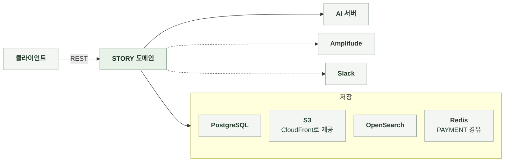

# 3-1 소프트웨어 구조

이 문서는 STORY 도메인 백엔드의 개요, 배경과 목표, 품질 속성, 배포 단위, 모듈 구조, 의존 방향, 도메인 모델을 정한다.

테이블과 컬럼은 DB 스키마에, 코딩 규칙은 컨벤션에, 엔드포인트별 처리 순서는 처리 흐름에 있다. ([3-2 DB 스키마](3-2-DB-SCHEMA.md), [3-3 컨벤션](3-3-CONVENTIONS.md), [4-1 처리 흐름](4-1-PIPELINES.md))

 

### 3-1-1 개요

STORY 도메인은 서버 애플리케이션 내부 패키지로 구성된다. 별도 프로세스로 실행하지 않는다. 같은 서버의 다른 도메인과는 서비스 호출과 이벤트로 연결한다.

| 외부 시스템 | 역할 | 연결 방식 |
|---|---|---|
| 클라이언트 | 요청 전송과 결과 표시 | REST |
| AI 서버 | 스토리라인, 컴파일, 이미지 생성 | 동기 HTTP |
| PostgreSQL | 원본 저장 | JDBC |
| S3 | 이미지 저장 | AWS SDK, presigned URL |
| CloudFront | 이미지 제공 | 응답의 CDN URL |
| OpenSearch | 검색 색인 | OpenSearch 클라이언트, SigV4 |
| Redis | 게스트 체험 카운터 | PAYMENT 도메인 경유 |
| Amplitude | 서버 분석 이벤트 | HTTP API |
| Slack | 신고 알림 | 웹훅 |

 

### 3-1-2 배경과 목표

| 배경 | 설계 목표 |
|---|---|
| AI 생성에는 분 단위 시간이 걸림 클라이언트 연결이 끊길 수 있음 | 생성 요청별로 기록을 남겨 결과를 복구하고 같은 요청을 두 번 실행하지 않음 |
| 간편 제작과 일반 제작이 같은 스토리 모델을 생성 | 두 제작 방식이 같은 저장 구조와 조회 경로를 사용 |
| 소유자가 공개 스토리를 비공개로 바꾸고 고칠 수 있음 | 마지막 공개본을 따로 보관해 다른 독자의 채팅이 끊기지 않음 |
| 검수 판정은 비동기 다른 도메인이 담당 | 접수와 승인 적용을 분리하고 접수는 즉시 응답 |
| 로그, 지표, 색인은 요청의 부가 작업 | 부가 작업 실패가 요청 결과를 바꾸지 않음 |

 

### 3-1-3 품질 속성

| 속성 | 기준 | 보장 방법 |
|---|---|---|
| 접근 안전 | 회원 소유 비공개 스토리는 소유자만 읽음 자동 증가 키를 외부에 노출하지 않음 | 읽기 권한 판정 로직 통합 공개 UUID 존재 판정을 소유 판정보다 먼저 |
| 복구 가능 | 응답을 받지 못한 생성 요청의 결과를 복구하고 중복 생성하지 않음 | 요청 단위 기록, 클라이언트가 생성한 요청 ID로 멱등성 보장, 중단 요청 회수 |
| 부분 실패 허용 | 인물 이미지와 표지 생성 실패가 컴파일을 막지 않음 | 이미지는 저장 트랜잭션 밖에서 처리 개별 이미지 실패는 건너뜀 표지가 없으면 빈 값으로 응답 |
| 정합성 | 공개 상태에서만 공개본을 갱신하고 비공개 전환 후 수정한 내용이 다른 독자에게 노출되지 않음 | 저장 트랜잭션 끝의 공개본 갱신 스토리 단위 잠금 |
| 관측 작업의 실패 격리 | 로그, 지표, 분석 이벤트, 색인, 트레이스 실패가 요청을 실패시키지 않음 AI 호출 기록의 DB 저장은 예외 저장 실패는 요청에 전파됨 | 예외를 요청에 전파하지 않음 비동기 리스너 태그 카디널리티 제한 |
| 제작 방식에 독립적인 조회 | 채팅과 상세가 간편 제작과 일반 제작을 구분하지 않음 | 두 제작 방식이 같은 저장 구조를 사용 |
| 원문 보존 | 주인공 이름 토큰을 저장 원문에 유지 | 치환은 응답과 AI 요청에서만 수행 |

 

### 3-1-4 배포 단위

STORY는 다른 도메인의 백엔드와 하나의 서버 이미지에 포함된다. 따로 배포하지 않는다.

 

### 3-1-5 모듈 구조

간편 제작의 전체 처리 순서는 간편 제작 서비스가 관리한다. 다른 구성 요소는 각자 맡은 단계만 처리한다. 간편 제작 진행 상태는 저장하지 않는다.

| 구성 요소 | 입력 | 출력 | 책임 |
|---|---|---|---|
| API 계층 | HTTP 요청 | HTTP 응답 | 형식 검증, 요청자 식별, 상태 코드 |
| 조회 서비스 | 필터, 정렬, 커서, 식별자 | 카드와 상세 | 노출 조건과 읽기 판정, 집계 결과 조립, 좋아요, 신고, 삭제 |
| 간편 제작 서비스 | 태그와 인물, 선택한 후보와 추가 정보 | 스토리라인 후보, 완성 스토리 | 과금과 한도 관리, AI 요청 조립과 호출, 응답 검증, 이미지 업로드, 저장, 지표 |
| 생성 요청 기록 | 클라이언트 생성 요청 ID | 저장된 결과 또는 실행 허가 | 멱등 판정, 중단 요청 회수, 결과 보관 |
| 일반 제작 적용과 수정 | 승인된 제출본, 수정 요청 | 저장된 스토리, 수정 폼 | 등록 저장, 부분 갱신과 하위 데이터 동기화, 공개 범위 단독 변경 |
| 검수 접수 | 등록과 수정 입력 | 제출본 | 입력 검증과 이미지 객체 확인 뒤 접수 판정은 MODERATION |
| 이미지 서비스 | 업로드 요청, 삭제 요청 | presigned URL, 삭제 결과 | 객체 키 발급, 소유권 확인, 참조 삭제 |
| 공개본 관리 | 저장된 스토리 | 마지막 공개본 | 공개 상태에서만 갱신, 독자의 권한에 따른 스토리 데이터 선택 |
| 제공 장르 | 검색어, 장르 입력 | 장르 목록, 정식 이름 | 정규화, 초성과 별칭 검색, 입력한 장르의 정식 이름 확정 |
| 이름 토큰 치환 | 저장 원문, 이름 | 치환된 글 | 조사 선택, 토큰 단위 절단 |
| AI 호출 | 조립된 요청, 트레이스 헤더 | 파싱된 응답 | 대기 시간, 직렬화, 호출 기록 |
| 검색 색인 | 색인 요청 이벤트 | 검색 문서 | 커밋 후 문서 생성과 색인, 재색인 |
| 이미지 저장소 | 객체 키와 바이트 | 이미지 제공 URL | S3 업로드, 서명, 존재 확인 |
| 초안 서비스 | 초안 저장 요청, 초안 ID | 초안 목록과 상세, 저장 결과 | 회원 단위 직렬화, 내용 비교와 버전 판정, 상한 검사, 이미지 키 검증, 접수 시 삭제 |
| 공통 | 모든 요청 | 요청자 식별자, 상관관계 식별자, 오류 응답 본문, 로그와 분석 이벤트 | 오류 응답, 인증, 상관관계 식별자, 구조화 로그, 분석 이벤트 |

 

### 3-1-6 의존 방향

| 방향 | 규칙 |
|---|---|
| API 계층 → 서비스 | API 계층은 서비스만 호출 저장 계층과 외부 시스템을 직접 호출하지 않음 |
| 서비스 → 다른 도메인 | 이프 차감과 환불, 게스트 체험 한도, 계정 상태 검사는 해당 도메인의 서비스 호출 |
| ACCOUNT → STORY | 회원 탈퇴가 초안 삭제를 호출 |
| 서비스 → 검색과 알림 | 이벤트로만 연결 색인 요청, 완성, 신고 이벤트를 발행하고 리스너가 커밋 후 처리 색인기와 발송기를 직접 호출하지 않음 |
| 이미지, 검색 → STORY | 도메인 모델만 읽고 서비스를 호출하지 않음 |
| CHAT ↔ STORY | CHAT은 읽기 판정, 공개본, 기본 주인공 이름, 토큰 치환을 사용 STORY는 채팅의 누적 턴 수와 존재 여부만 읽음 |
| MODERATION ↔ STORY | 검수 실행기가 승인 시 등록 저장과 수정 적용을 호출 STORY에서 MODERATION으로는 검수 접수만 요청 |
| 외부 시스템 | AI 서버, S3, OpenSearch는 인터페이스로 분리 스텁과 미구성 저장소로 대체 가능 |

 

### 3-1-7 도메인 모델

| 모델 | 하위 데이터 | 설계 의도 |
|---|---|---|
| 스토리 | 설정, 시작 설정, 추천 입력, 엔딩, 주요 사건, 인물, 인물 이미지, 로어북 연결, 좋아요, 신고, 공개본 | 하위 데이터의 수명은 스토리와 같음 두 제작 방식이 같은 모델을 생성 |
| 간편 제작 진행 | 입력 인물, 선택 태그, 스토리라인 후보, 추천 정보, 평가 | 완성 전까지의 입력과 후보 완성되면 생성된 스토리를 참조 |
| 생성 요청 | 없음 | 요청 한 건의 상태와 결과 진행이나 스토리와 외래 키 없이 요청 ID 값으로만 연결 |
| 초안 | 없음 | 회원의 작성 중 입력 내용은 해석하지 않는 JSON 서버는 요약 필드만 읽음 스토리라인 생성 요청을 선택적으로 참조 |

 

| 스토리의 판정 | 의미 |
|---|---|
| 공개 여부 | 발행 상태이면서 공개 |
| 목록 노출 | 공개 상태이며 삭제되지 않은 회원 소유 스토리 목록과 검색의 조건 |
| 읽기 가능 | 공개 상태이거나 소유자 없는 스토리이거나 요청자가 소유자 |
| 현재 표시 가능 | 읽기 가능하면 현재 제목과 표지, 아니면 마지막 공개본 |
