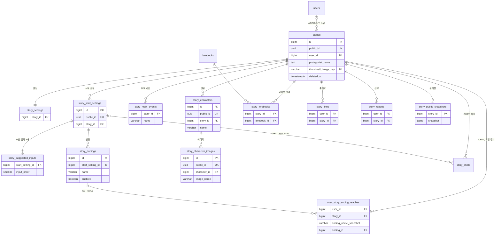
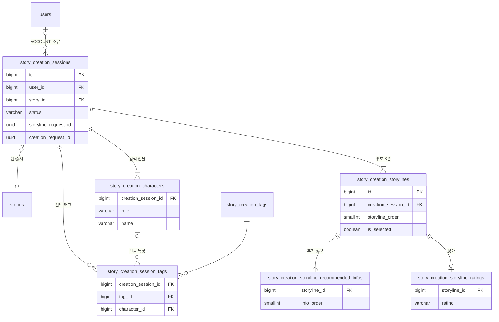
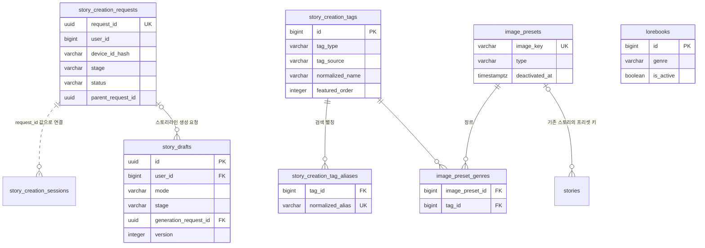

# 3-2 DB 스키마

이 문서는 STORY 도메인이 관리하는 PostgreSQL 테이블의 컬럼, 제약, 인덱스와 데이터 수명을 정한다.

다른 도메인의 테이블은 이 도메인이 참조하는 컬럼만 적는다.

입력값의 검증 규칙은 보안에, 저장과 삭제의 처리 순서는 처리 흐름에 있다. ([5-1-4 입력 검증](5-1-SECURITY.md#5-1-4-입력-검증), [4-1 처리 흐름](4-1-PIPELINES.md))

 

### 3-2-1 공통 규칙

| 규칙 | 내용 |
|---|---|
| 식별자 | 내부 PK는 `bigint` 자동 증가 외부에 노출하는 리소스는 `public_id uuid`를 따로 두고 API는 이 값만 사용: 스토리, 시작 설정, 인물, 인물 이미지 간편 제작 진행, 태그, 스토리라인, 추천 정보는 임시 리소스라 `bigint` ID를 그대로 노출 화풍은 공개 카탈로그라 문자열 `code`를 식별자로 노출 |
| 시각 | `timestamp with time zone` 모든 테이블에 `created_at`이 있고 기본값 `now()`, 갱신하는 테이블에는 `updated_at`이 있음 아래 표에서는 생략 |
| 삭제 | 스토리 삭제 시 `stories.deleted_at` 기록 하위 테이블의 행은 유지하고 조회 시 스토리의 삭제 여부로 제외 |
| FK | 스토리를 물리 삭제하면 하위 테이블의 행도 함께 삭제(`ON DELETE CASCADE`) 채팅이 참조하는 시작 설정이나 도달 기록이 참조하는 엔딩을 삭제해도 채팅과 도달 기록은 유지 외래 키 값만 비움(`ON DELETE SET NULL`) |
| 순서 | `smallint sort_order` 추천 입력, 엔딩, 로어북, 스토리라인, 추천 정보는 1부터, 주요 사건은 0부터 |
| 글 | 제목, 소개, 설정, 시작 설정, 추천 입력, 주요 사건, 공개 스냅샷의 텍스트는 `{username}` 토큰 원문을 보존 |
| 표기 | 용어집을 따름 `story_creation_tags.tag_type`은 API의 `category`에 해당하며 이름을 바꾸지 않음 `story_creation_session_tags.creation_session_id`도 용어집의 `creation_id` 계열과 다르지만 유지 |

 

### 3-2-2 관계도

관계도는 데이터 묶음별 소유 관계를 보여준다. 각 상자에는 식별과 연결에 쓰는 컬럼만 표시하며 전체 컬럼은 아래 표에서 정의한다. 다른 도메인의 테이블은 관계 라벨에 도메인을 적고 컬럼을 생략한다.

**1. 스토리**

 

**2. 간편 제작 진행**

 

**3. 생성 요청, 초안, 카탈로그**

생성 요청과 간편 제작 진행은 외래 키 없이 요청 ID 값으로 연결한다. 이 관계는 점선으로 표시한다. 초안은 생성 요청을 외래 키로 선택 참조한다.

 

### 3-2-3 스토리

**`stories`**

| 컬럼 | 타입 | 제약 | 의미 |
|---|---|---|---|
| `id` | bigint | PK | |
| `public_id` | uuid | NOT NULL, UNIQUE, 기본 `gen_random_uuid()` | |
| `user_id` | bigint | | 게스트 제작은 NULL, 이관 시 채움 |
| `title` | varchar(100) | NOT NULL | |
| `one_line_intro` | varchar(255) | | |
| `description` | text | | |
| `protagonist_name` | text | CHECK 1~30자 | 이름 도입 전 스토리는 NULL |
| `genre` | varchar(255) | | 장르 정식 이름을 `", "`로 연결한 문자열 |
| `status` | varchar(20) | NOT NULL, CHECK `DRAFT` `PUBLISHED`, 기본 `PUBLISHED` | |
| `visibility` | varchar(20) | NOT NULL, CHECK `PUBLIC` `PRIVATE`, 기본 `PUBLIC` | |
| `thumbnail_image_key` | varchar(64) | FK `image_presets.image_key` | 새 스토리에는 쓰지 않음 |
| `thumbnail_image_url` | text | | |
| `thumbnail_moderation_status` | varchar(20) | NOT NULL, CHECK `APPROVED` `PENDING` `REJECTED`, 기본 `APPROVED` | |
| `deleted_at` | timestamptz | | |

인덱스는 `idx_stories_user_created (user_id, created_at DESC, id DESC) WHERE deleted_at IS NULL` 하나다.

 

**`story_settings`**

| 컬럼 | 타입 | 제약 | 의미 |
|---|---|---|---|
| `story_id` | bigint | UNIQUE, FK CASCADE | |
| `world_setting` | text | | |
| `character_setting` | text | | |
| `user_role_setting` | text | | 이름을 제외한 주인공 설명 |
| `rule_setting` | text | | |

 

### 3-2-4 시작 설정과 하위

**`story_start_settings`**

| 컬럼 | 타입 | 제약 | 의미 |
|---|---|---|---|
| `id` | bigint | PK | |
| `public_id` | uuid | NOT NULL, UNIQUE | |
| `story_id` | bigint | NOT NULL, FK CASCADE, 인덱스 | |
| `name` | varchar(100) | NOT NULL | |
| `prologue` | text | | |
| `start_situation` | text | | |

표시 순서는 `id` 오름차순이다.

 

**`story_suggested_inputs`**

| 컬럼 | 타입 | 제약 | 의미 |
|---|---|---|---|
| `start_setting_id` | bigint | FK CASCADE | |
| `input_text` | text | NOT NULL | |
| `input_order` | smallint | CHECK `> 0`, UNIQUE `(start_setting_id, input_order)` | 시작 설정당 정확히 3개 |

 

**`story_endings`**

| 컬럼 | 타입 | 제약 | 의미 |
|---|---|---|---|
| `id` | bigint | PK | |
| `start_setting_id` | bigint | NOT NULL, FK CASCADE | |
| `name` | varchar(100) | NOT NULL | 시작 설정 안에서 유일 |
| `min_turns` | integer | NOT NULL | |
| `achievement_condition` | text | NOT NULL | |
| `epilogue` | text | NOT NULL | 도달 시 출력 가이드 |
| `sort_order` | smallint | NOT NULL, UNIQUE `(start_setting_id, sort_order)` | |
| `enabled` | boolean | NOT NULL | 레거시 행은 `false`로 비활성화해 보존 |
| `title` | | | 사용하지 않음 |
| `content` | | | 사용하지 않음 |
| `condition_text` | | | 사용하지 않음 |

 

### 3-2-5 인물과 이미지

**`story_characters`**

| 컬럼 | 타입 | 제약 | 의미 |
|---|---|---|---|
| `id` | bigint | PK | |
| `public_id` | uuid | NOT NULL, UNIQUE | |
| `story_id` | bigint | NOT NULL, FK CASCADE | |
| `name` | varchar(100) | NOT NULL, UNIQUE `(story_id, name)` | |
| `description` | text | | 인물 소개 도입 전에 생성된 행은 NULL |
| `image_url` | text | | 구버전 롤백 호환용으로 생성 이미지 URL을 함께 저장 대표 이미지 조회에는 사용하지 않음 |
| `gender` | text | | |
| `age` | text | | |
| `body` | text | | |
| `face` | text | | |
| `hair` | text | | |
| `outfit` | text | | |
| `visual_identity` | text | | 시각적 특징 요약 |

 

**`story_character_images`**

| 컬럼 | 타입 | 제약 | 의미 |
|---|---|---|---|
| `id` | bigint | PK | |
| `public_id` | uuid | NOT NULL, UNIQUE | |
| `character_id` | bigint | NOT NULL, FK, 인덱스 | |
| `image_name` | varchar(120) | NOT NULL, UNIQUE `(character_id, image_name)` | `{인물이름}_{접미}` 컴파일에서 생성한 첫 이미지는 `_기본` |
| `image_url` | text | NOT NULL | |
| `sort_order` | integer | NOT NULL | |
| `moderation_status` | varchar(20) | NOT NULL, 기본 `APPROVED` | 사용하지 않음 |

 

### 3-2-6 주요 사건과 엔딩 도달 집계

**`story_main_events`**

| 컬럼 | 타입 | 제약 | 의미 |
|---|---|---|---|
| `id` | bigint | PK | |
| `story_id` | bigint | NOT NULL, FK CASCADE | |
| `name` | varchar(100) | NOT NULL | 스토리 안에서 유일 |
| `description` | text | NOT NULL | |
| `key_sentence` | text | NOT NULL | 관련성 판단 문장 |
| `sort_order` | smallint | NOT NULL, UNIQUE `(story_id, sort_order)` | |

 

**`user_story_ending_reaches`**

| 컬럼 | 타입 | 제약 | 의미 |
|---|---|---|---|
| `id` | bigint | PK | |
| `user_id` | bigint | NOT NULL, FK CASCADE | |
| `story_id` | bigint | NOT NULL, FK CASCADE | |
| `ending_name_snapshot` | varchar(100) | NOT NULL, UNIQUE `(user_id, story_id, ending_name_snapshot)` | |
| `ending_id` | bigint | FK `ON DELETE SET NULL` | 보조 참조 |

 

### 3-2-7 소셜과 로어북

**`story_likes`**

| 컬럼 | 타입 | 제약 | 의미 |
|---|---|---|---|
| `id` | bigint | PK | |
| `user_id` | bigint | NOT NULL, FK CASCADE, UNIQUE `(user_id, story_id)` | |
| `story_id` | bigint | NOT NULL, FK CASCADE | |

 

**`story_reports`**

| 컬럼 | 타입 | 제약 | 의미 |
|---|---|---|---|
| `id` | bigint | PK | |
| `user_id` | bigint | NOT NULL, FK CASCADE, UNIQUE `(user_id, story_id)` | |
| `story_id` | bigint | NOT NULL, FK CASCADE | |
| `reason` | varchar(20) | NOT NULL, CHECK `SPAM` `INAPPROPRIATE` `ETC` | |
| `detail` | text | | |

 

**`lorebooks`**

| 컬럼 | 타입 | 제약 | 의미 |
|---|---|---|---|
| `id` | bigint | PK | |
| `name` | varchar(100) | NOT NULL | |
| `genre` | varchar(50) | | 장르 정식 표시명과 정확히 일치 |
| `content` | text | NOT NULL | |
| `sort_order` | integer | NOT NULL, CHECK `>= 0`, 기본 0 | |
| `is_active` | boolean | NOT NULL, 기본 true | |

 

**`story_lorebooks`**

| 컬럼 | 타입 | 제약 | 의미 |
|---|---|---|---|
| `id` | bigint | PK | |
| `story_id` | bigint | NOT NULL, FK CASCADE, UNIQUE `(story_id, lorebook_id)` | |
| `lorebook_id` | bigint | NOT NULL, FK CASCADE | |
| `sort_order` | smallint | NOT NULL, CHECK `> 0` | |

 

### 3-2-8 공개 스냅샷

**`story_public_snapshots`**

| 컬럼 | 타입 | 제약 | 의미 |
|---|---|---|---|
| `story_id` | bigint | PK이자 FK CASCADE | |
| `snapshot` | jsonb | NOT NULL | 마지막 공개 시점의 스토리 내용, 인물 소개 제외 |

스냅샷 안의 사건, 엔딩, 인물은 현재 스토리의 해당 행과 이름으로 연결하고 시작 설정만 `id`로 연결한다.

 

### 3-2-9 간편 제작 진행

**`story_creation_sessions`**

| 컬럼 | 타입 | 제약 | 의미 |
|---|---|---|---|
| `id` | bigint | PK | 공개 식별자로도 사용 |
| `user_id` | bigint | | |
| `story_id` | bigint | 인덱스 | 완성된 스토리 |
| `status` | varchar(30) | CHECK `STORYLINES_GENERATED` `STORY_CREATED` | |
| `creation_request_id` | uuid | | 완성 단계 요청 |
| `storyline_request_id` | uuid | 인덱스 | 스토리라인 단계 요청 |

 

**`story_creation_characters`**

| 컬럼 | 타입 | 제약 | 의미 |
|---|---|---|---|
| `id` | bigint | PK | |
| `creation_session_id` | bigint | NOT NULL, FK CASCADE, UNIQUE `(creation_session_id, role, sort_order)` | |
| `role` | varchar(30) | NOT NULL, CHECK `PROTAGONIST` `SUPPORTING_CHARACTER` | |
| `name` | varchar(30) | | |
| `gender` | varchar(10) | CHECK `MALE` `FEMALE` 또는 NULL | |
| `sort_order` | smallint | NOT NULL, CHECK `> 0` 주인공 역할이면 CHECK `= 1`, 주인공 역할 행은 진행당 하나(부분 유니크 인덱스) | |

 

**`story_creation_session_tags`**

| 컬럼 | 타입 | 제약 | 의미 |
|---|---|---|---|
| `id` | bigint | PK | |
| `creation_session_id` | bigint | NOT NULL, FK CASCADE, UNIQUE `(creation_session_id, character_id, tag_id)` `NULLS NOT DISTINCT` | |
| `tag_id` | bigint | NOT NULL, FK | |
| `character_id` | bigint | FK CASCADE | 인물 특징이면 인물, 장르면 NULL |

 

**`story_creation_storylines`**

| 컬럼 | 타입 | 제약 | 의미 |
|---|---|---|---|
| `id` | bigint | PK | |
| `creation_session_id` | bigint | NOT NULL, FK CASCADE, UNIQUE `(creation_session_id, storyline_order)` | |
| `storyline_text` | text | NOT NULL | |
| `storyline_order` | smallint | NOT NULL, CHECK `> 0` | 3편 |
| `is_selected` | boolean | NOT NULL, 기본 false | 스토리 완성에 사용할 후보로 선택됨 |

 

**`story_creation_storyline_recommended_infos`**

| 컬럼 | 타입 | 제약 | 의미 |
|---|---|---|---|
| `id` | bigint | PK | |
| `storyline_id` | bigint | NOT NULL, FK CASCADE, UNIQUE `(storyline_id, info_order)` | |
| `info_text` | text | NOT NULL | |
| `info_order` | smallint | NOT NULL, CHECK `> 0` | |

 

**`story_creation_storyline_ratings`**

| 컬럼 | 타입 | 제약 | 의미 |
|---|---|---|---|
| `id` | bigint | PK | |
| `storyline_id` | bigint | NOT NULL, UNIQUE, FK CASCADE | |
| `rating` | varchar(8) | NOT NULL, CHECK `GOOD` `BAD` | |

 

### 3-2-10 생성 요청과 초안

**`story_creation_requests`**

| 컬럼 | 타입 | 제약 | 의미 |
|---|---|---|---|
| `request_id` | uuid | NOT NULL, UNIQUE | 클라이언트가 생성 |
| `user_id` | bigint | | |
| `device_id_hash` | varchar(64) | | |
| `stage` | varchar(32) | CHECK `STORYLINE_GENERATION` `STORY_COMPLETION` | |
| `status` | varchar(16) | CHECK `PENDING` `COMPLETED` `FAILED` | |
| `result_json` | text | | `COMPLETED`일 때 원래 응답 본문 |
| `parent_request_id` | uuid | | 검증을 통과한 직전 생성 요청 |
| `attempted_parent_creation_id` | uuid | | 클라이언트가 보낸 원래 값 |
| `parent_link_error` | varchar(32) | | `NOT_FOUND` `OWNER_MISMATCH` `SELF_REFERENCE` |
| `updated_at` | timestamptz | | |

FK를 두지 않는다. 간편 제작 진행과 스토리는 `request_id` 값으로 연결한다.

 

**`story_drafts`**

| 컬럼 | 타입 | 제약 | 의미 |
|---|---|---|---|
| `id` | uuid | PK | 클라이언트가 생성 |
| `user_id` | bigint | NOT NULL, FK `users.id` | |
| `mode` | varchar(255) | NOT NULL, CHECK `SIMPLE` `GENERAL` | |
| `stage` | varchar(255) | NOT NULL, CHECK `GENERAL_DRAFT` `KEYWORD_DRAFT` `STORY_DRAFT` `GENERAL`은 `GENERAL_DRAFT`만, `SIMPLE`은 나머지 둘만 | |
| `schema_version` | integer | NOT NULL | 클라이언트 payload 스키마 버전 |
| `payload` | jsonb | NOT NULL, CHECK 객체 | 서버가 해석하지 않는 작성 중 입력 |
| `title` | text | | 목록용 요약 |
| `one_line_intro` | text | | 목록용 요약 |
| `thumbnail_object_key` | text | | 목록용 표지의 임시 업로드 객체 키 |
| `generation_request_id` | uuid | FK `story_creation_requests.request_id` | 연결한 스토리라인 생성 요청 |
| `version` | integer | NOT NULL, CHECK `>= 1` | 저장할 때마다 1씩 증가 |
| `updated_at` | timestamptz | NOT NULL | |

인덱스는 `(user_id, created_at DESC, id)` 하나다. 시각은 마이크로초로 잘라 저장한다.

 

### 3-2-11 카탈로그

**`story_creation_tags`**

| 컬럼 | 타입 | 제약 | 의미 |
|---|---|---|---|
| `id` | bigint | PK | 공개 식별자로도 사용 |
| `tag_type` | varchar(50) | NOT NULL, CHECK `GENRE` `PROTAGONIST` `SUPPORTING_CHARACTER` | API의 `category` |
| `name` | varchar(30) | NOT NULL | |
| `tag_source` | varchar(20) | NOT NULL, CHECK `PREDEFINED` `CUSTOM` | 제공 태그 또는 과거 직접 입력 태그 |
| `normalized_name` | varchar(60) | NOT NULL, UNIQUE `(tag_source, tag_type, normalized_name)` | 공백 제거와 소문자화 |
| `sort_order` | integer | NOT NULL, CHECK `>= 0` | 제공 장르는 카탈로그 번호 × 10 |
| `featured_order` | integer | | 대표 장르만 1~15 |
| `is_active` | boolean | NOT NULL, 기본 true | |

조회 인덱스는 `(tag_source, is_active, tag_type, sort_order, id)`다.

 

**`story_creation_tag_aliases`**

| 컬럼 | 타입 | 제약 | 의미 |
|---|---|---|---|
| `id` | bigint | PK | |
| `tag_id` | bigint | NOT NULL, FK, 인덱스 | |
| `alias` | varchar(30) | NOT NULL | |
| `normalized_alias` | varchar(60) | NOT NULL, UNIQUE | |

 

**`image_presets`**

| 컬럼 | 타입 | 제약 | 의미 |
|---|---|---|---|
| `id` | bigint | PK | |
| `image_key` | varchar(64) | NOT NULL, UNIQUE | 불변 |
| `type` | varchar(20) | NOT NULL, CHECK `THUMBNAIL` `BACKGROUND` `CHARACTER` | |
| `mood` | varchar(50) | | |
| `subject` | varchar(50) | | |
| `prop` | varchar(50) | | |
| `deactivated_at` | timestamptz | | 행은 지우지 않음 |

 

**`image_preset_genres`**

| 컬럼 | 타입 | 제약 | 의미 |
|---|---|---|---|
| `image_preset_id` | bigint | PK, FK CASCADE | |
| `tag_id` | bigint | PK, FK | 장르 태그 |

 

**`art_styles`**

| 컬럼 | 타입 | 제약 | 의미 |
|---|---|---|---|
| `code` | varchar(50) | PK | AI 컴파일의 화풍 계약값 |
| `name` | varchar(30) | NOT NULL | |
| `description` | text | NOT NULL | |
| `preview_image_url` | text | | 미리보기 이미지, 초기 시드는 NULL |
| `sort_order` | integer | NOT NULL, CHECK `>= 1` | |
| `is_active` | boolean | NOT NULL, 기본 true | |

 

### 3-2-12 데이터 수명

| 데이터 | 삭제 |
|---|---|
| 스토리와 하위 데이터 | `deleted_at` 기록, 물리 삭제 없음 |
| 인물 이미지 행 | 승인된 수정과 삭제 API로 삭제, S3 객체는 남김 |
| 공개 스냅샷 | 스토리 CASCADE |
| 간편 제작 진행, 생성 요청 | 삭제 없음 |
| 초안 | 등록이나 완성 접수, 삭제 API, 회원 탈퇴 시 물리 삭제 |
| 제공 장르, 별칭, 프리셋, 화풍 | 비활성화만 수행 |
| 검색 문서 | 스토리 삭제 시 `visible=false`로 재색인 |
