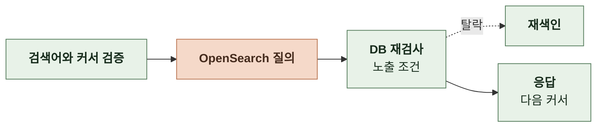
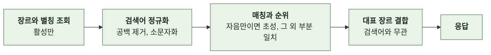
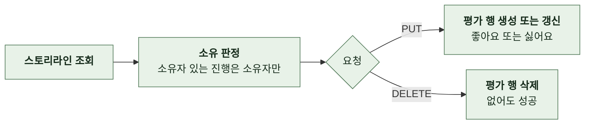
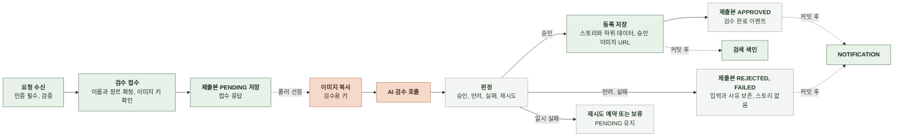
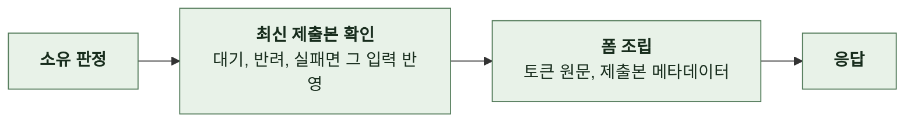
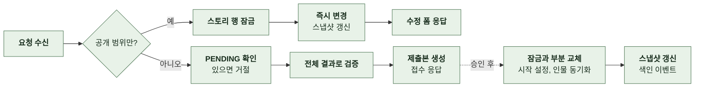
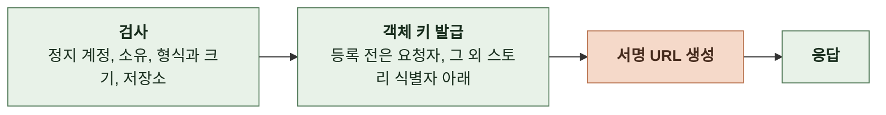
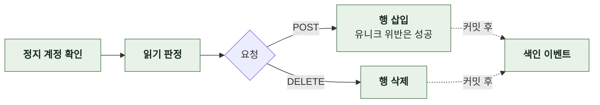

# 4-1 처리 흐름

이 문서는 STORY 도메인의 요청 수신부터 응답까지의 처리 단계를 정한다.

요청 필드, 응답 필드와 실패 응답은 계약에, 대기 한도와 복구 규칙은 오류 처리에, 멱등과 잠금은 동시성에 있다. ([4-2 계약](4-2-CONTRACT.md), [5-3 오류 처리](5-3-ERROR-HANDLING.md), [5-2 동시성](5-2-CONCURRENCY.md))

<br>

### 4-1-1 공통 처리

모든 요청은 상관관계 필터에서 요청 ID를 받는다. 이어서 보안 필터가 인증 수준을 판정한다. 검사를 마친 요청은 API 계층으로 전달한다.

스토리가 미삭제, 발행, 공개 상태로 저장될 때 하위 데이터 교체를 마친 같은 트랜잭션에서 공개 스냅샷을 갱신한다. 비공개나 삭제 상태에서 내용을 고쳐도 스냅샷을 덮어쓰지 않는다. 읽는 사람에게 현재 스토리를 읽을 권한이 없으면 마지막 공개 스냅샷을 쓴다.

흐름도에서 AI 서버나 외부 저장소를 호출하는 단계는 주황색이다.

<br>

**AI 호출**

AI 서버는 동기 HTTP로 호출한다. 백엔드는 재시도하지 않는다. 필드 이름은 snake_case다. 스텁 설정이 켜진 환경은 AI를 호출하지 않고 정해진 더미 응답을 반환한다.

| 요청 | 방식 | 성공 | 실패 |
|---|---|---|---|
| 스토리라인 | `POST /api/v1/story/storylines` | 200, JSON<br>후보 3편 | 4xx, 5xx, 시간 초과 |
| 컴파일 | `POST /api/v1/story/compile` | 200, JSON<br>스토리 설정과 이미지 | 4xx, 5xx, 시간 초과 |

요청 헤더는 값이 없으면 생략한다.

| 요청 헤더 | 값 | 스토리라인 | 컴파일 |
|---|---|---|---|
| `X-Manyak-Request-Id`, `X-Manyak-Session-Id` | 클라이언트 요청 헤더를 전달<br>`unknown`이면 생략 | 보냄 | 보냄 |
| `X-Manyak-Device-Id-Hash` | `X-Manyak-Device-Id`의 해시 | 보냄 | 보냄 |
| `X-Manyak-Creation-Id` | 스토리라인 단계 생성 요청의 `requestId`<br>컴파일은 진행에 저장된 값 | 보냄 | 보냄 |
| `X-Manyak-Parent-Creation-Id` | 검증을 통과한 `parentCreationId` | 재생성만 | 없음 |
| `X-Manyak-Storyline-Id`, `X-Manyak-Storyline-Order` | 선택한 스토리라인 ID와 후보 순번 1~3 | 없음 | 보냄 |
| `X-Manyak-Is-Regenerated` | 요청의 `isRegenerated`<br>`null`이면 생략 | 보냄 | 보냄 |
| `traceparent` | 추적이 켜진 환경의 현재 스팬 | 보냄 | 보냄 |

응답의 `meta`는 AI 호출 기록에 적재한다.

| `meta` 필드명 | 타입 | 처리 |
|---|---|---|
| `model`, `provider` | `string` | 실제 모델과 공급자<br>스텁 환경은 둘 다 `stub` |
| `prompt_versions` | `map<string, integer>` | 템플릿별 버전 |
| `input_token_count`, `output_token_count` | `integer / null` | 이미지 호출을 제외한 토큰 합계 |
| `retry_count` | `integer` | AI 내부 보완 호출 횟수 |

<br>

### 4-1-2 공개 목록


- 인기순 정렬값은 좋아요 수 × 10 + 누적 턴 수다. 정렬과 커서 조건에 같은 값을 쓴다.
- 오리지널 필터는 공식 계정의 회원 ID로 조회 범위를 제한한다. 공식 계정 설정이 없으면 빈 페이지를 반환한다.

<details>
<summary><b>커서 해석 예시</b></summary>

<br>

커서는 `<정렬 접두>:<정렬값>:<public_id>`를 패딩 없이 Base64URL로 인코딩한 값이다.

| 요청 | 디코딩 결과 | 해석 |
|---|---|---|
| `sort=latest`<br>`cursor=bDoxNzE4MDAwMDAwMTIzNDU2MDAwOjNmMjUwNGUwLTRmODktNDFkMy05YTBjLTAzMDVlODJjMzMwMQ` | `l:1718000000123456000:3f2504e0-4f89-41d3-9a0c-0305e82c3301` | 접두 `l`은 최신순, 정렬값은 마지막 카드 `createdAt`의 epoch 나노초, 마지막 카드의 `public_id` |
| `sort=popular`<br>`cursor=czoxNTMyOjNmMjUwNGUwLTRmODktNDFkMy05YTBjLTAzMDVlODJjMzMwMQ` | `s:1532:3f2504e0-4f89-41d3-9a0c-0305e82c3301` | 접두 `s`는 인기순, 정렬값 1532는 좋아요 150 × 10 + 누적 턴 32 |
| `sort=popular`<br>위 최신순 커서 | `l:...` | 접두 `l`이 `popular`의 `s`와 달라 거절 |

정렬 접두는 인기순 `s`, 최신순 `l`, 좋아요순 `k`, 채팅순 `c`다. 디코딩에 실패하면 거절한다. 구성 요소가 세 개가 아니거나 정렬값이 정수가 아니어도 거절한다. `public_id`가 UUID가 아니어도 거절한다.

</details>

<br>

### 4-1-3 검색



- 검색어는 앞뒤 공백을 지운 뒤 2~100자여야 한다.
- 질의 대상은 제목, 한 줄 소개, 장르, 인물 이름이다. 제목의 가중치는 3이다. `visible`이 참인 문서만 찾는다.
- 정렬은 관련도 점수, 생성 시각 내림차순, 공개 식별자 오름차순이다.
- 커서는 필터링 전 마지막 문서의 정렬값과 검색어 해시다. 커서의 검색어 해시는 요청한 검색어의 해시와 일치해야 한다.
- OpenSearch 결과를 DB에서 다시 확인해 현재 노출 조건을 만족하는 스토리만 응답에 포함한다.
- 노출 조건을 만족하지 않는 문서는 즉시 재색인한다.

<br>

### 4-1-4 제공 장르



- 순위는 정식 이름 완전 일치, 별칭 완전 일치, 정식 이름 접두, 별칭 접두, 정식 이름 포함, 별칭 포함, 초성 접두, 초성 포함 순이다.
- 동률은 순번과 ID 순이다.

<br>

### 4-1-5 로어북 카탈로그


<br>

### 4-1-6 일괄 조회


- 중복 식별자는 하나로 합치고 요청 순서를 유지한다.
- UUID 형식이 아닌 값은 오류 없이 제외한다. 유효한 식별자가 없으면 DB를 조회하지 않고 빈 배열을 반환한다.

<br>

### 4-1-7 상세


<br>

### 4-1-8 삭제


<br>

### 4-1-9 간편 제작 태그 목록


<br>

### 4-1-10 화풍 목록


<br>

### 4-1-11 간편 제작 스토리라인 생성


- 직접 입력 장르가 있으면 요청 행을 기록하기 전에 거절한다.
- 부모 요청은 스토리라인 단계의 과거 요청이어야 하고 자기 자신일 수 없다. 두 요청이 모두 회원 요청이면 같은 회원이어야 한다. 하나라도 게스트 요청이면 디바이스 해시가 같아야 한다.
- 부모 요청 연결 검증에 실패해도 거부하지 않고 사유(`NOT_FOUND`, `OWNER_MISMATCH`, `SELF_REFERENCE`)만 기록한다.
- 인물의 직접 입력 특징이 제공 태그와 정규화 키가 같으면 AI 요청에는 입력 원문을 보내고 저장과 응답에는 제공 표시명을 쓴다.
- 요청 행은 결과 저장과 별도의 트랜잭션으로 먼저 커밋한다.
- 같은 `requestId`가 완료 상태면 저장된 결과를 돌려준다. 진행 중이면 거절한다. 중단된 요청이면 회수해 재실행한다.
- 게스트는 체험 횟수를 예약한다. 체험 한도를 소진했으면 거절한다. 회원은 무료다.
- 저장은 한 트랜잭션이다. 직접 입력 특징 태그의 마스터 행만 별도 트랜잭션이다.

어느 단계든 실패하면 예약한 횟수를 되돌린다. 요청 행은 `FAILED`로 표시한다. 중단 요청을 회수해 재실행할 때 진행 행이 이미 있으면 AI를 다시 호출하지 않는다. 저장된 행으로 응답한다.

**1. AI 요청 조립**

| 요청 필드명 | 타입 | 출처 |
|---|---|---|
| `genre_tags` | `string[]` | `genreTagIds`를 태그 이름으로 변환, 선택 순서 |
| `protagonist` | `object` | `name`, `gender`, `features[]`<br>`features`는 제공 태그 이름과 직접 입력을 합친 값<br>비어도 객체를 생략하지 않음 |
| `supporting_characters` | `object[]` | 주인공과 같은 구조 |

<br>

**2. AI 응답 처리**

| 응답 필드명 | 타입 | 처리 |
|---|---|---|
| `stories[]` | `object[]` | `id`, `storyline`, `recommended_infos[]`<br>후보와 추천 정보를 저장하고 백엔드 ID를 부여해 클라이언트에 반환 |

<details>
<summary><b>AI 스토리라인 호출 예시</b></summary>

<br>

**1) Request**

```text
POST /api/v1/story/storylines
X-Manyak-Request-Id: 4f1c2a9e-7b3d-4e5f-8a6b-9c0d1e2f3a4b
X-Manyak-Session-Id: s_8f2d1c
X-Manyak-Device-Id-Hash: device_hash_3a7bd3e2360a3d29
X-Manyak-Creation-Id: 6d0f4a2e-1b7c-4e2a-9f11-2a4d1c9e8b10
X-Manyak-Is-Regenerated: false
```

```json
{
  "genre_tags": ["판타지", "미스터리"],
  "protagonist": { "name": "서린", "gender": "FEMALE", "features": ["기억을 잃은", "꼼꼼한"] },
  "supporting_characters": [
    { "name": "도윤", "gender": "MALE", "features": ["냉정한", "과묵한"] }
  ]
}
```

<br>

**2) 200 Response body**

후보는 3편 중 1편만 표시했다.

```json
{
  "stories": [
    {
      "id": 1,
      "storyline": "신입 기록관 서린은 마법 도서관에서 다음 날의 기록이 지워지고 있음을 발견한다. 과묵한 사서 도윤과 함께 사라진 기록의 출처를 추적한다.",
      "recommended_infos": [
        "지워진 기록은 지하 보관실에 흔적으로 남는다.",
        "도윤은 과거 기록 소실 사건의 유일한 목격자다.",
        "기록을 복원하려면 누군가의 잊힌 기억이 필요하다."
      ]
    }
  ],
  "meta": {
    "model": "<실제 사용한 모델 이름>",
    "provider": "google",
    "prompt_versions": { "STORYLINES": 7 },
    "input_token_count": 900,
    "output_token_count": 1400,
    "retry_count": 0
  }
}
```

</details>

<br>

### 4-1-12 간편 제작 완성

```mermaid
%%{init: {"flowchart": {"curve": "basis", "htmlLabels": true, "nodeSpacing": 24, "rankSpacing": 40}}}%%
flowchart LR
    A["<b>요청 수신</b><br/>검증, 정지 계정, 소유자 결정<br/><i>API 계층, 간편 제작 서비스</i>"] --> B["<b>요청 행 PENDING</b><br/><i>생성 요청 기록</i>"]
    B --> C["<b>진행과 후보 조회</b><br/>존재, 소유, 완성 여부 판정<br/><i>간편 제작 서비스</i>"]
    C --> D["<b>과금</b><br/>회원 이프 선차감, 게스트 카운터<br/><i>PAYMENT</i>"]
    D --> E["<b>AI 호출</b><br/>컴파일<br/><i>AI 호출</i>"]
    E --> F["<b>응답 검증</b><br/>주인공 이름, 인물 정리<br/><i>간편 제작 서비스</i>"]
    F --> G["<b>이미지 업로드</b><br/>인물, 표지<br/><i>이미지 저장소</i>"]
    G --> H["<b>저장</b><br/>진행 잠금, 스토리 묶음<br/><i>간편 제작 서비스, 공개본 관리</i>"]
    H --> I["<b>요청 행 COMPLETED</b><br/>완성 이벤트 발행<br/><i>생성 요청 기록</i>"]
    I --> J["<b>클라이언트</b>"]
    H -.->|커밋 후| K["<b>검색 색인</b>"]
    I -.->|커밋 후| L["<b>NOTIFICATION</b>"]
    classDef comp fill:#E8F2E8,stroke:#527A59,color:#182D1D
    classDef task fill:#F5D9C9,stroke:#B97450,color:#452B1D
    class A,B,C,D,F,H,I,J,K,L comp
    class E,G task
```



- 화풍 코드가 누락이면 카탈로그를 확인하지 않고 `ANIME`으로 본다. 값이 있으면 활성 코드가 아닐 때 거절한다.
- 진행의 장르와 일치하는 활성 로어북을 장르, 순번, ID 순으로 골라 AI에 보낸다. 저장에 성공하면 같은 목록을 스토리에 연결한다. 일치하는 장르가 없으면 빈 목록이다.
- 회원이 시작한 간편 제작은 해당 회원만 완성할 수 있다. 완성된 스토리도 해당 회원에게 귀속된다. 게스트가 시작한 제작은 완성 요청자의 신원에 따라 귀속된다.
- 진행이 없거나 타인 소유이거나 이미 완성된 경우에는 AI 호출 전에 거절한다. 정지 계정, 이프 부족, 체험 한도 소진도 AI 호출 전에 거절한다.
- 회원은 완성 체험 잔여가 있으면 체험으로 처리하고 없으면 이프를 선차감한다. 게스트는 체험 횟수를 예약한다.
- 회원 요청이면 생성 요청 행을 기록할 때 요청의 `draftId`에 해당하는 요청자 소유 초안을 삭제한다.
- 사건이나 엔딩 이름 중복, 토큰이 있는데 주인공 이름이 없는 응답은 실패로 처리한다.
- 이미지 업로드는 트랜잭션 밖에서 한다. 단계 제한 시간 안에만 진행한다. 개별 이미지 실패는 건너뛴다.
- 저장은 진행 행을 잠그고 상태를 재확인한 뒤 한 트랜잭션에서 한다.
- 텍스트는 컬럼의 길이 상한에 맞춰 자른다. 이름 토큰이 경계에 걸리면 토큰 앞에서 자른다.
- 공개 범위는 `PRIVATE`, 등록 상태는 `PUBLISHED`로 저장한다.
- 완성 이벤트는 요청 행을 `COMPLETED`로 표시하는 트랜잭션에서 회원 요청만 발행한다.

실패하면 이프를 환불하거나 횟수를 되돌린다. 요청 행은 `FAILED`로 표시한다. 저장 실패 뒤 스토리가 남아 있지 않으면 이번 요청에서 업로드한 객체를 삭제한다.

**1. AI 요청 조립**

| 요청 필드명 | 타입 | 출처 |
|---|---|---|
| `genre_tags`, `protagonist`, `supporting_characters` | 스토리라인과 같음 | 진행에 저장한 입력 |
| `selected_storyline` | `string` | `storylineId`가 가리키는 줄거리 |
| `additional_info` | `string` | `additionalInfos`를 줄바꿈으로 합친 값<br>없으면 빈 문자열 |
| `lorebooks` | `object[]` | 선택한 장르에 연결된 활성 로어북의 `name`, `content` |
| `art_style` | `string` | `artStyle`, 기본값 `ANIME` |

<br>

**2. AI 응답 처리**

| 응답 필드명 | 타입 | 처리 |
|---|---|---|
| `stories` | `object` | `title`, `one_line_intro`, `description`을 토큰 원문으로 저장 |
| `story_settings` | `object` | 통글 4필드와 `protagonist_name` 저장<br>이름도 토큰도 없으면 `null` |
| `story_start_settings` | `object` | 시작 설정 1개로 저장 |
| `story_suggested_inputs` | `string[]` | 시작 설정의 추천 입력 3개 |
| `story_main_events` | `object[]` | 배열 순서로 `sort_order` 부여 |
| `story_endings` | `object[]` | 시작 설정의 활성 엔딩으로 저장<br>빈 배열 허용 |
| `character_introductions` | `object[]` | `name`, `description`<br>필드가 없으면 빈 배열로 처리<br>대응하는 인물이 없는 소개는 제외 |
| `character_appearances` | `object[]` | 인물 외형 저장 |
| `character_images` | `object[]` | `image_base64`가 있으면 `{이름}_기본`으로 저장소에 업로드<br>`error`가 있으면 그 인물은 이미지 없음<br>`NONE`이면 빈 배열 |
| `thumbnail_image` | `object / null` | `image_base64`가 있으면 표지로 업로드<br>`NONE`이면 `error`가 `skipped`이고 표지 없이 저장<br>구버전 AI가 보내지 않을 수 있어 `null` 허용 |

<details>
<summary><b>AI 컴파일 호출 예시</b></summary>

<br>

**1) Request**

```text
POST /api/v1/story/compile
X-Manyak-Request-Id: 9e8d7c6b-5a4f-4e3d-2c1b-0a9f8e7d6c5b
X-Manyak-Session-Id: s_8f2d1c
X-Manyak-Device-Id-Hash: device_hash_3a7bd3e2360a3d29
X-Manyak-Creation-Id: 6d0f4a2e-1b7c-4e2a-9f11-2a4d1c9e8b10
X-Manyak-Storyline-Id: 5001
X-Manyak-Storyline-Order: 1
X-Manyak-Is-Regenerated: false
```

```json
{
  "genre_tags": ["판타지", "미스터리"],
  "protagonist": { "name": "서린", "gender": "FEMALE", "features": ["기억을 잃은", "꼼꼼한"] },
  "supporting_characters": [
    { "name": "도윤", "gender": "MALE", "features": ["냉정한", "과묵한"] }
  ],
  "selected_storyline": "신입 기록관 서린은 마법 도서관에서 다음 날의 기록이 지워지고 있음을 발견한다. 과묵한 사서 도윤과 함께 사라진 기록의 출처를 추적한다.",
  "additional_info": "지워진 기록은 지하 보관실에 흔적으로 남는다.\n결말은 서린이 기록을 되찾는 여운 있는 해피엔딩",
  "lorebooks": [
    { "name": "기록의 잔향", "content": "마법으로 지워진 문장은 원본이 보관된 장소에 푸른 빛의 흔적을 남긴다." }
  ]
}
```

<br>

**2) 200 Response body**

이미지의 Base64 문자열은 생략했다. 주요 사건과 엔딩은 각 1개만 표시했다.

```json
{
  "stories": {
    "title": "사라지는 내일의 기록",
    "one_line_intro": "마법 도서관에서 지워진 미래를 추적하는 신입 기록관 {username}의 이야기",
    "description": "{username}과 도윤은 마법 도서관에서 사라진 기록의 출처를 추적한다."
  },
  "story_settings": {
    "world_setting": "# 세계관\n왕립 마법 도서관은 도시의 과거와 미래를 기록한다.",
    "character_setting": "# 도윤\n과묵한 남성 사서. 기록을 보호하려 하지만 {username}의 조사 능력을 인정한다.",
    "user_role_setting": "# 주인공\n{username}은 꼼꼼한 여성 신입 기록관이며 기록 소실 사건을 조사한다.",
    "rule_setting": "# 전개 규칙\n사용자의 선택에 따라 단서를 공개한다.",
    "protagonist_name": "서린"
  },
  "story_start_settings": {
    "name": "폐관 뒤의 도서관",
    "start_situation": "폐관 직후 기록 열람실에서 {username}과 도윤이 빛나는 기록장을 살핀다.",
    "prologue": "*마지막 종이 울린 뒤, {username}은 빈 기록장 가장자리에서 푸른 빛을 발견한다.*"
  },
  "story_suggested_inputs": ["기록장을 빛에 비춰 본다.", "도윤에게 푸른 흔적을 가리킨다.", "기록장의 보관 위치를 확인한다."],
  "story_main_events": [
    { "name": "기록의 잔향 발견", "description": "기록장에 남은 푸른 흔적이 지하 보관실로 이어진다는 단서를 찾는다.", "key_sentence": "사라진 문장의 흔적을 조사한다." }
  ],
  "story_endings": [
    { "name": "되찾은 기록", "min_turns": 8, "achievement_condition": "소실 원인을 밝히고 원본을 보존한다.", "epilogue": "{username}의 선택이 도서관의 기록을 지켜낸 결과를 보여준다." }
  ],
  "character_introductions": [
    { "name": "도윤", "description": "기록을 지키는 과묵한 사서. {username}의 조사를 조용히 돕는다." }
  ],
  "character_appearances": [
    { "name": "도윤", "gender": "남성", "age": "30대 초반", "body": "키가 크고 마른 체형", "face": "갸름한 얼굴과 짙은 눈썹", "hair": "짧은 검은 머리", "outfit": "남색 사서 제복", "visual_identity": "은색 책 모양 브로치" }
  ],
  "character_images": [
    { "name": "도윤", "image_name": "도윤_기본", "image_base64": "<WebP 이미지의 Base64 문자열>", "content_type": "image/webp", "error": null }
  ],
  "thumbnail_image": { "image_name": "썸네일_기본", "image_base64": "<WebP 이미지의 Base64 문자열>", "content_type": "image/webp", "error": null },
  "meta": {
    "model": "<실제 사용한 모델 이름>",
    "provider": "google",
    "prompt_versions": { "COMPILE": 11, "CHARACTER_IMAGE": 1, "THUMBNAIL_IMAGE": 1 },
    "input_token_count": 1700,
    "output_token_count": 4300,
    "retry_count": 0
  }
}
```

<br>

**3) 이미지 실패가 섞인 200 Response body**

전체 완료 예시와 달라지는 필드만 표시했다. 백엔드는 스토리를 정상 저장하고 도윤의 이미지와 표지만 비운다.

```json
{
  "character_images": [
    { "name": "도윤", "image_name": "도윤_기본", "image_base64": null, "content_type": "image/webp", "error": "timeout" }
  ],
  "thumbnail_image": { "image_name": "썸네일_기본", "image_base64": null, "content_type": "image/webp", "error": "timeout" }
}
```

</details>

<details>
<summary><b>컴파일 응답의 인물과 토큰 저장 예시</b></summary>

<br>

**1) 컴파일 응답**

인물 관련 필드만 표시한다. 외형 세부 정보와 base64는 생략한다.

```json
{
  "stories": { "title": "{username}의 잿빛 왕관" },
  "story_settings": { "protagonist_name": " 세라 " },
  "character_appearances": [
    { "name": " 도윤 " }, { "name": "도윤" }, { "name": "미래" }, { "name": "" },
    { "name": "하준" }, { "name": "유나" }, { "name": "소희" }
  ],
  "character_images": [
    { "name": "도윤", "image_base64": "..." },
    { "name": "태오", "image_base64": "..." },
    { "name": "유나", "error": "timeout" }
  ],
  "character_introductions": [
    { "name": "도윤", "description": "  왕실 근위대장.  " },
    { "name": "태오", "description": "" }
  ]
}
```

<br>

**2) 정리 결과**

| 처리 | 결과 |
|---|---|
| 이름 정리 | 앞뒤 공백 제거 후 100자로 제한<br>빈 이름은 제외하고 중복 이름은 첫 항목만 유지<br>외형: 도윤, 미래, 하준, 유나, 소희<br>이미지: 도윤, 태오, 유나 |
| 5명 상한 | 외형에 포함된 이름 뒤에 이미지에만 포함된 이름을 추가한 뒤 앞 5명만 유지<br>도윤, 미래, 하준, 유나, 소희<br>태오는 저장과 업로드에서 제외하고 로그 기록 |
| 이미지 업로드 | 도윤만 업로드<br>유나는 `error`가 있어 건너뜀 |
| 소개 연결 | 도윤의 소개는 앞뒤 공백을 제거한 `왕실 근위대장.`<br>태오의 소개는 연결할 인물이 없어 제외 |
| 기본 주인공 이름 | `세라` |

<br>

**3) 저장 행과 응답**

| 대상 | 값 |
|---|---|
| `stories.title` | `{username}의 잿빛 왕관`<br>토큰 원문 유지 |
| `stories.protagonist_name` | `세라` |
| `story_characters` | 도윤(소개, `image_url`), 미래, 하준, 유나, 소희<br>이미지 URL은 도윤만 |
| `story_character_images` | 도윤 한 행, `image_name`은 `도윤_기본` |
| 응답 `title` | `세라의 잿빛 왕관` |

</details>

<br>

### 4-1-13 간편 제작 복구 조회


<br>

### 4-1-14 간편 제작 스토리라인 평가



<br>

### 4-1-15 일반 제작 등록



- 접수 트랜잭션에서 요청의 `draftId`에 해당하는 요청자 소유 초안을 삭제한다.
- 승인 적용은 스토리와 하위 데이터를 한 트랜잭션에 저장한다.
- 등록 상태는 `PUBLISHED`, 공개 범위는 요청값이다.
- 접수와 판정은 다른 요청이다.
- 등록 저장과 제출본 `APPROVED` 표시는 같은 트랜잭션이다.
- 색인과 검수 완료 이벤트는 커밋 후에 처리한다.

<br>

### 4-1-16 수정 폼



<br>

### 4-1-17 스토리 수정



- `visibility`만 담긴 요청은 즉시 반영한다. 응답은 수정 폼이다.
- 다른 필드가 포함되면 제출본으로 접수한다.
- `PENDING` 제출본이 있으면 두 경로 모두 거절한다.
- 검증은 기존 값에 요청을 반영한 전체 결과를 대상으로 한다.
- 승인 시 시작 설정과 인물을 식별자로 비교해 유지, 추가, 삭제할 항목을 반영한다.
- 인물 이름이 바뀌면 유지하는 이미지 이름의 접두도 새 이름으로 바꾼다.
- 주요 사건과 엔딩은 전체 교체한다. 엔딩 교체 시 레거시 행도 삭제한다.

<br>

### 4-1-18 이미지 presign



- 등록 전에 발급한 키는 등록 요청 때 같은 접두어로 소유권을 다시 확인한다.

<br>

### 4-1-19 표지 삭제


- 표지가 없어도 성공으로 응답한다.

<br>

### 4-1-20 인물 이미지 삭제


<br>

### 4-1-21 좋아요



<br>

### 4-1-22 신고

```mermaid
%%{init: {"flowchart": {"curve": "basis", "htmlLabels": true, "nodeSpacing": 24, "rankSpacing": 40}}}%%
flowchart LR
    A["<b>정지 계정 확인</b>"] --> B["<b>읽기 판정</b>"]
    B --> C["<b>행 삽입</b>"]
    C -->|유니크 위반| D["<b>종료</b><br/>알림 없음"]
    C -->|새 행| E["<b>신고 이벤트</b>"]
    E -.->|커밋 후| F["<b>Slack 전송</b>"]
    classDef comp fill:#E8F2E8,stroke:#527A59,color:#182D1D
    classDef task fill:#F5D9C9,stroke:#B97450,color:#452B1D
    class A,B,C,D,E comp
    class F task
```

<br>

### 4-1-23 초안 목록

```mermaid
%%{init: {"flowchart": {"curve": "basis", "htmlLabels": true, "nodeSpacing": 24, "rankSpacing": 40}}}%%
flowchart LR
    A["<b>회원 확인</b><br/>정지 계정 거절"] --> B["<b>초안 조회</b><br/>요청자 소유"]
    A --> C["<b>생성 요청 조회</b><br/>PENDING, 회수 기준 이내"]
    B --> D["<b>합쳐서 정렬</b><br/>생성 시각 내림차순"]
    C --> D --> E["<b>응답</b>"]
    classDef comp fill:#E8F2E8,stroke:#527A59,color:#182D1D
    class A,B,C,D,E comp
```

- 초안 카드에는 `payload`를 싣지 않는다.
- 생성 요청 카드는 회수 기준 시간을 넘긴 `PENDING`을 제외한다.
- 생성 시각이 같으면 초안 ID 또는 요청 ID 문자열 순으로 정렬한다.

<br>

### 4-1-24 초안 상세

```mermaid
%%{init: {"flowchart": {"curve": "basis", "htmlLabels": true, "nodeSpacing": 24, "rankSpacing": 40}}}%%
flowchart LR
    A["<b>회원 확인</b>"] --> B["<b>초안 조회</b><br/>없거나 타인 것이면 없는 것으로 응답"]
    B --> C["<b>이미지 읽기 URL 조립</b><br/>payload 안의 임시 업로드 키"]
    C --> D{"<b>STORY_DRAFT이고<br/>생성 요청 연결</b>"}
    D -->|예| E["<b>복구 조회 결과 첨부</b>"] --> F["<b>응답</b>"]
    D -->|아니오| F
    classDef comp fill:#E8F2E8,stroke:#527A59,color:#182D1D
    class A,B,C,D,E,F comp
```

- 이미지 키는 형식과 접두어만 확인하고 객체 존재는 확인하지 않는다.
- 생성 요청 결과는 복구 조회와 같은 소유권 판정과 응답 규칙을 쓴다.

<br>

### 4-1-25 초안 저장

```mermaid
%%{init: {"flowchart": {"curve": "basis", "htmlLabels": true, "nodeSpacing": 24, "rankSpacing": 40}}}%%
flowchart LR
    A["<b>회원 행 잠금</b><br/>정지 계정 거절"] --> B["<b>검증</b><br/>방식과 단계 조합, 객체 payload, 64KB, 이미지 키, 생성 요청 소유"]
    B --> C{"<b>같은 ID의<br/>내 초안 있음</b>"}
    C -->|예| D{"<b>내용 동일</b>"}
    D -->|예| E["<b>현재 상태 응답</b><br/>버전과 시각 유지"]
    D -->|아니오| F{"<b>baseVersion 일치</b>"}
    F -->|예| G["<b>전체 덮어쓰기</b><br/>버전 +1, 수정 시각 갱신"]
    F -->|아니오| H["<b>버전 충돌로 거절</b><br/>현재 버전과 수정 시각 포함"]
    C -->|아니오| I{"<b>내 초안 5개 미만</b>"}
    I -->|예| J["<b>새 행 삽입</b><br/>버전 1"]
    I -->|아니오| K["<b>상한 초과로 거절</b>"]
    classDef comp fill:#E8F2E8,stroke:#527A59,color:#182D1D
    class A,B,C,D,E,F,G,H,I,J,K comp
```

- 같은 ID가 타인의 초안이면 없는 것으로 응답한다.
- 내용 비교 대상은 방식, 단계, 스키마 버전, payload, 요약 필드, 생성 요청 연결이다. `baseVersion`은 비교에서 제외한다. JSON 키 순서와 공백은 무시하고 배열 순서는 유지한다.
- 신규 저장은 삽입만 허용한다. 다른 회원이 같은 UUID를 먼저 삽입했으면 없는 것으로 응답한다.
- 선택 필드의 누락과 `null`은 값 없음으로 저장한다. 이전 값은 유지하지 않는다.

<br>

### 4-1-26 초안 삭제

```mermaid
%%{init: {"flowchart": {"curve": "basis", "htmlLabels": true, "nodeSpacing": 24, "rankSpacing": 40}}}%%
flowchart LR
    A["<b>회원 행 잠금</b>"] --> B["<b>요청자 소유 초안 삭제</b><br/>없거나 타인 것이어도 성공"] --> C["<b>응답</b>"]
    classDef comp fill:#E8F2E8,stroke:#527A59,color:#182D1D
    class A,B,C comp
```

- 등록, 완성, 재제출 접수의 `draftId`에 대해서도 접수 트랜잭션 안에서 같은 삭제를 수행한다. 없거나 타인의 초안이면 접수를 실패시키지 않는다.

<br>

### 4-1-27 검색 색인

```mermaid
%%{init: {"flowchart": {"curve": "basis", "htmlLabels": true, "nodeSpacing": 24, "rankSpacing": 40}}}%%
flowchart LR
    A["<b>색인 이벤트 발행</b><br/>저장, 수정, 공개 전환, 삭제, 좋아요"] -.->|커밋 후| B["<b>리스너</b><br/>비동기"]
    B --> C["<b>스토리 재조회</b>"]
    C --> D["<b>문서 생성</b><br/>치환한 제목, visible"]
    D --> E["<b>OpenSearch 색인</b>"]
    classDef comp fill:#E8F2E8,stroke:#527A59,color:#182D1D
    classDef task fill:#F5D9C9,stroke:#B97450,color:#452B1D
    class A,B,C,D comp
    class E task
```

| 항목 | 처리 |
|---|---|
| 발행 지점 | 스토리 저장, 승인된 수정, 공개 범위 변경, 삭제, 표지 삭제, 좋아요 변경<br>닉네임 변경 시 ACCOUNT 도메인이 해당 회원의 소유 스토리 전체에 색인 이벤트 발행 |
| 리스너 | 커밋 후 비동기로 스토리를 다시 읽어 문서를 만들고 `publicId`를 문서 ID로 색인<br>제목과 한 줄 소개는 기본 주인공 이름으로 치환한 값을 색인<br>문서의 `visible`은 목록 노출 조건과 같음 |
| 문서 필드 | `publicId`, `title`, `oneLineIntro`, `genres`, `characterNames`, `thumbnailUrlSm`, `author`(닉네임만), `turnCount`, `likeCount`, `createdAt`, `visible`<br>제목, 한 줄 소개, 인물 이름은 한국어 형태소 분석, 장르는 키워드 |
| 저장소 없음 | 색인 작업 없음 |
| 기동 | 인덱스를 확인해 없으면 생성<br>재색인 설정이 켜져 있으면 500건씩 전체 재색인 |

<br>

### 4-1-28 이름 토큰 치환

스토리 본문이 실리는 모든 응답에 적용한다. 공개 목록, 검색, 일괄 조회의 카드, 상세, 간편 제작 완성 응답, 복구 조회의 결과, 검색 색인 문서가 대상이다. 수정 폼과 검수 제출본은 원문을 반환한다.

응답에 싣는 스토리 본문은 응답 직전에 이름 토큰을 기본 주인공 이름으로 치환한다. 저장 원문은 그대로 둔다. 치환해 넣은 이름은 다시 토큰으로 해석하지 않는다. 기본 주인공 이름이 없으면 원문을 그대로 보낸다.

`{username}`과 바로 뒤에 붙은 조사 표기 하나를 이름과 조사로 바꾼다. 인식하는 조사 표기는 `이(가)`, `은(는)`, `을(를)`, `과(와)`, `아(야)`, `(으)로`, `으로(로)`, `이랑(랑)`이다. 그 밖의 글자는 토큰 뒤에 그대로 남는다. 조사는 이름 마지막 글자의 받침에 따라 선택한다. `(으)로`는 ㄹ 받침을 받침 없음으로 본다.

<details>
<summary><b>이름 토큰 치환 예시</b></summary>

<br>

| 저장 원문 | 이름 `세라` | 이름 `지훈` | 이름 `하늘` |
|---|---|---|---|
| `{username}은(는) 견습 기사다.` | `세라는 견습 기사다.` | `지훈은 견습 기사다.` | `하늘은 견습 기사다.` |
| `{username}이(가) 옥좌의 비밀을 좇는다.` | `세라가 옥좌의 비밀을 좇는다.` | `지훈이 옥좌의 비밀을 좇는다.` | `하늘이 옥좌의 비밀을 좇는다.` |
| `근위대장이 {username}(으)로 불렀다.` | `근위대장이 세라로 불렀다.` | `근위대장이 지훈으로 불렀다.` | `근위대장이 하늘로 불렀다.` |
| `{username}의 선택` | `세라의 선택` | `지훈의 선택` | `하늘의 선택` |

<br>

</details>

<br>

### 4-1-29 관리자 오리지널

관리자 API가 공식 계정 소유 스토리를 검수 없이 만들고 고친다. 요청자 판정과 감사 기록은 ADMIN의 연산을 쓴다.

```mermaid
%%{init: {"flowchart": {"curve": "basis", "htmlLabels": true, "nodeSpacing": 24, "rankSpacing": 40}}}%%
flowchart LR
    A["<b>요청 수신</b><br/>관리자, 공식 계정 확인"] --> B{"<b>등록인가</b>"}
    B -->|등록| C["<b>상태별 검증</b><br/>초안은 제목만, 발행은 등록 검증"] --> D["<b>등록 저장</b><br/>소유자 공식 계정, 이미지 키 확인"]
    B -->|수정| E["<b>소유 판정</b><br/>공식 계정 스토리만"] --> F["<b>전체 결과로 검증</b>"] --> G["<b>잠금과 부분 교체</b><br/>시작 설정, 인물 동기화"]
    D --> H["<b>스냅샷 갱신</b><br/>발행이고 공개일 때"]
    G --> H
    H --> I["<b>감사 기록</b><br/>ADMIN, 같은 트랜잭션"]
    I --> J["<b>응답</b><br/>오리지널 상세"]
    I -.->|커밋 후| K["<b>검색 색인</b>"]
    classDef comp fill:#E8F2E8,stroke:#527A59,color:#182D1D
    classDef task fill:#F5D9C9,stroke:#B97450,color:#452B1D
    class A,B,C,D,E,F,G,H,J,K comp
    class I task
```

| 항목 | 규칙 |
|---|---|
| 공식 계정 | 설정값의 공개 식별자로 회원을 찾음<br>비어 있거나 회원이 없으면 등록과 presign은 사용 불가, 목록은 빈 페이지 |
| 소유 판정 | 목록, 상세, 수정, 표지 삭제, 스토리 presign은 공식 계정이 소유한 미삭제 스토리만<br>다른 스토리는 없는 것으로 응답 |
| 초안 | 상태 `DRAFT`, 공개 범위 `PRIVATE`로 저장<br>제목 외 필드는 비어 있을 수 있음<br>목록, 검색, 상세, 채팅 시작에 노출되지 않음 |
| 발행 | 등록 검증 전부를 통과해야 함<br>발행 뒤 초안으로 되돌리지 않음 |
| 저장 | 등록 저장과 수정 적용은 일반 제작의 승인 적용과 같은 서비스<br>제출본을 만들지 않고 호출 |
| 이미지 | 객체 키 접두어는 공식 계정의 임시 업로드 접두어 또는 스토리 접두어<br>승인 과정이 없으므로 이미지 검수 상태는 승인으로 저장 |
| 스냅샷 | 발행이고 공개인 스토리를 저장하면 같은 트랜잭션에서 공개 스냅샷 갱신<br>비공개 전환 뒤 수정은 갱신하지 않음 |
| 감사 기록 | 등록은 변경 후 값, 수정은 전후 값, 표지 삭제는 변경 전 값<br>같은 트랜잭션 |
| 색인 | 발행이고 공개인 스토리의 저장은 커밋 후 색인 요청 이벤트 |
| 시드 오리지널 | 공식 계정 소유로 저장된 기존 스토리라 같은 경로로 조회와 수정 |
