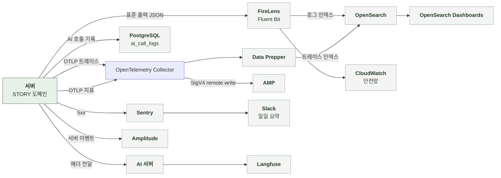

# 5-4 관측

이 문서는 STORY 도메인의 관측 스택, 요청을 추적할 식별자, AI 서버에 전달하는 헤더, AI 호출 기록, 구조화 로그 이벤트, 오류 확인 위치, 지표, 알림, 수집 조건, 분석 이벤트를 정한다.

AI 서버로 보내는 헤더 목록은 처리 흐름의 공통 처리에, 개인정보 취급 규칙은 보안에 있다. ([4-1-1 공통 처리](4-1-PIPELINES.md#4-1-1-공통-처리), [5-1-6 식별자와 개인정보](5-1-SECURITY.md#5-1-6-식별자와-개인정보))

<br>

### 5-4-1 관측 스택



운영 전송 경로는 Terraform 선언 기준이다. 공통 로그의 추가 OTLP 경로와 수신 확인 기준은 [백엔드 운영 관측](../../../platform/BACKEND/2-OBSERVABILITY.md#2-1-메트릭과-운영-연동)을 따른다. 위 그림은 도메인별 신호를 중심으로 표시한다.

<br>

### 5-4-2 상관관계 식별자

상관관계 필터는 모든 요청의 MDC에 다음 값을 기록한다. 로그, Sentry, `ai_call_logs`는 같은 식별자 값을 사용한다. 필터가 인증보다 먼저 실행되므로 인증에 실패한 요청도 추적할 수 있다. 비동기 실행기는 MDC와 현재 스팬을 워커 스레드에 복사한다.

| MDC 필드 | 값 | 규칙 |
|---|---|---|
| `request_id` | `req_` + UUID | 요청 헤더 값을 쓰고 없으면 생성<br>응답 헤더로 반환 |
| `session_id` | `X-Manyak-Session-Id` | 없으면 `unknown` |
| `device_id_hash` | `device_hash_` + SHA-256(pepper + 원본) 앞 16자 | 원본은 저장하지 않음 |
| `sentry_event_id` | Sentry 이벤트 ID | 5xx를 Sentry로 보낸 요청만<br>같은 요청의 `api_request_failed` 로그에 실림 |
| `traceId`, `spanId` | 현재 스팬 | 트레이스 전송이 비활성화되어도 생성해 로그에 포함 |

| 식별자 | 기록 위치 | 연결 대상 |
|---|---|---|
| `request_id` | 로그 MDC, Sentry 태그, `ai_call_logs.request_id`, AI 서버 Langfuse metadata | 백엔드 요청과 AI 호출 |
| `session_id`, `device_id_hash` | 로그 MDC, Sentry `identity` 컨텍스트, `ai_call_logs` | 같은 분석 세션과 기기<br>`unknown`은 Sentry와 `ai_call_logs`에 싣지 않음 |
| `ai_call_log_id` | `story_created`, `ai_call_started`, `ai_call_completed` 로그 | `ai_call_logs` 행 |
| `story_public_id`, `story_id`(응답 ID) | 이미지, 완성 로그 | 스토리 공개 ID<br>내부 PK는 로그에 싣지 않음 |

생성 요청 행의 `request_id`(도메인 멱등 키)는 MDC의 `request_id`와 다른 값이다.

<br>

### 5-4-3 AI 서버로 전달하는 헤더

| 항목 | 내용 |
|---|---|
| 연결 방식 | AI는 헤더 값을 Langfuse 메타데이터에 기록하며 트레이스를 자동으로 합치지는 않음<br>같은 제작 과정의 트레이스는 `X-Manyak-Creation-Id`로 검색해 연결 |
| 분석 ID와의 관계 | 제품 분석의 `creation_id`(`simpleCreationId`)와 트레이스 연결 ID는 값도 타입도 달라 직접 조인하지 않음 |
| `traceparent` | AI 호출 클라이언트가 현재 스팬을 전파 |

<br>

### 5-4-4 AI 호출 기록

AI 호출 1회마다 1행을 남긴다. 호출 전 `STARTED`로 적재하고 종료 시 `SUCCEEDED` 또는 `FAILED`로 바꾼다. `completed_at` 없이 `STARTED`로 남은 행은 호출 처리 중 프로세스가 중단되었거나 종료 상태 저장에 실패했을 수 있다. `SUCCEEDED`는 AI 호출 성공만 의미하고 스토리 저장 완료를 의미하지 않는다. AI 내용 거절은 AI 서버가 계약대로 응답한 호출이라 `SUCCEEDED`다.

| 필드 | STORY 도메인의 값 |
|---|---|
| `feature` | `storyline_generation`, `story_completion` |
| `caller_service` | `manyak-server` |
| `request_id` | MDC 값, 없으면 `unknown`<br>128자로 자름 |
| `session_id`, `device_id_hash` | MDC 값, `unknown`이면 `null`<br>128자로 자름 |
| `story_id`, `chat_id`, `turn_number` | `null` |
| `provider`, `model` | AI 응답 `meta`, 컬럼 길이 상한에 맞춰 자름 |
| `input_token_count`, `output_token_count`, `retry_count` | AI 응답 `meta`, 음수는 0<br>`null`이면 덮어쓰지 않음 |
| `prompt_versions` | AI 응답 `meta`<br>`null`이면 덮어쓰지 않음 |
| `latency_ms` | 호출 시작부터 응답까지<br>`ai_call_completed.duration_ms`, 지표와 같은 시계로 측정 |
| `error_code` | 실패 시 예외 분류 |
| `sentry_event_id` | `null` |

<br>

### 5-4-5 구조화 로그 이벤트

구조화 로그는 `event_name`을 맨 앞에 둔 JSON을 INFO로 남긴다. 이벤트 이름은 snake_case다. `prod`, `dev`, `jsonlog` 프로파일만 JSON이다. 그 외는 콘솔 패턴이다. JSON에는 `service=manyak-server`가 붙는다. MDC 값은 인코더가 최상위 필드로 싣는다.

| 단위 | 기록 시점과 이름 | 기록 내용 |
|---|---|---|
| 모든 API 요청 | 응답 종료<br>`api_request_completed`, 5xx는 `api_request_failed` | `endpoint`, `http_method`, `status_code`, `duration_ms`<br>5xx는 `error_code`(예외 클래스 이름 또는 상태 이름)<br>actuator, swagger, `/error` 제외 |
| 추적 헤더 누락 | `/api/` 요청에 기기, 세션 헤더가 없을 때 WARN<br>웹훅 경로 제외 | 누락 헤더 이름, 메서드, 경로<br>평문 로그 |
| AI 호출 | 호출 직전 `ai_call_started`, 종료 시 `ai_call_completed` | `feature`, `ai_call_log_id`<br>종료 시 `outcome`(`success`, `failure`), `duration_ms` |
| 완성 요청 | 요청 수신<br>`story_create_requested` | `creation_id`(진행 ID) |
| 완성 성공 | 저장 성공<br>`story_created` | `story_id`(공개 ID), `ai_call_log_id`, `duration_ms`<br>회수 재구성은 `ai_call_log_id`가 null |
| 완성 실패 | 예외 전파 직전<br>`story_create_failed` | `error_code`(HTTP 상태 이름 또는 예외 클래스 이름), `duration_ms` |
| 인물 수 초과 | 저장 인물이 상한을 넘을 때<br>`character_limit_exceeded` | `story_public_id`, `received`, `kept` |
| 생성 이미지 업로드 실패 | 디코딩 또는 업로드 실패<br>`character_image_upload_failed`, `thumbnail_image_upload_failed` | `story_public_id`, `error_type`(예외 클래스 이름)<br>AI가 `error`를 포함해 반환한 이미지는 로그 없이 제외 |
| 이미지 단계 제한 시간 소진 | 남은 시간이 없어 건너뛸 때<br>`character_image_budget_exhausted`, `thumbnail_image_budget_exhausted` | `story_public_id`, `stage`(`upload`, `cleanup`) |
| 보상 삭제 생략과 실패 | `generated_image_cleanup_skipped`<br>`character_image_cleanup_failed`, `thumbnail_image_cleanup_failed` | `story_public_id`, `reason`(`story_exists`, `lookup_failed`), `error_type`<br>`lookup_failed`는 고아 객체 가능 |
| 검색 색인과 재색인 실패 | 커밋 후 리스너, 기동 시 재색인과 인덱스 초기화 | 예외 클래스 이름만 WARN<br>평문 로그 |

<details>
<summary><b>예시: 완성 성공 로그 1줄</b></summary>

<br>

예시는 가상 값이다. 로그 프레임워크가 붙이는 필드는 생략했다. `request_id`, `session_id`, `device_id_hash`, `traceId`, `spanId`는 MDC에서 인코더가 붙인다.

```json
{"@timestamp":"2026-10-12T01:23:45.678Z","message":"event_name=story_created, story_id=3f2a9c1e-5b7d-4e8f-9a0b-1c2d3e4f5a6b, ai_call_log_id=48213, duration_ms=23810","level":"INFO","request_id":"req_0f1e2d3c4b5a69788796a5b4c3d2e1f0","session_id":"sess_7c1d9e2b","device_id_hash":"device_hash_9a8b7c6d5e4f3a2b","traceId":"4bf92f3577b34da6a3ce929d0e0e4736","spanId":"00f067aa0ba902b7","event_name":"story_created","story_id":"3f2a9c1e-5b7d-4e8f-9a0b-1c2d3e4f5a6b","ai_call_log_id":48213,"duration_ms":23810,"service":"manyak-server"}
```

</details>

<br>

### 5-4-6 오류 확인

| 기능 | 오류 조회 위치 |
|---|---|
| 스토리라인 생성 | `ai_call_logs` `feature=storyline_generation`<br>Sentry `endpoint=/api/v1/stories/simple/storylines` |
| 완성 | `ai_call_logs` `feature=story_completion`, 로그 `story_create_failed`<br>Sentry `endpoint=/api/v1/stories/simple` |
| 일반 제작 | Sentry `endpoint=/api/v1/stories/general` |
| 생성 이미지 | 로그 `*_upload_failed`, `*_budget_exhausted`, `*_cleanup_*`<br>스토리는 성공으로 끝나 Sentry와 `ai_call_logs`에 남지 않음 |
| 검색 색인 | WARN 평문 로그<br>요청 실패로 이어지지 않음 |

`ai_call_logs.error_code`는 호출 기록기가 잡은 예외의 클래스 단순 이름이다. 100자로 잘라 기록한다. 연결 실패와 읽기 시간 초과는 `ResourceAccessException`, 내용 거절을 뺀 AI 서버의 4xx와 5xx는 HTTP 클라이언트의 상태별 예외 이름, 빈 본문은 `IllegalStateException`이다. AI 호출 실패는 호출부에서 502로 바뀌어 전파되므로 Sentry와 `story_create_failed`의 `error_code`는 `BAD_GATEWAY`가 된다. 내용 거절은 422로 바뀌어 전파되므로 Sentry에 남지 않는다.

<br>

### 5-4-7 지표

지표 태그에는 값의 종류가 제한된 enum만 사용한다.

| 지표 | 종류와 태그 | 의미 |
|---|---|---|
| `manyak.ai.call.duration` | Timer<br>`feature`, `outcome`(`success`, `failure`) | AI 호출 지연과 실패율 |
| `manyak.story.creation.duration` | Timer<br>`outcome`(`success`, `failure`, `rejected`) | 완성 처리 시간<br>AI 호출과 저장을 포함하고 멱등 재요청과 회수 재구성은 제외 |
| `manyak.storyline.creation.result` | Counter<br>`outcome`(`success`, `failure`, `rejected`) | 스토리라인 생성 결과 분포<br>게스트 한도 소진처럼 AI 호출 전에 거부된 요청도 기록 |
| `http.server.requests` | Timer<br>`uri`, `method`, `status`, `outcome` | 요청률, 오류율, 응답 시간 |

| 기준 | 내용 |
|---|---|
| `rejected`와 `failure` | `rejected`는 컴파일 또는 AI 호출 전의 4xx 거부와 AI 내용 거절<br>`failure`는 호출에 진입한 뒤의 그 밖의 실패<br>판별 기준은 HTTP 상태가 아니라 AI 진입 여부이고 AI 내용 거절만 진입 뒤에도 `rejected`<br>알림과 p95는 `failure`만 사용 |
| AI 내용 거절의 AI 호출 지표 | AI 서버가 계약대로 응답한 호출이라 `manyak.ai.call.duration`과 `ai_call_completed`의 `outcome`은 `success` |
| 히스토그램 구간 | `manyak.story.creation.duration`과 `manyak.ai.call.duration`은 100ms에서 240초<br>상한이 컴파일 대기 180초보다 커야 대기 초과 직전 분포가 보임<br>`http.server.requests`는 10ms에서 10초라 AI 대기 경로의 p95는 10초 상한에 제한되어 실제 지연을 구분하기 어려움 |

<br>

**집계 조건**

| 항목 | 기준과 제한 |
|---|---|
| 전송 여부 | 지표 전송을 켠 환경만 AMP에 있음 |
| 전송 주기 | 60초 간격 |
| 인스턴스 | 리소스 속성 `service.instance.id`가 기동마다 바뀜<br>여러 태스크의 누적 건수는 인스턴스별로 합산 |
| 스텁 환경 | AI를 호출하지 않아 지연이 실제와 다름 |
| `ai_call_logs` 기간 | `created_at` 기준<br>`completed_at`은 전이 시각 |
| 재요청 | 멱등 재요청과 회수 재구성은 지표에 없고 로그 `story_created`에는 있음<br>로그와 지표 건수를 같다고 보지 않음 |

<br>

### 5-4-8 트레이스

| 항목 | 내용 |
|---|---|
| 활성화와 표본 | 환경 변수로 켜며 기본값은 비활성 |
| 스팬 | HTTP 요청 아래에 AI 호출(`traceparent` 전파), JDBC(QUERY만, 바인딩 값 제외), Redis 스팬<br>워커 스레드의 작업도 요청 트레이스 아래에 연결 |
| 제외 | 검수 폴러의 주기 실행, actuator 요청, Spring Security 내부 관측, 요청 밖 루트 DB와 Redis 관측은 노이즈 필터가 제외 |

<br>

### 5-4-9 알림

| 항목 | 기준 |
|---|---|
| 정기 보고 | 매일 오전 10시(KST), 지난 24시간의 운영 Sentry 오류 요약 |
| 범위 | AI 서버, 백엔드(`java-spring-boot`), 웹 프로젝트 |
| 오류 없음과 조회 실패 | 오류가 없다는 결과와 조회 실패를 구분해 전달 |
| STORY에서 잡히는 것 | 502 AI 실패와 500 예상하지 못한 예외<br>4xx 거부, AI 내용 거절, 이미지 누락, 색인 실패, `STARTED`와 `PENDING` 잔존은 Sentry에 없어 보고에 포함되지 않음 |

<br>

### 5-4-10 수집 조건과 실패 처리

**1. 데이터 범위**

| 데이터 | 현재 기록 방식 |
|---|---|
| 사용자 입력 원문, 프롬프트, AI 응답 본문 | 로그, Sentry, `ai_call_logs`에 싣지 않음<br>원문은 AI 서버의 Langfuse에서 관리 |
| 생성 이미지 | base64와 URL을 로그에 싣지 않음<br>객체 키는 S3 보상 삭제에만 사용 |
| 검색어 | 로그와 Sentry에 구조화 필드로 싣지 않음 |
| Sentry 이벤트 | 5xx를 전부 캡처<br>기본 개인정보 수집 끔<br>`request_id`는 태그, `session_id`와 `device_id_hash`는 `identity` 컨텍스트, `unknown`은 제외 |
| JDBC 스팬 | placeholder SQL만 수집<br>바인딩 값 제외 |
| 로그 `message` | 예외 메시지와 스택트레이스는 그대로 기록 |

<br>

**2. 수집 실패**

| 상황 | 처리 |
|---|---|
| `ai_call_logs` `STARTED` 적재 실패 | 예외가 전파되어 AI 호출에 진입하지 않음 |
| `ai_call_logs` 전이 저장 실패 | 예외가 전파됨<br>성공한 AI 호출도 호출부에서 502로 바뀜 |
| 응답 `meta` 반영, 지표 기록, AI 호출 로그 기록 실패 | 무시하고 호출 결과 유지 |
| 완성 지표 기록 실패 | 무시하고 응답 또는 원래 예외 유지 |
| Sentry 캡처 실패 | SDK 내부에서 처리<br>DSN 없는 환경은 no-op |
| OTLP 트레이스와 지표 전송 실패 | SDK로 배치 전송<br>실패분은 유실 |
| Amplitude 전송 실패 | 비동기 호출 뒤 WARN 로그만 남기고 재시도 없음 |
| 이미지 보상 삭제 실패 | 로그만 남기고 원래 예외 유지 |
| 미수집과 누락 | 수집 비활성화, 표본 제외, 기록 실패, 전송 유실을 구분<br>기록이 없다는 이유만으로 요청이 없었다고 판단하지 않음 |

<br>

### 5-4-11 분석 이벤트

**서버 이벤트**

Amplitude HTTP API로 비동기 발행한다. 분석 전송을 켜고 API 키가 있는 환경만 전송한다. 스토리 완성에는 서버 이벤트가 없다. 클라이언트가 스토리 ID 확정 시점에 `client_storyCreate_completed`를 보낸다.

| 이벤트 | 시점 | 프로퍼티 |
|---|---|---|
| `server_storyCreate_storyGeneration_processed_succeeded` | 스토리라인 생성 성공 | `creation_id` |
| `server_storyCreate_storyGeneration_processed_failed` | 스토리라인 생성 실패 | `creation_id`(발급 전 실패는 없음), `error_type` |

| 공통 프로퍼티 | 값 |
|---|---|
| `user_id` | 회원이면 공개 식별자 |
| `device_id` | 요청 헤더 `X-Manyak-Device-Id` 원본<br>헤더가 없으면 게스트는 `unknown`, 회원은 생략 |
| `session_id`, `request_id`, `is_logged_in` | 요청 문맥 |
| `platform`, `app_version` | ACCOUNT와 같음 ([ACCOUNT 5-4-9 분석 이벤트](../../ACCOUNT/BACKEND/5-4-OBSERVABILITY.md#5-4-9-분석-이벤트)) |
| `insert_id` | `{request_id}:{eventType}`<br>재시도 중복 제거 |
| `error_type` | `network`, `validation`, `server` |

<details>
<summary><b>서버 이벤트 예시</b></summary>

<br>

Amplitude HTTP V2 배치 페이로드 1건이다. 예시 값은 형식만 맞춘 가상 값이다. `device_id`는 요청 헤더 원본이고 이벤트 프로퍼티 `device_id_hash`는 그 해시다.

```json
{
  "api_key": "<AMPLITUDE_API_KEY>",
  "events": [
    {
      "event_type": "server_storyCreate_storyGeneration_processed_succeeded",
      "user_id": "3f6a1c2e-9b7d-4e21-8c55-0a1b2c3d4e5f",
      "device_id": "9b1deb4d-3b7d-4bad-9bdd-2b0d7b3dcb6d",
      "session_id": 1760000000000,
      "insert_id": "req_0123456789abcdef:server_storyCreate_storyGeneration_processed_succeeded",
      "time": 1760000000123,
      "event_properties": {
        "is_logged_in": true,
        "request_id": "req_0123456789abcdef",
        "device_id_hash": "device_hash_0123456789abcdef",
        "creation_id": 12345
      }
    }
  ]
}
```

</details>

<br>

제작 퍼널의 클라이언트 이벤트는 `creation_id`에 `simpleCreationId`를 싣는다. 서버 이벤트의 `creation_id`도 같은 값이므로 퍼널은 이 값으로 연결한다. `request_id`는 진단용 상관 키이며 제품 분석에서 데이터를 연결하는 키로 사용하지 않는다.
