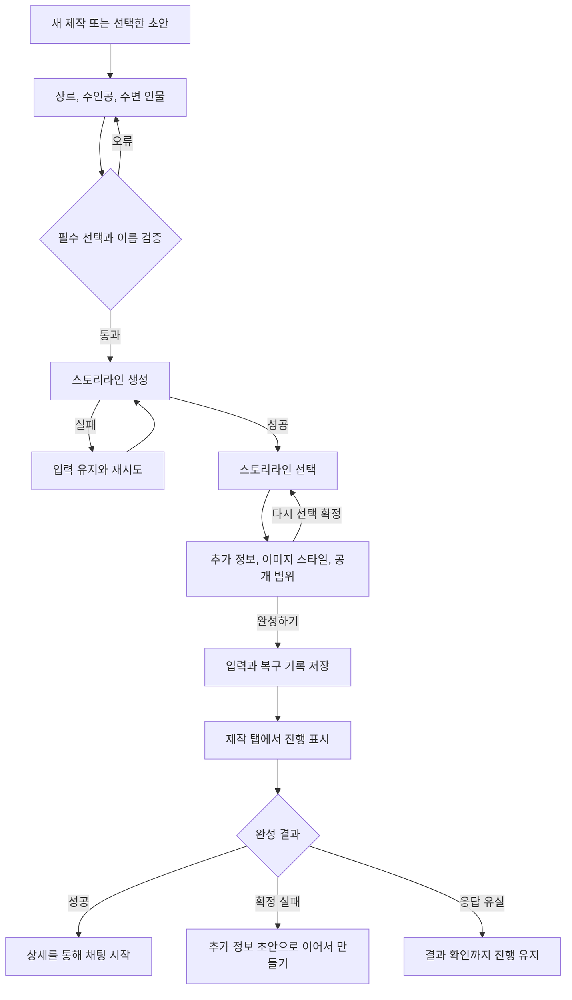
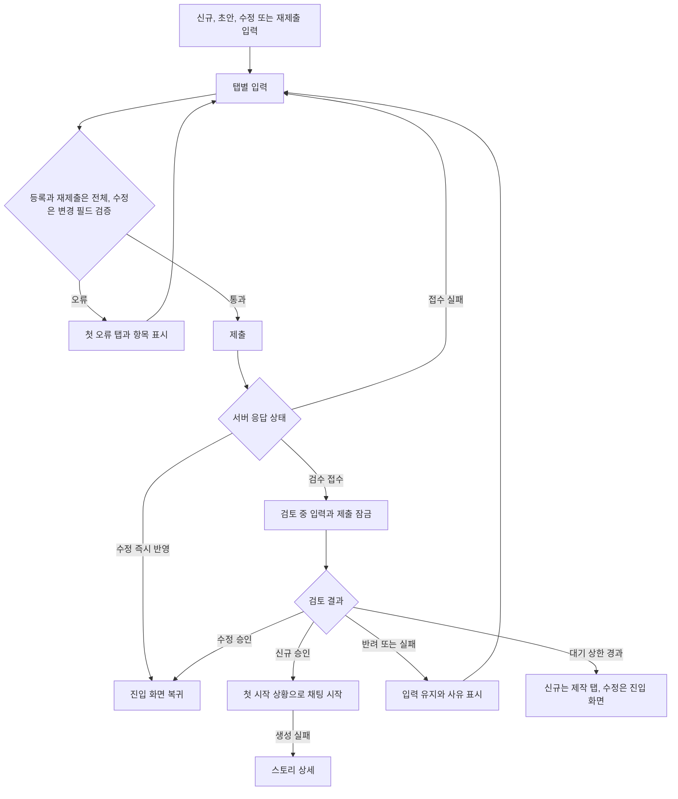

# 3-2 화면 흐름

기준: [화면 구성](3-1-INFORMATION-ARCHITECTURE.md), [요구사항](2-2-REQUIREMENTS.md).

 

### 3-2-1 탐색과 상세

1. 홈에서 필터와 정렬을 선택하면 선택한 목록으로 바꾼다. 같은 필터를 눌러 해제하지 않는다.
2. 카드로 상세를 열고 시작 상황과 페르소나를 고른다. 새 페르소나 만들기는 선택을 즉시 바꾸지 않으며 해당 흐름에서 생성한 항목만 복귀 때 미리 선택한다.
3. 새 채팅 시작을 누르면 진행 상태를 보이고 중복 조작을 막는다. 성공하면 채팅방, 실패하면 선택한 상세를 유지한다.
4. 표지와 인물 이미지는 뷰어에서 확대한다. 닫기, 바깥 영역과 뒤로가기는 뷰어만 닫으며 확대 상태는 초기화한다.
5. 삭제는 옵션 시트를 먼저 닫고 확인을 연다. 내 스토리 카드 삭제는 현재 제작 탭을 유지하고 상세 삭제 성공은 제작 탭으로 돌아간다.

 

### 3-2-2 간편 제작

1. 새 제작은 기존 초안에 대한 질문 없이 새 입력을 연다. 이어서 만들기는 제작 카드에서 선택한 기록만 연다.
2. 키워드는 장르, 주인공, 주변 인물 순서로 정한다. 앞 필수 카테고리를 충족하기 전에는 뒤 카테고리를 열지 않는다.
3. 생성 버튼은 항상 제공하고 누를 때 필수 선택과 이름을 검증한다. 통과하면 중복 조작을 막고 스토리라인 로딩으로 이동한다.
4. 스토리라인 세 개 중 하나를 고르거나 다시 만들기, 평가, 선택 키워드 보기를 사용한다. 생성에 실패하면 입력을 유지해 재시도한다.
5. 추가 정보에서 추천과 자유 입력, 이미지 스타일과 공개 범위를 정한다. 이미지 스타일을 고르지 않으면 이동하지 않고 푸터에 안내한다.
6. 다시 선택하기는 작성한 추가 정보가 있을 때 확인을 연다. 닫기는 모두 유지하고, 확정은 스토리라인 선택과 추가 정보만 지워 선택 단계로 돌아간다.
7. 완성하기는 입력과 복구 기록의 저장이 끝나면 제작 탭으로 돌아간다. 성공 결과를 목록에 표시하며 상세를 통해 채팅을 시작한다.
8. 확정 완성 실패는 같은 입력의 추가 정보 초안으로 돌아가 이어서 만들기를 제공한다. 응답 유실은 결과를 확인할 때까지 진행 상태를 유지한다.

 

### 3-2-3 일반 제작과 수정

1. 일반 제작은 새 입력 또는 저장한 입력으로 열고, 재개는 스토리 프로필 탭에서 시작한다. 수정과 재제출은 대상의 입력을 조회한 뒤 연다.
2. 탭, 이전과 다음으로 이동한다. 선택한 탭을 가로 가운데로 맞추고 본문을 맨 위로 올린다. 반복 항목 추가는 새 입력이 보이게 스크롤하되 키보드를 열지 않는다.
3. 시작 상황은 칩으로 선택한다. 첫 항목은 남기고 선택한 뒤 항목을 지우면 바로 앞 항목을 고른다. 내용이 있으면 삭제를 확인한다.
4. 등록하기는 누른 시점에 전체 입력을 검증한다. 오류 탭을 표시하고 첫 오류가 있는 탭과 접힌 항목을 열어 첫 칸을 화면 가운데에 보인다. 초점을 강제로 옮기지 않는다.
5. 서버 응답이 즉시 반영이면 수정 성공을 알리고 진입 화면으로 돌아간다. 검수 접수이면 입력과 제출을 잠그고 닫기는 허용한다. 공개 제한된 스토리의 공개 변경도 검수 접수 결과를 따른다. 신규 등록 승인 후 첫 시작 상황으로 채팅을 시작하며 실패하면 상세로 이동한다.
6. 반려와 실패는 입력을 유지해 사유가 있는 첫 탭을 연다. 고치거나 삭제한 칸의 사유는 내린다. 같은 제출본으로 다시 등록하거나 저장한다.
7. 대기 상한이 지나면 신규 등록은 제작 탭, 수정은 진입했던 화면으로 돌아가 후속 반영을 안내한다.
8. 검토 중 수정 제출본은 입력과 저장을 잠그되 탭은 볼 수 있다. 변경 없는 수정은 요청 없이 돌아가고, 성공한 수정도 진입 화면으로 돌아간다.

 

### 3-2-4 저장과 이탈 확인

| 현재 상태 | 닫기와 뒤로가기 |
|---|---|
| 입력과 저장본 및 진행 기록이 모두 없음. Android 일반 제작은 이미지 업로드와 쓰기 요청도 진행 중이 아님 | 확인 없이 제작 탭으로 나간다 |
| Android 일반 제작에서 입력은 없지만 이미지 업로드나 쓰기 요청이 진행 중임 | 이탈 확인을 유지한다 |
| 저장 없이 입력만 있음 | 지금 나가면 입력이 사라짐을 확인한다 |
| 저장 이후 편집이 남음 | 마지막 저장 이후 내용이 사라짐을 확인한다 |
| 저장된 초안이나 생성 기록만 있음 | 제작 탭에서 이어갈 수 있음을 안내한다 |
| 일반 제작 접수 후 편집 없음 | 제작 탭에서 등록 요청 내용을 확인할 수 있음을 안내한다 |
| 일반 제작 접수 후 편집 있음 | 접수 이후의 변경은 사라짐을 확인한다 |
| 수정 화면의 변경 없음 | 확인 없이 돌아간다 |
| 수정 화면의 변경 있음 | 저장하지 않은 변경이 사라짐을 확인한다 |

이탈을 확정해도 미저장 편집을 추가 저장하지 않는다. 충돌 확인에서 서버 내용을 남기면 현재 입력을 강제로 덮지 않고 닫으며, 현재 입력으로 저장하기를 확정하면 그 입력을 저장한다.

 

### 3-2-5 검수 제출본

| 선택 | 흐름 |
|---|---|
| 검토 중 등록 취소 | 확인 후 제출본을 삭제하고 취소 완료를 안내한다 |
| 반려와 실패 수정하기 | 제출한 입력과 사유를 일반 제작 폼에 채운다 |
| 재제출 진입 시 이미 검토 중 | 제작 탭으로 돌아가 아직 검토 중임을 알린다 |
| 재제출 진입 시 승인됨 | 만들어진 스토리 상세로 이동한다 |
| 재제출 조회 실패 | 제작 탭으로 돌아가 조회 실패를 안내한다 |
| 반려와 실패 삭제 | 입력을 잃는다는 확인 후 해당 제출본만 삭제한다 |
