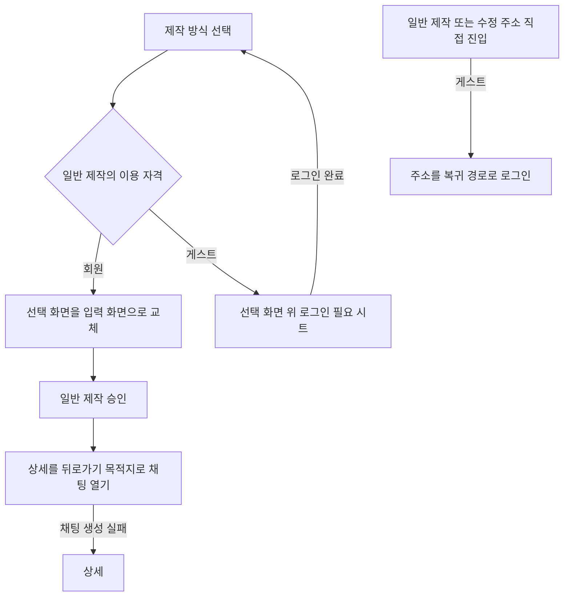
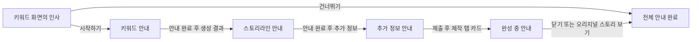

# 3-2 화면 흐름: 웹

기준: [공통 흐름](../3-2-INTERACTION-FLOWS.md), [웹 URL](3-1-INFORMATION-ARCHITECTURE.md).

 

### 3-2-1 진입과 복귀

| 조작 | 화면 결과 |
|---|---|
| 제작 방식 선택 | 선택 화면을 입력 화면으로 바꿔 열어 뒤로가기로 선택 화면이 다시 나타나지 않게 한다 |
| 게스트의 일반 제작 선택 | 선택 화면에 남고 로그인 필요 시트. 로그인 뒤 선택 화면으로 복귀 |
| 게스트의 일반 제작 및 수정 주소 진입 | 해당 주소를 복귀 경로로 로그인 화면 이동 |
| 상세 뒤로가기 | 앱 안에서 왔으면 이전 화면, 직접 진입이면 홈으로 교체 |
| 수정 종료와 성공 | 앱 안에서 왔으면 상세 또는 제작 탭으로 복귀, 직접 진입이면 상세로 교체 |
| 수정 조회 실패 | 조회 실패를 알리고 앱 안 진입은 이전 화면, 직접 진입은 상세로 이동 |
| 이탈 확인에서 뒤로가기 | 확인창만 닫는다. 나가기를 확정하면 가드를 정리하고 제작 탭으로 교체 |
| 간편 제작 | 키워드와 스토리라인 및 추가 정보를 같은 URL에서 전환. 새 진입은 기존 기록을 자동 복원하지 않는다 |
| 일반 제작 승인 | 상세가 뒤로가기 목적지로 남도록 채팅을 연다. 채팅 생성 실패는 상세 |
| 완료 카드 교체 | 데이터가 준비되면 해당 위치에서 짧게 페이드로 바꾸고 기존 카드와 스크롤 위치 유지 |

 

### 3-2-2 제작 안내

| 단계 | 여는 시점 | 동작 |
|---|---|---|
| 인사 | 키워드 화면 준비 | 건너뛰기는 전체 완료, 시작하기는 키워드 안내 |
| 키워드 | 인사에서 시작하기 | 확인으로 닫음 |
| 스토리라인 | 앞 안내 완료 후 생성 결과 표시 | 확인으로 닫음 |
| 추가 정보 | 앞 안내 완료 후 추가 정보 표시 | 확인으로 닫음 |
| 완성 중 | 제출 후 제작 탭에 완성 중 카드 표시 | 닫기 또는 오리지널 스토리 보기로 전체 완료 |

화면 준비 약 200ms 뒤 연다. 생성 중과 실패, 로그인 필요 시트, 저장 충돌, 초대 코드 시트와 겹치지 않는다. 버튼이나 뒤로가기로 닫을 때만 완료를 기록하고 열린 채 이탈하면 같은 안내를 다시 연다. 다시 보기 진입점은 없다. 두 버튼인 단계의 뒤로가기는 왼쪽 버튼, 나머지는 확인과 같다. 오리지널 스토리 보기는 하단 탭 이동처럼 홈으로 전환한다.
