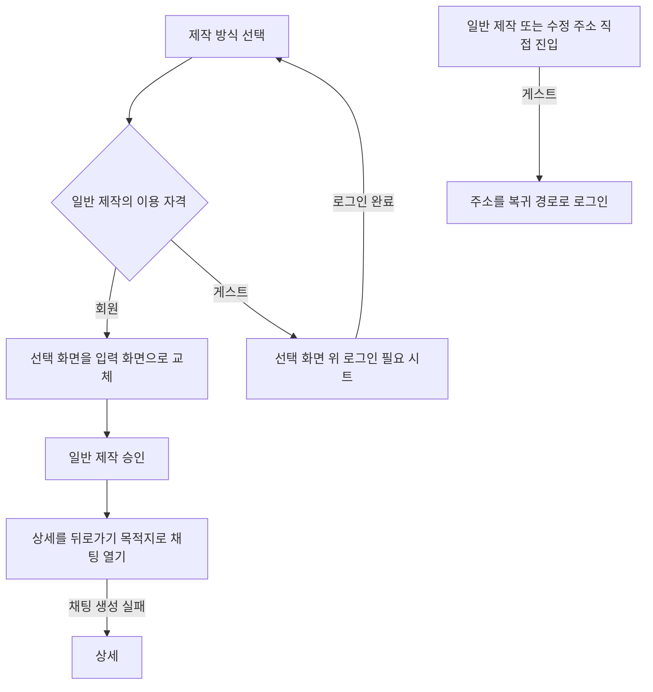

# 3-2 화면 흐름: 웹

기준: [공통 흐름](../3-2-INTERACTION-FLOWS.md), [웹 URL](3-1-INFORMATION-ARCHITECTURE.md).

 

### 3-2-1 진입과 복귀

| 조작 | 화면 결과 |
|---|---|
| 제작 방식 선택 | 선택 화면을 입력 화면으로 바꿔 열어 뒤로가기로 선택 화면이 다시 나타나지 않게 한다 |
| 게스트의 일반 제작 선택 | 선택 화면에 남고 로그인 필요 시트. 로그인 뒤 선택 화면으로 복귀 |
| 게스트의 일반 제작 및 수정 주소 진입 | 해당 주소를 복귀 경로로 로그인 화면 이동 |
| 상세 뒤로가기 | 앱 안에서 왔으면 이전 화면, 직접 진입이면 홈으로 교체 |
| 홈 섹션 화살표 | 다음, 이전을 누르면 카드 한 장과 간격 8px만큼 부드럽게 넘기고 카드 시작점에 맞춘다. 넘기는 중에 다시 누르면 가던 목적지에서 한 번 더 넘긴다. 처음에는 이전, 끝에서는 다음이 꺼진다. 동작 줄이기에서는 바로 이동 |
| 탐색 탭 진입 | 다른 탭에서 하단 탭으로 들어오면 남은 탐색 목록과 스크롤 기억을 버리고 새 순서를 맨 위부터 보인다. 이미 탐색이면 다시 눌러도 그대로 둔다 |
| 탐색 복귀 | 상세에서 뒤로가면 같은 문서에서 받은 목록과 스크롤 위치를 다시 쓴다 |
| 검색 제출과 지우기 | 현재 방문 기록의 주소만 `?q=` 있는 주소와 없는 주소로 바꾼다. 서버에 화면을 다시 요청하지 않는다 |
| 검색 뒤로가기 | 앱 안에서 왔으면 검색 화면을 연 곳, 직접 진입이면 탐색으로 교체 |
| 검색 결과 복귀 | 상세에서 뒤로가면 주소의 검색어로 같은 결과와 떠날 때의 스크롤 위치를 다시 보인다. 같은 검색어를 새로 열면 맨 위에서 시작 |
| 수정 종료와 성공 | 앱 안에서 왔으면 상세 또는 제작 탭으로 복귀, 직접 진입이면 상세로 교체 |
| 수정 조회 실패 | 조회 실패를 알리고 앱 안 진입은 이전 화면, 직접 진입은 상세로 이동 |
| 이탈 확인에서 뒤로가기 | 확인창만 닫는다. 나가기를 확정하면 가드를 정리하고 제작 탭으로 교체 |
| 간편 제작 | 키워드와 스토리라인 및 추가 정보를 같은 URL에서 전환. 새 진입은 기존 기록을 자동 복원하지 않는다 |
| 일반 제작 승인 | 상세가 뒤로가기 목적지로 남도록 채팅을 연다. 채팅 생성 실패는 상세 |
| 완료 카드 교체 | 데이터가 준비되면 해당 위치에서 짧게 페이드로 바꾸고 기존 카드와 스크롤 위치 유지 |

 

### 3-2-2 제작 안내

단계와 여는 조건은 [공통 제작 안내 흐름](../3-2-INTERACTION-FLOWS.md#3-2-6-제작-안내)을 따른다.

| 상황 | 웹 동작 |
|---|---|
| 뒤로가기 | 대화창이 히스토리 레이어를 하나 쌓아 브라우저와 기기 뒤로가기로 대화창만 닫는다 |
| 조작 없이 열린 대화창 | 브라우저가 더미 히스토리를 허용하지 않아 뒤로가기가 간편 제작 화면을 떠난다. 기록하지 않아 다음 진입에 같은 단계를 다시 연다 |
| 오리지널 스토리 보기 | 열린 히스토리 레이어를 소비한 뒤 하단 탭 이동처럼 홈 URL로 바꾼다 |
