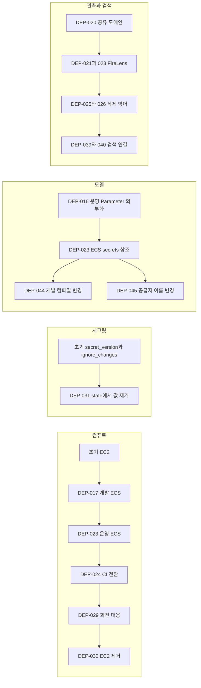

# DECISIONS.md

현재 적용 기준은 각 명세에 두고 결정 당시의 이유와 대체 관계는 이 문서에 기록한다.

 

### 1. 기록 규칙

- 결정 하나를 표 하나로 기록한다. 기존 ID, 날짜, 당시 상태와 근거를 유지한다.
- 상태와 구현 설명은 원본의 기록 시점을 기준으로 해석한다. 현재 적용 여부나 배포 완료를 과거 기록만으로 단정하지 않는다.
- 결정이 바뀌면 새 ID로 기록하고 대체하는 결정과 적용 범위를 명시한다.
- 원문에 구분되지 않은 배경, 대안과 영향은 추측해서 보충하지 않는다.

 

### 2. 기록의 기준과 전환

**기록의 출처**

이 문서는 2026-09-12에 `manyak-terraform`의 전체 로컬 Git 이력과 PR을 대조해 복원했다. 날짜는 별도 표기가 없으면 PR 병합 시각(KST)이다. 병합만으로 apply나 실배포를 단정하지 않는다.

확정된 판단 근거와 사실은 유지하고 결정 변경은 새 ID로 추가한다. 대안이 없으면 원문에도 기록이 없었던 것이다. `후속`이 없으면 이 문서에서 확인한 대체 결정이 없다. 현재 적용 범위는 [배포 명세](DEPLOYMENT.md)를 따른다. PR 이전 구성은 manyak-terraform 분리 커밋 `e107845` 이전 manyak-server 이력에서 확인한다.

**초기 기반과 전환 관계**

2026-06-27 `e107845`에서 운영 Terraform을 manyak-server에서 분리했다. 출발점은 단일 EC2와 Compose, ALB, RDS, Redis, SSM 배포이다. 그 이전 구성은 manyak-server 이력에서 확인하며, 이 날짜를 최초 결정일로 보지 않는다.

**전환 단계 기록**

DPL 기록은 DEP 결정을 전환 단계별로 묶은 당시 구현 방법이다. DEP 기록은 시간순으로 배열한다. 현재 구조는 배포 명세에서 관리한다.

 

### 3. 결정 기록

 

**DPL-D01. EC2 운영 기반과 설정 전달**

| 항목 | 내용 |
|---|---|
| 상태 | 원문에 별도 상태 기록 없음 |
| 배경 | 원문에 별도 항목으로 구분하지 않음 |
| 채택 | ALB 뒤 EC2의 Compose가 server, ai를 실행하고 RDS, Redis를 외부 데이터 계층으로 사용했다. SSM 배포가 Secrets Manager를 읽어 실행 설정을 구성했다. DB 회전은 EventBridge, SSM으로 설정을 재동기화했다. |
| 대안 | 원문에 별도 항목으로 구분하지 않음 |
| 영향 | 시크릿 검증 후 임시 파일을 원자적으로 교체했다. AI 모델 설정을 AI 전용 파일로 분리하고 사전검사 후 컨테이너를 교체했다. user-data는 base64gzip으로 전달했다. |
| 근거 | 2026-06-27 분리 커밋 `e107845`, 2026-07-01~2026-08-08 Terraform PR #1~16. |
| 연결 결정 | DEP-001~016. |
| 종료 관계 | 운영 컴퓨트와 실행 경로는 DPL-D03, D04로 대체되었다. 현재 운영 절차로 실행하지 않는다. |

 

**DPL-D02. 개발 ECS 선행 구축**

| 항목 | 내용 |
|---|---|
| 상태 | 원문에 별도 상태 기록 없음 |
| 배경 | 원문에 별도 항목으로 구분하지 않음 |
| 채택 | 분리된 dev state, VPC에 단일 awsvpc 태스크를 만들고 server, ai, postgres, redis를 함께 배치했다. 태스크 내부는 localhost로 통신하고 PostgreSQL은 EFS에 보존했다. NAT 비용을 피하는 공인 IP, Fargate Spot 구성으로 개발 검증 범위를 한정했다. |
| 대안 | 원문에 별도 항목으로 구분하지 않음 |
| 영향 | 개발 기동과 영속성, 프로파일, OIDC 배포를 확인하는 설계다. 운영 RDS, ElastiCache, 사설 네트워크, 무중단 배포까지 증명하지 않는다. |
| 근거 | 2026-08-14(KST) Terraform PR #17~19, 이후 #20~22. |
| 연결 결정 | DEP-017~022. |

 

**DPL-D03. 운영 ECS 단계 전환**

| 항목 | 내용 |
|---|---|
| 상태 | 원문에 별도 상태 기록 없음 |
| 배경 | 원문에 별도 항목으로 구분하지 않음 |
| 채택 | RDS, ElastiCache는 유지하고 server, ai, FireLens를 운영 Fargate 태스크로 옮겼다. ALB IP target group과 태스크 SG를 연결하고 초기에는 EC2 복귀 경로를 남겼다. CI를 ECS로 바꾸고 DB 회전 대체재를 갖춘 뒤 EC2를 제거했다. |
| 대안 | 원문에 별도 항목으로 구분하지 않음 |
| 영향 | 새 deployment와 태스크를 검증한다. 전환기에만 EC2 가중치 복귀가 가능했다. EC2 제거 이후에는 이미지, 설정 복구를 사용한다. |
| 근거 | 2026-08-22~2026-08-25(KST) Terraform PR #23~30. |
| 연결 결정 | DEP-023~030. |

 

**DPL-D04. 배포와 인프라 변경의 검증 경계**

| 항목 | 내용 |
|---|---|
| 상태 | 원문에 별도 상태 기록 없음 |
| 배경 | 원문에 별도 항목으로 구분하지 않음 |
| 채택 | Terraform이 task definition, IAM을 소유하고 서비스 workflow는 환경 태그 승격과 force-new-deployment를 수행하도록 나눴다. 배포가 만든 deployment ID와 컨테이너를 검증한다. |
| 대안 | 원문에 별도 항목으로 구분하지 않음 |
| 영향 | 태그 복원 없이 같은 정의로 재배포하면 실패 이미지가 다시 내려올 수 있다. 이전 정상 digest 복원 후 재배포한다. 공유 로그 도메인 삭제 사고 이후 lifecycle 방어와 최신 dev apply, drift 검사를 함께 두었다. |
| 근거 | Terraform PR #19, 24~26, 서비스별 ECS 배포 workflow. |
| 연결 결정 | DEP-019, 024~026. |

 

**DPL-D05. 시크릿 수명과 회전**

| 항목 | 내용 |
|---|---|
| 상태 | 원문에 별도 상태 기록 없음 |
| 배경 | 원문에 별도 항목으로 구분하지 않음 |
| 채택 | ECS 시작 시 secrets 참조로 값을 주입한다. 회전 감지는 값이 아닌 시각 메타데이터를 비교하는 Lambda로 구현했다. secret_version은 destroy=false로 state에서 제거해 실제 시크릿을 보존했다. |
| 대안 | 원문에 별도 항목으로 구분하지 않음 |
| 영향 | ignore_changes가 refresh를 막는다고 가정하지 않는다. 설정 등록과 태스크 참조, 재배포를 별도로 수행한다. |
| 근거 | 2026-08-25(KST) Terraform PR #29, 31. |
| 연결 결정 | DEP-029, 031. |

 

**DPL-D06. 기능별 인프라 배선 확장**

| 항목 | 내용 |
|---|---|
| 상태 | 원문에 별도 상태 기록 없음 |
| 배경 | 원문에 별도 항목으로 구분하지 않음 |
| 채택 | 생성 인물 이미지, 생성 표지, 사용자 업로드의 S3 prefix 권한을 순서대로 확장했다. 검색은 공유 OpenSearch의 환경별 인덱스와 nori 패키지, 역할 매핑으로 연결했다. 신고, 푸시, 결제는 server에 시크릿 참조를 추가하고 모델은 환경별 설정 전달 방법에 맞춰 갱신했다. |
| 대안 | 원문에 별도 항목으로 구분하지 않음 |
| 영향 | 호환 코드, 설정값, 권한, 태스크 참조를 준비하고 대상 환경을 재배포한 뒤 기능을 검수한다. 과거 PR의 apply 예정 문장은 완료 증거가 아니다. |
| 근거 | 2026-08-25~2026-09-12(KST) Terraform PR #32~46. |
| 연결 결정 | DEP-032~046. |

 

**DPL-D07. 릴리스의 코드 외 할 일과 설정 대조**

| 항목 | 내용 |
|---|---|
| 날짜 | 2026-11-01 |
| 상태 | 채택 |
| 배경 | 대화 요약은 서버를 설정을 끈 채 먼저 배포하고 AI 요약 API가 운영에 나간 뒤 다음 서버 릴리스에서 `MANYAK_CHAT_COMPACT_ENABLED`를 켜기로 했다. 2026-10-31 01:12 server v0.13.0 릴리스에서 이 Terraform 적용이 빠져 2026-11-01 15:46까지 약 38시간 30분 동안 운영에서 요약이 돌지 않았다. 릴리스 PR과 티켓은 dev에 병합된 PR 목록으로 채워 코드가 아닌 작업이 들어갈 자리가 없었다. 그 사이 v0.13.1 배포도 헬스와 배포 상태만 확인해 누락을 찾지 못했다. |
| 채택 | 릴리스 PR과 릴리스 티켓에 코드 외 할 일 칸을 두고 다음 릴리스에 묶기로 한 설정 변경을 여기에 적는다. 없으면 "없음"이라고 적는다. 이 칸의 항목이 모두 끝나야 릴리스를 완료로 본다. 기능 설정을 켜거나 끄는 배포는 실행 태스크 정의의 환경 변수를 대조한다. |
| 대안 | 별도로 검토한 대안 없음 |
| 영향 | 설정 켜기와 Terraform 적용이 릴리스 기록에 남는다. 요약이 꺼진 상태는 CHAT 지표와 알림으로도 감지한다. |
| 근거 | [KNK-1955](https://kimandkang.atlassian.net/browse/KNK-1955), [KNK-1958](https://kimandkang.atlassian.net/browse/KNK-1958), [KNK-1961](https://kimandkang.atlassian.net/browse/KNK-1961), [Terraform PR #119](https://github.com/KIM-N-KANG/manyak-terraform/pull/119). |
| 연결 결정 | CHAT 결정 26. |

 

**DEP-001. 아키텍처의 현재와 목표를 구분**

| 항목 | 내용 |
|---|---|
| 병합 | 2026-07-01 19:06 KST. |
| 상태 | 원문에 별도 상태 기록 없음 |
| 배경 | 목표 아키텍처가 이미 구현된 것처럼 보이는 과대표기를 막는다. |
| 채택 | 단일 EC2, Compose를 당시 현재 구성으로, ECS Fargate, 다중 AZ를 목표로 구분하고 네 가지 관점의 도면으로 기록했다. |
| 대안 | 원문에 별도 항목으로 구분하지 않음 |
| 영향 | 원문에 별도 항목으로 구분하지 않음 |
| 출처 | [Terraform PR #1](https://github.com/KIM-N-KANG/manyak-terraform/pull/1), [병합 커밋 `80ba8b5`](https://github.com/KIM-N-KANG/manyak-terraform/commit/80ba8b56e2ed59e6ee8e08bc55388d09910b7d6d). |

 

**DEP-002. 운영 인증 설정 주입**

| 항목 | 내용 |
|---|---|
| 병합 | 2026-07-01 20:02 KST. |
| 상태 | 원문에 별도 상태 기록 없음 |
| 배경 | 코드만 릴리스하면 기동 실패 또는 로그인 거부가 발생하므로 인프라 배선을 선행한다. |
| 채택 | JWT 서명 설정과 Google 허용 client ID를 Secrets Manager에서 서버 실행 환경으로 전달했다. |
| 대안 | 원문에 별도 항목으로 구분하지 않음 |
| 영향 | 원문에 별도 항목으로 구분하지 않음 |
| 출처 | [Terraform PR #2](https://github.com/KIM-N-KANG/manyak-terraform/pull/2), [병합 커밋 `ce3d69a`](https://github.com/KIM-N-KANG/manyak-terraform/commit/ce3d69a10624d4097df9d00679c278ccd79bdc24). |

 

**DEP-003. DB 회전 감지와 EC2 재동기화**

| 항목 | 내용 |
|---|---|
| 병합 | 2026-07-02 17:43 KST. |
| 상태 | 원문에 별도 상태 기록 없음 |
| 배경 | 2026-07-02 DB 인증 장애 재발 방지. 활성 CloudTrail이 필요한 회전 이벤트 대신 메타데이터 폴링을 선택했다. |
| 채택 | 5분 주기의 EventBridge와 SSM으로 AWSCURRENT 버전 ID 변경 때만 deploy.sh를 실행했다. |
| 대안 | 원문에 별도 항목으로 구분하지 않음 |
| 영향 | 원문에 별도 항목으로 구분하지 않음 |
| 후속 | DB 회전 실행 방식은 DEP-029가 대체한다. |
| 출처 | [Terraform PR #3](https://github.com/KIM-N-KANG/manyak-terraform/pull/3), [병합 커밋 `447c8fc`](https://github.com/KIM-N-KANG/manyak-terraform/commit/447c8fc9fb3ebf478542a749402a64c829943eab). |

 

**DEP-004. 정적 자산 S3와 CloudFront**

| 항목 | 내용 |
|---|---|
| 병합 | 2026-07-10 18:16 KST. |
| 상태 | 원문에 별도 상태 기록 없음 |
| 배경 | 이미지 배포를 애플리케이션 릴리스와 분리한다. URL만 조합하는 서버에 S3 읽기 권한을 추가하지 않았다. |
| 채택 | 비공개 S3와 OAC CloudFront로 프리셋을 서빙하고 서버는 키에서 URL을 조합한다. |
| 대안 | 원문에 별도 항목으로 구분하지 않음 |
| 영향 | 원문에 별도 항목으로 구분하지 않음 |
| 출처 | [Terraform PR #4](https://github.com/KIM-N-KANG/manyak-terraform/pull/4), [병합 커밋 `362199c`](https://github.com/KIM-N-KANG/manyak-terraform/commit/362199c043cf399fc41fe87353f8617c7658af19). |

 

**DEP-005. 프리셋 시드 재현**

| 항목 | 내용 |
|---|---|
| 병합 | 2026-07-10 18:42 KST. |
| 상태 | 원문에 별도 상태 기록 없음 |
| 배경 | 서버 릴리스 전에 자산을 올리고, 키 오류, 누락, 중복을 탐지한다. |
| 채택 | 매핑 TSV를 참조하는 dry-run 기본 업로드 스크립트를 두었다. |
| 대안 | 원문에 별도 항목으로 구분하지 않음 |
| 영향 | 원문에 별도 항목으로 구분하지 않음 |
| 출처 | [Terraform PR #5](https://github.com/KIM-N-KANG/manyak-terraform/pull/5), [병합 커밋 `6c73863`](https://github.com/KIM-N-KANG/manyak-terraform/commit/6c73863034c7d3f2409ad3f2396a285cc7d1d74a). |

 

**DEP-006. 썸네일 파생 재현**

| 항목 | 내용 |
|---|---|
| 병합 | 2026-07-11 01:35 KST. |
| 상태 | 원문에 별도 상태 기록 없음 |
| 배경 | 수동 생성물 때문에 버킷 재구성 시 404가 발생하는 문제를 없앤다. 확대와 임의 툴 대체는 허용하지 않았다. |
| 채택 | 원본 양자화와 _sm 축소를 업로드 파이프라인에 포함하고 동일 객체는 건너뛴다. |
| 대안 | 원문에 별도 항목으로 구분하지 않음 |
| 영향 | 원문에 별도 항목으로 구분하지 않음 |
| 출처 | [Terraform PR #6](https://github.com/KIM-N-KANG/manyak-terraform/pull/6), [병합 커밋 `29e8f64`](https://github.com/KIM-N-KANG/manyak-terraform/commit/29e8f64b708b13c7e7d071cb6a78e51b049b9684). |

 

**DEP-007. 서버 분석 설정 주입**

| 항목 | 내용 |
|---|---|
| 병합 | 2026-07-11 15:12 KST. |
| 상태 | 원문에 별도 상태 기록 없음 |
| 배경 | 서버 이벤트 코드에 운영 수집 설정을 연결한다. |
| 채택 | 운영 서버에 Amplitude 설정을 전달한다. |
| 대안 | 원문에 별도 항목으로 구분하지 않음 |
| 영향 | 원문에 별도 항목으로 구분하지 않음 |
| 출처 | [Terraform PR #7](https://github.com/KIM-N-KANG/manyak-terraform/pull/7), [병합 커밋 `23a3722`](https://github.com/KIM-N-KANG/manyak-terraform/commit/23a3722ae456f50cd812f92462447fc891379b02). |

 

**DEP-008. ALB 대기 시간 조정**

| 항목 | 내용 |
|---|---|
| 병합 | 2026-07-12 01:04 KST. |
| 상태 | 원문에 별도 상태 기록 없음 |
| 배경 | 애플리케이션 처리가 끝나기 전에 프록시가 연결을 끊지 않게 한다. |
| 채택 | 긴 AI 응답을 수용하도록 ALB idle timeout을 상향했다. |
| 대안 | 원문에 별도 항목으로 구분하지 않음 |
| 영향 | 원문에 별도 항목으로 구분하지 않음 |
| 출처 | [Terraform PR #8](https://github.com/KIM-N-KANG/manyak-terraform/pull/8), [병합 커밋 `3580fe1`](https://github.com/KIM-N-KANG/manyak-terraform/commit/3580fe1beaf688e7976091fd2aa69630e316d37d). |

 

**DEP-009. AI 관측 키 분리**

| 항목 | 내용 |
|---|---|
| 병합 | 2026-07-22 15:16 KST. |
| 상태 | 원문에 별도 상태 기록 없음 |
| 배경 | AI가 관측 활성화 조건을 검사하고 실행 환경이 시크릿을 전달한다. |
| 채택 | AI 컨테이너에 Langfuse 설정을 전달한다. |
| 대안 | 원문에 별도 항목으로 구분하지 않음 |
| 영향 | 원문에 별도 항목으로 구분하지 않음 |
| 출처 | [Terraform PR #9](https://github.com/KIM-N-KANG/manyak-terraform/pull/9), [병합 커밋 `29f0ff6`](https://github.com/KIM-N-KANG/manyak-terraform/commit/29f0ff6ab14f3c8726df64d1a6a79a4bde98ec5e). |

 

**DEP-010. Redis volatile-ttl**

| 항목 | 내용 |
|---|---|
| 병합 | 2026-07-24 23:51 KST. |
| 상태 | 원문에 별도 상태 기록 없음 |
| 배경 | 메모리 압박 때 장기 refresh 토큰보다 짧은 핸드오프 키를 먼저 축출해 영향 범위를 줄인다. |
| 채택 | volatile-lru에서 volatile-ttl로 전환하고 메모리 알람을 추가했다. |
| 대안 | 원문에 별도 항목으로 구분하지 않음 |
| 영향 | 원문에 별도 항목으로 구분하지 않음 |
| 출처 | [Terraform PR #10](https://github.com/KIM-N-KANG/manyak-terraform/pull/10), [병합 커밋 `abfe60d`](https://github.com/KIM-N-KANG/manyak-terraform/commit/abfe60dda4399d588ae3ef220a3c4a70b1891761). |

 

**DEP-011. Kakao 허용 client ID 주입**

| 항목 | 내용 |
|---|---|
| 병합 | 2026-08-02 00:57 KST. |
| 상태 | 원문에 별도 상태 기록 없음 |
| 배경 | 허용 audience 목록이 비면 모든 Kakao 로그인이 거부된다. |
| 채택 | Google과 같은 설정 전달 경로로 Kakao client ID를 공급했다. |
| 대안 | 원문에 별도 항목으로 구분하지 않음 |
| 영향 | 원문에 별도 항목으로 구분하지 않음 |
| 출처 | [Terraform PR #11](https://github.com/KIM-N-KANG/manyak-terraform/pull/11), [병합 커밋 `3a9c4b3`](https://github.com/KIM-N-KANG/manyak-terraform/commit/3a9c4b33b53b18105645bf29e755f475f48c828d). |

 

**DEP-012. OTLP 조건부 활성화**

| 항목 | 내용 |
|---|---|
| 병합 | 2026-08-05 17:42 KST. |
| 상태 | 원문에 별도 상태 기록 없음 |
| 배경 | 관측 설정이 비어 있어도 서버 자체는 기동하게 한다. |
| 채택 | 엔드포인트와 인증 설정이 모두 있을 때만 OTLP export를 켰다. |
| 대안 | 원문에 별도 항목으로 구분하지 않음 |
| 영향 | 원문에 별도 항목으로 구분하지 않음 |
| 출처 | [Terraform PR #12](https://github.com/KIM-N-KANG/manyak-terraform/pull/12), [병합 커밋 `266966d`](https://github.com/KIM-N-KANG/manyak-terraform/commit/266966d1332b9cbd793efa06e64bf7dd83b658c8). |

 

**DEP-013. 시크릿 검증 후 원자적 설정 교체**

| 항목 | 내용 |
|---|---|
| 병합 | 2026-08-05 20:51 KST. |
| 상태 | 원문에 별도 상태 기록 없음 |
| 배경 | 빈 응답을 성공으로 간주해 정상 설정을 덮어쓰던 실패 경로를 막았다. |
| 채택 | EC2 배포에서 시크릿을 검증하고 임시 파일을 완성한 뒤 기존 .env를 교체했다. |
| 대안 | 원문에 별도 항목으로 구분하지 않음 |
| 영향 | 원문에 별도 항목으로 구분하지 않음 |
| 후속 | EC2 설정 파일 방식은 DEP-030에서 종료한다. |
| 출처 | [Terraform PR #13](https://github.com/KIM-N-KANG/manyak-terraform/pull/13), [병합 커밋 `22fff66`](https://github.com/KIM-N-KANG/manyak-terraform/commit/22fff666a8f2f4376cc931dfa46a07643a1fa01d). |

 

**DEP-014. EC2 user-data 압축**

| 항목 | 내용 |
|---|---|
| 병합 | 2026-08-06 13:42 KST. |
| 상태 | 원문에 별도 상태 기록 없음 |
| 배경 | 16KB 한도에 도달한 스크립트를 주석 삭제나 실행 내용 변경 없이 전달한다. |
| 채택 | user-data를 base64gzip으로 전달했다. |
| 대안 | 원문에 별도 항목으로 구분하지 않음 |
| 영향 | 원문에 별도 항목으로 구분하지 않음 |
| 후속 | EC2 제거 DEP-030으로 적용 대상이 사라진다. |
| 출처 | [Terraform PR #14](https://github.com/KIM-N-KANG/manyak-terraform/pull/14), [병합 커밋 `cd92b5e`](https://github.com/KIM-N-KANG/manyak-terraform/commit/cd92b5e6c65d7cb99e6b68f1c853ebb01e55334c). |

 

**DEP-015. OpenAI 키는 AI에만 전달**

| 항목 | 내용 |
|---|---|
| 병합 | 2026-08-07 23:15 KST. |
| 상태 | 원문에 별도 상태 기록 없음 |
| 배경 | 선택하지 않은 공급자의 키 누락이 서버 배포까지 막지 않게 한다. |
| 채택 | OpenAI 키를 AI 컨테이너에만 전달하고 필요 여부는 모델을 아는 AI 기동 검사에 맡겼다. |
| 대안 | 원문에 별도 항목으로 구분하지 않음 |
| 영향 | 원문에 별도 항목으로 구분하지 않음 |
| 출처 | [Terraform PR #15](https://github.com/KIM-N-KANG/manyak-terraform/pull/15), [병합 커밋 `c167073`](https://github.com/KIM-N-KANG/manyak-terraform/commit/c16707385f392826714cdd51cbfc4a244e418be6). |

 

**DEP-016. 운영 모델 설정 외부화**

| 항목 | 내용 |
|---|---|
| 병합 | 2026-08-08 14:24 KST. |
| 상태 | 원문에 별도 상태 기록 없음 |
| 배경 | 이미지 수정 없이 모델을 바꾸며 잘못된 설정으로 정상 컨테이너를 먼저 내리지 않는다. |
| 채택 | 컴파일, 스토리라인, 채팅 모델을 독립 SSM Parameter로 관리했다. 당시 EC2는 AI 전용 설정과 사전검사 후 교체를 사용했다. |
| 대안 | 원문에 별도 항목으로 구분하지 않음 |
| 영향 | 원문에 별도 항목으로 구분하지 않음 |
| 후속 | 모델 외부화는 유지하며 EC2 재기동 방법은 DEP-023, 030으로 대체한다. |
| 출처 | [Terraform PR #16](https://github.com/KIM-N-KANG/manyak-terraform/pull/16), [병합 커밋 `50a1954`](https://github.com/KIM-N-KANG/manyak-terraform/commit/50a1954e2e13900539b08b8dcfb09101bfa8112b). |

 

**DEP-017. 개발 환경에서 ECS 선행 검증**

| 항목 | 내용 |
|---|---|
| 병합 | 2026-08-14 04:43 KST. |
| 상태 | 원문에 별도 상태 기록 없음 |
| 배경 | Fargate 문제를 운영 트래픽에서 처음 디버깅하지 않는다. 태스크 내부 localhost로 Compose 서비스 DNS 의존을 제거한다. |
| 채택 | server, ai, postgres, redis를 한 Fargate 태스크로 구성하고 개발 state를 분리했다. PostgreSQL은 EFS, Redis는 비영속으로 둔다. |
| 대안 | 원문에 별도 항목으로 구분하지 않음 |
| 영향 | 원문에 별도 항목으로 구분하지 않음 |
| 후속 | 초기 수동 배포는 DEP-019에서 CI 배포로 확장한다. |
| 출처 | [Terraform PR #17](https://github.com/KIM-N-KANG/manyak-terraform/pull/17), [병합 커밋 `7f0d8ae`](https://github.com/KIM-N-KANG/manyak-terraform/commit/7f0d8aea15f75d95e7cd77c0a6e36ebc21b7790e). |

 

**DEP-018. 독립 dev 프로파일**

| 항목 | 내용 |
|---|---|
| 병합 | 2026-08-14 14:14 KST. |
| 상태 | 원문에 별도 상태 기록 없음 |
| 배경 | 개발 API 문서와 개발용 동작이 운영 프로파일의 비활성 설정을 물려받지 않게 한다. |
| 채택 | prod 상속 대신 독립 dev 프로파일을 선택했다. |
| 대안 | 원문에 별도 항목으로 구분하지 않음 |
| 영향 | 원문에 별도 항목으로 구분하지 않음 |
| 출처 | [Terraform PR #18](https://github.com/KIM-N-KANG/manyak-terraform/pull/18), [병합 커밋 `e48decb`](https://github.com/KIM-N-KANG/manyak-terraform/commit/e48decbe9eb880e01dc54f9dec70a03b2046c535). |

 

**DEP-019. 개발 배포 OIDC 최소 권한**

| 항목 | 내용 |
|---|---|
| 병합 | 2026-08-14 16:12 KST. |
| 상태 | 원문에 별도 상태 기록 없음 |
| 배경 | RegisterTaskDefinition과 PassRole 없이 기존 정의의 이미지 재pull만 허용한다. |
| 채택 | server, ai dev 브랜치만 개발 ECS 서비스를 재배포하도록 역할을 분리했다. |
| 대안 | 원문에 별도 항목으로 구분하지 않음 |
| 영향 | 원문에 별도 항목으로 구분하지 않음 |
| 출처 | [Terraform PR #19](https://github.com/KIM-N-KANG/manyak-terraform/pull/19), [병합 커밋 `0c13226`](https://github.com/KIM-N-KANG/manyak-terraform/commit/0c13226788fccea3ee11b1d8dd27d14a23156be8). |

 

**DEP-020. 로그 도메인 환경 간 공유**

| 항목 | 내용 |
|---|---|
| 병합 | 2026-08-22 14:27 KST. |
| 상태 | 원문에 별도 상태 기록 없음 |
| 배경 | 환경별 도메인 고정 비용을 줄인다. 공유 리소스의 삭제 영향은 두 환경에 미친다. |
| 채택 | OpenSearch 도메인 하나를 dev state에서 소유하고 환경별 인덱스로 분리했다. |
| 대안 | 원문에 별도 항목으로 구분하지 않음 |
| 영향 | 원문에 별도 항목으로 구분하지 않음 |
| 출처 | [Terraform PR #20](https://github.com/KIM-N-KANG/manyak-terraform/pull/20), [병합 커밋 `57ccdbf`](https://github.com/KIM-N-KANG/manyak-terraform/commit/57ccdbf57e858eafc2f029765937a9b66b8b666a). |

 

**DEP-021. 개발 FireLens 로그 전달**

| 항목 | 내용 |
|---|---|
| 병합 | 2026-08-22 17:00 KST. |
| 상태 | 원문에 별도 상태 기록 없음 |
| 배경 | 애플리케이션 코드에 검색 저장소 전송 책임을 넣지 않는다. |
| 채택 | FireLens 라우터로 개발 태스크 로그를 OpenSearch에 전달했다. |
| 대안 | 원문에 별도 항목으로 구분하지 않음 |
| 영향 | 원문에 별도 항목으로 구분하지 않음 |
| 출처 | [Terraform PR #21](https://github.com/KIM-N-KANG/manyak-terraform/pull/21), [병합 커밋 `33aa7bd`](https://github.com/KIM-N-KANG/manyak-terraform/commit/33aa7bda159123f8b56f34edb6a0329f9c055bcb). |

 

**DEP-022. 개발 Gemini 키 배선**

| 항목 | 내용 |
|---|---|
| 병합 | 2026-08-22 21:02 KST. |
| 상태 | 원문에 별도 상태 기록 없음 |
| 배경 | 모델 전환에 필요한 공급자 설정을 실행 환경에 공급한다. |
| 채택 | 개발 AI 태스크에 Gemini 키를 전달했다. |
| 대안 | 원문에 별도 항목으로 구분하지 않음 |
| 영향 | 원문에 별도 항목으로 구분하지 않음 |
| 출처 | [Terraform PR #22](https://github.com/KIM-N-KANG/manyak-terraform/pull/22), [병합 커밋 `2ca5bf0`](https://github.com/KIM-N-KANG/manyak-terraform/commit/2ca5bf0f513b380c9c1dccc11bf958d51fc8518c). |

 

**DEP-023. 운영 ECS 전환**

| 항목 | 내용 |
|---|---|
| 병합 | 2026-08-23 00:41 KST. |
| 상태 | 원문에 별도 상태 기록 없음 |
| 배경 | 컴퓨트 전환과 데이터 이전을 분리해 변경 범위를 제한한다. |
| 채택 | server, ai, FireLens를 한 Fargate 태스크에 배치하고 RDS, ElastiCache를 유지했다. 전환 단계에는 EC2 롤백 경로를 남겼다. |
| 대안 | 원문에 별도 항목으로 구분하지 않음 |
| 영향 | 원문에 별도 항목으로 구분하지 않음 |
| 후속 | 전환기의 EC2 롤백 경로는 DEP-030에서 종료한다. |
| 출처 | [Terraform PR #23](https://github.com/KIM-N-KANG/manyak-terraform/pull/23), [병합 커밋 `662a6f5`](https://github.com/KIM-N-KANG/manyak-terraform/commit/662a6f53605019440e78a4e84e11a6eb25312f54). |

 

**DEP-024. 운영 CI 배포 경로 ECS 전환**

| 항목 | 내용 |
|---|---|
| 병합 | 2026-08-23 14:52 KST. |
| 상태 | 원문에 별도 상태 기록 없음 |
| 배경 | 트래픽만 ECS로 옮기고 CI가 옛 EC2를 갱신하는 불일치를 제거한다. |
| 채택 | SSM, EC2 대신 ECS 서비스 재배포를 사용하도록 운영 배포 권한과 절차를 바꿨다. |
| 대안 | 원문에 별도 항목으로 구분하지 않음 |
| 영향 | 원문에 별도 항목으로 구분하지 않음 |
| 출처 | [Terraform PR #24](https://github.com/KIM-N-KANG/manyak-terraform/pull/24), [병합 커밋 `c0ee062`](https://github.com/KIM-N-KANG/manyak-terraform/commit/c0ee062fc3b6dbcb0644c9caa0ba559b3e404bc5). |

 

**DEP-025. 공유 로그 리소스 삭제 방어**

| 항목 | 내용 |
|---|---|
| 병합 | 2026-08-23 23:20 KST. |
| 상태 | 원문에 별도 상태 기록 없음 |
| 배경 | 이전 브랜치로 apply해 공유 로그 도메인을 지운 사고의 재발을 막는다. 모듈 자체가 없는 브랜치에서는 lifecycle만으로 보호할 수 없다. |
| 채택 | FireLens 리소스에 삭제 방어를 추가했다. |
| 대안 | 원문에 별도 항목으로 구분하지 않음 |
| 영향 | 원문에 별도 항목으로 구분하지 않음 |
| 후속 | 모듈 삭제 한계는 DEP-026으로 보완한다. |
| 출처 | [Terraform PR #25](https://github.com/KIM-N-KANG/manyak-terraform/pull/25), [병합 커밋 `bbb19ba`](https://github.com/KIM-N-KANG/manyak-terraform/commit/bbb19badf1b9e3da4e1eb4dfcd7aae43fb3475d6). |

 

**DEP-026. Terraform PR 검증과 drift 감지**

| 항목 | 내용 |
|---|---|
| 병합 | 2026-08-24 15:29 KST. |
| 상태 | 원문에 별도 상태 기록 없음 |
| 배경 | 오래된 브랜치 apply와 로컬 값 편차를 탐지한다. apply는 최신 dev를 확인하는 스크립트로 수행한다. |
| 채택 | 자격증명이 없는 PR 검증과 읽기 권한을 가진 drift 검사를 분리하고 비밀이 아닌 운영값을 버전 관리한다. |
| 대안 | 원문에 별도 항목으로 구분하지 않음 |
| 영향 | 원문에 별도 항목으로 구분하지 않음 |
| 출처 | [Terraform PR #26](https://github.com/KIM-N-KANG/manyak-terraform/pull/26), [병합 커밋 `14bbed5`](https://github.com/KIM-N-KANG/manyak-terraform/commit/14bbed5372c71bdc99725fd4b2837a23831e0c4b). |

 

**DEP-027. 운영 공식 계정 ID 전달**

| 항목 | 내용 |
|---|---|
| 병합 | 2026-08-24 16:52 KST. |
| 상태 | 원문에 별도 상태 기록 없음 |
| 배경 | 공개 식별자는 시크릿과 분리하며 전환 중 실행 경로의 동작을 맞춘다. |
| 채택 | 운영 공식 계정 public ID를 서버 환경변수로 전달했다. 당시 EC2 롤백 경로에도 같은 값을 전달했다. |
| 대안 | 원문에 별도 항목으로 구분하지 않음 |
| 영향 | 원문에 별도 항목으로 구분하지 않음 |
| 후속 | EC2 경로는 DEP-030에서 제거한다. |
| 출처 | [Terraform PR #27](https://github.com/KIM-N-KANG/manyak-terraform/pull/27), [병합 커밋 `8c96c9b`](https://github.com/KIM-N-KANG/manyak-terraform/commit/8c96c9b9a8d321aa9276ac1012966b1937f805d6). |

 

**DEP-028. 리소스 개수는 정적 입력**

| 항목 | 내용 |
|---|---|
| 병합 | 2026-08-24 16:58 KST. |
| 상태 | 원문에 별도 상태 기록 없음 |
| 배경 | 교체 계획 때 unknown 값으로 count를 계산하지 못하는 문제를 해결한다. |
| 채택 | EC2 target attachment count를 apply 후에 정해지는 instance ID와 분리했다. |
| 대안 | 원문에 별도 항목으로 구분하지 않음 |
| 영향 | 원문에 별도 항목으로 구분하지 않음 |
| 후속 | EC2 경로는 DEP-030에서 제거한다. |
| 출처 | [Terraform PR #28](https://github.com/KIM-N-KANG/manyak-terraform/pull/28), [병합 커밋 `e57af95`](https://github.com/KIM-N-KANG/manyak-terraform/commit/e57af95f7e74eafef6740463f1576beb8c095fab). |

 

**DEP-029. DB 회전 대응을 ECS로 전환**

| 항목 | 내용 |
|---|---|
| 병합 | 2026-08-25 01:53 KST. |
| 상태 | 원문에 별도 상태 기록 없음 |
| 배경 | 태스크 시작 시 주입된 DB 비밀번호를 갱신한다. 조건 분기가 없는 Scheduler, UpdateService를 직접 호출하지 못하는 Rule 대신 Lambda를 선택했다. GetSecretValue 권한은 없다. |
| 채택 | 5분 주기의 Lambda가 시크릿 LastChangedDate와 실행 태스크 createdAt을 비교하고 필요할 때만 force-new-deployment한다. |
| 대안 | 원문에 별도 항목으로 구분하지 않음 |
| 영향 | 원문에 별도 항목으로 구분하지 않음 |
| 출처 | [Terraform PR #29](https://github.com/KIM-N-KANG/manyak-terraform/pull/29), [병합 커밋 `17e9e3e`](https://github.com/KIM-N-KANG/manyak-terraform/commit/17e9e3e755188739f2c4de974f8a8bf11f7bca9f). |

 

**DEP-030. EC2 실행 경로 제거**

| 항목 | 내용 |
|---|---|
| 병합 | 2026-08-25 02:44 KST. |
| 상태 | 원문에 별도 상태 기록 없음 |
| 배경 | 사용하지 않는 실행 경로와 유지 비용을 없앤다. 이후 가중치를 EC2로 돌리는 롤백은 사용할 수 없다. |
| 채택 | ECS 트래픽, 배포, DB 회전 대응을 갖춘 뒤 EC2, 운영 Compose, SSM 배포 잔존물을 제거했다. |
| 대안 | 원문에 별도 항목으로 구분하지 않음 |
| 영향 | 원문에 별도 항목으로 구분하지 않음 |
| 출처 | [Terraform PR #30](https://github.com/KIM-N-KANG/manyak-terraform/pull/30), [병합 커밋 `96dfbc0`](https://github.com/KIM-N-KANG/manyak-terraform/commit/96dfbc043cf521774087add918ca1ad76929e09c). |

 

**DEP-031. 시크릿 값을 Terraform state에서 제거**

| 항목 | 내용 |
|---|---|
| 병합 | 2026-08-25 03:45 KST. |
| 상태 | 원문에 별도 상태 기록 없음 |
| 배경 | ignore_changes는 refresh 중 비밀값 조회를 막지 않는다. AWS 시크릿 값은 유지하고 Terraform은 리소스와 참조만 관리한다. |
| 채택 | secret_version을 removed 블록의 destroy=false로 state에서만 제거하고 CI의 GetSecretValue 권한을 없앴다. |
| 대안 | 원문에 별도 항목으로 구분하지 않음 |
| 영향 | 원문에 별도 항목으로 구분하지 않음 |
| 출처 | [Terraform PR #31](https://github.com/KIM-N-KANG/manyak-terraform/pull/31), [병합 커밋 `ccd9a66`](https://github.com/KIM-N-KANG/manyak-terraform/commit/ccd9a66e77c5d40977a76980431f3467ae919b8e). |

 

**DEP-032. 생성 이미지 저장 환경**

| 항목 | 내용 |
|---|---|
| 병합 | 2026-08-25 11:57 KST. |
| 상태 | 원문에 별도 상태 기록 없음 |
| 배경 | 환경 간 자산을 분리하면서 서버의 생성 이미지 업로드를 활성화한다. |
| 채택 | 기존 prod 자산 버킷을 재사용하고 dev 자산 버킷, CDN을 분리했다. 생성 인물 이미지 prefix 쓰기 권한과 설정을 공급한다. |
| 대안 | 원문에 별도 항목으로 구분하지 않음 |
| 영향 | 원문에 별도 항목으로 구분하지 않음 |
| 출처 | [Terraform PR #32](https://github.com/KIM-N-KANG/manyak-terraform/pull/32), [병합 커밋 `6a79bd3`](https://github.com/KIM-N-KANG/manyak-terraform/commit/6a79bd3671307c863b89bb375cae3cc15b0784a6). |

 

**DEP-033. 개발 공식 계정 ID 분리**

| 항목 | 내용 |
|---|---|
| 병합 | 2026-08-25 15:44 KST. |
| 상태 | 원문에 별도 상태 기록 없음 |
| 배경 | 공식 계정 역할은 같아도 데이터베이스별 식별자는 다르다. |
| 채택 | dev DB의 공식 계정 public ID를 개발 태스크에 별도로 전달했다. |
| 대안 | 원문에 별도 항목으로 구분하지 않음 |
| 영향 | 원문에 별도 항목으로 구분하지 않음 |
| 출처 | [Terraform PR #33](https://github.com/KIM-N-KANG/manyak-terraform/pull/33), [병합 커밋 `fd19130`](https://github.com/KIM-N-KANG/manyak-terraform/commit/fd19130f44f22465bdabe270154a5b396a5b628b). |

 

**DEP-034. 운영 OTLP 활성값 복원**

| 항목 | 내용 |
|---|---|
| 병합 | 2026-08-26 01:54 KST. |
| 상태 | 원문에 별도 상태 기록 없음 |
| 배경 | 배선 누락이 아니라 토글 기본값 false가 원인이었다. EC2 제거로 드러난 수집 공백을 복원한다. |
| 채택 | prod.auto.tfvars의 enable_otlp_metrics를 true로 설정했다. |
| 대안 | 원문에 별도 항목으로 구분하지 않음 |
| 영향 | 원문에 별도 항목으로 구분하지 않음 |
| 출처 | [Terraform PR #34](https://github.com/KIM-N-KANG/manyak-terraform/pull/34), [병합 커밋 `870291a`](https://github.com/KIM-N-KANG/manyak-terraform/commit/870291af2568bd7e3b204f08d9892c13cbbd9ccb). |

 

**DEP-035. 신고 알림 설정 분리**

| 항목 | 내용 |
|---|---|
| 병합 | 2026-08-31 12:12 KST. |
| 상태 | 원문에 별도 상태 기록 없음 |
| 배경 | 채널이 고정되는 webhook을 피드백과 분리해 신고가 피드백에 묻히지 않게 한다. |
| 채택 | 신고용 Slack webhook 참조를 운영 서버에 추가했다. |
| 대안 | 원문에 별도 항목으로 구분하지 않음 |
| 영향 | 원문에 별도 항목으로 구분하지 않음 |
| 출처 | [Terraform PR #35](https://github.com/KIM-N-KANG/manyak-terraform/pull/35), [병합 커밋 `3cebf00`](https://github.com/KIM-N-KANG/manyak-terraform/commit/3cebf002dcf3dadf0d7236dc4926c2b1f01d62a2). |

 

**DEP-036. 생성 썸네일 prefix 허용**

| 항목 | 내용 |
|---|---|
| 병합 | 2026-08-31 20:45 KST. |
| 상태 | 원문에 별도 상태 기록 없음 |
| 배경 | 생성 표지 업로드의 403을 해결하며 기존 버킷, CDN은 재사용한다. |
| 채택 | 태스크 S3 쓰기 범위에 thumbnails/generated/*를 추가했다. |
| 대안 | 원문에 별도 항목으로 구분하지 않음 |
| 영향 | 원문에 별도 항목으로 구분하지 않음 |
| 출처 | [Terraform PR #36](https://github.com/KIM-N-KANG/manyak-terraform/pull/36), [병합 커밋 `1bceeb0`](https://github.com/KIM-N-KANG/manyak-terraform/commit/1bceeb0ac94cea165cc761e420a21ab261f7c016). |

 

**DEP-037. 개발 FCM 설정**

| 항목 | 내용 |
|---|---|
| 병합 | 2026-09-03 17:17 KST. |
| 상태 | 원문에 별도 상태 기록 없음 |
| 배경 | 시크릿 값만 등록하고 태스크 참조를 빠뜨려 발송하지 않는 문제를 막는다. |
| 채택 | 개발 server 컨테이너에 FCM 서비스 계정 참조를 추가했다. |
| 대안 | 원문에 별도 항목으로 구분하지 않음 |
| 영향 | 원문에 별도 항목으로 구분하지 않음 |
| 후속 | 운영 환경은 DEP-046에서 추가한다. |
| 출처 | [Terraform PR #37](https://github.com/KIM-N-KANG/manyak-terraform/pull/37), [병합 커밋 `d49f35e`](https://github.com/KIM-N-KANG/manyak-terraform/commit/d49f35e5b480f1ec8137dc1c9eaf6e422551af5c). |

 

**DEP-038. 사용자 업로드 권한과 CORS**

| 항목 | 내용 |
|---|---|
| 병합 | 2026-09-05 16:05 KST. |
| 상태 | 원문에 별도 상태 기록 없음 |
| 배경 | presign 이후 브라우저 업로드가 403 또는 CORS로 실패하지 않게 한다. CDN GET 정책과는 분리한다. |
| 채택 | 태스크 역할의 업로드 prefix 권한과 S3 PUT, HEAD CORS를 추가했다. |
| 대안 | 원문에 별도 항목으로 구분하지 않음 |
| 영향 | 원문에 별도 항목으로 구분하지 않음 |
| 출처 | [Terraform PR #38](https://github.com/KIM-N-KANG/manyak-terraform/pull/38), [병합 커밋 `6073ebf`](https://github.com/KIM-N-KANG/manyak-terraform/commit/6073ebfccca8f2565f42935209514326cd4aef3b). |

 

**DEP-039. 검색 인덱스 환경 분리**

| 항목 | 내용 |
|---|---|
| 병합 | 2026-09-07 14:23 KST. |
| 상태 | 원문에 별도 상태 기록 없음 |
| 배경 | 새 도메인 없이 검색을 연결한다. IAM과 별도로 세분 접근 제어 역할 매핑이 필요하다. |
| 채택 | 공유 로그 도메인에 stories-dev, stories-prod를 두고 검색 환경변수와 일회성 기동 재색인 토글을 전달했다. |
| 대안 | 원문에 별도 항목으로 구분하지 않음 |
| 영향 | 원문에 별도 항목으로 구분하지 않음 |
| 출처 | [Terraform PR #39](https://github.com/KIM-N-KANG/manyak-terraform/pull/39), [병합 커밋 `f08eeb6`](https://github.com/KIM-N-KANG/manyak-terraform/commit/f08eeb648ac1934a3e4a2b54e25808018da00fef). |

 

**DEP-040. 한국어 형태소 플러그인**

| 항목 | 내용 |
|---|---|
| 병합 | 2026-09-07 16:13 KST. |
| 상태 | 원문에 별도 상태 기록 없음 |
| 배경 | nori_tokenizer를 사용하는 인덱스 생성의 선행 조건이다. 엔진 업그레이드와 패키지 호환성을 함께 관리한다. |
| 채택 | 공유 도메인에 analysis-nori 패키지를 dev state에서 한 번 연결했다. |
| 대안 | 원문에 별도 항목으로 구분하지 않음 |
| 영향 | 원문에 별도 항목으로 구분하지 않음 |
| 출처 | [Terraform PR #40](https://github.com/KIM-N-KANG/manyak-terraform/pull/40), [병합 커밋 `8260e39`](https://github.com/KIM-N-KANG/manyak-terraform/commit/8260e399b2d93c9a1827ab4e0efa0d65270f7dc2). |

 

**DEP-041. Groble webhook 설정**

| 항목 | 내용 |
|---|---|
| 병합 | 2026-09-09 01:13 KST. |
| 상태 | 원문에 별도 상태 기록 없음 |
| 배경 | 설정 누락 시 주문 생성과 webhook이 503이 되는 서버 계약을 충족한다. |
| 채택 | 개발 ECS 서버에 Groble HMAC 시크릿 참조를 연결했다. |
| 대안 | 원문에 별도 항목으로 구분하지 않음 |
| 영향 | 원문에 별도 항목으로 구분하지 않음 |
| 후속 | 운영 누락은 DEP-043에서 보완한다. |
| 출처 | [Terraform PR #41](https://github.com/KIM-N-KANG/manyak-terraform/pull/41), [병합 커밋 `5320e67`](https://github.com/KIM-N-KANG/manyak-terraform/commit/5320e67be1edff087a44b71bbfa1e40aaaa4835d). |

 

**DEP-042. 개발 Google Play 설정**

| 항목 | 내용 |
|---|---|
| 병합 | 2026-09-09 18:00 KST. |
| 상태 | 원문에 별도 상태 기록 없음 |
| 배경 | 구매 검증과 voided 대사 설정을 공급한다. 이 시점의 운영 모듈은 변경하지 않았다. |
| 채택 | 개발 서버에 Google Play 서비스 계정과 패키지명 참조를 연결했다. |
| 대안 | 원문에 별도 항목으로 구분하지 않음 |
| 영향 | 원문에 별도 항목으로 구분하지 않음 |
| 후속 | 운영 환경은 DEP-043에서 추가한다. |
| 출처 | [Terraform PR #42](https://github.com/KIM-N-KANG/manyak-terraform/pull/42), [병합 커밋 `142aae8`](https://github.com/KIM-N-KANG/manyak-terraform/commit/142aae8795343476e882b5a9efadb21d317b2cea). |

 

**DEP-043. 운영 결제 설정 보완**

| 항목 | 내용 |
|---|---|
| 병합 | 2026-09-10 15:14 KST. |
| 상태 | 원문에 별도 상태 기록 없음 |
| 배경 | 개발 환경에만 있던 설정을 운영에도 추가해 결제 기능을 활성화한다. |
| 채택 | 운영 모듈에 Groble과 Google Play 세 가지 설정 참조를 추가했다. |
| 대안 | 원문에 별도 항목으로 구분하지 않음 |
| 영향 | 원문에 별도 항목으로 구분하지 않음 |
| 출처 | [Terraform PR #43](https://github.com/KIM-N-KANG/manyak-terraform/pull/43), [병합 커밋 `1c69f37`](https://github.com/KIM-N-KANG/manyak-terraform/commit/1c69f3722573748fed87301eb32c48d68e6881a4). |

 

**DEP-044. 개발 컴파일 모델 갱신**

| 항목 | 내용 |
|---|---|
| 병합 | 2026-09-11 00:36 KST. |
| 상태 | 원문에 별도 상태 기록 없음 |
| 배경 | dev 모델은 태스크 정의에 들어가므로 운영 Parameter 변경과 달리 apply와 태스크 교체가 필요하다. |
| 채택 | dev.auto.tfvars에서 컴파일 모델을 gemini-3.7-flash로 지정했다. |
| 대안 | 원문에 별도 항목으로 구분하지 않음 |
| 영향 | 원문에 별도 항목으로 구분하지 않음 |
| 출처 | [Terraform PR #44](https://github.com/KIM-N-KANG/manyak-terraform/pull/44), [병합 커밋 `2b38fc3`](https://github.com/KIM-N-KANG/manyak-terraform/commit/2b38fc3d6cd56ddcd893c14543787277ce52f96b). |

 

**DEP-045. DeepSeek 모델 이름 갱신**

| 항목 | 내용 |
|---|---|
| 병합 | 2026-09-11 16:39 KST. |
| 상태 | 원문에 별도 상태 기록 없음 |
| 배경 | AI 등록부와 이름을 맞춘다. ignore_changes인 기존 운영 Parameter 값은 이 커밋만으로 바뀌지 않으므로 AI 배포와 함께 따로 전환한다. |
| 채택 | 스토리라인, 채팅 기본 이름을 deepseek-flash로 변경했다. |
| 대안 | 원문에 별도 항목으로 구분하지 않음 |
| 영향 | 원문에 별도 항목으로 구분하지 않음 |
| 출처 | [Terraform PR #45](https://github.com/KIM-N-KANG/manyak-terraform/pull/45), [병합 커밋 `1dad1d5`](https://github.com/KIM-N-KANG/manyak-terraform/commit/1dad1d5b2b94d0cf660fe389557d5d2804dd021f). |

 

**DEP-046. 운영 FCM 참조 보완**

| 항목 | 내용 |
|---|---|
| 병합 | 2026-09-12 01:42 KST. |
| 상태 | 원문에 별도 상태 기록 없음 |
| 배경 | 푸시 코드 릴리스와 별도로 필요한 태스크 배선을 보완한다. PR의 apply 예정 기록은 실발송 완료 증거가 아니다. |
| 채택 | 운영 server 컨테이너에 FCM 서비스 계정 참조를 추가했다. |
| 대안 | 원문에 별도 항목으로 구분하지 않음 |
| 영향 | 원문에 별도 항목으로 구분하지 않음 |
| 출처 | [Terraform PR #46](https://github.com/KIM-N-KANG/manyak-terraform/pull/46), [병합 커밋 `4c99219`](https://github.com/KIM-N-KANG/manyak-terraform/commit/4c99219701604e2b9ed691580a913bf17d5a65be). |

 

**DEP-047. 운영 지표 AMP 전환**

| 항목 | 내용 |
|---|---|
| 병합 | 2026-10-24 00:18 KST(전환), 2026-10-24 03:08 KST(Grafana PDC 제거). |
| 상태 | 채택. Grafana는 쓰지 않는다. 알림 규칙 이전은 KNK-1931에서 진행 중 |
| 배경 | 서버 지표를 앱이 Grafana Cloud로 직접 보내던 구성을 OpenTelemetry Collector로 모아 트레이스(OpenSearch)와 지표(AMP)를 한 수집 경로로 다룬다(KNK-1797). |
| 채택 | `otel_collector_enabled = true`로 server, ai, notification 태스크가 OTLP를 내부 Collector로 보낸다. 서버 `MANAGEMENT_OTLP_METRICS_EXPORT_URL`은 Collector `/v1/metrics`, 집계는 `cumulative`이고 Grafana 인증 헤더 시크릿 주입을 뺐다. Collector가 SigV4로 AMP `manyak-prod-metrics`에 원격 쓰기한다. 조회는 OpenSearch UI 작업 공간 `manyak-prod`의 Metrics다. 이어서 Grafana PDC 에이전트와 Grafana 지표 대체 경로를 지웠다. |
| 대안 | 원문에 별도 항목으로 구분하지 않음 |
| 영향 | 2026-10-24부터 Grafana Cloud에 서버 지표가 들어가지 않아 Grafana에 남은 알림 규칙 세 개(수집 끊김, AI 실패 급증, 환불 실패)가 데이터 없음으로 일시 정지됐다. 같은 날부터 운영 알림이 없는 공백이 생겼고 AMP 규칙과 Slack 전달 이전은 KNK-1931이다. Collector가 `service.name`을 `job` 라벨로 옮기므로 PromQL은 `service_name` 대신 `job`을 쓴다. |
| 출처 | [Terraform PR #106](https://github.com/KIM-N-KANG/manyak-terraform/pull/106), [병합 커밋 `a44d6c3`](https://github.com/KIM-N-KANG/manyak-terraform/commit/a44d6c3b5b44ff0ea1fcf1823b0e8c3caf9dc9f2), [Terraform PR #110](https://github.com/KIM-N-KANG/manyak-terraform/pull/110), [병합 커밋 `ccdd7d7`](https://github.com/KIM-N-KANG/manyak-terraform/commit/ccdd7d76cfae4a158a4a07f0167ec23c3b62b372). Grafana 규칙 상태는 2026-10-30 Grafana Cloud 화면 확인. |
