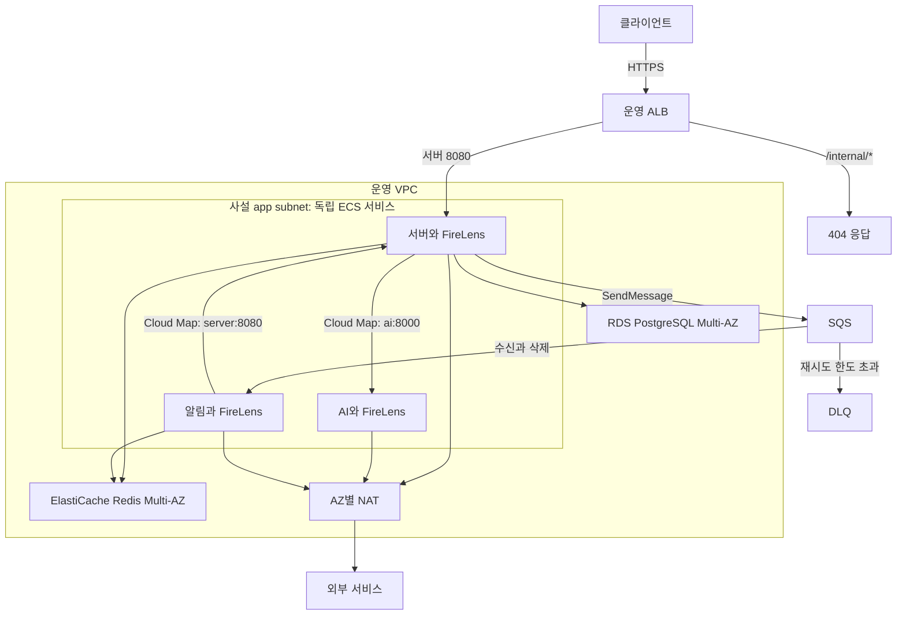
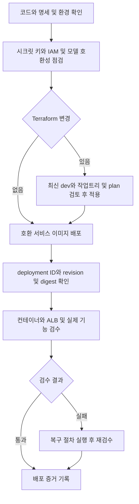
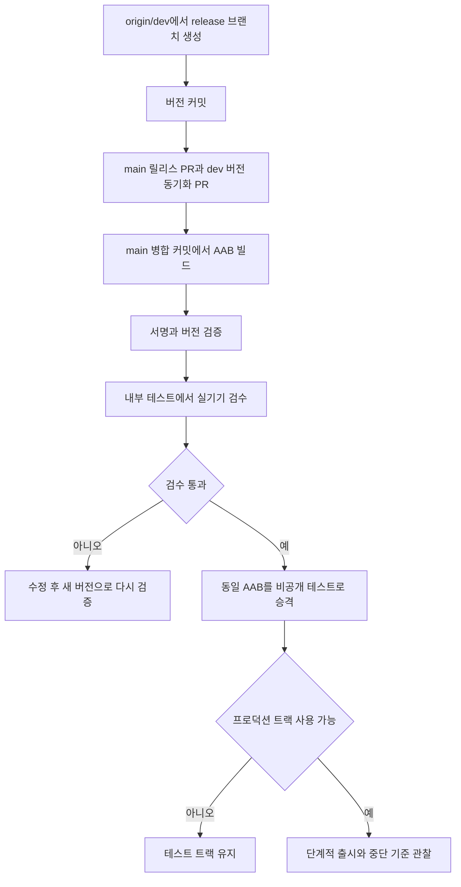
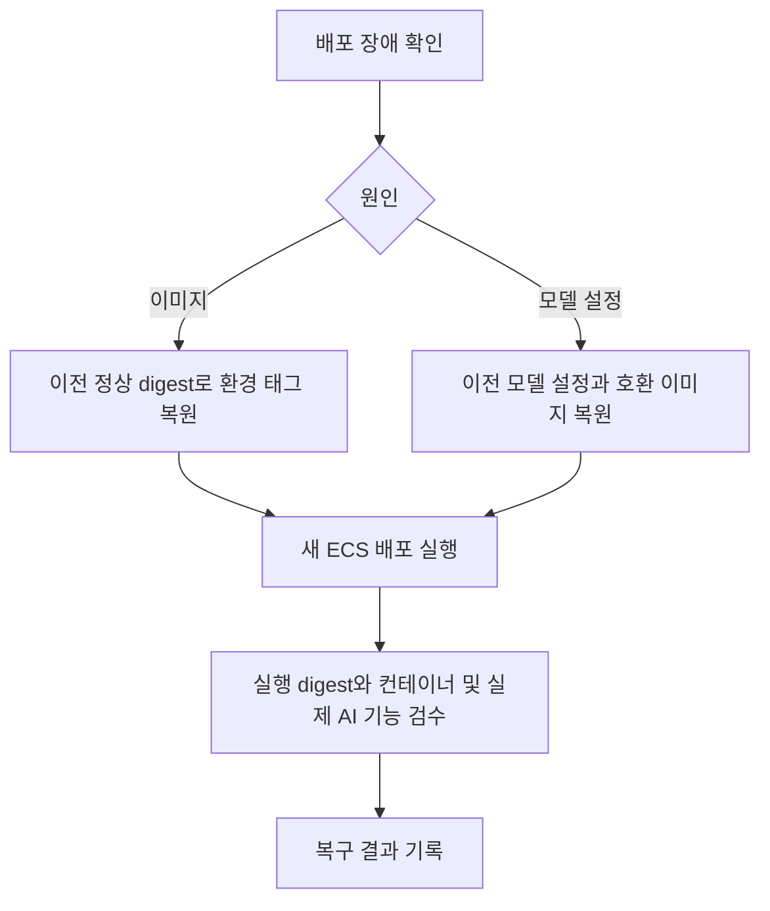

# 배포

 

### 1 목적과 범위

AWS 구성은 2026-10-30에 확인한 [Terraform 선언](https://github.com/KIM-N-KANG/manyak-terraform/tree/c3b590d352f6b47292121c179b3196cfea8e3eb0/terraform/envs)을 기준으로 한다. 알림 배포는 [워크플로](https://github.com/KIM-N-KANG/manyak-notification/blob/5c0ae2f5dfaa6e73437056504a111c6d7597b1a8/.github/workflows/docker-image.yml)를 기준으로 한다. 이 문서의 선언값은 AWS 리소스 실측값이나 배포 완료 증거가 아니다. 실제 활성값과 실행 이미지 다이제스트는 배포 기록으로 확인한다.

 

### 2 기준 레포지토리와 책임 경계

| 레포지토리 | 책임 | 코드 위치 |
| --- | --- | --- |
| manyak-terraform | AWS 리소스, IAM, 태스크 정의, 설정 참조, Terraform 검증 | `terraform/envs/dev`, `terraform/envs/prod`, `terraform/modules`, `scripts/tf-apply.sh` |
| manyak-server, manyak-ai | 이미지 빌드, 태그 승격, ECS 배포, 서비스 검수 | 각 `.github/workflows/docker-image.yml` |
| manyak-notification | 알림 이미지 빌드, dev 공유 ECS 태스크와 prod 별도 ECS 서비스 배포 | `.github/workflows/docker-image.yml` |
| manyak-infra | 로컬 통합 Docker Compose | `docker-compose.yml` |
| manyak-web, manyak-android | 플랫폼별 빌드, 배포 | 각 플랫폼 레포 및 [웹 배포](../platform/CLIENT/WEB/6-DEPLOYMENT.md), [Android 배포](../platform/CLIENT/ANDROID/5-DEPLOYMENT.md) |
| knk-harness | 현재 구조, 결정 이력 | 이 문서와 배포 결정 기록 |

Terraform에서 관리하지 않는 웹 호스팅 설정이나 Play 배포 트랙을 AWS 코드에서 추정하지 않는다. 애플리케이션 도메인 계약은 도메인별 백엔드와 AI 명세에서 정한다. ([도메인 목록](../domain/AGENTS.md#1-도메인과-세트))

 

### 3 환경 구분과 배포 단위

| 항목 | 개발 AWS | 운영 AWS | 로컬 통합 |
| --- | --- | --- | --- |
| 선언 위치 | `terraform/envs/dev` | `terraform/envs/prod` | manyak-infra Compose |
| 컴퓨트 | ECS Fargate Spot, 단일 태스크 | ECS Fargate, server와 ai 및 notification을 별도 서비스로 배포. 서비스별 Auto Scaling 2~4개 | Docker Compose |
| 태스크 구성 | server, ai, notification, postgres, redis, FireLens | server + FireLens, ai + FireLens, notification + FireLens로 분리 | 독립 Compose 서비스 |
| DB | PostgreSQL 컨테이너, EFS 영속 | RDS PostgreSQL Multi-AZ | PostgreSQL 컨테이너 |
| Redis | 태스크 내 비영속 Redis | ElastiCache Redis 복제 그룹, Multi-AZ | 비영속 Redis 컨테이너 |
| 서버 프로파일 | 독립 `dev` | `prod` | `local` |
| 외부 API | `https://dev-api.manyak.app` | `https://api.manyak.app` | Compose 포트 매핑 |
| 자산 | dev S3, `dev-cdn.manyak.app` | prod S3, `cdn.manyak.app` | 실행 설정에 따른 URL |
| 이미지 기본 좌표 | GHCR `dev` | ECR `latest` | Compose의 이미지, 빌드 선언 |

개발은 서버와 AI 및 알림이 같은 ECS 태스크의 네트워크를 공유하므로 내부 호출에 `localhost`를 사용한다. 운영은 별도 서비스이며 AWS Cloud Map private DNS를 사용한다. 서버는 AI를 `http://ai.manyak-prod.local:8000`으로 호출한다. Compose 서비스명 DNS는 ECS에서 쓰지 않는다. 서버 상태 검사만으로 AI 기능 성공을 판정하지 않는다. 개발 태스크 교체는 PostgreSQL과 Redis에도 영향을 주며 교체 중 중단을 허용한다. 개발 검수는 운영 RDS, ElastiCache, NAT, 롤링 배포를 검증하지 않는다.

 

### 4 인프라 아키텍처

### 4-1 네트워크와 트래픽

운영 서버, AI, 알림은 배포 단위와 태스크 역할을 분리한다. AI는 서버 보안 그룹에서 오는 8000 포트 요청만 받으며 DB, Redis, SQS 접근 권한을 갖지 않는다. 이미지 업로드는 서버가 발급한 presigned PUT URL을 사용한다.

운영 VPC는 `10.0.0.0/16`, 개발은 `10.1.0.0/16`으로 분리한다. 운영 태스크는 사설 app subnet에서 NAT를 통해 외부로 나가며 공인 IP를 받지 않는다. 개발은 NAT 없이 공인 IP를 가진 태스크를 사용한다. 운영은 AZ별 NAT, RDS Multi-AZ, Redis 자동 장애 조치와 서비스별 Auto Scaling을 선언한다. 실제 태스크 배치와 장애 조치 결과는 별도 검수한다.

HTTPS ALB는 IP target group의 서버 8080으로 전달한다. 운영 상태 검사 경로는 `/actuator/health`, 성공 코드는 200이다. ALB에서 태스크 보안 그룹으로 가는 8080 egress가 필요하다. 태스크 보안 그룹의 DB와 Redis egress는 대상 보안 그룹으로 제한한다. 현재 Terraform에는 운영 EC2, 운영 Compose, EC2 `deploy.sh`, SSM 배포 경로가 없다.

dev 알림은 서버와 같은 태스크에서 `http://localhost:8080`으로 내부 API를 호출한다. prod는 아래 구성을 Terraform에 선언한다. 분리 배포의 결정 근거는 BE-051에 있다. ([BE-051](../reference/decisions/BACKEND.md#be-051))

| 항목 | prod 선언 |
| --- | --- |
| 배포 단위 | prod ECS 클러스터의 별도 알림 서비스. FireLens 사이드카를 포함해 0.25 vCPU, 1GB |
| 내부 호출 | 서버 ECS 서비스를 AWS Cloud Map private DNS에 등록하고 `http://server.manyak-prod.local:8080`으로 호출. 레코드 TTL 10초 |
| 공개 경로 차단 | 공개 ALB의 `/internal/*`는 404 고정 응답. 내부 API는 private DNS와 공유 시크릿 사용 |
| 큐와 역할 | SQS 표준 본 큐와 DLQ. 서버 태스크 역할은 `SendMessage`, 알림 태스크 역할은 `ReceiveMessage`와 `DeleteMessage`로 메시지 권한 분리 |

오래된 DNS 레코드로 자격 조회가 실패하면 소비자는 `ELIGIBILITY_UNAVAILABLE`을 `RETRY`로 처리한다. SQS는 메시지를 삭제하지 않고 가시성 60초 뒤 재전달하며 재시도 한도 이후에는 DLQ에 보존한다. dev의 큐와 DLQ는 `envs/dev/sqs.tf`, 알림 컨테이너는 `modules/compute-ecs/main.tf`에 구현되어 있다. dev와 prod의 DLQ 경보는 가시 메시지 수가 0보다 크면 SNS 이메일로 알린다. 환경별 수신 주소 설정과 SNS 구독 확인이 필요하다. 본 큐 적체 경보는 임계값 근거가 부족해 보류한 결정을 유지한다. ([KNK-1381](https://kimandkang.atlassian.net/browse/KNK-1381))

 

### 4-2 배포와 데이터의 현재 선언값

아래 값은 기준 커밋의 Terraform 입력, 리소스 선언이며 AWS 실측값이 아니다. 복구 판단 시 기본값만 읽지 않고 환경별 override도 함께 확인한다.

| 항목 | 현재 선언 | 근거 |
| --- | --- | --- |
| ALB idle timeout | dev, prod 200초 | `modules/edge/variables.tf`의 `idle_timeout`, 환경 호출부에 override 없음 |
| ECS 배포 중 태스크 비율 | dev 최소 0%, 최대 100%, prod 최소 100%, 최대 200% | `modules/compute-ecs/main.tf`, `modules/compute-ecs-app/main.tf` |
| target draining | dev 30초, prod 240초 | `envs/dev/main.tf`, `envs/prod/ecs.tf` |
| 운영 AI 종료 대기 | `stopTimeout=120`초 | `envs/prod/ai.tf`. 모든 진행 중 요청의 완료를 보장하는 값은 아님 |
| 운영 Auto Scaling | server, ai, notification 각각 최소 2개, 최대 4개. CPU 목표 70%, 증감 대기 300초 | `prod.auto.tfvars`, `autoscaling.tf`. CPU 목표는 KNK-1498 부하 검증 전 잠정값 |
| 운영 RDS | PostgreSQL 16, db.t3.micro, 20GB, Multi-AZ | `modules/data/variables.tf`, `main.tf`, `envs/prod/main.tf` |
| RDS 자동 백업 | 7일 | `db_backup_retention_days` |
| 운영 Redis | 2노드 복제 그룹, Multi-AZ와 자동 장애 조치. 스냅샷 7일 보관, KST 04:00~05:00 | `modules/data/main.tf`, `envs/prod/main.tf` |
| RDS 삭제 관련 설정 | `deletion_protection=true`, `skip_final_snapshot=true` | prod는 삭제 보호만 override. 최종 스냅샷 생략은 data 모듈 기본값이므로 삭제 시 자동 생성된다고 가정하지 않음 |

 

### 4-3 저장소와 자산

PostgreSQL이 업무 데이터의 기준이며 OpenSearch 인덱스는 파생 데이터다. 운영 DB와 Redis는 태스크 수명과 분리된다. 개발 PostgreSQL의 EFS는 태스크 교체 후 데이터를 유지하지만 Redis는 교체 시 유실된다. 운영 Redis는 `volatile-ttl` 축출 정책으로 짧은 TTL 키부터 축출한다. TTL 없는 카운터와 TTL 있는 세션의 수명은 백엔드 Spec을 따른다.

알림의 멱등 기록은 `notification:` 접두어 키에 저장한다. dev는 태스크 내 Redis를 사용하고, prod는 서버와 같은 ElastiCache 복제 그룹을 사용한다. 알림 보안 그룹의 Redis 접근도 Terraform에 선언한다. ([BE-051](../reference/decisions/BACKEND.md#be-051))

이미지는 비공개 S3에서 CloudFront OAC로 서빙한다. 프리셋 키는 불변이며 변경은 새 키로 만든다. 썸네일 원본과 `_sm` 파생은 `scripts/upload-image-presets.sh`가 재현한다. 생성 이미지와 사용자 업로드는 서버 태스크 역할에 허용된 prefix 안에서 저장한다. `characters/generated/*`와 `thumbnails/generated/*` 권한을 구분하며 업로드 prefix도 별도로 제한한다. S3 PUT, HEAD CORS는 브라우저 업로드용이며 CDN GET 서빙 정책과 별개다.

 

### 4-4 로그와 검색

공유 OpenSearch 도메인 `manyak-logs`는 dev state가 관리한다. prod는 도메인 이름으로 조회하며 같은 리소스를 중복 소유하지 않는다. FireLens 로그는 `manyak-logs-dev-*`, `manyak-logs-prod-*`, 검색은 `stories-dev`, `stories-prod`로 분리한다. 한국어 분석용 `analysis-nori` 연결은 공유 도메인에서 한 번 관리하며 엔진 버전과 맞는 패키지를 사용한다.

태스크 IAM의 `es:ESHttp*`만으로 검색 접근이 완성되지 않는다. 서버의 `opensearch/setup-search.sh`가 관리하는 세분 접근 제어 역할과 backend role 매핑도 필요하다. `MANYAK_OPENSEARCH_REINDEX_ON_STARTUP`은 초기 적재, 복구 때 일시적으로 켠 뒤 되돌린다. 서버의 재색인 대상과 검색 가시성은 백엔드 Spec을 따른다.

prod 알림은 서버와 같은 FireLens 구성으로 `manyak-logs-prod-*`에 로그를 보내고 CloudWatch 안전망을 유지한다. Fargate FireLens에는 영속 디스크 버퍼가 없으므로 OpenSearch 장애 때 로그 유실을 막는 별도 저장 경로가 필요하다. CloudWatch는 OpenSearch 403 진단에 필요한 로그 라우터 자체 로그도 저장한다. 알림 CloudWatch 보존 기간은 7일로 정한다. ([BE-051](../reference/decisions/BACKEND.md#be-051))

 

### 4-5 관측 수집 경로

운영은 OpenTelemetry Collector를 OTLP 수신점으로 사용한다. 트레이스는 Data Prepper를 거쳐 OpenSearch로, 메트릭은 SigV4 인증을 사용하는 Prometheus remote write로 Amazon Managed Service for Prometheus(AMP)에 보낸다. `otel_logs_enabled=true`에서는 FireLens의 기존 OpenSearch 직접 전송과 CloudWatch 경로를 유지하면서 Collector, Data Prepper를 거치는 로그 경로도 함께 사용한다. 새 로그 인덱스는 `logs-otel-v1-YYYY.MM.dd`다. 수집 흐름과 지표 조회 기준은 [백엔드 운영 관측](../platform/BACKEND/2-OBSERVABILITY.md#2-1-메트릭과-운영-연동)을 따른다.

 

### 5 이미지 빌드와 CI/CD

### 5-1 server, ai 이미지

서비스 워크플로는 SHA 이미지를 빌드하고 환경 태그를 갱신한 뒤 ECS `force-new-deployment`를 실행한다. ECS는 기존 태스크 정의로 새 태스크를 띄워 갱신된 환경 태그를 다시 받는다. Terraform은 태스크 정의와 서비스 설정을 관리한다. 개발 역할은 각 서비스 저장소의 dev 브랜치, 운영 역할은 운영 워크플로만 맡는다. AWS 인증은 GitHub OIDC를 사용한다.

배포 작업은 최신 브랜치 SHA를 확인하고 같은 저장소, 환경의 배포를 직렬화한다. GitHub concurrency는 저장소마다 동작하므로 개발에서는 server, ai, notification이 공유 태스크를 동시에 배포할 수 있다. 운영은 세 서비스가 독립된 배포 단위다. 성공 여부는 deployment ID의 완료 상태, 실행 태스크의 이미지 digest, 각 컨테이너와 외부 API의 상태를 함께 확인한다. 가변 태그 이름만 같다고 같은 이미지로 판단하지 않는다.

Terraform PR 검증과 drift 검사는 자격증명과 권한을 분리한다. 비밀이 아닌 운영값은 `dev.auto.tfvars`와 `prod.auto.tfvars`에 보관한다. `desired_count`의 기본값 0만 보고 현재 서비스의 목표 수를 판단하지 않는다. 개발은 1개, 운영은 서비스별 2~4개 범위에서 Auto Scaling이 수량을 관리한다. 운영에서 `desired_count=0`만 바꾸어서는 중지되지 않으며 비상 중지는 `ecs_autoscaling_capacity={min=0,max=0}`으로 지정한다. 일시 변경은 실행 기록에 남긴다.

알림 서비스의 현재 `.github/workflows/docker-image.yml`은 dev push에서 GHCR SHA 이미지를 빌드하고 최신 SHA 확인 후 `ghcr.io/kim-n-kang/manyak-notification:dev`로 승격해 dev ECS를 자동 배포한다. 같은 태스크의 server, ai, notification이 함께 갱신되며 각 컨테이너의 실행 상태와 헬스를 검증한다.

prod 알림 워크플로는 main push에서 ECR SHA 이미지를 빌드하고 최신 main SHA 확인 후 `latest`로 승격한다. 별도 `manyak-prod-notification` 서비스의 새 deployment ID가 완료되고 해당 태스크의 알림 컨테이너가 정상인지 검증한다. 서비스의 desired count가 0이면 이미지만 승격하고 배포와 헬스 검사를 생략한다. 태그 승격 후 실패하거나 취소되면 이전 digest를 복원하고 복구 배포를 요청하지만, 복구 완료는 별도로 확인해야 한다. 이전 digest가 없는 최초 배포는 수동 복구가 필요하다. ([알림 배포 워크플로](https://github.com/KIM-N-KANG/manyak-notification/blob/5c0ae2f5dfaa6e73437056504a111c6d7597b1a8/.github/workflows/docker-image.yml))

 

### 5-2 manyak-web CI/CD

| 트리거 | 동작 |
| --- | --- |
| PR → `dev` | pnpm install, lint, typecheck, Docker build 검증 |
| PR, push → `dev`, `main` | Playwright(4 워커 병렬): Pixel 5 전체 E2E, 비주얼 회귀, iPhone 13 스모크. CI가 Chromium, WebKit을 설치하고 Linux 기준 이미지와 비교 |
| push → `dev` | GHCR `dev`, `<short-sha>` push |
| push tag `v*` | GHCR release 이미지 push. build arg는 `NEXT_PUBLIC_AMPLITUDE_API_KEY`, `NEXT_PUBLIC_META_PIXEL_ID` |

비주얼 기준 이미지는 Linux에서 렌더링한 결과만 사용한다. UI를 의도적으로 바꾸면 `manyak-web`에서 `pnpm test:e2e:visual:update`로 Playwright Docker 이미지 기준을 갱신하고 diff를 검토한다. macOS 로컬 실행은 폰트, 안티앨리어싱 차이 때문에 스냅샷 비교를 건너뛴다.

운영 Terraform에는 `manyak-web` 컨테이너를 호스팅에 배포하는 리소스가 없다. 웹은 Vercel에서 서빙하며 release PR은 GHCR release 이미지 발행과 외부 호스팅 반영을 전제로 한다. Vercel 프로젝트 `manyak`의 Function Region은 백엔드와 같은 서울 `icn1`이다(프로젝트 설정 Settings → Functions, 레포에는 설정이 없음). 브라우저의 모든 API 호출이 거치는 BFF 프록시(`/api/[...path]`)와 서버 렌더가 이 리전의 함수에서 백엔드를 부르므로, 기본값 `iad1`(미국 동부)이면 호출마다 왕복 약 700ms가 더 들었다(2026-10-19 전환, 프록시 호출 800ms → 100ms대). 리전 설정은 이후 배포부터 적용되므로 바꾸면 운영과 `dev` 브랜치 도메인(`dev.manyak.app`) 배포를 다시 만들어야 한다.

Web Sentry는 Vercel 환경 변수 `NEXT_PUBLIC_SENTRY_DSN`으로 활성이고, SDK는 `NODE_ENV=production`이면서 Vercel 배포일 때만 전송한다. 배포 판별에 쓰는 `VERCEL_ENV`는 `next.config.ts`가 빌드 시점에 인라인한다. Sentry release와 Amplitude `app_version`이 읽는 앱 버전 `NEXT_PUBLIC_APP_VERSION`도 `next.config.ts`가 `package.json`의 `version`으로 인라인하며, 같은 이름의 배포 환경 변수보다 우선한다. GHCR release workflow와 Dockerfile에는 이 build arg가 없어 컨테이너 경로는 비활성이다.

웹 푸시는 Vercel 환경 변수 `NEXT_PUBLIC_FIREBASE_API_KEY`, `NEXT_PUBLIC_FIREBASE_PROJECT_ID`, `NEXT_PUBLIC_FIREBASE_MESSAGING_SENDER_ID`, `NEXT_PUBLIC_FIREBASE_APP_ID`, `NEXT_PUBLIC_FIREBASE_VAPID_KEY`(Production, Preview, 공개값)로 활성이며 하나라도 비면 전체가 꺼진다. 값은 서버 및 Android와 같은 Firebase 프로젝트의 웹 앱 `manyak-web`과 클라우드 메시징의 웹 푸시 인증서에서 발급하고, GHCR 컨테이너 경로에는 이 build arg가 없어 비활성이다.

 

### 5-3 manyak-android CI

컨테이너 이미지가 없는 앱 저장소이다. `.github/workflows/android-ci.yml`이 `dev`, `main` 대상 PR, push와 수동 실행에서 Temurin Java 25를 설정하고(`gradle-daemon-jvm.properties`와 일치) `./gradlew check`(ktlint, detekt, Android lint, 단위 테스트)와 `./gradlew assembleDebug`를 실행한 뒤 리포트를 아티팩트로 올린다.

release 번들(AAB)은 CI가 만들지 않는다. 릴리스 담당자가 로컬에서 `./gradlew bundleRelease`로 만들어 Play Console에 직접 올린다.

- **CI에 서명키를 두지 않는다.** 릴리스가 2주에 한 번이고 올리는 사람이 한 명인 동안에는 Play Publisher API 서비스 계정과 GitHub Secrets 키스토어를 유지하는 비용이 수동 업로드보다 크다. 키를 CI에 올리면 유출면도 넓어진다. 자동화는 릴리스가 주 1회를 넘거나 담당이 둘 이상이 될 때 다시 판단한다.
- **서명키 보관.** Play 앱 서명을 쓰므로 배포 인증서는 Google이 보관하고 팀은 업로드 키만 가진다. 업로드 키스토어는 저장소 밖에 두고 `local.properties`의 `RELEASE_STORE_FILE`, `RELEASE_STORE_PASSWORD`, `RELEASE_KEY_ALIAS`, `RELEASE_KEY_PASSWORD`로 주입한다. 키 파일과 비밀번호는 암호화 백업 두 곳에 둔다. 잃으면 Google 지원으로 업로드 키를 재설정할 때까지 업데이트를 올릴 수 없다. 키 값과 실제 경로는 문서에도 저장소에도 적지 않는다.
- **release BuildConfig 주입값**도 `local.properties`에서 읽는다(`GOOGLE_SERVER_CLIENT_ID_RELEASE`, `KAKAO_NATIVE_APP_KEY_RELEASE`, `AMPLITUDE_API_KEY_RELEASE`). 비어 있어도 빌드는 성공하고 해당 공급자만 런타임에 실패하므로 번들을 만들기 전에 세 값을 확인한다. 운영 `BASE_URL`은 `app/build.gradle.kts`에 고정돼 있다.
- **`google-services.json`은 저장소에 커밋한다.** CI에 주입할 시크릿이 없는데 PR마다 `assembleDebug`를 돌리므로 파일이 없으면 모든 PR이 실패한다. 값은 APK에 실려 나가고 보호는 Firebase 보안 규칙과 API 키 제한이 맡는다. Firebase 프로젝트는 서버 FCM과 같은 하나를 쓰며 환경별로 나누지 않는다. `applicationId`가 빌드 타입 간 같고 debug는 `firebase_crashlytics_collection_enabled=false`로 수집하지 않는다.
- release는 R8 축소, 난독화를 적용한다(`optimization.enable = true`, keep 규칙은 `app/proguard-rules.pro`). `bundleRelease`가 Crashlytics로 매핑 파일을 올리고 AAB의 `BUNDLE-METADATA`에도 매핑이 실린다. 결정 이유는 [Android ADR A-047](../platform/CLIENT/ANDROID/DECISIONS.md#a-047)에 있다.

 

### 6 런타임 설정과 시크릿

Terraform은 Secrets Manager 리소스와 태스크의 참조를 관리한다. 실제 앱 시크릿 값은 Terraform state에 저장하지 않는다. `ignore_changes`만으로 secret_version refresh를 차단할 수 없으므로 해당 리소스를 다시 도입하지 않는다. 태스크 실행 역할의 비밀 읽기와 애플리케이션 태스크 역할의 AWS 접근을 구분한다. 시크릿 값 등록, 태스크 참조, 재배포의 세 단계가 모두 있어야 실행 중 컨테이너에 반영된다.

| 설정 묶음 | 주입 대상, 경계 |
| --- | --- |
| JWT, Google, Kakao | server 인증 설정. 허용 client ID와 서명 설정은 백엔드 계약에 맞춰 공급 |
| RDS 비밀번호 | 운영 server에 시작 시 주입. 회전 후 새 태스크로 갱신 |
| LLM 공급자 키, Langfuse | AI 컨테이너. AI가 선택 모델의 공급자와 관측 설정을 검사 |
| 이미지 bucket, region, base URL | server 생성 이미지 저장. 필요한 값과 IAM을 함께 공급 |
| OpenSearch endpoint, index, 재색인 | server 검색, 색인. IAM과 검색 역할 매핑을 별도로 확인 |
| OTLP | server, ai, notification에 Collector endpoint와 활성 토글을 공급. prod는 `enable_otlp_metrics=true`, `otel_collector_enabled=true`, `tracing_enabled=true`. AMP 인증은 Collector의 IAM과 SigV4가 담당 |
| 신고, 피드백 webhook | server에 목적별 참조. 값이 없을 때 저장과 알림의 실패 경계는 백엔드 계약을 따름 |
| FCM | dev와 prod의 server, notification에 `MANYAK_FCM_SERVICE_ACCOUNT_JSON` 참조. prod 서버 참조도 현재 선언에 남아 있음 |
| 내부 API 인증 | dev와 prod의 server, notification에 같은 `MANYAK_INTERNAL_SHARED_SECRET` 참조를 주입. prod 공개 ALB는 `/internal/*` 차단 |
| 알림의 서버 주소 | `MANYAK_SERVER_INTERNAL_BASE_URL`: dev는 `http://localhost:8080`, prod는 `http://server.manyak-prod.local:8080` |
| Groble, Google Play | dev, prod server에 HMAC, 서비스 계정 JSON, 패키지명 참조. 비어 있으면 구매는 503, 대사는 실행하지 않음 |

알림 시크릿은 저장 전에 값의 길이를 검사해 빈 값을 거부한다. dev 빈 값 저장 사고를 반복하지 않도록 저장 결과의 길이도 확인하며 값 자체는 로그나 문서에 출력하지 않는다. 빈 값 거부 외에 최소 길이 수치는 미정이다. prod는 `push_mode="remote"`를 선언하지만 서버의 FCM 참조도 유지한다. 롤백 창 종료 후 서버 참조를 제거하는 결정과 적용 순서는 BE-051 및 KNK-1367에서 확인한다. 선언만으로 시크릿 값 등록이나 운영 전환 검수가 끝났다고 판단하지 않는다. ([BE-051](../reference/decisions/BACKEND.md#be-051), [KNK-1367](https://kimandkang.atlassian.net/browse/KNK-1367))

운영은 `STORY_COMPILE_MODEL`, `STORYLINES_MODEL`, `CHAT_MODEL`의 SSM Parameter 참조를 주입한다. 기존 Parameter 값은 `ignore_changes` 대상이므로 Terraform 기본값만 바꾸어서는 갱신되지 않는다. Parameter 변경 후 새 태스크가 읽게 해야 한다. 개발은 태스크 정의 환경변수이므로 apply가 필요하다. 실제 모델 선택은 [AI 배포의 모델 라우팅](../domain/CHAT/AI/7-4-DEPLOYMENT.md)을 따른다. 특히 채팅의 `model_tier` 라우팅과 단일 `CHAT_MODEL` 설정을 동일시하지 않는다. 운영 Parameter 실값은 이 문서 검토에서 조회하지 않았다. 모델 이름과 AI 등록부가 바뀌는 전환은 설정과 이미지를 같은 배포 단위로 맞춘다.

 

### 7 배포 절차

1. 작업 코드, 현재 명세, 결정 기록과 대상 환경을 확인한다. 새 설정은 시크릿 키 존재, IAM, 태스크 참조, 공급자 모델 호환성을 먼저 점검한다.
2. Terraform 변경은 저장소의 `scripts/tf-apply.sh`가 요구하는 최신 dev, 작업트리, plan 검사를 통과한 뒤 적용한다. 오래된 브랜치의 plan을 현재 운영 변경으로 사용하지 않는다. plan의 replace, destroy 범위를 개별 리소스로 검토한다.
3. 설정이 준비된 환경에 호환되는 서비스 이미지를 배포한다. 태스크 정의 변경과 서비스 이미지 배포가 서로 다른 SHA, 설정을 덮지 않는지 확인한다.
4. 새 deployment ID, 태스크 정의 revision, 이미지 digest, 컨테이너, ALB target, API 상태를 확인한다. AI 변경은 실제 생성, 채팅 검수 결과를 따로 남긴다.
5. 실행 시각(KST), 코드 SHA, 이미지 digest, 설정 변경 범위, 검수, 복구 결과를 배포 기록에 남긴다. 합의된 현재 구성은 이 문서에 반영한다.

DB 변경은 expand/contract로 진행한다. 신규 컬럼, 테이블을 먼저 추가하고 구버전 태스크가 더 이상 해당 컬럼을 읽지 않는 릴리스 이후에 제거한다. 새 태스크의 Flyway 실행 중에도 이전 태스크가 요청을 받을 수 있다. 이미지 롤백은 파괴적 DB 변경을 자동 복구하지 않는다.

 

### 7-1 Web release 이미지 배포

1. `manyak-web` 변경을 `dev`에 병합해 GHCR `dev` 이미지를 검증한다.
2. release tag `v*`를 push하면 `release.yml`이 GHCR release 이미지를 빌드한다.
3. 운영 웹 호스팅 반영은 Terraform이 관리하지 않는 Vercel 절차다. 코드화되면 이 절을 갱신한다.

 

### 7-2 Android 앱 릴리스

스토어에 올라가는 번들은 `main`에서만 만든다. v1.0.2까지는 이 규칙이 없어 `versionCode 3`을 `dev`에서 바로 빌드해 올렸고, 그 결과 스토어에 있는 코드가 `main`에 없었다(그래서 `main`은 2에서 4로 건너뛴다). 어느 코드가 사용자 손에 있는지 `main`으로 답할 수 없게 되므로 반복하지 않는다.

1. `release/v{버전}` 브랜치를 `origin/dev`에서 만들고 `app/build.gradle.kts`의 `versionName`, `versionCode` 두 줄만 커밋한다.
2. 같은 브랜치로 PR 둘을 낸다. `main`(`Release` 태그)과 `dev`(버전 동기화)이다. 릴리스 커밋이 `dev`에도 돌아가야 다음 릴리스의 분기 기준이 어긋나지 않는다.
3. `main` 병합 후 그 커밋에서 `./gradlew bundleRelease`를 실행한다.
4. `jarsigner -verify`가 `jar verified.`를 내는지, 번들 매니페스트의 `versionCode`, `versionName`이 의도한 값인지 확인한다.
5. 같은 AAB를 내부 테스트 트랙에 올리고 실기기에서 로그인과 핵심 흐름을 완주한다.
6. 통과하면 같은 AAB를 비공개 테스트에서 프로덕션으로 승격한다. 트랙마다 다시 빌드하지 않는다. 다시 빌드하면 검증한 번들과 출시하는 번들이 달라진다.
7. 프로덕션은 단계적 출시로 시작하고 [§9](#9-검수-관측-롤백)의 중단 기준을 관찰한다.

- `versionCode`는 업로드할 때마다 1씩 올리며 재사용할 수 없다. 심사 반려로 같은 내용을 다시 올릴 때도 올린다.
- `versionName`은 사용자용이다. 버그 수정은 patch, 기능 추가는 minor로 올린다.
- 프로덕션 트랙은 Play 개인 개발자 계정 정책상 비공개 테스트 12명이 14일 연속 옵트인한 뒤에야 열린다. 그 전까지 릴리스는 내부 테스트와 비공개 테스트에서 끝난다.

 

### 8 로컬, 통합 실행

`manyak-infra`의 Compose가 로컬 실행 기준이다. 서버, AI, 웹, PostgreSQL, Redis와 Prometheus 설정을 함께 확인한다. 서비스명 DNS는 Compose 네트워크 안에서 사용한다. AI stub과 실제 AI 호출 여부는 명시적인 실행 설정으로 확인한다.

현재 Compose의 모델 기본값과 AWS 태스크 선언은 같다고 가정하지 않는다. 통합 레포의 모델 기본값에는 과거 이름이 남아 있으므로 선택한 AI 이미지의 등록부와 맞는 값을 공급해야 한다. 로컬 통합 성공은 AWS IAM, Secrets Manager 주입, CloudFront 업로드 CORS, ECS 롤링 성공의 증거가 아니다.

 

### 9 검수, 관측, 롤백

### 9-1 서버, AI 검수와 복구

- 서버와 AI 컨테이너의 상태, 실제 AI 기능을 각각 확인한다.
- FireLens 로그의 환경 인덱스와 OTLP 수집을 각각 확인한다. 로그 수집 성공으로 메트릭 export를 판정하지 않는다.
- DB 회전은 EventBridge 5분 주기 Lambda가 시크릿 `LastChangedDate`와 태스크 `createdAt`을 비교한다. 필요할 때만 운영 서비스를 재배포하며 시크릿 원문 읽기 권한은 갖지 않는다. 이 감지 간격은 무중단 보장이 아니므로 실제 재배포와 DB 연결 결과를 확인한다.
- 이미지 장애는 이전 정상 digest로 환경 태그를 복원한 뒤 새 ECS 배포를 실행하고 같은 검수를 반복한다. 같은 태스크 정의, 가변 태그를 쓰므로 circuit breaker만으로 이전 이미지 복귀가 보장되지 않는다.
- 모델 설정 장애는 이전 모델 설정과 호환 이미지의 조합으로 복원한다. Terraform 기본값을 되돌리는 것만으로 기존 운영 Parameter가 바뀌지 않는다.
- EC2는 현재 복구 대상이 아니다. 과거 EC2 가중치 전환, SSM 재실행은 [배포 ADR DEP-023, 030](DECISIONS.md#전환-단계-기록)의 역사 기록이다.

 

### 9-2 Definition of Done

다음 조건을 모두 만족하면 배포가 완료된다.

- 변경 대상 저장소의 필수 테스트와 Docker build 검증이 통과한다.
- 웹은 Pixel 5 전체 E2E, 비주얼 회귀와 iPhone 13 스모크가 통과한다. UI 변경이면 Linux 기준 이미지 diff를 함께 검토한다.
- server와 ai 배포는 레지스트리에 환경 태그와 `<short-sha>` 태그가 모두 있고, 그 배포가 만든 deployment ID가 완료 상태이며, 실행 태스크의 이미지 digest가 의도한 SHA와 일치한다.
- server는 외부 `https://api.manyak.app/actuator/health`가 200과 `status=UP`을 반환한다.
- ai는 컨테이너 health가 정상이고 실제 생성, 채팅 1건이 성공한다. 서버 헬스 성공만으로 판정하지 않는다.
- 운영 AI 모델 변경은 직전 Parameter 값을 보관하고, 새 값을 읽은 태스크가 떴으며, 바꾼 기능의 운영 API 1건이 성공한다. 모델명과 provider는 확인하되 키 값은 출력하지 않는다.
- Terraform 변경은 plan 리뷰 후 적용하고, 대상 리소스와 ALB target group health 중 영향 범위를 확인한다.
- 시크릿 변경은 값을 소비하는 서비스의 재배포까지 끝나야 반영으로 본다.
- 웹 release는 GHCR release 이미지 태그가 발행된다. 호스팅 반영은 Vercel 쪽 별도 절차로 확인한다.
- Android 릴리스는 `main` 커밋에서 만든 AAB가 내부 테스트 실기기 스모크를 통과하고 승격한 트랙에 같은 번들이 올라간다. 프로덕션은 단계적 출시를 시작한 시점이 아니라 100% 도달과 중단 기준 미발동을 확인해야 완료된다.
- 롤백 기준 이미지 태그 또는 DB 복구 계획을 배포 전에 확인한다. Flyway 마이그레이션은 전진 전용으로 취급한다.

 

### 9-3 Android 단계적 출시와 중단 기준

프로덕션은 단계적 출시로 시작한다. 비율은 20%에서 100%이고 각 단계를 최소 하루 둔다. 초기 설치 수에서는 5% 단위로 나누면 비교할 표본이 부족하다. 며칠 동안 출시를 중단할 수 있는 상태를 유지하면서 지표를 관찰한다.

아래 기준 중 하나라도 충족하면 출시를 중단하고 수정판을 준비한다. 중단 기준은 출시 전에 확정한다.

| 신호 | 중단 기준 |
| --- | --- |
| Crashlytics 크래시 없는 사용자 비율 | 직전 버전 대비 1%p 이상 하락 |
| Crashlytics 신규 이슈 | 세션의 0.5% 이상에서 발생 |
| Amplitude 로그인 성공률, 스토리 생성 완주율 | 직전 버전 대비 하락이 관찰될 때 |

세 기준은 모두 앱 버전별로 비교한다. Crashlytics, Amplitude의 버전별 비교 대시보드는 아직 없으며 첫 프로덕션 출시 전에 만들어야 기준이 성립한다.
