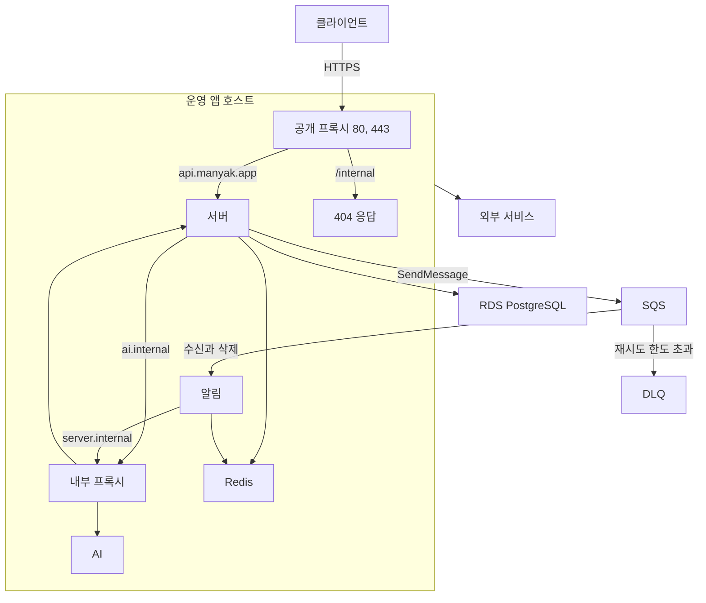
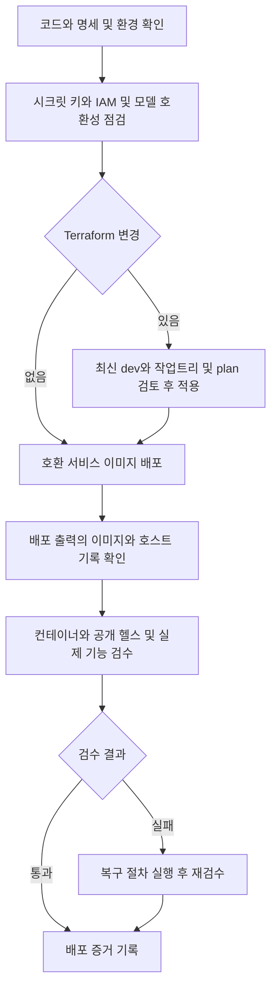
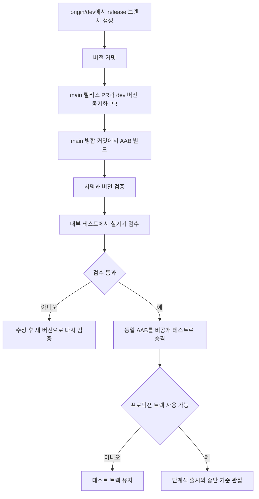
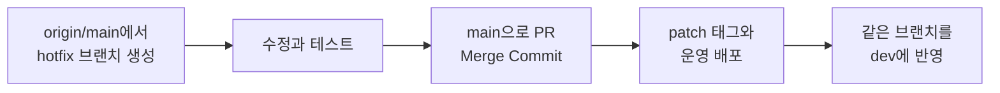
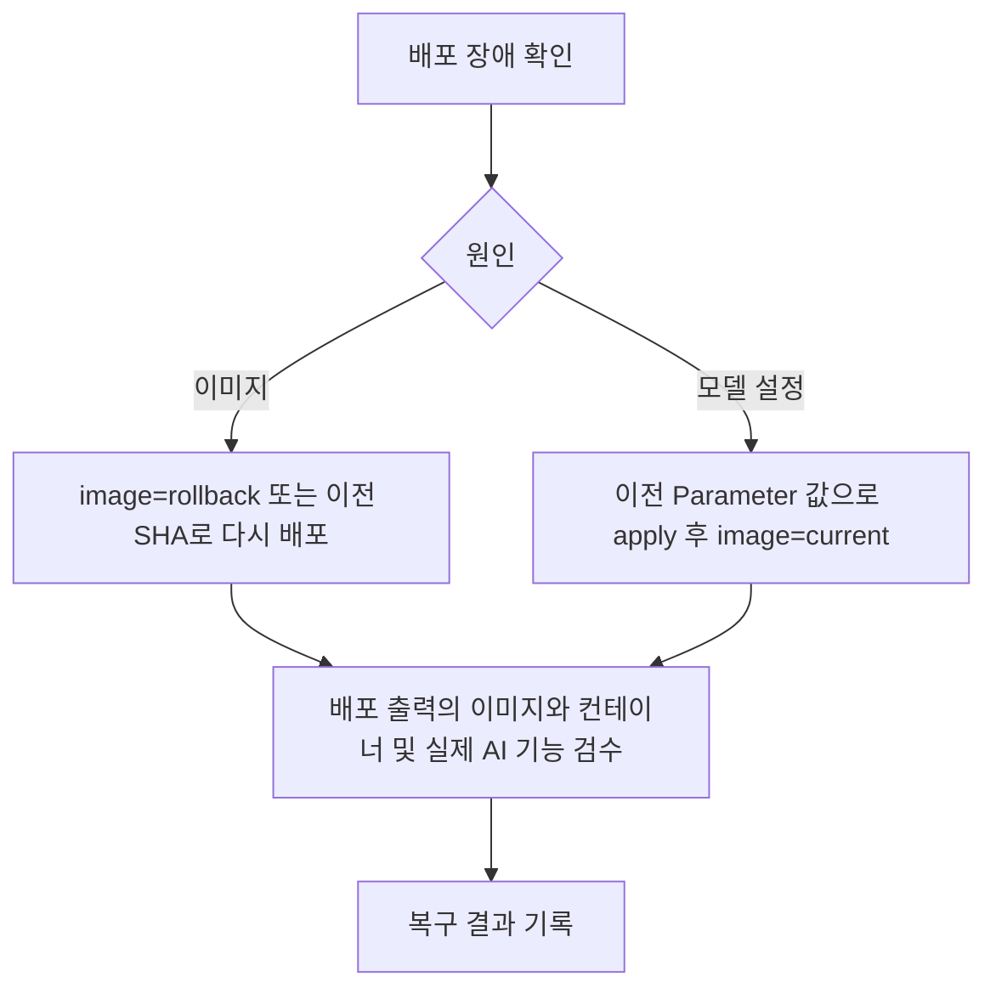

# 배포

 

### 1 목적과 범위

AWS 구성은 2026-11-22에 확인한 [Terraform 선언](https://github.com/KIM-N-KANG/manyak-terraform/tree/50c066c8d9c77230f07640c68eb139992d80437a/terraform)(`envs/prod`, `modules/app-host`)을 기준으로 한다. 서비스 배포는 같은 날 확인한 [server](https://github.com/KIM-N-KANG/manyak-server/blob/4898a651c80076748828f3c5ed40c85de4c7bd57/.github/workflows/docker-image.yml), [ai](https://github.com/KIM-N-KANG/manyak-ai/blob/df2fd64906cea9b13a5d173547fed1212c27e9cb/.github/workflows/docker-image.yml), [notification](https://github.com/KIM-N-KANG/manyak-notification/blob/5ae93a17e2a82ab1be26f7d5f21c0195d5e0f110/.github/workflows/docker-image.yml) 워크플로를 기준으로 한다. 이 문서의 선언값은 AWS 리소스 실측값이나 배포 완료 증거가 아니다. 실제 실행 이미지는 배포 기록과 호스트의 배포 기록으로 확인한다.

 

### 2 기준 레포지토리와 책임 경계

| 레포지토리 | 책임 | 코드 위치 |
| --- | --- | --- |
| manyak-terraform | AWS 리소스, IAM, 앱 호스트와 컨테이너 설정, 설정 참조, Terraform 검증 | `terraform/envs/prod`, `terraform/modules`, `scripts/tf-apply.sh` |
| manyak-server, manyak-ai, manyak-notification | 이미지 빌드, 태그 승격, 앱 호스트 배포, 서비스 검수 | 각 `.github/workflows/docker-image.yml` |
| manyak-infra | 로컬 통합 Docker Compose | `docker-compose.yml` |
| manyak-web, manyak-android | 플랫폼별 빌드, 배포 | 각 플랫폼 레포 및 [웹 배포](../platform/CLIENT/WEB/6-DEPLOYMENT.md), [Android 배포](../platform/CLIENT/ANDROID/5-DEPLOYMENT.md) |
| manyak-ios(저장소 생성 전) | iOS 빌드, 배포 | [iOS 배포](../platform/CLIENT/IOS/5-DEPLOYMENT.md) |
| knk-harness | 현재 구조, 결정 이력 | 이 문서와 배포 결정 기록 |

Terraform에서 관리하지 않는 웹 호스팅 설정, Play 배포 트랙이나 App Store Connect 배포를 AWS 코드에서 추정하지 않는다. 애플리케이션 도메인 계약은 도메인별 백엔드와 AI 명세에서 정한다. ([도메인 목록](../spec/AGENTS.md#1-도메인과-세트))

 

### 3 환경 구분과 배포 단위

| 항목 | 운영 | 로컬 통합 |
| --- | --- | --- |
| 선언 위치 | `terraform/envs/prod` | manyak-infra Compose |
| 컴퓨트 | EC2 앱 호스트 한 대(`manyak-prod-host`). server, ai, notification 컨테이너를 서비스마다 따로 배포 | Docker Compose |
| 호스트 구성 | 공개 프록시와 내부 프록시(kamal-proxy), Redis, 로그 라우터(fluent-bit) | 독립 Compose 서비스 |
| DB | RDS PostgreSQL, 단일 AZ | PostgreSQL 컨테이너 |
| Redis | 호스트의 Redis 컨테이너. 데이터 볼륨에 AOF로 영속 | 비영속 Redis 컨테이너 |
| 서버 프로파일 | `prod` | `local` |
| 외부 API | `https://api.manyak.app` | Compose 포트 매핑 |
| 자산 | prod S3, `cdn.manyak.app` | 실행 설정에 따른 URL |
| 이미지 | ECR `:<sha7>`. 호스트에 배포 기록이 없을 때만 `:latest` | Compose의 이미지, 빌드 선언 |

개발 환경은 `dev` 브랜치에 머지하면 CI가 GHCR `:dev` 이미지를 올리고 dev 환경이 자동으로 받아 교체한다. 주소는 `https://dev-api.manyak.app`이다.

운영 컨테이너끼리의 호출은 내부 프록시를 거친다. 서버는 AI를 `http://ai.internal`로, 알림은 서버를 `http://server.internal`로 호출한다. 서버 상태 검사만으로 AI 기능 성공을 판정하지 않는다. 개발 검수는 운영 RDS와 앱 호스트 배포를 검증하지 않는다.

 

### 4 인프라 아키텍처

### 4-1 네트워크와 트래픽

서버, AI, 알림은 같은 호스트의 컨테이너이며 서비스마다 따로 배포한다. 인스턴스 역할 하나를 모든 컨테이너가 쓸 수 있으므로, AWS SDK가 필요한 server, notification과 로그 라우터만 인스턴스 메타데이터(IMDS)에 닿게 하고 AI, Redis, 프록시는 막는다. 서비스마다 메모리 상한을 둔다. 이미지 업로드는 서버가 발급한 presigned PUT URL을 사용한다.

운영 VPC는 `10.0.0.0/16`이다. 앱 호스트는 RDS 주 DB와 같은 AZ(`ap-northeast-2a`)의 퍼블릭 서브넷에서 고정 공인 IP(EIP)로 외부와 통신하며 NAT는 두지 않는다. 호스트가 한 대이고 RDS가 단일 AZ이므로 호스트나 그 AZ가 멈추면 서비스가 멈춘다.

공개 프록시는 80, 443을 받아 Let's Encrypt 인증서로 TLS를 처리하고 서버 8080으로 전달한다. `api.manyak.app`은 호스트 레코드 `prod-host.manyak.app`을 가리키고, 그 레코드가 EIP를 가리킨다. 서버 상태 검사 경로는 `/actuator/health`다. 공개 호스트의 `/internal` 경로는 서버 대신 404만 돌려주는 작은 컨테이너로 보낸다. 호스트 접속은 SSM Session Manager로 하며 22번 포트는 열지 않는다.

알림은 들어오는 요청이 없어 공개 프록시를 거치지 않는다. 분리 배포의 결정 근거는 BE-051에 있다. ([BE-051](../reference/decisions/BACKEND.md#be-051))

| 항목 | 운영 선언 |
| --- | --- |
| 배포 단위 | 앱 호스트의 notification 컨테이너. 서비스별 SSM 문서로 따로 배포 |
| 내부 호출 | 내부 프록시로 `http://server.internal` 호출 |
| 공개 경로 차단 | 공개 프록시의 `/internal` 경로는 404. 내부 API는 내부 프록시와 공유 시크릿 사용 |
| 큐와 역할 | SQS 표준 본 큐와 DLQ. 서버가 발행하고 알림이 수신, 삭제한다. 두 컨테이너는 같은 인스턴스 역할을 쓴다 |

자격 조회가 실패하면 소비자는 `ELIGIBILITY_UNAVAILABLE`을 `RETRY`로 처리한다. SQS는 메시지를 삭제하지 않고 가시성 60초 뒤 재전달하며 재시도 한도(5회) 이후에는 DLQ에 보존한다. 큐와 DLQ는 `envs/prod/sqs.tf`에 있다. DLQ 경보는 가시 메시지 수가 0보다 크면 SNS 이메일로 알린다. 수신 주소 설정과 SNS 구독 확인이 필요하다. 본 큐 적체 경보는 임계값 근거가 부족해 보류한 결정을 유지한다. ([KNK-1381](https://kimandkang.atlassian.net/browse/KNK-1381))

 

### 4-2 배포와 데이터의 현재 선언값

아래 값은 Terraform 입력, 리소스 선언이며 AWS 실측값이 아니다. 복구 판단 시 기본값만 읽지 않고 환경별 override도 함께 확인한다.

| 항목 | 현재 선언 | 근거 |
| --- | --- | --- |
| 앱 호스트 | t4g.medium 한 대(Auto Scaling 그룹 1대, Graviton, Amazon Linux 2023), 스왑 2 GiB | `envs/prod/app-host.tf`, `modules/app-host` |
| 서비스 메모리 상한 | server 1536m, notification 768m, ai 512m | `envs/prod/app-host.tf`의 `host_guard` |
| 프록시 드레인 | 240초. 전환 뒤 옛 컨테이너의 진행 중 요청을 기다리는 시간 | `modules/app-host`의 `drain_timeout_seconds` |
| AI 정지 대기 | 130초. 모든 진행 중 요청의 완료를 보장하는 값은 아님 | `envs/prod/app-host.tf`의 `stop_timeout` |
| 운영 RDS | PostgreSQL 16, db.t4g.micro, 20GB, 단일 AZ | `modules/data/variables.tf`, `envs/prod/main.tf` |
| RDS 자동 백업 | 7일 | `db_backup_retention_days` |
| 운영 Redis | 호스트 컨테이너, `maxmemory` 256mb, `noeviction`, AOF everysec | `envs/prod/app-host.tf`, `modules/app-host` |
| 데이터 볼륨 | `/data` EBS(Redis AOF, 프록시 인증서, 배포 기록). 매일 03:00 KST 스냅샷, 7개 보관 | `modules/app-host` |
| RDS 삭제 관련 설정 | `deletion_protection=true`, `skip_final_snapshot=true` | prod는 삭제 보호만 override. 최종 스냅샷 생략은 data 모듈 기본값이므로 삭제 시 자동 생성된다고 가정하지 않음 |

 

### 4-3 저장소와 자산

PostgreSQL이 업무 데이터의 기준이며 OpenSearch 인덱스는 파생 데이터다. 운영 DB는 RDS라 호스트 수명과 분리된다. Redis는 호스트 데이터 볼륨에 AOF로 남아 컨테이너와 인스턴스를 바꿔도 유지된다. 운영 Redis는 `noeviction` 정책이라 메모리가 차면 쓰기가 실패한다. TTL 없는 카운터와 TTL 있는 세션의 수명은 백엔드 Spec을 따른다.

알림의 멱등 기록은 `notification:` 접두어 키에 저장하며 서버와 같은 Redis를 사용한다. ([BE-051](../reference/decisions/BACKEND.md#be-051))

이미지는 비공개 S3에서 CloudFront OAC로 서빙한다. 프리셋 키는 불변이며 변경은 새 키로 만든다. 썸네일 원본과 `_sm` 파생은 `scripts/upload-image-presets.sh`가 재현한다. 생성 이미지와 사용자 업로드는 서버에 허용된 prefix 안에서 저장한다. `characters/generated/*`와 `thumbnails/generated/*` 권한을 구분하며 업로드 prefix도 별도로 제한한다. S3 PUT, HEAD CORS는 브라우저 업로드용이며 CDN GET 서빙 정책과 별개다.

 

### 4-4 로그와 검색

앱 컨테이너와 기반 서비스 로그는 호스트의 로그 라우터(fluent-bit)가 CloudWatch 로그 그룹 `/manyak/prod/app-host`(보존 14일)와 관측 서버로 보낸다. 관측 서버로 보내지 못한 동안에도 CloudWatch 사본이 남는다.

스토리 검색 인덱스 `stories-dev`, `stories-prod`는 관측 서버의 OpenSearch에 관측 데이터와 같은 클러스터로 둔다. 한국어 분석용 `analysis-nori` 플러그인은 그 OpenSearch 이미지에 엔진 버전과 맞는 것으로 설치한다. 서버는 검색 서버 주소(`story-search.manyak.app`)로 연결하고 Cloudflare Access 서비스 토큰과 환경별 검색 전용 계정으로 인증한다. 계정의 역할은 그 환경의 인덱스 `stories-{env}*`로 제한한다. 검색 인덱스는 파생 데이터라 백업하지 않고 재색인으로 복구한다. `MANYAK_OPENSEARCH_REINDEX_ON_STARTUP`은 초기 적재, 복구 때 일시적으로 켠 뒤 되돌린다. 서버의 재색인 대상과 검색 가시성은 백엔드 Spec을 따른다.

 

### 4-5 관측 수집 경로

server, ai, notification은 트레이스와 메트릭을 OTLP로 관측 서버에 직접 보낸다. 메트릭은 관측 서버의 Prometheus에 쌓인다. 호스트 메모리와 디스크 지표는 별도 fluent-bit 컨테이너가 같은 입구로 1분마다 보낸다. 관측 서버나 연결이 끊긴 동안 메트릭은 빈 구간이 생기고 트레이스는 버려진다. 수집 흐름과 지표 조회 기준은 [백엔드 운영 관측](../platform/BACKEND/2-OBSERVABILITY.md#2-1-메트릭과-운영-연동)을 따른다.

 

### 5 이미지 빌드와 CI/CD

### 5-1 server, ai, notification 이미지

서비스 워크플로(`docker-image.yml`)는 main push에서 ECR `:<sha7>` 이미지를 빌드하고 `deploy-prod` 잡에서 앱 호스트에 배포한다. AWS 인증은 GitHub OIDC이며 레포마다 역할이 따로 있고, 운영 역할은 자기 서비스의 SSM 문서만 실행한다. 같은 레포의 배포는 GitHub concurrency로, 세 레포 사이의 배포는 호스트 `deploy.sh`의 잠금(`flock`)으로 직렬화한다.

| 단계 | 동작 |
| --- | --- |
| 배포 대상 | server, ai는 이 실행의 커밋이 아니라 현재 main HEAD를 배포한다. 그 이미지가 ECR에 아직 없으면 배포하지 않고 끝낸다(그 커밋의 실행이 배포한다). notification은 이 실행의 커밋이 최신 main일 때만 배포한다 |
| 호스트 배포 | SSM 문서 `manyak-prod-host-deploy-<서비스>`를 태그 `manyak:host=manyak-prod-host` 대상으로 실행한다. `deploy.sh`는 시크릿을 Secrets Manager에서 읽어 새 컨테이너를 띄우고, Docker 헬스를 기다린 뒤 프록시를 넘기고, 옛 컨테이너를 드레인한 다음 정지한다. notification은 프록시를 거치지 않아 헬스가 통과하면 옛 컨테이너를 내린다. 새 컨테이너가 실패하면 그것만 지우고 옛 컨테이너가 계속 서비스한다 |
| 배포 확인 | 명령 출력의 `<서비스>: deployed <image>` 줄이 요청한 이미지인지 본다 |
| 스모크 | server만 `https://api.manyak.app/actuator/health`를 확인하고, 실패하면 같은 문서를 `image=rollback`으로 보낸다 |
| 태그 승격 | 배포가 성공한 뒤에만 `:latest`를 그 SHA로 옮긴다 |

호스트는 서비스별 현재 이미지와 직전 이미지를 `/data/state`에 기록한다. SSM 문서의 `image`는 그 서비스의 이미지, `current`(기록된 이미지 다시 배포), `rollback`(직전 이미지)만 받는다. 가변 태그 이름만 같다고 같은 이미지로 판단하지 않는다.

dev push는 GHCR `:<sha7>`를 올리고, `deploy-dev` 잡이 최신 dev SHA 게이트 뒤 `:dev`로 옮긴다. dev 환경이 그 이미지를 자동으로 받아 교체한다.

Terraform PR 검증과 drift 검사는 자격증명과 권한을 분리한다. 비밀이 아닌 운영값은 `prod.auto.tfvars`에 보관한다. 컨테이너 환경 변수, 시크릿 참조, 헬스 검사는 `envs/prod/app-host.tf`의 `app_host_defs`가 정본이며 Terraform이 호스트 설정(S3)으로 내려보낸다. 배포 잡은 이미지 태그만 바꾼다.

 

### 5-2 manyak-web CI/CD

| 트리거 | 동작 |
| --- | --- |
| PR → `dev` | pnpm install, lint, typecheck, Docker build 검증 |
| PR, push → `dev`, `main` | Playwright(4 워커 병렬): Pixel 5 전체 E2E, iPhone 13 스모크. 브라우저가 포함된 Playwright 컨테이너에서 실행 |
| push → `dev` | GHCR `dev`, `<short-sha>` push |
| push tag `v*` | GHCR release 이미지 push. build arg는 `NEXT_PUBLIC_AMPLITUDE_API_KEY`, `NEXT_PUBLIC_META_PIXEL_ID` |

화면 표현은 CI에서 비교하지 않는다. UI를 바꾼 PR은 만들기 전에 UI 검사를 하고 결과를 PR에 남긴다. ([5-1 검증 수단](../platform/CLIENT/WEB/5-VERIFICATION.md#5-1-검증-수단))

운영 Terraform에는 `manyak-web` 컨테이너를 호스팅에 배포하는 리소스가 없다. 웹은 Vercel에서 서빙하며 release PR은 GHCR release 이미지 발행과 외부 호스팅 반영을 전제로 한다. Vercel 프로젝트 `manyak`의 Function Region은 백엔드와 같은 오사카 `kix1`이다(프로젝트 설정 Settings → Functions, 레포에는 설정이 없음). 브라우저의 모든 API 호출이 거치는 BFF 프록시(`/api/[...path]`)와 서버 렌더가 이 리전의 함수에서 백엔드를 부르므로 함수 리전은 백엔드 위치를 따른다. 백엔드가 서울에 있을 때 기본값 `iad1`(미국 동부)이면 호출마다 왕복 약 700ms가 더 들었다(2026-10-19 `icn1` 전환, 프록시 호출 800ms → 100ms대). 2026-11-24 운영 백엔드를 OCI 오사카로 옮기면서 `kix1`로 바꿨다. 리전 설정은 이후 배포부터 적용되므로 바꾸면 운영과 `dev` 브랜치 도메인(`dev.manyak.app`) 배포를 다시 만들어야 한다.

Web Sentry는 Vercel 환경 변수 `NEXT_PUBLIC_SENTRY_DSN`으로 활성이고, SDK는 `NODE_ENV=production`이면서 Vercel 배포일 때만 전송한다. 배포 판별에 쓰는 `VERCEL_ENV`는 `next.config.ts`가 빌드 시점에 인라인한다. Sentry release와 Amplitude `app_version`이 읽는 앱 버전 `NEXT_PUBLIC_APP_VERSION`도 `next.config.ts`가 `package.json`의 `version`으로 인라인하며, 같은 이름의 배포 환경 변수보다 우선한다. GHCR release workflow와 Dockerfile에는 이 build arg가 없어 컨테이너 경로는 비활성이다.

웹 푸시는 Vercel 환경 변수 `NEXT_PUBLIC_FIREBASE_API_KEY`, `NEXT_PUBLIC_FIREBASE_PROJECT_ID`, `NEXT_PUBLIC_FIREBASE_MESSAGING_SENDER_ID`, `NEXT_PUBLIC_FIREBASE_APP_ID`, `NEXT_PUBLIC_FIREBASE_VAPID_KEY`(Production, Preview, 공개값)로 활성이며 하나라도 비면 전체가 꺼진다. 값은 서버 및 Android와 같은 Firebase 프로젝트의 웹 앱 `manyak-web`과 클라우드 메시징의 웹 푸시 인증서에서 발급하고, GHCR 컨테이너 경로에는 이 build arg가 없어 비활성이다.

 

### 5-3 manyak-android CI

컨테이너 이미지가 없는 앱 저장소이다. `.github/workflows/android-ci.yml`이 `dev`, `main` 대상 PR, push와 수동 실행에서 Temurin Java 25를 설정하고(`gradle-daemon-jvm.properties`와 일치) `./gradlew check`(ktlint, detekt, Android lint, 단위 테스트)와 `./gradlew assembleDebug`를 실행한 뒤 리포트를 아티팩트로 올린다.

release 번들(AAB)은 CI가 만들지 않는다. 릴리스 담당자가 로컬에서 `./gradlew bundleRelease`로 만들어 Play Console에 직접 올린다.

- **CI에 서명키를 두지 않는다.** 릴리스가 2주에 한 번이고 올리는 사람이 한 명인 동안에는 Play Publisher API 서비스 계정과 GitHub Secrets 키스토어를 유지하는 비용이 수동 업로드보다 크다. 키를 CI에 올리면 유출면도 넓어진다. 자동화는 릴리스가 주 1회를 넘거나 담당이 둘 이상이 될 때 다시 판단한다.
- **서명키 보관.** Play 앱 서명을 쓰므로 배포 인증서는 Google이 보관하고 팀은 업로드 키만 가진다. 업로드 키스토어는 저장소 밖에 두고 `local.properties`의 `RELEASE_STORE_FILE`, `RELEASE_STORE_PASSWORD`, `RELEASE_KEY_ALIAS`, `RELEASE_KEY_PASSWORD`로 주입한다. 키 파일과 비밀번호는 암호화 백업 두 곳에 둔다. 잃으면 Google 지원으로 업로드 키를 재설정할 때까지 업데이트를 올릴 수 없다. 키 값과 실제 경로는 문서에도 저장소에도 적지 않는다.
- **release BuildConfig 주입값**도 `local.properties`에서 읽는다(`GOOGLE_SERVER_CLIENT_ID_RELEASE`, `KAKAO_NATIVE_APP_KEY_RELEASE`, `AMPLITUDE_API_KEY_RELEASE`). 비어 있어도 빌드는 성공하고 해당 공급자만 런타임에 실패하므로 번들을 만들기 전에 세 값을 확인한다. 운영 `BASE_URL`은 `app/build.gradle.kts`에 고정돼 있다.
- **`google-services.json`은 저장소에 커밋한다.** CI에 주입할 시크릿이 없는데 PR마다 `assembleDebug`를 돌리므로 파일이 없으면 모든 PR이 실패한다. 값은 APK에 실려 나가고 보호는 Firebase 보안 규칙과 API 키 제한이 맡는다. Firebase 프로젝트는 서버 FCM과 같은 하나를 쓰며 환경별로 나누지 않는다. `applicationId`가 빌드 타입 간 같고 debug는 `firebase_crashlytics_collection_enabled=false`로 수집하지 않는다.
- release는 R8 축소, 난독화를 적용한다(`optimization.enable = true`, keep 규칙은 `app/proguard-rules.pro`). `bundleRelease`가 Crashlytics로 매핑 파일을 올리고 AAB의 `BUNDLE-METADATA`에도 매핑이 실린다. 결정 이유는 [Android ADR A-047](../platform/CLIENT/ANDROID/DECISIONS.md#a-047)에 있다.

 

### 5-4 manyak-ios CI

저장소 생성 전이며 아래는 계획 구성이다. 컨테이너 이미지가 없는 앱 저장소이다. GitHub Actions macOS 러너의 iOS 워크플로가 `dev`, `main` 대상 PR과 push에서 swift-format 검사, SwiftLint, iOS 시뮬레이터 단위 테스트와 시뮬레이터용 Debug 빌드를 실행하고 한 단계라도 실패하면 실패한다. XCUITest는 CI에서 돌리지 않는다. 러너 이미지의 Xcode 27 제공 여부는 확인하지 않았다(2026-11-26 기준). ([I-013](../platform/CLIENT/IOS/DECISIONS.md#i-013))

Release Archive는 CI가 만들지 않는다. 릴리스 담당자가 `main` 병합 커밋에서 Xcode로 Archive하고 App Store Connect에 직접 올린다.

- **CI에 서명 자산을 두지 않는다.** 배포 인증서, 프로비저닝 프로파일과 App Store Connect 키는 릴리스 담당자의 Mac에만 둔다. 서명은 Xcode 자동 서명을 쓰고 인증서와 프로파일을 따로 보관하지 않으며 담당자의 Mac을 쓸 수 없으면 다른 Mac에서 다시 발급한다. ([I-014](../platform/CLIENT/IOS/DECISIONS.md#i-014), [I-025](../platform/CLIENT/IOS/DECISIONS.md#i-025))
- **Release 주입값**은 커밋하지 않는 비밀값 xcconfig에서 읽는다(Google iOS 클라이언트 ID, 서버 클라이언트 ID, Kakao 네이티브 앱 키, Amplitude 키). 저장소에는 예시 파일만 둔다. 비어 있어도 빌드는 성공하고 해당 기능만 실행 시 실패하므로 Archive 전에 Release 값 네 개를 확인한다. 운영 서버 주소 `https://api.manyak.app/api/v1/`은 Release 구성에 고정한다. 키 값과 실제 경로는 문서에도 저장소에도 적지 않는다. ([5-1 빌드와 환경](../platform/CLIENT/IOS/5-DEPLOYMENT.md#5-1-빌드와-환경))
- **`GoogleService-Info.plist`는 저장소에 커밋한다.** CI는 비밀값 없이 PR마다 Debug 빌드를 만든다. 서버 FCM, Android와 같은 Firebase 프로젝트에 iOS 앱을 추가하며 환경별로 나누지 않는다. Debug는 Crashlytics 수집을 끈다. APNs 인증 키는 Firebase 콘솔에만 등록하고 저장소와 문서에 두지 않는다. ([I-021](../platform/CLIENT/IOS/DECISIONS.md#i-021))
- 난독화는 적용하지 않는다. Archive마다 dSYM을 Crashlytics에 올린다.

 

### 6 런타임 설정과 시크릿

Terraform은 Secrets Manager 리소스와 컨테이너의 시크릿 참조(`envs/prod/app-host.tf`의 `app_host_defs`)를 관리한다. 실제 앱 시크릿 값은 Terraform state에 저장하지 않는다. `ignore_changes`만으로 secret_version refresh를 차단할 수 없으므로 해당 리소스를 다시 도입하지 않는다. 호스트 `deploy.sh`는 배포할 때마다 S3의 호스트 설정을 받고 시크릿을 새로 읽어 컨테이너 환경으로 넘긴다. 시크릿 값 등록, 참조 선언과 apply, 서비스 재배포(SSM 문서 `image=current`)의 세 단계가 모두 있어야 실행 중 컨테이너에 반영된다.

| 설정 묶음 | 주입 대상, 경계 |
| --- | --- |
| JWT, Google, Kakao | server 인증 설정. 허용 client ID와 서명 설정은 백엔드 계약에 맞춰 공급 |
| RDS 비밀번호 | server에 배포 때 주입. 회전 뒤에는 server를 다시 배포해야 새 값을 읽음([9-1](#9-1-서버-ai-검수와-복구)) |
| LLM 공급자 키, Langfuse | AI 컨테이너. AI가 선택 모델의 공급자와 관측 설정을 검사 |
| 이미지 bucket, region, base URL | server 생성 이미지 저장. 필요한 값과 IAM을 함께 공급 |
| OpenSearch endpoint, index, 재색인 | server 검색, 색인. 검색 계정과 Access 서비스 토큰 시크릿을 별도로 확인 |
| OTLP | server, ai, notification에 관측 서버의 OTLP 주소, 활성 토글, 인증 헤더 참조를 공급. 운영은 메트릭과 트레이스 전송을 켬 |
| 신고, 피드백 webhook | server에 목적별 참조. 값이 없을 때 저장과 알림의 실패 경계는 백엔드 계약을 따름 |
| FCM | server, notification에 `MANYAK_FCM_SERVICE_ACCOUNT_JSON` 참조. 서버 참조도 현재 선언에 남아 있음 |
| 내부 API 인증 | server, notification에 같은 `MANYAK_INTERNAL_SHARED_SECRET` 참조를 주입. 공개 프록시는 `/internal` 차단 |
| 알림의 서버 주소 | `MANYAK_SERVER_INTERNAL_BASE_URL`: `http://server.internal`(내부 프록시) |
| Groble, Google Play | server에 HMAC, 서비스 계정 JSON, 패키지명 참조. 비어 있으면 구매는 503, 대사는 실행하지 않음 |

알림 시크릿은 저장 전에 값의 길이를 검사해 빈 값을 거부한다. dev 빈 값 저장 사고를 반복하지 않도록 저장 결과의 길이도 확인하며 값 자체는 로그나 문서에 출력하지 않는다. 빈 값 거부 외에 최소 길이 수치는 미정이다. prod는 `push_mode="remote"`를 선언하지만 서버의 FCM 참조도 유지한다. 롤백 창 종료 후 서버 참조를 제거하는 결정과 적용 순서는 BE-051 및 KNK-1367에서 확인한다. 선언만으로 시크릿 값 등록이나 운영 전환 검수가 끝났다고 판단하지 않는다. ([BE-051](../reference/decisions/BACKEND.md#be-051), [KNK-1367](https://kimandkang.atlassian.net/browse/KNK-1367))

운영 AI의 `STORY_COMPILE_MODEL`, `STORYLINES_MODEL`, `CHAT_MODEL`은 SSM Parameter Store 값이 정본이다. Terraform이 apply 때 그 값을 읽어 ai 컨테이너 환경 변수로 넣으므로, Parameter를 바꾼 뒤 apply하고 ai를 SSM 문서 `image=current`로 다시 배포해야 반영된다. 기존 Parameter 값은 `ignore_changes` 대상이므로 Terraform 기본값만 바꾸어서는 갱신되지 않는다. 실제 모델 선택은 [AI 배포의 모델 라우팅](../spec/CHAT/AI/7-4-DEPLOYMENT.md)을 따른다. 특히 채팅의 `model_tier` 라우팅과 단일 `CHAT_MODEL` 설정을 동일시하지 않는다. 운영 Parameter 실값은 이 문서 검토에서 조회하지 않았다. 모델 이름과 AI 등록부가 바뀌는 전환은 설정과 이미지를 같은 배포 단위로 맞춘다.

 

### 7 배포 절차

1. 작업 코드, 현재 명세, 결정 기록과 대상 환경을 확인한다. 새 설정은 시크릿 키 존재, IAM, 컨테이너 시크릿 참조, 공급자 모델 호환성을 먼저 점검한다.
2. Terraform 변경은 저장소의 `scripts/tf-apply.sh`가 요구하는 최신 dev, 작업트리, plan 검사를 통과한 뒤 적용한다. 오래된 브랜치의 plan을 현재 운영 변경으로 사용하지 않는다. plan의 replace, destroy 범위를 개별 리소스로 검토한다.
3. 설정이 준비된 환경에 호환되는 서비스 이미지를 배포한다. 설정 apply와 서비스 이미지 배포가 서로 다른 SHA, 설정을 덮지 않는지 확인한다.
4. 배포 출력의 `<서비스>: deployed <image>` 줄, 호스트의 `/data/state/<서비스>.image`, 컨테이너와 API 상태를 확인한다. 기능 설정을 켜거나 끄는 배포는 실행 중인 컨테이너의 해당 환경 변수가 의도한 값인지 호스트의 `/opt/manyak/config/services/<서비스>.env`로 확인한다. AI 변경은 실제 생성, 채팅 검수 결과를 따로 남긴다.
5. 실행 시각(KST), 코드 SHA, 이미지 digest, 설정 변경 범위, 검수, 복구 결과를 배포 기록에 남긴다. 합의된 현재 구성은 이 문서에 반영한다.

릴리스 PR과 릴리스 티켓에는 포함한 PR 목록과 별도로 코드 외 할 일 칸을 둔다. 설정 켜기, Terraform 적용처럼 이미지 배포만으로 끝나지 않는 작업과 다음 릴리스에 묶기로 한 설정 변경을 적고, 없으면 "없음"이라고 적는다. ([DPL-D07](DECISIONS.md#dpl-d07))

DB 변경은 expand/contract로 진행한다. 신규 컬럼, 테이블을 먼저 추가하고 구버전 컨테이너가 더 이상 해당 컬럼을 읽지 않는 릴리스 이후에 제거한다. 새 server 컨테이너의 Flyway 실행 중에도 이전 컨테이너가 요청을 받을 수 있다. 이미지 롤백은 파괴적 DB 변경을 자동 복구하지 않는다.

 

### 7-1 Web release 이미지 배포

1. `manyak-web` 변경을 `dev`에 병합해 GHCR `dev` 이미지를 검증한다.
2. release tag `v*`를 push하면 `release.yml`이 GHCR release 이미지를 빌드한다.
3. 운영 웹 호스팅 반영은 Terraform이 관리하지 않는 Vercel 절차다. 코드화되면 이 절을 갱신한다.

 

### 7-2 Android 앱 릴리스

스토어에 올라가는 번들은 `main`에서만 만든다. v1.0.2까지는 이 규칙이 없어 `versionCode 3`을 `dev`에서 바로 빌드해 올렸고, 그 결과 스토어에 있는 코드가 `main`에 없었다(그래서 `main`은 2에서 4로 건너뛴다). 어느 코드가 사용자 손에 있는지 `main`으로 답할 수 없게 되므로 반복하지 않는다.

1. `release/v{버전}` 브랜치를 `origin/dev`에서 만들고 `app/build.gradle.kts`의 `versionName`, `versionCode` 두 줄만 커밋한다.
2. 같은 브랜치로 PR 둘을 낸다. `main`(`Release` 태그)과 `dev`(버전 동기화)이다. 릴리스 커밋이 `dev`에도 돌아가야 다음 릴리스의 분기 기준이 어긋나지 않는다.
3. `main` 병합 후 그 커밋에서 `./gradlew bundleRelease`를 실행한다.
4. `jarsigner -verify`가 `jar verified.`를 내는지, 번들 매니페스트의 `versionCode`, `versionName`이 의도한 값인지 확인한다.
5. 같은 AAB를 내부 테스트 트랙에 올리고 실기기에서 로그인과 핵심 흐름을 완주한다.
6. 통과하면 같은 AAB를 비공개 테스트에서 프로덕션으로 승격한다. 트랙마다 다시 빌드하지 않는다. 다시 빌드하면 검증한 번들과 출시하는 번들이 달라진다.
7. 프로덕션은 단계적 출시로 시작하고 [§9](#9-검수-관측-롤백)의 중단 기준을 관찰한다.

- `versionCode`는 업로드할 때마다 1씩 올리며 재사용할 수 없다. 심사 반려로 같은 내용을 다시 올릴 때도 올린다.
- `versionName`은 사용자용이다. 버그 수정은 patch, 기능 추가는 minor로 올린다.
- 프로덕션 트랙은 Play 개인 개발자 계정 정책상 비공개 테스트 12명이 14일 연속 옵트인한 뒤에야 열린다. 그 전까지 릴리스는 내부 테스트와 비공개 테스트에서 끝난다.

 

### 7-3 운영 긴급 수정

운영 장애나 보안 문제를 바로 고쳐야 하는데 `dev`에 다음 운영 릴리스에 넣을 수 없는 변경이 있을 때만 이 경로를 쓴다. `dev`에 내보내면 안 되는 변경이 없으면 일반 릴리스 경로로 patch 릴리스를 낸다. ([DPL-D08](DECISIONS.md#dpl-d08))

| 항목 | 규칙 |
|---|---|
| 분기 | 최신 `origin/main`에서 `hotfix/{JIRA_KEY}-{slug}` |
| 범위 | 장애를 고치는 최소 변경만 다른 기능과 정리 작업을 섞지 않음 |
| PR 제목 | `[KNK-xxx] Hotfix: vX.Y.Z 배포` |
| main 병합 | 릴리스와 같은 Merge Commit 병합 뒤 patch 버전 태그 |
| 검증 | 일반 릴리스와 같은 CI, 배포 확인, 코드 외 할 일 칸 |
| dev 반영 | 같은 브랜치를 `dev`로 PR해 그 저장소의 릴리스 역반영 방식으로 병합 main 병합 직후에 하고, 충돌은 `dev`의 변경을 살려 해결 |
| 기록 | 릴리스와 같은 티켓과 태그 규칙 |

Android는 hotfix도 `main` 병합 커밋에서만 AAB를 만들고 `versionCode`를 올린다([7-2](#7-2-android-앱-릴리스)). iOS도 hotfix를 `main` 병합 커밋에서만 Archive하고 빌드 번호를 올린다([7-4](#7-4-ios-앱-릴리스)).

 

### 7-4 iOS 앱 릴리스

iOS 저장소 `manyak-ios`는 생성 전이다. 브랜치 생성부터 App Store 출시까지의 순서와 단계별 확인은 [5-4 출시](../platform/CLIENT/IOS/5-DEPLOYMENT.md#5-4-출시)에 있고 운영 규칙은 아래와 같다. ([I-014](../platform/CLIENT/IOS/DECISIONS.md#i-014), [I-015](../platform/CLIENT/IOS/DECISIONS.md#i-015), [I-023](../platform/CLIENT/IOS/DECISIONS.md#i-023))

| 항목 | 규칙 |
|---|---|
| 릴리스 브랜치 | `origin/dev`에서 `release/v{버전}`. 공용 xcconfig의 마케팅 버전과 빌드 번호만 커밋 같은 브랜치로 `main` 릴리스 PR과 `dev` 버전 동기화 PR |
| 출시 빌드 | `main` 병합 커밋에서만 Release Archive. Archive 뒤 App Store Connect 업로드와 같은 빌드의 dSYM 업로드 확인 |
| 승격 | TestFlight 내부 테스터 실기기 검수, 외부 테스터, App Store 심사 순으로 같은 빌드. 단계마다 다시 빌드하지 않음 |
| 심사 | 외부 테스터 배포와 App Store 제출은 Apple 심사를 거침. 반려되면 수정 후 새 빌드 번호로 다시 검증 |
| 빌드 번호 | `CFBundleVersion`. 업로드할 때마다 1 증가, 재사용 금지. 심사 반려 뒤 같은 내용을 다시 올릴 때도 올림 |
| 마케팅 버전 | `CFBundleShortVersionString`. 1.0.0부터 시작하고 Android 버전과 별개. 버그 수정은 patch, 기능 추가는 minor |
| 출시 | App Store Connect의 단계적 출시로 시작하고 [9-4](#9-4-ios-단계적-출시와-중단-기준)의 기준을 관찰 |

로그인이 필수인 앱이므로 심사 전용 Google 계정의 자격 증명을 App Store Connect의 심사 정보에만 적는다. ([I-026](../platform/CLIENT/IOS/DECISIONS.md#i-026))

 

### 8 로컬, 통합 실행

`manyak-infra`의 Compose가 로컬 실행 기준이다. 서버, AI, 웹, PostgreSQL, Redis와 Prometheus 설정을 함께 확인한다. 서비스명 DNS는 Compose 네트워크 안에서 사용한다. AI stub과 실제 AI 호출 여부는 명시적인 실행 설정으로 확인한다.

현재 Compose의 모델 기본값과 운영 선언은 같다고 가정하지 않는다. 통합 레포의 모델 기본값에는 과거 이름이 남아 있으므로 선택한 AI 이미지의 등록부와 맞는 값을 공급해야 한다. 로컬 통합 성공은 AWS IAM, Secrets Manager 주입, CloudFront 업로드 CORS, 앱 호스트 배포 성공의 증거가 아니다.

 

### 9 검수, 관측, 롤백

### 9-1 서버, AI 검수와 복구

- 서버와 AI 컨테이너의 상태, 실제 AI 기능을 각각 확인한다.
- CloudWatch와 관측 서버의 로그, OTLP 수집을 각각 확인한다. 로그 수집 성공으로 메트릭 export를 판정하지 않는다.
- DB 비밀번호 회전은 EventBridge 5분 주기 Lambda가 시크릿이 바뀐 시각 뒤에 성공한 server 배포 명령이 있는지 본다. 없을 때만 SSM 문서를 `image=current`로 실행하며 시크릿 원문 읽기 권한은 갖지 않는다. 이 감지 간격은 무중단 보장이 아니므로 실제 재배포와 DB 연결 결과를 확인한다.
- 이미지 장애는 SSM 문서를 `image=rollback`(호스트가 기록한 직전 이미지) 또는 `image=<ECR 이미지>:<sha7>`로 실행한 뒤 같은 검수를 반복한다. server는 배포 잡의 스모크가 실패하면 `image=rollback`을 자동으로 보내지만 복구 완료는 따로 확인한다.
- 모델 설정 장애는 이전 Parameter 값과 호환 이미지의 조합으로 복원한다. Terraform 기본값을 되돌리는 것만으로 기존 운영 Parameter가 바뀌지 않는다.
- 옛 ECS 경로(태스크 정의, `force-new-deployment`)와 그 전의 EC2 경로는 복구 수단이 아니다. 전환 경위는 [배포 결정 기록](DECISIONS.md#전환-단계-기록)에 있다.

 

### 9-2 Definition of Done

다음 조건을 모두 만족하면 배포가 완료된다.

- 변경 대상 저장소의 필수 테스트와 Docker build 검증이 통과한다.
- 웹은 Pixel 5 전체 E2E와 iPhone 13 스모크가 통과한다. UI 변경이면 PR에 남긴 UI 검사 결과를 함께 검토한다.
- server, ai, notification 배포는 ECR에 `<short-sha>` 태그가 있고, 배포 출력의 `deployed <image>`가 그 이미지이며, 배포 뒤 `:latest`가 같은 SHA로 옮겨졌다.
- server는 외부 `https://api.manyak.app/actuator/health`가 200과 `status=UP`을 반환한다.
- 기능 설정을 켜거나 끄는 배포는 실행 중인 컨테이너의 해당 환경 변수가 의도한 값이다. 헬스 성공만으로 판정하지 않는다.
- 릴리스 PR과 릴리스 티켓의 코드 외 할 일이 모두 끝난다.
- ai는 컨테이너 health가 정상이고 실제 생성, 채팅 1건이 성공한다. 서버 헬스 성공만으로 판정하지 않는다.
- 운영 AI 모델 변경은 직전 Parameter 값을 보관하고, `image=current`로 다시 배포한 ai가 새 값을 읽었으며, 바꾼 기능의 운영 API 1건이 성공한다. 모델명과 provider는 확인하되 키 값은 출력하지 않는다.
- Terraform 변경은 plan 리뷰 후 적용하고, 대상 리소스와 앱 호스트 서비스 헬스 중 영향 범위를 확인한다.
- 시크릿 변경은 값을 소비하는 서비스의 재배포까지 끝나야 반영으로 본다.
- 웹 release는 GHCR release 이미지 태그가 발행된다. 호스팅 반영은 Vercel 쪽 별도 절차로 확인한다.
- Android 릴리스는 `main` 커밋에서 만든 AAB가 내부 테스트 실기기 스모크를 통과하고 승격한 트랙에 같은 번들이 올라간다. 프로덕션은 단계적 출시를 시작한 시점이 아니라 100% 도달과 중단 기준 미발동을 확인해야 완료된다.
- iOS 릴리스는 `main` 커밋에서 Archive한 빌드가 TestFlight 내부 테스터 실기기 스모크를 통과하고 외부 테스터와 App Store에 같은 빌드가 올라간다. App Store 출시는 단계적 출시를 시작한 시점이 아니라 전체 출시 도달과 중단 기준 미발동을 확인해야 완료된다.
- 롤백 기준 이미지 태그 또는 DB 복구 계획을 배포 전에 확인한다. Flyway 마이그레이션은 전진 전용으로 취급한다.

 

### 9-3 Android 단계적 출시와 중단 기준

프로덕션은 단계적 출시로 시작한다. 비율은 20%에서 100%이고 각 단계를 최소 하루 둔다. 초기 설치 수에서는 5% 단위로 나누면 비교할 표본이 부족하다. 며칠 동안 출시를 중단할 수 있는 상태를 유지하면서 지표를 관찰한다.

아래 기준 중 하나라도 충족하면 출시를 중단하고 수정판을 준비한다. 중단 기준은 출시 전에 확정한다.

| 신호 | 중단 기준 |
| --- | --- |
| Crashlytics 크래시 없는 사용자 비율 | 직전 버전 대비 1%p 이상 하락 |
| Crashlytics 신규 이슈 | 세션의 0.5% 이상에서 발생 |
| Amplitude 로그인 성공률, 스토리 생성 완주율 | 직전 버전 대비 하락이 관찰될 때 |

세 기준은 모두 앱 버전별로 비교한다. Crashlytics, Amplitude의 버전별 비교 대시보드는 아직 없으며 첫 프로덕션 출시 전에 만들어야 기준이 성립한다.

 

### 9-4 iOS 단계적 출시와 중단 기준

App Store 출시는 App Store Connect의 단계적 출시로 시작한다. 단계별 비율과 기간은 App Store Connect가 정하며 이번 작성에서 확인하지 않았다. 중단 기준은 [9-3](#9-3-android-단계적-출시와-중단-기준)의 표와 같고 iOS 앱 버전별로 비교한다. 기준 중 하나라도 충족하면 단계적 출시를 멈추고 수정판을 준비한다. ([I-015](../platform/CLIENT/IOS/DECISIONS.md#i-015))

iOS도 Crashlytics, Amplitude의 버전별 비교 대시보드가 첫 App Store 출시 전에 있어야 기준이 성립한다. Amplitude에서 iOS 앱 버전을 담는 값은 미확인이다. ([3-2 공통 프로퍼티](../reference/ANALYTICS.md#3-2-공통-프로퍼티))
