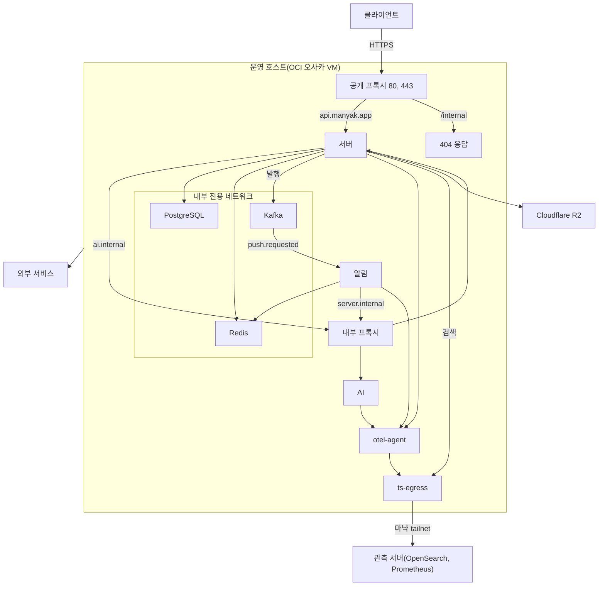
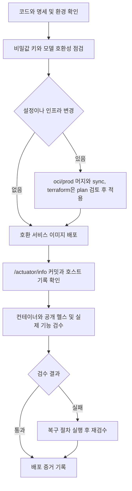
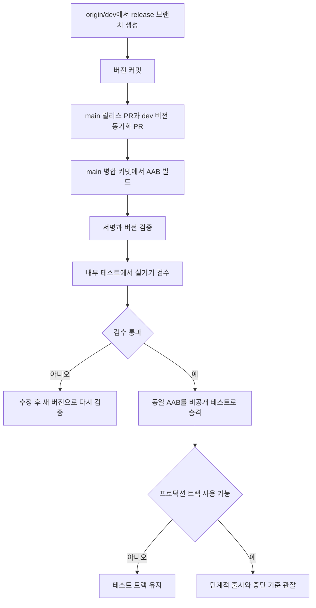
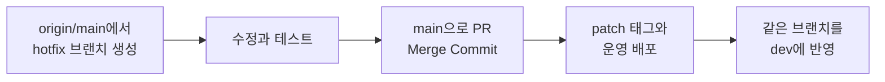
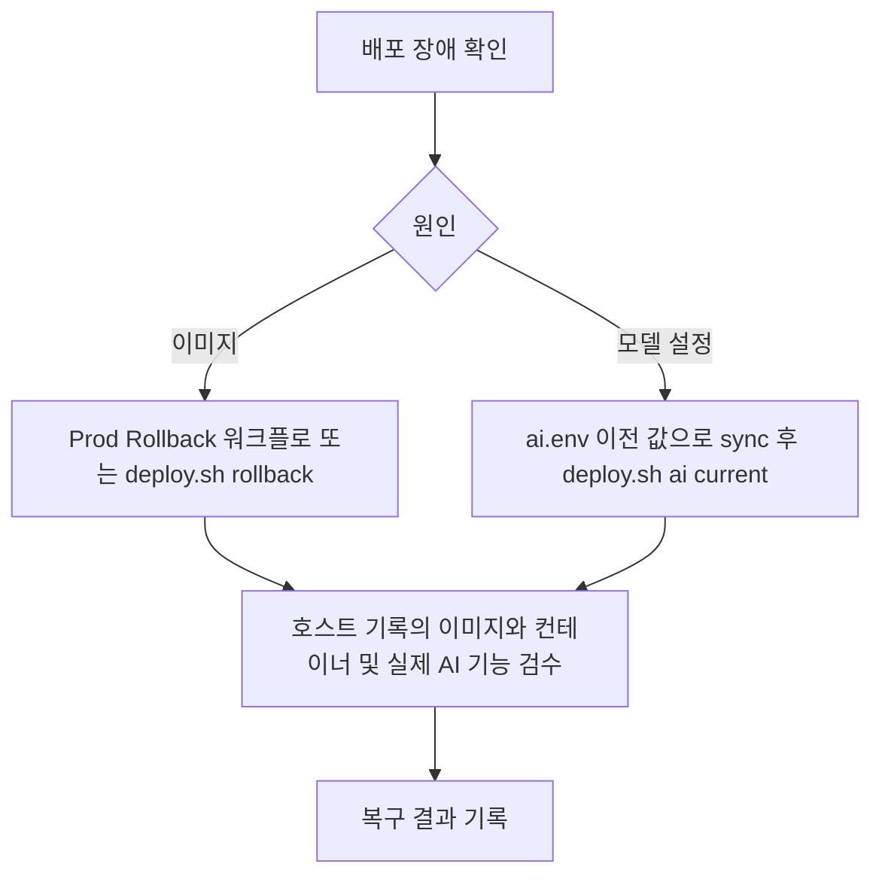

# 배포

 

### 1 목적과 범위

운영 구성은 2026-11-25에 확인한 manyak-terraform [`oci/prod`와 `terraform/envs/prod`](https://github.com/KIM-N-KANG/manyak-terraform/tree/cbc91ff/oci/prod)를 기준으로 한다. 서비스 배포는 같은 날 확인한 [server](https://github.com/KIM-N-KANG/manyak-server/blob/8f92ce7b/.github/workflows/docker-image.yml), [ai](https://github.com/KIM-N-KANG/manyak-ai/blob/071dcd4/.github/workflows/docker-image.yml), [notification](https://github.com/KIM-N-KANG/manyak-notification/blob/c1f531c/.github/workflows/docker-image.yml) 워크플로를 기준으로 한다. 이 문서의 선언값은 실측값이나 배포 완료 증거가 아니다. 실제 실행 이미지는 배포 기록과 호스트의 배포 기록으로 확인한다. 2026-11-24에 운영을 AWS에서 OCI 오사카로 옮겼고 AWS 자원은 모두 지웠다. ([KNK-2126](https://kimandkang.atlassian.net/browse/KNK-2126), [DPL-D10](DECISIONS.md#dpl-d10))

 

### 2 기준 레포지토리와 책임 경계

| 레포지토리 | 책임 | 코드 위치 |
| --- | --- | --- |
| manyak-terraform | Cloudflare DNS와 OCI 자원(VCN, VM, 블록 볼륨, 예약 공인 IP, 백업 정책), 운영 호스트 구성, 홈서버 스택 | `terraform/envs/prod`, `oci/prod`, `homeserver/` |
| manyak-server, manyak-ai, manyak-notification | 이미지 빌드, GHCR `:dev`와 `:prod` 승격, 배포 뒤 스모크, 서비스 검수 | 각 `.github/workflows/docker-image.yml` |
| manyak-infra | 로컬 통합 Docker Compose | `docker-compose.yml` |
| manyak-web, manyak-android | 플랫폼별 빌드, 배포 | 각 플랫폼 레포 및 [웹 배포](../platform/CLIENT/WEB/6-DEPLOYMENT.md), [Android 배포](../platform/CLIENT/ANDROID/5-DEPLOYMENT.md) |
| knk-harness | 현재 구조, 결정 이력 | 이 문서와 배포 결정 기록 |

Terraform에서 관리하지 않는 웹 호스팅 설정이나 Play 배포 트랙을 terraform 코드에서 추정하지 않는다. 애플리케이션 도메인 계약은 도메인별 백엔드와 AI 명세에서 정한다. ([도메인 목록](../spec/AGENTS.md#1-도메인과-세트))

 

### 3 환경 구분과 배포 단위

| 항목 | 운영 | 로컬 통합 |
| --- | --- | --- |
| 선언 위치 | `oci/prod`(호스트 구성), `terraform/envs/prod`(DNS, OCI 자원) | manyak-infra Compose |
| 컴퓨트 | OCI 오사카 VM 한 대(Arm 2 OCPU, 12 GB). server, ai, notification 컨테이너를 서비스마다 따로 배포 | Docker Compose |
| 호스트 구성 | 공개 프록시와 내부 프록시(kamal-proxy), PostgreSQL, Redis, Kafka, 로그 라우터(fluent-bit), 호스트 수집기(otel-agent), tailnet 출구(ts-egress) | 독립 Compose 서비스 |
| DB | 호스트의 PostgreSQL 16 컨테이너. 데이터는 블록 볼륨 `/data/postgres` | PostgreSQL 컨테이너 |
| Redis | 호스트의 Redis 컨테이너. 데이터 볼륨에 AOF로 영속 | 비영속 Redis 컨테이너 |
| 큐 | 호스트의 Kafka(KRaft 단일 노드) | Kafka 컨테이너 |
| 서버 프로파일 | `prod` | `local` |
| 외부 API | `https://api.manyak.app` | Compose 포트 매핑 |
| 자산 | Cloudflare R2 `manyak-prod-assets`, `cdn.manyak.app` | 실행 설정에 따른 URL |
| 이미지 | GHCR `:<sha7>`, 운영 태그 `:prod` | Compose의 이미지, 빌드 선언 |

개발 환경은 `dev` 브랜치에 머지하면 CI가 GHCR `:dev` 이미지를 올리고 dev 환경이 자동으로 받아 교체한다. 주소는 `https://dev-api.manyak.app`이다.

운영 컨테이너끼리의 호출은 내부 프록시를 거친다. 서버는 AI를 `http://ai.internal`로, 알림은 서버를 `http://server.internal`로 호출한다. 서버 상태 검사만으로 AI 기능 성공을 판정하지 않는다. 개발 검수는 운영 DB와 운영 호스트 배포를 검증하지 않는다.

 

### 4 인프라 아키텍처

### 4-1 네트워크와 트래픽

서버, AI, 알림은 같은 호스트의 컨테이너이며 서비스마다 따로 배포한다. PostgreSQL, Redis, Kafka는 내부 전용 네트워크 `manyak-data`에만 붙고, 앱 컨테이너만 두 네트워크에 붙는다. 컨테이너에서 인스턴스 메타데이터(링크 로컬)로 가는 접근은 `host-guard.sh`가 모두 막는다. 서비스마다 메모리 상한을 두고 스왑을 쓰지 않는다. 이미지 업로드는 서버가 발급한 presigned PUT URL로 클라이언트와 AI가 R2에 직접 올린다.

호스트는 OCI VCN의 퍼블릭 서브넷에 있고 예약 공인 IP로 외부와 통신하며 NAT는 두지 않는다. 보안 목록은 80, 443과 ICMP만 연다. 호스트가 한 대이고 DB도 같은 호스트에 있으므로 호스트가 멈추면 서비스가 멈춘다.

공개 프록시는 80, 443을 받아 Let's Encrypt 인증서로 TLS를 처리하고 서버 8080으로 전달한다. `api.manyak.app`은 호스트 레코드(Cloudflare DNS only, 프록시 없음)를 가리키고, 그 레코드가 예약 공인 IP를 가리킨다. 서버 상태 검사 경로는 `/actuator/health`다. 공개 호스트의 `/internal` 경로는 서버 대신 404만 돌려주는 작은 컨테이너로 보낸다. 관리 접속은 마냑 tailnet으로만 하며 22번 포트는 열지 않는다.

알림은 들어오는 요청이 없어 공개 프록시를 거치지 않는다. 분리 배포의 결정 근거는 BE-051에 있다. ([BE-051](../reference/decisions/BACKEND.md#be-051))

| 항목 | 운영 선언 |
| --- | --- |
| 배포 단위 | 운영 호스트의 notification 컨테이너. 다른 서비스와 같은 updater가 GHCR `:prod`를 따라 배포 |
| 내부 호출 | 내부 프록시로 `http://server.internal` 호출 |
| 공개 경로 차단 | 공개 프록시의 `/internal` 경로는 404. 내부 API는 내부 프록시와 공유 시크릿 사용 |
| 큐 | Kafka 토픽 `push.requested`, 재시도 토픽, DLQ 토픽. 서버가 아웃박스에서 발행하고 알림이 소비한다(`MANYAK_PUSH_BROKER=kafka`) |

자격 조회가 실패하면 소비자는 `ELIGIBILITY_UNAVAILABLE`을 `RETRY`로 처리한다. 알림은 메시지를 재시도 토픽으로 보내 60초 간격으로 5회까지 다시 처리하고, 한도를 넘으면 DLQ 토픽에 남긴다. 토픽 보존은 브로커 기본값 7일(168시간)이다. DLQ 경보 규칙은 지금 없다. 본 큐 적체 경보는 임계값 근거가 부족해 보류한 결정을 유지한다. ([KNK-1381](https://kimandkang.atlassian.net/browse/KNK-1381))

 

### 4-2 배포와 데이터의 현재 선언값

아래 값은 `oci/prod`와 `terraform/envs/prod`의 선언이며 실측값이 아니다.

| 항목 | 현재 선언 | 근거 |
| --- | --- | --- |
| 운영 호스트 | OCI 오사카 VM 한 대(Arm A1, 2 OCPU, 12 GB) | `terraform/envs/prod/oci.tf` |
| 서비스 메모리 상한 | server 1536 MiB, notification 640 MiB, ai 512 MiB, postgres 3072 MiB, kafka 1024 MiB, redis 320 MiB. 컨테이너는 스왑을 쓰지 않음 | `oci/prod/services/*.conf`, `compose.yaml` |
| 프록시 드레인 | 240초. 전환 뒤 옛 컨테이너의 진행 중 요청을 기다리는 시간 | `oci/prod/host.conf` |
| AI 정지 대기 | 130초. 모든 진행 중 요청의 완료를 보장하는 값은 아님 | `oci/prod/services/ai.conf` |
| 운영 DB | PostgreSQL 16 컨테이너(`max_connections=60`, `shared_buffers=768MB`) | `oci/prod/compose.yaml` |
| DB 백업 | 매일 03:30 KST `pg_dump`를 R2 백업 버킷 `pg/`로, 7일 보관(버킷 수명 주기) | `oci/prod/scripts/backup.sh`, `systemd/manyak-backup.timer` |
| 볼륨 백업 | OCI 정책. 데이터 볼륨 매일 04:00 KST(약 3.5일 보관), 부트 볼륨 매월 1일(27일 보관) | `terraform/envs/prod/oci.tf` |
| 운영 Redis | 호스트 컨테이너, `maxmemory` 256mb, `noeviction`, AOF everysec | `oci/prod/compose.yaml` |
| 데이터 볼륨 | `/data` 블록 볼륨(PostgreSQL, Redis AOF, Kafka, 프록시 인증서, 배포 기록) | `oci/prod/README.md` |
| 삭제 보호 | VM, 데이터 볼륨, 예약 공인 IP에 `prevent_destroy` | `terraform/envs/prod/oci.tf` |

 

### 4-3 저장소와 자산

PostgreSQL이 업무 데이터의 기준이며 OpenSearch 인덱스는 파생 데이터다. 운영 DB는 같은 호스트의 컨테이너다. 데이터는 블록 볼륨 `/data`에 있어 컨테이너를 바꿔도 남지만, 호스트나 볼륨 장애는 R2 덤프와 OCI 볼륨 백업으로 복구한다(`oci/prod/scripts/restore.sh`). Redis는 호스트 데이터 볼륨에 AOF로 남아 컨테이너를 바꿔도 유지된다. 운영 Redis는 `noeviction` 정책이라 메모리가 차면 쓰기가 실패한다. TTL 없는 카운터와 TTL 있는 세션의 수명은 백엔드 Spec을 따른다.

알림의 멱등 기록은 `notification:` 접두어 키에 저장하며 서버와 같은 Redis를 사용한다. ([BE-051](../reference/decisions/BACKEND.md#be-051))

이미지는 Cloudflare R2 버킷 `manyak-prod-assets`(S3 호환 API)에 두고 `cdn.manyak.app`(R2 사용자 도메인)으로 서빙한다. 프리셋 키는 불변이며 변경은 새 키로 만든다. 썸네일 원본과 `_sm` 파생은 `scripts/upload-image-presets.sh`가 재현한다. 생성 이미지와 사용자 업로드는 서버가 허용한 키 접두어 안에서 저장한다. R2 접근 키는 버킷 단위라 접두어별 쓰기 권한은 나누지 않으며, 접두어 제한은 서버가 presigned URL을 발급할 때 건다. 버킷 CORS(PUT, HEAD)와 접근 키는 Cloudflare에서 관리한다(terraform 밖).

 

### 4-4 로그와 검색

앱 컨테이너와 기반 서비스 로그는 Docker 로그 드라이버로 호스트의 로그 라우터(fluent-bit)에 모이고, 로그 라우터가 otel-agent로 넘긴다. otel-agent는 마냑 tailnet(ts-egress)으로 관측 서버에 보낸다. 별도 사본은 없으므로 관측 서버나 연결이 otel-agent의 재시도 한도(최대 10분)보다 오래 멈추면 그 구간 로그는 버려진다. 관측 서버의 로그 보존은 14일이다.

스토리 검색 인덱스 `stories-dev`, `stories-prod`는 관측 서버의 OpenSearch에 관측 데이터와 같은 클러스터로 둔다. 한국어 분석용 `analysis-nori` 플러그인은 그 OpenSearch 이미지에 엔진 버전과 맞는 것으로 설치한다. 서버는 마냑 tailnet으로 관측 서버 기기에 `https://<기기 이름>:443`(Tailscale 인증서)으로 연결하고 환경별 검색 전용 계정으로 인증한다. 기기 이름은 호스트 비밀값에 둔다. 계정의 역할은 그 환경의 인덱스 `stories-{env}*`로 제한한다. 검색 인덱스는 파생 데이터라 백업하지 않고 재색인으로 복구한다. `MANYAK_OPENSEARCH_REINDEX_ON_STARTUP`은 초기 적재, 복구 때 일시적으로 켠 뒤 되돌린다. 서버의 재색인 대상과 검색 가시성은 백엔드 Spec을 따른다. ([KNK-2139](https://kimandkang.atlassian.net/browse/KNK-2139))

 

### 4-5 관측 수집 경로

server, ai, notification은 트레이스와 메트릭을 OTLP로 같은 호스트의 otel-agent에 보낸다(인증 없음). otel-agent는 컨테이너, PostgreSQL, Redis 지표도 직접 모으고, 노드 메모리와 디스크 지표는 별도 fluent-bit 컨테이너(host_metrics)가 otel-agent로 보낸다. otel-agent만 관측 서버 OTLP 계정을 갖고 큐와 재시도(최대 10분)를 두어 마냑 tailnet으로 관측 서버 입구에 보낸다. 메트릭은 관측 서버의 Prometheus에, 로그와 트레이스는 OpenSearch에 쌓인다. 재시도 한도를 넘게 끊기면 메트릭은 빈 구간이 생기고 트레이스는 버려진다. 수집 흐름과 지표 조회 기준은 [백엔드 운영 관측](../platform/BACKEND/2-OBSERVABILITY.md#2-1-메트릭과-운영-연동)을 따른다.

 

### 5 이미지 빌드와 CI/CD

### 5-1 server, ai, notification 이미지

서비스 워크플로(`docker-image.yml`)는 main push에서 GHCR `:<sha7>` 이미지를 빌드하고 `deploy-prod` 잡에서 `:prod`로 승격한다. CI는 운영 호스트에 들어가지 않는다. 운영 호스트의 `manyak-updater.timer`가 앞 실행이 끝나고 60초마다 GHCR `:prod` 다이제스트를 확인해 바뀌면 `deploy.sh`로 교체한다. 같은 레포의 배포는 GitHub concurrency로, 호스트의 서비스 사이 배포는 `deploy.sh`의 잠금(`flock`)으로 직렬화한다.

| 단계 | 동작 |
| --- | --- |
| 배포 대상 | 배포 잡은 이 실행의 커밋이 아니라 현재 main HEAD의 이미지를 `:prod`로 옮긴다. 그 이미지가 GHCR에 아직 없으면 옮기지 않고 끝낸다(그 커밋의 실행이 옮긴다) |
| 호스트 배포 | updater가 새 다이제스트를 받아 새 컨테이너를 띄우고, Docker 헬스를 기다린 뒤 프록시를 넘기고, 옛 컨테이너를 드레인한 다음 정지한다. notification은 프록시를 거치지 않아 헬스가 통과하면 옛 컨테이너를 내린다. 새 컨테이너가 실패하면 그것만 지우고 그 다이제스트를 `/data/state/<서비스>.failed`에 기록해 다시 시도하지 않으며, 옛 컨테이너가 계속 서비스한다 |
| 배포 확인 | server는 공개 `/actuator/info`의 `build.commit`이 그 커밋으로 바뀔 때까지 최대 20분 기다린다. ai, notification은 updater가 교체할 시간을 기다린다 |
| 스모크 | 세 서비스 모두 `https://api.manyak.app/actuator/health`가 `UP`인지 확인하고, 실패하면 `:prod`를 직전 다이제스트로 되돌린다. 결과는 Slack으로 알린다 |

호스트는 서비스별 현재 이미지와 직전 이미지를 `/data/state`에 기록한다. 수동 되돌리기는 `Prod Rollback (GHCR :prod)` 워크플로로 `:prod`를 직전 릴리스로 옮기거나 호스트에서 `deploy.sh <서비스> rollback`(직전 이미지)을 실행한다. 가변 태그 이름만 같다고 같은 이미지로 판단하지 않는다.

dev push는 GHCR `:<sha7>`를 올리고, `deploy-dev` 잡이 최신 dev SHA 게이트 뒤 `:dev`로 옮긴다. dev 환경이 그 이미지를 자동으로 받아 교체한다.

비밀 아닌 운영 설정은 manyak-terraform `oci/prod/services/<서비스>.env`가 정본이다. 호스트는 레포의 읽기 전용 clone을 갖고 있으며 머지 뒤 `deploy.sh sync`를 손으로 실행해야 반영된다(자동으로 따라가지 않음). 설정만 바꿨으면 `deploy.sh <서비스> current`로 다시 배포한다. Terraform CI는 자격 없는 검사(check, checkov, gitleaks)만 하고, `terraform/envs/prod` 변경은 사람이 `scripts/tf-apply.sh`로 적용한다. state는 Cloudflare R2에 둔다.

 

### 5-2 manyak-web CI/CD

| 트리거 | 동작 |
| --- | --- |
| PR → `dev` | pnpm install, lint, typecheck, Docker build 검증 |
| PR, push → `dev`, `main` | Playwright(4 워커 병렬): Pixel 5 전체 E2E, iPhone 13 스모크. 브라우저가 포함된 Playwright 컨테이너에서 실행 |
| push → `dev` | GHCR `dev`, `<short-sha>` push |
| push tag `v*` | GHCR release 이미지 push. build arg는 `NEXT_PUBLIC_AMPLITUDE_API_KEY`, `NEXT_PUBLIC_META_PIXEL_ID` |

화면 표현은 CI에서 비교하지 않는다. UI를 바꾼 PR은 만들기 전에 UI 검사를 하고 결과를 PR에 남긴다. ([5-1 검증 수단](../platform/CLIENT/WEB/5-VERIFICATION.md#5-1-검증-수단))

운영 Terraform에는 `manyak-web` 컨테이너를 호스팅에 배포하는 리소스가 없다. 웹은 Vercel에서 서빙하며 release PR은 GHCR release 이미지 발행과 외부 호스팅 반영을 전제로 한다. Vercel 프로젝트 `manyak`의 Function Region은 백엔드와 같은 오사카 `kix1`이다(프로젝트 설정 Settings → Functions, 레포에는 설정이 없음). 브라우저의 모든 API 호출이 거치는 BFF 프록시(`/api/[...path]`)와 서버 렌더가 이 리전의 함수에서 백엔드를 부르므로 함수 리전은 백엔드 위치를 따른다. 백엔드가 서울에 있을 때 기본값 `iad1`(미국 동부)이면 호출마다 왕복 약 700ms가 더 들었다(2026-10-19 `icn1` 전환, 프록시 호출 800ms → 100ms대). 2026-11-24 운영 백엔드를 OCI 오사카로 옮기면서 `kix1`로 바꿨다. 리전 설정은 이후 배포부터 적용되므로 바꾸면 운영과 `dev` 브랜치 도메인(`dev.manyak.app`) 배포를 다시 만들어야 한다.

Web Sentry는 Vercel 환경 변수 `NEXT_PUBLIC_SENTRY_DSN`으로 활성이고, SDK는 `NODE_ENV=production`이면서 Vercel 배포일 때만 전송한다. 배포 판별에 쓰는 `VERCEL_ENV`는 `next.config.ts`가 빌드 시점에 인라인한다. Sentry release와 Amplitude `app_version`이 읽는 앱 버전 `NEXT_PUBLIC_APP_VERSION`도 `next.config.ts`가 `package.json`의 `version`으로 인라인하며, 같은 이름의 배포 환경 변수보다 우선한다. GHCR release workflow와 Dockerfile에는 이 build arg가 없어 컨테이너 경로는 비활성이다.

웹 푸시는 Vercel 환경 변수 `NEXT_PUBLIC_FIREBASE_API_KEY`, `NEXT_PUBLIC_FIREBASE_PROJECT_ID`, `NEXT_PUBLIC_FIREBASE_MESSAGING_SENDER_ID`, `NEXT_PUBLIC_FIREBASE_APP_ID`, `NEXT_PUBLIC_FIREBASE_VAPID_KEY`(Production, Preview, 공개값)로 활성이며 하나라도 비면 전체가 꺼진다. 값은 서버 및 Android와 같은 Firebase 프로젝트의 웹 앱 `manyak-web`과 클라우드 메시징의 웹 푸시 인증서에서 발급하고, GHCR 컨테이너 경로에는 이 build arg가 없어 비활성이다.

 

### 5-3 manyak-android CI

컨테이너 이미지가 없는 앱 저장소이다. `.github/workflows/android-ci.yml`이 `dev`, `main` 대상 PR, push와 수동 실행에서 Temurin Java 25를 설정하고(`gradle-daemon-jvm.properties`와 일치) `./gradlew check`(ktlint, detekt, Android lint, 단위 테스트)와 `./gradlew assembleDebug`를 실행한 뒤 리포트를 아티팩트로 올린다.

release 번들(AAB)은 CI가 만들지 않는다. 릴리스 담당자가 로컬에서 `./gradlew bundleRelease`로 만들어 Play Console에 직접 올린다.

- **CI에 서명키를 두지 않는다.** 릴리스가 2주에 한 번이고 올리는 사람이 한 명인 동안에는 Play Publisher API 서비스 계정과 GitHub Secrets 키스토어를 유지하는 비용이 수동 업로드보다 크다. 키를 CI에 올리면 유출면도 넓어진다. 자동화는 릴리스가 주 1회를 넘거나 담당이 둘 이상이 될 때 다시 판단한다.
- **서명키 보관.** Play 앱 서명을 쓰므로 배포 인증서는 Google이 보관하고 팀은 업로드 키만 가진다. 업로드 키스토어는 저장소 밖에 두고 `local.properties`의 `RELEASE_STORE_FILE`, `RELEASE_STORE_PASSWORD`, `RELEASE_KEY_ALIAS`, `RELEASE_KEY_PASSWORD`로 주입한다. 키 파일과 비밀번호는 암호화 백업 두 곳에 둔다. 잃으면 Google 지원으로 업로드 키를 재설정할 때까지 업데이트를 올릴 수 없다. 키 값과 실제 경로는 문서에도 저장소에도 적지 않는다.
- **release BuildConfig 주입값**도 `local.properties`에서 읽는다(`GOOGLE_SERVER_CLIENT_ID_RELEASE`, `KAKAO_NATIVE_APP_KEY_RELEASE`, `AMPLITUDE_API_KEY_RELEASE`). 비어 있어도 빌드는 성공하고 해당 공급자만 런타임에 실패하므로 번들을 만들기 전에 세 값을 확인한다. 운영 `BASE_URL`은 `app/build.gradle.kts`에 고정돼 있다.
- **`google-services.json`은 저장소에 커밋한다.** CI에 주입할 시크릿이 없는데 PR마다 `assembleDebug`를 돌리므로 파일이 없으면 모든 PR이 실패한다. 값은 APK에 실려 나가고 보호는 Firebase 보안 규칙과 API 키 제한이 맡는다. Firebase 프로젝트는 서버 FCM과 같은 하나를 쓰며 환경별로 나누지 않는다. `applicationId`가 빌드 타입 간 같고 debug는 `firebase_crashlytics_collection_enabled=false`로 수집하지 않는다.
- release는 R8 축소, 난독화를 적용한다(`optimization.enable = true`, keep 규칙은 `app/proguard-rules.pro`). `bundleRelease`가 Crashlytics로 매핑 파일을 올리고 AAB의 `BUNDLE-METADATA`에도 매핑이 실린다. 결정 이유는 [Android ADR A-047](../platform/CLIENT/ANDROID/DECISIONS.md#a-047)에 있다.

 

### 6 런타임 설정과 시크릿

비밀 아닌 값은 manyak-terraform `oci/prod/services/<서비스>.env`, 비밀값은 운영 호스트 `/opt/manyak/secrets/<서비스>.env`(권한 600)에 둔다. 비밀값 키 이름은 `oci/prod/secrets/*.example`에 있고 값은 레포와 Terraform state에 두지 않는다. 호스트 `deploy.sh`는 배포할 때마다 두 파일을 읽어 컨테이너 환경으로 넘긴다. 레포 값은 머지 뒤 `deploy.sh sync`, 비밀값은 호스트 파일 수정, 그다음 서비스 재배포(`deploy.sh <서비스> current`)까지 해야 실행 중 컨테이너에 반영된다.

| 설정 묶음 | 주입 대상, 경계 |
| --- | --- |
| JWT, Google, Kakao | server 인증 설정. 허용 client ID와 서명 설정은 백엔드 계약에 맞춰 공급 |
| DB 비밀번호 | server의 `MANYAK_DB_PASSWORD`와 postgres의 `POSTGRES_PASSWORD`가 같은 값. 바꾸면 DB 사용자 비밀번호와 두 파일을 함께 바꾸고 server를 다시 배포([9-1](#9-1-서버-ai-검수와-복구)) |
| LLM 공급자 키, Langfuse | AI 컨테이너. AI가 선택 모델의 공급자와 관측 설정을 검사 |
| 이미지 bucket, region, base URL | server 생성 이미지 저장. R2 계정 엔드포인트와 그 버킷만 쓰는 접근 키는 비밀값, 버킷 이름과 `cdn.manyak.app`은 `services/server.env` |
| OpenSearch endpoint, index, 재색인 | server 검색, 색인. 주소(관측 서버 tailnet 기기 이름)와 검색 계정은 비밀값, 인덱스와 재색인 토글은 `services/server.env` |
| OTLP | server, ai, notification에 같은 호스트의 otel-agent 주소(`http://otel-agent:4318`)와 활성 토글을 공급. 관측 서버 인증(`OTLP_PASSWORD`)은 otel-agent만 가짐. 운영은 메트릭과 트레이스 전송을 켬 |
| 신고, 피드백 webhook | server에 목적별 참조. 값이 없을 때 저장과 알림의 실패 경계는 백엔드 계약을 따름 |
| FCM | notification에 `MANYAK_FCM_SERVICE_ACCOUNT_JSON`. server 비밀값 파일에도 같은 키가 남아 있음 |
| 내부 API 인증 | server, notification에 같은 `MANYAK_INTERNAL_SHARED_SECRET`을 주입. 공개 프록시는 `/internal` 차단 |
| 알림의 서버 주소 | `MANYAK_SERVER_INTERNAL_BASE_URL`: `http://server.internal`(내부 프록시) |
| Groble, Google Play | server에 HMAC, 서비스 계정 JSON, 패키지명. 비어 있으면 구매는 503, 대사는 실행하지 않음 |

비밀값 파일을 고칠 때는 값이 비지 않았는지 길이로 확인하며 값 자체는 로그나 문서에 출력하지 않는다. 운영 푸시는 알림 서비스가 보내고(`MANYAK_PUSH_BROKER=kafka`), server 비밀값의 FCM 키는 롤백 창 때 남긴 것이다. 제거 결정과 적용 순서는 BE-051 및 KNK-1367에서 확인한다. ([BE-051](../reference/decisions/BACKEND.md#be-051), [KNK-1367](https://kimandkang.atlassian.net/browse/KNK-1367))

운영 AI의 `STORY_COMPILE_MODEL`, `STORYLINES_MODEL`, `CHAT_MODEL`은 manyak-terraform `oci/prod/services/ai.env` 값이 정본이다. 바꾸면 머지 뒤 호스트에서 `deploy.sh sync`와 `deploy.sh ai current`를 실행해야 반영된다. 실제 모델 선택은 [AI 배포의 모델 라우팅](../spec/CHAT/AI/7-4-DEPLOYMENT.md)을 따른다. 특히 채팅의 `model_tier` 라우팅과 단일 `CHAT_MODEL` 설정을 동일시하지 않는다. 모델 이름과 AI 등록부가 바뀌는 전환은 설정과 이미지를 같은 배포 단위로 맞춘다.

 

### 7 배포 절차

1. 작업 코드, 현재 명세, 결정 기록과 대상 환경을 확인한다. 새 설정은 호스트 비밀값 파일의 키 존재, 공급자 모델 호환성을 먼저 점검한다.
2. 비밀 아닌 설정은 `oci/prod/services/<서비스>.env`를 머지한 뒤 호스트에서 `deploy.sh sync`로 반영한다. DNS나 OCI 자원을 바꾸는 Terraform 변경은 저장소의 `scripts/tf-apply.sh`가 요구하는 최신 dev, 작업트리, plan 검사를 통과한 뒤 적용한다. 오래된 브랜치의 plan을 현재 운영 변경으로 사용하지 않는다. plan의 replace, destroy 범위를 개별 리소스로 검토한다.
3. 설정이 준비된 환경에 호환되는 서비스 이미지를 배포한다(main 릴리스로 `:prod` 승격). 설정만 바꿨으면 `deploy.sh <서비스> current`로 다시 배포한다.
4. 운영 `/actuator/info`의 커밋, 호스트의 `/data/state/<서비스>.image`, 컨테이너와 API 상태를 확인한다. 기능 설정을 켜거나 끄는 배포는 실행 중인 컨테이너의 해당 환경 변수가 의도한 값인지 `docker inspect`나 호스트의 `services/<서비스>.env`로 확인한다. AI 변경은 실제 생성, 채팅 검수 결과를 따로 남긴다.
5. 실행 시각(KST), 코드 SHA, 이미지 digest, 설정 변경 범위, 검수, 복구 결과를 배포 기록에 남긴다. 합의된 현재 구성은 이 문서에 반영한다.

릴리스 PR과 릴리스 티켓에는 포함한 PR 목록과 별도로 코드 외 할 일 칸을 둔다. 설정 켜기, `deploy.sh sync`, Terraform 적용처럼 이미지 배포만으로 끝나지 않는 작업과 다음 릴리스에 묶기로 한 설정 변경을 적고, 없으면 "없음"이라고 적는다. ([DPL-D07](DECISIONS.md#dpl-d07))

DB 변경은 expand/contract로 진행한다. 신규 컬럼, 테이블을 먼저 추가하고 구버전 컨테이너가 더 이상 해당 컬럼을 읽지 않는 릴리스 이후에 제거한다. 새 server 컨테이너의 Flyway 실행 중에도 이전 컨테이너가 요청을 받을 수 있다. 이미지 롤백은 파괴적 DB 변경을 자동 복구하지 않는다.

 

### 7-1 Web release 이미지 배포

1. `manyak-web` 변경을 `dev`에 병합해 GHCR `dev` 이미지를 검증한다.
2. release tag `v*`를 push하면 `release.yml`이 GHCR release 이미지를 빌드한다.
3. 운영 웹 호스팅 반영은 Terraform이 관리하지 않는 Vercel 절차다. 코드화되면 이 절을 갱신한다.

 

### 7-2 Android 앱 릴리스

스토어에 올라가는 번들은 `main`에서만 만든다. v1.0.2까지는 이 규칙이 없어 `versionCode 3`을 `dev`에서 바로 빌드해 올렸고, 그 결과 스토어에 있는 코드가 `main`에 없었다(그래서 `main`은 2에서 4로 건너뛴다). 어느 코드가 사용자 손에 있는지 `main`으로 답할 수 없게 되므로 반복하지 않는다.

1. `release/v{버전}` 브랜치를 `origin/dev`에서 만들고 `app/build.gradle.kts`의 `versionName`, `versionCode` 두 줄만 커밋한다.
2. 같은 브랜치로 PR 둘을 낸다. `main`(`Release` 태그)과 `dev`(버전 동기화)이다. 릴리스 커밋이 `dev`에도 돌아가야 다음 릴리스의 분기 기준이 어긋나지 않는다.
3. `main` 병합 후 그 커밋에서 `./gradlew bundleRelease`를 실행한다.
4. `jarsigner -verify`가 `jar verified.`를 내는지, 번들 매니페스트의 `versionCode`, `versionName`이 의도한 값인지 확인한다.
5. 같은 AAB를 내부 테스트 트랙에 올리고 실기기에서 로그인과 핵심 흐름을 완주한다.
6. 통과하면 같은 AAB를 비공개 테스트에서 프로덕션으로 승격한다. 트랙마다 다시 빌드하지 않는다. 다시 빌드하면 검증한 번들과 출시하는 번들이 달라진다.
7. 프로덕션은 단계적 출시로 시작하고 [§9](#9-검수-관측-롤백)의 중단 기준을 관찰한다.

- `versionCode`는 업로드할 때마다 1씩 올리며 재사용할 수 없다. 심사 반려로 같은 내용을 다시 올릴 때도 올린다.
- `versionName`은 사용자용이다. 버그 수정은 patch, 기능 추가는 minor로 올린다.
- 프로덕션 트랙은 Play 개인 개발자 계정 정책상 비공개 테스트 12명이 14일 연속 옵트인한 뒤에야 열린다. 그 전까지 릴리스는 내부 테스트와 비공개 테스트에서 끝난다.

 

### 7-3 운영 긴급 수정

운영 장애나 보안 문제를 바로 고쳐야 하는데 `dev`에 다음 운영 릴리스에 넣을 수 없는 변경이 있을 때만 이 경로를 쓴다. `dev`에 내보내면 안 되는 변경이 없으면 일반 릴리스 경로로 patch 릴리스를 낸다. ([DPL-D08](DECISIONS.md#dpl-d08))

| 항목 | 규칙 |
|---|---|
| 분기 | 최신 `origin/main`에서 `hotfix/{JIRA_KEY}-{slug}` |
| 범위 | 장애를 고치는 최소 변경만 다른 기능과 정리 작업을 섞지 않음 |
| PR 제목 | `[KNK-xxx] Hotfix: vX.Y.Z 배포` |
| main 병합 | 릴리스와 같은 Merge Commit 병합 뒤 patch 버전 태그 |
| 검증 | 일반 릴리스와 같은 CI, 배포 확인, 코드 외 할 일 칸 |
| dev 반영 | 같은 브랜치를 `dev`로 PR해 그 저장소의 릴리스 역반영 방식으로 병합 main 병합 직후에 하고, 충돌은 `dev`의 변경을 살려 해결 |
| 기록 | 릴리스와 같은 티켓과 태그 규칙 |

Android는 hotfix도 `main` 병합 커밋에서만 AAB를 만들고 `versionCode`를 올린다([7-2](#7-2-android-앱-릴리스)).

 

### 8 로컬, 통합 실행

`manyak-infra`의 Compose가 로컬 실행 기준이다. 서버, AI, 웹, PostgreSQL, Redis와 Prometheus 설정을 함께 확인한다. 서비스명 DNS는 Compose 네트워크 안에서 사용한다. AI stub과 실제 AI 호출 여부는 명시적인 실행 설정으로 확인한다.

현재 Compose의 모델 기본값과 운영 선언은 같다고 가정하지 않는다. 통합 레포의 모델 기본값에는 과거 이름이 남아 있으므로 선택한 AI 이미지의 등록부와 맞는 값을 공급해야 한다. 로컬 통합 성공은 R2 권한과 업로드 CORS, 호스트 비밀값 주입, 운영 호스트 배포 성공의 증거가 아니다.

 

### 9 검수, 관측, 롤백

### 9-1 서버, AI 검수와 복구

- 서버와 AI 컨테이너의 상태, 실제 AI 기능을 각각 확인한다.
- 관측 서버의 로그(`logs.manyak.app`)와 호스트의 `docker logs`, OTLP 수집을 각각 확인한다. 로그 수집 성공으로 메트릭 export를 판정하지 않는다.
- DB 비밀번호는 자동으로 회전하지 않는다. 바꿀 때는 DB 사용자 비밀번호, server와 postgres 비밀값 파일을 함께 바꾸고 server를 다시 배포한 뒤 DB 연결을 확인한다.
- 이미지 장애는 `Prod Rollback (GHCR :prod)` 워크플로로 `:prod`를 직전 릴리스로 옮기거나 호스트에서 `deploy.sh <서비스> rollback`(호스트가 기록한 직전 이미지)을 실행한 뒤 같은 검수를 반복한다. 배포 잡의 스모크가 실패하면 `:prod`를 자동으로 되돌리지만 복구 완료는 따로 확인한다.
- 모델 설정 장애는 `ai.env`의 이전 값과 호환 이미지의 조합으로 복원한다.
- 옛 AWS 경로(ECS 태스크 정의, EC2 앱 호스트의 SSM 문서)는 복구 수단이 아니다. AWS 자원은 2026-11-24에 모두 지웠다. 전환 경위는 [배포 결정 기록](DECISIONS.md#전환-단계-기록)에 있다.

 

### 9-2 Definition of Done

다음 조건을 모두 만족하면 배포가 완료된다.

- 변경 대상 저장소의 필수 테스트와 Docker build 검증이 통과한다.
- 웹은 Pixel 5 전체 E2E와 iPhone 13 스모크가 통과한다. UI 변경이면 PR에 남긴 UI 검사 결과를 함께 검토한다.
- server, ai, notification 배포는 GHCR `:prod`가 그 커밋의 이미지이고, 호스트 기록(`/data/state/<서비스>.image`)이 그 이미지다. server는 운영 `/actuator/info`의 커밋이 main HEAD다.
- server는 외부 `https://api.manyak.app/actuator/health`가 200과 `status=UP`을 반환한다.
- 기능 설정을 켜거나 끄는 배포는 실행 중인 컨테이너의 해당 환경 변수가 의도한 값이다. 헬스 성공만으로 판정하지 않는다.
- 릴리스 PR과 릴리스 티켓의 코드 외 할 일이 모두 끝난다.
- ai는 컨테이너 health가 정상이고 실제 생성, 채팅 1건이 성공한다. 서버 헬스 성공만으로 판정하지 않는다.
- 운영 AI 모델 변경은 `ai.env`의 직전 값을 기록하고, `deploy.sh ai current`로 다시 배포한 ai가 새 값을 읽었으며, 바꾼 기능의 운영 API 1건이 성공한다. 모델명과 provider는 확인하되 키 값은 출력하지 않는다.
- Terraform 변경은 plan 리뷰 후 적용하고, 대상 리소스와 운영 호스트 서비스 헬스 중 영향 범위를 확인한다.
- 시크릿 변경은 값을 소비하는 서비스의 재배포까지 끝나야 반영으로 본다.
- 웹 release는 GHCR release 이미지 태그가 발행된다. 호스팅 반영은 Vercel 쪽 별도 절차로 확인한다.
- Android 릴리스는 `main` 커밋에서 만든 AAB가 내부 테스트 실기기 스모크를 통과하고 승격한 트랙에 같은 번들이 올라간다. 프로덕션은 단계적 출시를 시작한 시점이 아니라 100% 도달과 중단 기준 미발동을 확인해야 완료된다.
- 롤백 기준 이미지 태그 또는 DB 복구 계획을 배포 전에 확인한다. Flyway 마이그레이션은 전진 전용으로 취급한다.

 

### 9-3 Android 단계적 출시와 중단 기준

프로덕션은 단계적 출시로 시작한다. 비율은 20%에서 100%이고 각 단계를 최소 하루 둔다. 초기 설치 수에서는 5% 단위로 나누면 비교할 표본이 부족하다. 며칠 동안 출시를 중단할 수 있는 상태를 유지하면서 지표를 관찰한다.

아래 기준 중 하나라도 충족하면 출시를 중단하고 수정판을 준비한다. 중단 기준은 출시 전에 확정한다.

| 신호 | 중단 기준 |
| --- | --- |
| Crashlytics 크래시 없는 사용자 비율 | 직전 버전 대비 1%p 이상 하락 |
| Crashlytics 신규 이슈 | 세션의 0.5% 이상에서 발생 |
| Amplitude 로그인 성공률, 스토리 생성 완주율 | 직전 버전 대비 하락이 관찰될 때 |

세 기준은 모두 앱 버전별로 비교한다. Crashlytics, Amplitude의 버전별 비교 대시보드는 아직 없으며 첫 프로덕션 출시 전에 만들어야 기준이 성립한다.
