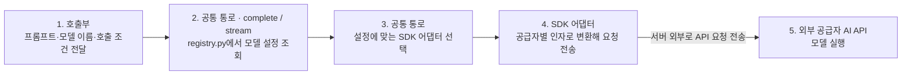

# AI 호출 기반

기능별 프롬프트, 모델 선택과 실행 계약은 도메인 AI 세트에서 정한다.

 

### 1 공통 호출 경계

Python 3.11·FastAPI·Pydantic v2 기반입니다.

텍스트 LLM 호출은 호출부·모델 특성·SDK 어댑터의 세 층으로 나뉩니다.

| 층 | 책임 | 구현 |
| --- | --- | --- |
| 호출부 | 프롬프트·모델·출력 길이·시간 제한을 요청하고, 결과 검증·보완 호출·실패 시 대체 처리를 담당 | `story_llm.py`, `chat_llm.py` 등 기능별 서비스 |
| 모델 특성 | 모델별 공급자·어댑터·추론 설정·지원 인자·한도를 정의 | [registry.py](../../../../manyak-ai/src/services/llm/registry.py) |
| SDK 어댑터 | 공통 요청을 공급자별 SDK 인자로 바꾸고, 응답·토큰 사용량·오류를 공통 형식으로 반환 | [llm/](../../../../manyak-ai/src/services/llm)의 `openai_sdk.py`, `anthropic_sdk.py`, `google_sdk.py` |

호출부가 요청을 넘기면 [공통 통로](../../../../manyak-ai/src/services/llm/__init__.py)가 모델 등록부에서 설정을 조회하고, 해당 SDK 어댑터를 선택해 공급자 API를 호출합니다. 아래 그림의 1~4는 AI 서버 내부 처리입니다. 4번 SDK 어댑터가 서버 밖으로 요청을 전송하면, 5번 외부 공급자 서버에서 모델을 실행합니다.

응답은 SDK 어댑터가 공통 형식으로 바꿔 공통 통로를 통해 호출부에 돌려줍니다. `complete()`는 완성된 결과를, `stream()`은 생성 중인 본문 조각과 완료 정보를 전달합니다. 공급자 오류도 공통 오류 형식으로 변환합니다.

DeepSeek과 GPT는 OpenAI SDK 어댑터를 공유합니다. Anthropic과 Google은 각각의 SDK 어댑터를 사용합니다.

이미지는 [별도 이미지 통로](../../../../manyak-ai/src/services/image)의 `generate_image()`를 사용합니다. 인물·썸네일·자식 이미지 생성 호출부가 프롬프트를 넘기면, 이미지 모델 매핑과 설정을 적용해 `openai_api.py`의 Images API 어댑터로 전달합니다. 이미지 결과·오류도 텍스트와 별도의 공통 형식으로 반환합니다.
