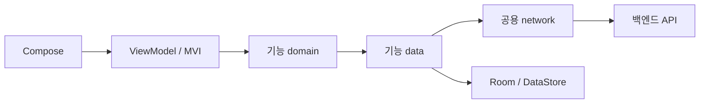

# 4-2 Android 공용 구성

기준: [표현](../../domain/APP/CLIENT/ANDROID/3-3-LAYOUT.md), [공통 연동](../CLIENT/4-1-CONTRACT.md).

 

### 4-2-1 책임과 의존

Android는 BFF 없이 백엔드에 직접 요청한다. 공용 전송과 인증 포트, 기능의 DTO 및 매핑과 Repository 구현을 분리한다. Kotlin과 Jetpack Compose, Material 3, Hilt 및 Navigation 3를 사용한다.

| 경계 | 책임 |
|---|---|
| 앱 조립 | 내비게이션, DI, 세션 종료와 기능 콜백 연결 |
| 공통 모델 | 공유 오류와 결과 및 포트. 다른 프로젝트 모듈 의존 없음 |
| 디자인 시스템 | 값과 콜백을 받는 공용 Compose UI와 토큰. Repository 의존 없음 |
| 내비게이션 | 경로와 결과 타입. 다른 프로젝트 모듈 의존 없음 |
| 네트워크 | 공용 HTTP와 인증 포트. 공통 모델 의존 |
| 관측 | 자체 값과 기본 타입을 받는 어댑터. 기능 모델 의존 없음 |
| 기능 | 실제 필요한 entity, domain, data와 presentation 패키지만 둠. 화면 기능 간 직접 의존 없음 |
| 빌드 로직 | 공통 빌드 설정. 앱 서명 설정을 소유하지 않음 |

기능 domain과 entity는 Android, Compose, Retrofit, Room 및 data 구현에 의존하지 않는다. presentation도 data와 network 구현을 직접 참조하지 않는다. entity의 domain 의존은 허용된 오류 값 예외로 제한한다. 단순 위임 UseCase, 빈 계층과 하위 UI 전용 ViewModel을 추가하지 않는다.

공용 계약의 구현은 실제 기능에 둔다. 앱이 소비자와 구현자를 연결하고 비즈니스 Repository를 공통 모듈로 옮기지 않는다. 리소스와 공개 타입은 실제 소유권과 필요한 최소 범위를 따르되 Hilt 생성 코드의 접근성을 확인한다.
