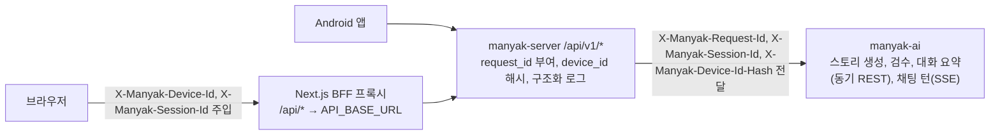

# 1 백엔드 실행 기반

기술 환경과 공통 요청 경계는 서버 dev `32ae380`의 빌드 설정과 코드를 기준으로 하며 운영 활성 상태의 증거가 아니다. 현재 기능별 구조와 계약은 도메인 세트에서 확인한다.

 

### 1-1 기술 환경

| 분류 | 기술 |
| --- | --- |
| 언어, 런타임 | Kotlin 2.2.21, Java 21 (Temurin) |
| 프레임워크 | Spring Boot 4.0.6, Spring MVC + `SseEmitter`(SSE), WebClient(AI 스트림 수신) |
| 영속성 | Spring Data JPA, PostgreSQL(운영), H2(테스트), Flyway 마이그레이션 |
| Redis | refresh 토큰, 동의 대기 코드와 연동 코드, 체험 카운터, 채팅 생성 중 상태와 이벤트 보관, 배치 회차 선점 |
| 메시지 발행 | 알림 아웃박스의 원격 모드에서 dev와 prod는 SQS, local은 Kafka |
| 검색, 객체 저장 | OpenSearch(스토리 검색), S3(이미지) |
| 인증 | Spring Security, OAuth2 Resource Server(JWT), 소셜 OIDC ID 토큰 검증(Nimbus: Google, Kakao 공용) |
| 관측 | Logstash Logback Encoder(JSON 구조화 로그), Sentry, Spring Actuator, Micrometer OTLP 메트릭, OpenTelemetry 트레이스 |
| API 문서 | SpringDoc OpenAPI (Swagger UI) |
| 빌드, 배포 | Gradle(Kotlin DSL), Docker multi-stage, GitHub Actions |

 

### 1-2 요청 흐름

 

### 1-3 핵심 구조

| 특징 | 요지 | 기준 |
| --- | --- | --- |
| 게스트 허용과 선택적 인증 | 익명을 허용하는 경로는 토큰이 없거나 무효이면 익명으로 처리 유효한 앱 토큰이면 요청자를 회원으로 귀속 인증 수준은 경로마다 다르며 간편 제작, 채팅, 피드백은 익명 허용 | [ACCOUNT 4-2-1 공통 규칙과 헤더](../../domain/ACCOUNT/BACKEND/4-2-CONTRACT.md#4-2-1-공통-규칙과-헤더) |
| 내부 PK와 공개 식별자 분리 | 순차 PK를 API에 노출하지 않고 외부에 노출하는 리소스는 `public_id` UUID를 사용 임시 리소스와 카탈로그의 예외는 도메인 스키마가 정함 | [STORY 3-2-1](../../domain/STORY/BACKEND/3-2-DB-SCHEMA.md#3-2-1-공통-규칙), [CHAT 3-2-1](../../domain/CHAT/BACKEND/3-2-DB-SCHEMA.md#3-2-1-공통-규칙) |
| AI 서버 중계 | 스토리라인 생성과 컴파일, 검수, 대화 요약은 동기 REST로 호출 채팅 턴은 SSE로 받아 중계 결과를 검증한 뒤 저장 | [도메인 목록의 AI 계약](../../domain/AGENTS.md#1-도메인과-세트) |
| 상관관계 관측 | 모든 요청에 `request_id`를 부여하고 `device_id_hash`로 익명 요청을 이어 로그, Sentry, `ai_call_logs`를 연결 | [분석 기준 6-3](../../reference/ANALYTICS.md#6-3-요청-식별자와-상관관계) |
| 소프트 삭제 | 스토리와 채팅은 `deleted_at`을 기록하고 조회에서 제외 | [STORY 3-2-1](../../domain/STORY/BACKEND/3-2-DB-SCHEMA.md#3-2-1-공통-규칙), [CHAT 3-2-1](../../domain/CHAT/BACKEND/3-2-DB-SCHEMA.md#3-2-1-공통-규칙) |
| 남용 방지 계층 | 게스트 허용으로 넓어진 악용 여지를 여러 장치로 줄임 | [1-5 남용 방지 설계](#1-5-남용-방지-설계) |

 

### 1-4 코드 모듈과 도메인

서버 코드는 `src/main/kotlin/com/knk/manyak/` 아래 패키지로 나뉜다. 패키지와 도메인 세트는 일대일이 아니다.

| 패키지 | 도메인 세트 |
| --- | --- |
| `auth`, `user`, `invite`, `migration` | ACCOUNT `user/draft`는 STORY의 임시 저장 초안 |
| `credit` | PAYMENT |
| `chat`, `feedback` | CHAT |
| `story`, `image`, `search` | STORY `story/submission`은 MODERATION |
| `push` | NOTIFICATION 발송 요청의 소비와 FCM 발송은 별도 저장소 `manyak-notification` |
| `notice` | NOTICE |
| `admin` | ADMIN |
| `global` | 이 플랫폼 기반: 보안 설정, 공통 오류 응답, 상관관계 필터, 구조화 로그, `ai_call_logs`, 분석 이벤트 발행 |

 

### 1-5 남용 방지 설계

게스트 허용과 선택적 인증은 가입 전 진입 장벽을 없애는 대신 악용 여지를 넓힌다. 아래 장치를 계층으로 쌓아 줄인다.

| 계층 | 막는 것 | 장치 |
| --- | --- | --- |
| 진입 상한 | 가입 전 무제한 무료 사용 | 기기별 체험 한도 ([PAYMENT 4-1-4](../../domain/PAYMENT/BACKEND/4-1-PIPELINES.md#4-1-4-체험-예약-복원-스냅샷)) |
| 전환 차단 | 게스트 콘텐츠의 반복 이관 | 이관 계정당 1회 잠금과 시도 상한 ([ACCOUNT 4-1-10](../../domain/ACCOUNT/BACKEND/4-1-PIPELINES.md#4-1-10-게스트-이관)) 게스트와 회원 사이의 교차 접근 차단 ([STORY 5-1-2](../../domain/STORY/BACKEND/5-1-SECURITY.md#5-1-2-소유권과-읽기-판정), [CHAT 5-1-2](../../domain/CHAT/BACKEND/5-1-SECURITY.md#5-1-2-소유권-판정)) |
| 재가입 차단 | 탈퇴와 재가입 반복으로 계정 단위 1회성 혜택을 다시 받음 | 끊긴 소셜 연동 재사용, 보상 신원과 정지 상태 승계 ([ACCOUNT 4-1-6](../../domain/ACCOUNT/BACKEND/4-1-PIPELINES.md#4-1-6-계정-생성과-재가입)) 재가입 계정의 회원 체험은 소진 상태로 시작 ([PAYMENT 4-1-4](../../domain/PAYMENT/BACKEND/4-1-PIPELINES.md#4-1-4-체험-예약-복원-스냅샷)) |
| 회원 재화 보호 | 선차감 뒤 실패의 과금과 이중 환불 | 차감과 환불의 1회 처리, 선차감 대사, 보상 멱등 키 ([PAYMENT 5-1-6](../../domain/PAYMENT/BACKEND/5-1-SECURITY.md#5-1-6-재화-보호), [PAYMENT 4-1-15](../../domain/PAYMENT/BACKEND/4-1-PIPELINES.md#4-1-15-선차감-대사)) |
| 관측 보완 | 우회 시도의 사후 탐지 | 상관관계 식별자, 호출량과 카운터 키 증가 추이 |

디바이스 헤더 변조, 기기 교체, 게스트 간 리소스 접근과 무인증 쓰기 경로의 요청량 제한 부재는 막지 않고 수용한다. ([BE-045](../../reference/decisions/BACKEND.md#be-045))

 

### 1-6 보안 설정

| 항목 | 설정 |
| --- | --- |
| 필터 체인 | `/api/v1/admin/**`은 관리자 토큰 필터를 쓰는 별도 체인 ([ADMIN 5-1-1](../../domain/ADMIN/BACKEND/5-1-SECURITY.md#5-1-1-인증-수준과-토큰)) 나머지 경로는 앱 토큰 체인 |
| 세션 | 두 체인 모두 서버 세션을 만들지 않는 stateless 구성 인증은 요청마다 `Authorization` 헤더의 토큰으로 판정 |
| CSRF | 두 체인 모두 비활성 |
| CORS | 허용 origin은 `MANYAK_CORS_ALLOWED_ORIGINS`(콤마 구분) 메서드 `GET`, `POST`, `PUT`, `PATCH`, `DELETE`, `OPTIONS`, 요청 헤더 전체 허용 `X-Manyak-Request-Id`를 노출 헤더로 지정 |
| Bearer 토큰 해석 생략 | 공개 인증 경로, 선택적 인증 경로, `/internal/**`, 공개 정적 자산은 리소스 서버가 토큰을 해석하지 않음 자동 첨부된 만료나 위조 토큰으로 401이 나지 않음 선택적 인증 경로의 회원 귀속은 별도 필터가 수행 |
| 내부 경로 | `/internal/**`은 사용자 인증 대신 공유 시크릿으로 보호 ([NOTIFICATION 5-1-6](../../domain/NOTIFICATION/BACKEND/5-1-SECURITY.md#5-1-6-내부-경로-보호)) |
| 무인증 허용 | `/actuator/health`와 하위 경로, `/error`, `/profile-presets/**`, API 문서 경로 `/actuator/prometheus`는 local 프로파일에서만 |

 

### 1-7 공통 오류 응답

모든 오류 본문은 `ApiErrorResponse` 형식이다. 필드와 도메인별 앱 코드는 각 도메인 계약과 오류 처리에서 정한다. ([ACCOUNT 4-2-1 공통 규칙과 헤더](../../domain/ACCOUNT/BACKEND/4-2-CONTRACT.md#4-2-1-공통-규칙과-헤더))

아래는 컨트롤러 메서드에 도달하기 전에 프레임워크가 판정하는 요청 오류와 예상하지 못한 오류이며 전역 핸들러가 처리한다. 보안 필터가 인증을 요구하는 요청은 인증 판정이 먼저라 토큰이 없으면 아래 상태 대신 401로 끝난다.

| 상태 | `code` | 조건 | 응답 |
| --- | --- | --- | --- |
| 404 | `NOT_FOUND` | 매핑된 핸들러가 없는 경로 운영에서 끈 API 문서 경로 포함 | "요청한 리소스를 찾을 수 없습니다." 500으로 처리하지 않음 |
| 405 | `METHOD_NOT_ALLOWED` | 경로가 지원하지 않는 HTTP 메서드 | "지원하지 않는 HTTP 메서드입니다." `Allow` 헤더에 허용 메서드 |
| 406 | `NOT_ACCEPTABLE` | `Accept` 협상 실패 예: SSE 경로에 `Accept: application/json` | "요청한 응답 형식(Accept)을 제공할 수 없습니다." |
| 415 | `UNSUPPORTED_MEDIA_TYPE` | 지원하지 않는 `Content-Type` | "지원하지 않는 Content-Type입니다." |
| 500 | `INTERNAL_SERVER_ERROR` | 예상하지 못한 예외 | "서버 오류가 발생했습니다." 스택트레이스와 내부 정보를 싣지 않음 |

다섯 상태 모두 `details`는 빈 배열이다. Sentry에는 500만 보낸다.
