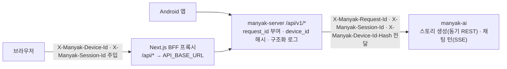

# 1 백엔드 실행 기반

기술 환경은 기존 문서의 기준 코드 `d4fe174`를 따르며 운영 활성 상태의 증거가 아니다. 현재 기능별 구조와 계약은 도메인 세트에서 확인한다.

 

### 1-1 기술 환경

| 분류 | 기술 |
| --- | --- |
| 언어·런타임 | Kotlin 2.2.21, Java 21 (Temurin) |
| 프레임워크 | Spring Boot 4.0.6, Spring MVC + `SseEmitter`(SSE), WebClient(AI 스트림 수신) |
| 영속성 | Spring Data JPA, PostgreSQL(운영)·H2(테스트), Flyway 마이그레이션 |
| 캐시·토큰 저장소 | Redis (refresh 토큰) |
| 인증 | Spring Security, OAuth2 Resource Server(JWT), 소셜 OIDC ID 토큰 검증(Nimbus: Google·Kakao 공용) |
| 관측 | Logstash Logback Encoder(JSON 구조화 로그), Sentry, Spring Actuator |
| API 문서 | SpringDoc OpenAPI (Swagger UI) |
| 빌드·배포 | Gradle(Kotlin DSL), Docker multi-stage, GitHub Actions |

 

### 1-2 요청 흐름

