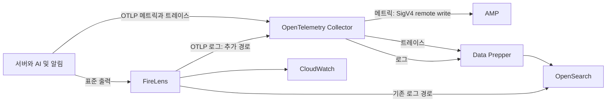

# 2 백엔드 운영 관측

메트릭 측정값은 기존 문서의 Spring Boot 4.0.6과 Micrometer 1.16.5 실측 기록을 보존한다. 운영 전송 경로는 [배포 문서의 Terraform 기준](../../operations/DEPLOYMENT.md#1-목적과-범위)을 따른다. 선언 검토와 실제 수신 검증은 구분한다.

### 2-1 메트릭과 운영 연동

구조화 로그, Sentry, `ai_call_logs`는 개별 사건을 기록하고, 메트릭은 RED(Rate, Error, Duration)와 AI 호출 지연을 시계열로 집계한다. 운영 선언은 Micrometer의 OTLP 메트릭을 OpenTelemetry Collector로 보내고 Amazon Managed Service for Prometheus(AMP)에 저장한다. Grafana Cloud 직접 전송은 이전 구성이다.

**수집 경로**: `OtlpMeterRegistry`가 step 주기마다 내부 Collector의 `/v1/metrics`로 전송한다. Collector가 IAM과 SigV4 인증으로 AMP에 Prometheus remote write를 수행한다. 트레이스는 Collector에서 Data Prepper로 전달한 뒤 OpenSearch에 저장한다. 앱의 `/actuator/prometheus`를 운영 외부에 노출하지 않으며 actuator는 `health,info`만 공개한다. 로컬은 `prometheus`를 추가해 수신 형식 확인과 Compose의 Prometheus 수집에 사용한다. ([배포 구성](../../operations/DEPLOYMENT.md#4-5-관측-수집-경로))

위 그림은 prod의 활성 토글 선언 기준이다. 각 앱의 실제 계측 항목은 해당 명세를 따른다. FireLens의 기존 로그와 OTLP 로그를 합쳐 요청 수를 중복 집계하지 않는다.

**지표 카탈로그**

| 메트릭 | 태그 | 출처 | 용도 |
| --- | --- | --- | --- |
| `http.server.requests` | `uri`(경로 템플릿), `method`, `status`, `outcome` | Spring Boot 자동 | RED: 요청률, 5xx 오류율, p95 응답시간 |
| `manyak.ai.call.duration` | `feature`(enum 6종), `outcome`(`success`/`failure`) | `AiCallRecorder` | AI API 호출 지연, 실패율. `ai_call_logs.latency_ms`와 같은 구간을 재는 집계 뷰 |
| `manyak.story.creation.duration` | `outcome`(`success`/`failure`/`rejected`) | `SimpleStoryCreationService` | 간편 스토리 완성 처리시간(AI 호출 + 저장 포함) |
| JVM, 프로세스, DB 커넥션 풀 | 바인더별 기본 태그 | Micrometer 기본 바인더(자동 등록) | CPU, 힙, GC, 스레드, 커넥션 풀: 이름은 아래 표 |

기본 바인더 지표는 대시보드 패널 단위로 묶어 쓴다.

| 패널 | 메트릭 |
| --- | --- |
| CPU | `process.cpu.usage`, `system.cpu.usage`, `system.load.average.1m` |
| 힙 | `jvm.memory.used`, `jvm.memory.max`, `jvm.memory.committed`, `jvm.memory.usage.after.gc` |
| GC | `jvm.gc.pause`, `jvm.gc.overhead`, `jvm.gc.memory.allocated` |
| 스레드 | `jvm.threads.live`, `jvm.threads.states` |
| DB 커넥션 풀 | `hikaricp.connections.{active,idle,pending,max}` **또는** `jdbc.connections.{active,idle,max}` |

DB 커넥션 풀은 **둘 중 하나만 고른다.** `hikaricp.*`(Hikari 자체 tracker)와 `jdbc.*`(Boot pool metadata)가 함께 등록되어 같은 값을 두 이름으로 내보내므로, 두 계열로 패널을 만들면 중복이다. `jvm.gc.pause`는 GC가 실제로 발생한 뒤에야 나타나므로 기동 직후 패널이 비어 보이는 것이 정상이다.

위 이름은 바인더 실측 기준이며, 전체 앱 컨텍스트에서 최종 등록까지 확인한 것은 아니다. 로컬 기동 후 `/actuator/prometheus`로 확인한다(서버 레포 `http/common/metrics-prometheus.http`).

**카디널리티 규칙**: 메트릭 태그에는 **고유값을 넣지 않는다**. `user_id`, `story_id`, `chat_id`, `request_id`, `device_id_hash`는 금지이며, 개별 추적은 구조화 로그와 `ai_call_logs`의 몫이다. 태그는 유한 enum으로만 둔다(`feature` 6종 × `outcome` 2종 = 최대 12개 태그 조합, 실제 기록하는 조합만 생성). `uri`는 Spring이 경로 변수를 템플릿(`/api/v1/stories/{storyId}`)으로 치환해 적재하므로 안전하다.

**히스토그램 비용**: 서버 측에서 p95를 계산하려면 percentile histogram이 필요하며, 태그 조합마다 `le` 버킷 수만큼 시계열이 늘어난다. Micrometer 1.16.5의 기본 1ms~30s 구간에서 69개 버킷을 측정했다. 아래 구간은 당시 엔드포인트 39개와 상태 코드 3~5종으로 약 8천~1만 3천 시계열을 예상해 범위를 줄인 기록이다. 당시 Grafana Cloud 무료 티어의 1만 active series를 비용 기준으로 삼았으며, 이 값은 현재 AMP의 한도나 요금 기준이 아니다.

| 메트릭 | 구간 | 버킷 수(실측) | 근거 |
| --- | --- | ---: | --- |
| (기본값 참고) | 1ms\~30s | 69 | Micrometer `AbstractTimerBuilder` 기본 |
| `http.server.requests` | 10ms\~10s | 47 | 일반 HTTP 응답 구간 |
| `manyak.ai.call.duration` | 100ms\~240s | 54 | AI 타임아웃 최대 180초(compile)보다 **위**여야 타임아웃 직전 분포가 보인다 |
| `manyak.story.creation.duration` | 100ms\~240s | 54 | 위와 같음(스토리 완성 = compile 호출 포함) |

버킷 수는 **scrape 프레임 기준**이다: `registry.scrape`가 실제로 뱉는 `_bucket` 라인 수(min/max clamp 경계와 `+Inf` 포함)이다. AMP에 최종 적재된 시계열 수와 요금은 별도 확인한다. `PercentileHistogramBuckets.buckets`의 순수 버킷 집합을 직접 세면 프레임 차이로 일관되게 3 적게 나온다(66, 44, 51). 100ms\~240s의 54는 100ms\~120s(49)에 상한 확대분 +5를 더한 값이고, 증가분 +5는 두 프레임에서 동일하다.

상한은 **타임아웃보다 높게** 둔다. 같거나 낮으면 느린 정상 호출이 `+Inf` 구간에 합쳐져 타임아웃 직전의 p95, p99를 구분할 수 없다.

`http.server.requests`의 10초 상한은 **의도적으로 AI 대기 엔드포인트를 덮지 않는다.** 그 경로의 지연은 전용 `manyak.*` 타이머가 담당하고, HTTP 히스토그램 상한을 올리면 버킷이 엔드포인트 수만큼 곱해져 비용이 크다. 대신 AI 엔드포인트의 HTTP p95는 10초에서 상한값으로 집계된다는 점을 알고 받아들인다.

**환경 구분**: `service.name`과 환경별 수집 경로로 구분한다. 서버 기본 서비스명은 `manyak-server`, 로컬 예시는 `OTEL_SERVICE_NAME=manyak-server-local`이다. 현재 Collector는 `service.name`을 `job`, `service.instance.id`를 `instance`로 변환하는 exporter 기본 동작을 사용하며 모든 리소스 속성을 라벨로 승격하지 않는다. 이전 Grafana Cloud의 `service_name` 필터를 AMP 쿼리에 그대로 복사하지 않는다. 실제 수신 라벨과 데이터 소스를 확인해 조회한다.

**조회 시 이름과 단위**: 같은 Timer도 전송 경로에 따라 이름과 단위가 달라질 수 있다. 기존 실측에서는 로컬 Prometheus에 `manyak_story_creation_duration_seconds_*`, Grafana Cloud에는 `manyak_story_creation_duration_milliseconds_*`로 나타났다. 이 결과를 현재 AMP 수신 형식으로 간주하지 않는다. 대시보드와 알림 쿼리는 실제 AMP에 수신된 이름과 단위를 확인한 뒤 작성한다.

**전송 주기**: 서버 기본값은 60초, 로컬 프로파일은 10초다. 주기가 짧을수록 데이터 포인트 수와 수집 비용이 늘어나므로 필요한 관측 해상도와 함께 판단한다.

**OTLP는 기본으로 끈다.** `MANYAK_OTLP_METRICS_ENABLED`의 앱 기본값은 `false`다. 운영 Terraform은 Collector endpoint와 `cumulative` 집계 방식, 활성 토글을 함께 주입한다. 앱에 Grafana Cloud 인증 헤더를 주입하는 이전 구성은 현재 prod 선언에서 제거됐다. 메트릭 전송 실패는 사용자 요청과 분리한다. ([6 관측 구현](../../reference/ANALYTICS.md#6-관측-구현))

**미주입과 빈 값은 다르다.** Spring Boot 4.0.6의 `PropertiesConfigAdapter.obtain`은 null만 검사한다. URL이 빈 문자열이면 기본값을 찾지 않고 빈 값 그대로 micrometer에 전달한다.

| URL 속성 상태 | 결과 |
| --- | --- |
| 미주입(null) | `OTEL_EXPORTER_OTLP_METRICS_ENDPOINT` → `OTEL_EXPORTER_OTLP_ENDPOINT` → `http://localhost:4318/v1/metrics` 순으로 찾아 전송 |
| 빈 문자열(`""`) | 빈 URL로 push 시도. localhost로 보내는 요청이 아니라 매 step 전송 오류 |

URL 설정을 빈 문자열로 두면 이 경로를 타므로 endpoint는 유효한 값으로 주입한다. 수집을 끄려면 활성 토글을 `false`로 둔다. URL 미주입만으로 전송이 비활성화되지는 않는다.

`OtlpConfig`는 `System.getenv`에서 표준 `OTEL_*` 변수를 직접 읽는다. Spring `Environment`와 프로파일을 거치지 않으므로 운영에서는 충돌을 피하려고 Spring 전용 변수명을 쓴다([3-5 관측과 분석](3-CONFIGURATION.md#3-5-관측과-분석)).

**측정 범위 주의**: `manyak.story.creation.duration`은 실제 생성 콜백만 감싼다. AI 호출 없이 저장된 결과를 돌려주는 **조회 경로 두 가지는 의도적으로 제외**한다: ① 멱등 재요청(`recordOrRun`의 COMPLETED replay: [간편 제작 계약](../../domain/STORY/BACKEND/4-2-CONTRACT.md#4-2-11-간편-제작-스토리라인-생성))은 콜백 자체가 실행되지 않아 자연히 빠지고, ② 회수 재실행 재구성은 콜백은 타지만 AI, 저장이 없어 `aiCallLogId`가 `null`인 것으로 판별해 제외한다. 포함하면 아주 짧은 시간이 섞여 p95가 실제 생성 비용보다 낙관적으로 왜곡된다.

**실패는 다시 둘로 나눈다**. `outcome`이 3값인 이유이다.

| 값 | 의미 | 걸리는 시간 |
| --- | --- | --- |
| `success` | 생성, 저장까지 끝난 호출 | 수 초\~180초 |
| `failure` | 생성을 시도하다 깨진 호출: AI compile 실패(502, 타임아웃), 응답 검증 실패, 저장 경합 | 수 초\~180초 |
| `rejected` | 생성 시도 **이전에** 거부된 4xx: 세션 없음(404), 소유권(403), 이미 생성됨(409), 태그 오류(400), 이프 부족과 게스트 한도(402) | 밀리초(DB 조회 몇 번) |

**판별 기준은 HTTP 상태가 아니라 compile 시작 여부이다.** compile을 마친 뒤에도 4xx가 날 수 있기 때문이다: 같은 세션에 `requestId`가 다른 완성 요청 둘이 겹치면 둘 다 잠금 없는 초기 검사를 통과해 compile을 호출하고, 진 쪽이 잠금을 잡은 뒤 409(세션 소실 시 404)를 던진다. 이건 AI 호출을 이미 마친 **실제 생성 실패**이므로 `failure`이다. 따라서 compile 진입 여부를 먼저 보고, 진입했으면 상태 코드와 무관하게 `failure`, 진입 전 4xx만 `rejected`, 그 외(5xx, 비 HTTP 예외)는 `failure`이다.

4xx를 `failure`에서 떼는 이유는 두 갈래를 한 히스토그램에 섞으면 **거부 비중에 따라 실패 p95가 요동치기** 때문이다. 거부가 늘수록 밀리초 표본이 늘어 p95가 오히려 **낮아지므로**, AI가 실제로 느려지는데 지표는 개선된 것처럼 보이는 역전이 생긴다. 실패 건수 알림도 404 급증만으로 오발화한다. **알림과 p95는 `outcome="failure"`만 봐야 한다.** 태그 값이 2에서 3으로 늘어도 유한 enum이라 카디널리티는 안전하다(위 카디널리티 규칙).

**알림**: [CHAT 알림](../../domain/CHAT/BACKEND/5-4-OBSERVABILITY.md#5-4-9-알림)의 환불 실패와 AI 실패 급증 임계값을 보존한다. 이전 Grafana 규칙은 2026-10-24부터 일시 정지 상태이고 Grafana는 쓰지 않는다. AMP 규칙과 Slack 전달은 KNK-1931에서 옮기며 적용 뒤 발화를 확인한다. 새 지연과 실패율 임계값은 운영 기준선으로 정하고, 서버 중단 시 No Data 처리도 함께 정의한다.

**현재 구현하지 않은 범위.** AI는 전달받은 식별자를 Langfuse 관측에 연결한다. 선택지 상호작용 API의 저장은 구현돼 있지만, 사용자 반응을 생성 버전에 연결해 score로 발행하는 전체 경로(outbox와 score 전송 포함)는 구현되지 않았다. 계약은 [6 관측 구현](../../reference/ANALYTICS.md#6-관측-구현)에 있다.

운영 readiness는 Redis를 검사하지 않는다(`management.health.redis.enabled=false`). 재활성 시점은 정하지 않았다.
