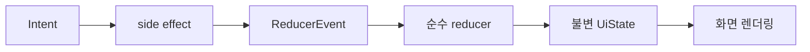

# 2 상태 관리: 안드로이드

기준: [구성](1-COMPONENT-ARCHITECTURE.md).

 

### 2-1 MVI와 작업 수명

ViewModel 밖이나 비동기 작업에서 MutableStateFlow를 직접 갱신하지 않는다.

| 상태와 작업 | 수명과 처리 |
|---|---|
| Intent, ReducerEvent, UiEffect | 각각 용량 64, SUSPEND bounded Channel과 단일 소비자. 버리기 정책과 결과 무시 trySend 금지 |
| UiEffect | receiveAsFlow를 STARTED 단일 host에서 소비. 정지 중 큐에 유지, 소비한 이벤트 재생 안 함, ViewModel 종료 시 사라짐 |
| 필수 결과 | 소비 여부를 확인할 수 있는 지속 상태로 모델링 |
| 화면 실행 | ViewModel 수명. 목록 필터, 선택과 로딩 및 스트림 소유 |
| 제작과 푸시 등록 | 앱 수명, 프로세스 종료를 넘는 상태는 Room 등에서 복구. WorkManager와 Foreground Service로 실행을 유지하지 않음 |
| 옵션 열림 | 목록의 대상은 ViewModel, 상세와 채팅방의 열림은 rememberSaveable. 구성 변경 유지 |
| 이미지 뷰어 | 화면 ViewModel의 URL, 저장 상태와 라우트에 넣지 않음. 대상 이미지가 없어지면 닫음 |
| 구성 변경 | Activity 재생성, configChanges와 방향 고정으로 우회하지 않음 |

필수 저장 상태와 일시 효과를 혼용하지 않는다. stateIn과 shareIn은 scope, 시작 조건 및 구독자 부재 시 유지 시간을 명시한다. 포커스, 키보드와 장식 애니메이션은 저장 상태 복구 보장에 포함하지 않는다.

 

### 2-2 저장 호환

모듈이나 패키지 이동으로 DB 파일명, 버전과 스키마 identity hash, DataStore 파일과 키, Keystore alias, 직렬화 경로 이름과 패키지, Application ID, Manifest 및 백업 제외 규칙을 바꾸지 않는다. 구조 변경을 이유로 destructive migration이나 저장소 일괄 삭제를 사용하지 않는다.
