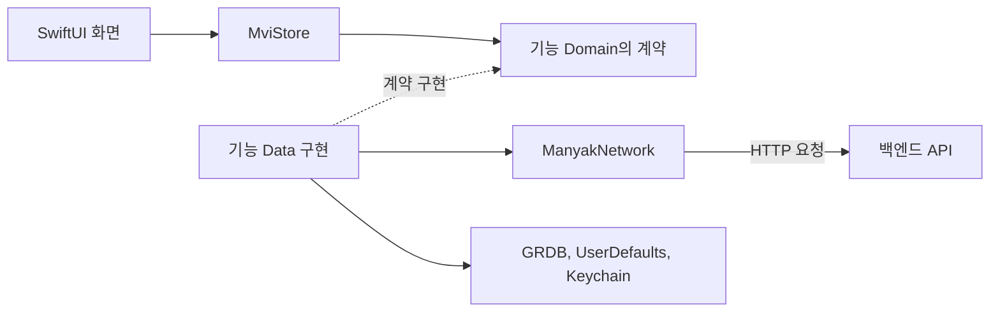

# 1 컴포넌트 구조: iOS

기준: [표현](../../../ui/IOS/3-3-LAYOUT.md), [공통 연동](../CONTRACT.md).

 

### 1-1 책임과 의존

iOS는 BFF 없이 백엔드에 직접 요청한다. Swift 6 언어 모드, SwiftUI, Observation과 Swift Concurrency를 사용하며 엄격한 동시성 검사를 끄지 않는다. 최소 배포 대상은 iOS 26이고 iOS 27 전용 API는 가용성 분기(`#available`)로 감싸서도 쓰지 않는다. 의존성은 Swift Package Manager로만 받는다.

| 경계 | 책임 |
|---|---|
| 앱 타깃 `Manyak` | 유일한 실행 타깃. 조립 객체, 라우터, 세션 종료 조정자와 등록 배열. 앱 확장 타깃 없음 |
| `ManyakCommon` | 공용 포트, `DomainError`와 `DomainResult`, `MviStore` 기반과 공용 저장. 다른 프로젝트 타깃 의존 없음 |
| `ManyakDesignSystem` | `ManyakTheme` 토큰, 값과 콜백을 받는 공용 SwiftUI 컴포넌트, 글꼴, 아이콘과 원격 이미지 로딩. 저장소 의존 없음 |
| `ManyakNavigation` | 라우트 값, 딥링크와 푸시 진입 해석. 다른 프로젝트 타깃 의존 없음 |
| `ManyakNetwork` | `URLSession` 요청 계층, 공통 헤더, 오류 변환과 인증 포트 |
| `ManyakAnalytics` | Amplitude와 Crashlytics 어댑터. 자체 값과 기본 타입만 받고 기능 모델 의존 없음 |
| `ManyakAuth` | 세션, 토큰과 제공자 로그인 |
| `ManyakReport` | `ManyakChat`, `ManyakStudio`, `ManyakStory`가 함께 쓰는 신고 |
| 기능 타깃 12개 | 실제 필요한 계층 폴더만 둠. 기능 사이 직접 의존 없음 |
| `ManyakTesting` | 테스트 타깃 전용. `URLProtocol` 대역, 조작 가능한 시계, 두 타깃 이상이 같은 동작으로 쓰는 공용 계약의 Fake. 프로덕션 의존 없음 |

 

### 1-2 모듈과 허용 의존

라이브러리 타깃은 모두 저장소 안 로컬 패키지 하나의 `Package.swift`에 선언하고 앱 타깃이 그 제품에 의존한다. 타깃 사이 의존은 아래 표에 있는 것만 선언하며 선언하지 않은 타깃은 import가 컴파일되지 않는다. ([I-005](DECISIONS.md#i-005))

| 타깃 | 의존할 수 있는 프로젝트 타깃 |
|---|---|
| `ManyakCommon`, `ManyakDesignSystem`, `ManyakNavigation` | 없음 |
| `ManyakNetwork`, `ManyakAnalytics` | `ManyakCommon` |
| `ManyakAuth` | `ManyakCommon`, `ManyakNetwork` |
| `ManyakReport` | `ManyakCommon`, `ManyakNetwork`, `ManyakDesignSystem`, `ManyakAnalytics` |
| `ManyakChat`, `ManyakStudio`, `ManyakStory` | 기반 6개, `ManyakReport` |
| 나머지 기능 9개 | 기반 6개 |
| 앱 타깃 `Manyak` | 기반 6개, `ManyakReport`, 기능 12개 |
| `ManyakTesting` | `ManyakCommon`. 테스트 타깃만 의존 |

기반 6개는 `ManyakCommon`, `ManyakDesignSystem`, `ManyakNavigation`, `ManyakNetwork`, `ManyakAnalytics`, `ManyakAuth`다. 나머지 기능 9개는 `ManyakHome`, `ManyakCredit`, `ManyakLogin`, `ManyakLegal`, `ManyakMy`, `ManyakCreate`, `ManyakNotification`, `ManyakNotice`, `ManyakOnboarding`이다. 테스트 타깃은 대상 타깃의 허용 의존과 `ManyakTesting` 안에서만 의존하고 다른 기능의 테스트 코드를 쓰지 않는다.

| 서드파티 | 소유 타깃 | 용도 |
|---|---|---|
| GRDB.swift | `ManyakCreate` | 제작 데이터베이스 |
| Nuke | `ManyakDesignSystem` | 원격 이미지 로딩과 캐시 |
| Amplitude Swift SDK | `ManyakAnalytics` | 제품 분석 |
| Firebase Crashlytics | `ManyakAnalytics` | 크래시와 non-fatal 수집 |
| Firebase Messaging | `ManyakNotification` | 푸시 토큰 |
| Google Sign-In, Kakao SDK | `ManyakAuth` | 제공자 로그인 |

서드파티 SDK의 타입은 소유 타깃 밖으로 공개하지 않으며 다른 타깃은 소유 타깃이 정의한 타입만 쓴다. Firebase 초기화는 앱 타깃이 시작할 때 한 번 한다. 정확한 버전은 구현 저장소의 `Package.resolved`를 따른다.

 

### 1-3 계층 규칙

앱 타깃, `ManyakNavigation`, `ManyakDesignSystem`, `ManyakTesting`을 제외한 타깃은 실제 필요한 `Entity`, `Domain`, `Data`, `Presentation` 폴더만 둔다. 같은 타깃 안의 폴더 사이 참조는 컴파일러가 막지 않으므로 아래 규칙은 PR 리뷰로 확인하고 자동 검사 도구는 두지 않는다. ([I-005](DECISIONS.md#i-005))

| 계층 | 참조하지 않는 대상 |
|---|---|
| `Entity`, `Domain` | SwiftUI, UIKit, `URLSession`과 HTTP 타입, GRDB, UserDefaults, Keychain, 서드파티 SDK, `Data` |
| `Presentation` | `Data` |
| `Data`를 제외한 모든 계층 | `ManyakNetwork` |

`Entity`와 `Domain`은 Foundation의 값 타입을 쓸 수 있다. `Entity`의 `Domain` 의존은 오류 값으로 제한한다. 단순 위임 UseCase, 빈 계층과 하위 뷰 전용 Store를 추가하지 않는다. 다른 타깃이 쓰는 타입만 `public`으로 열고 나머지는 기본 접근 수준을 유지한다.

 

### 1-4 공용 포트와 조립

의존성 주입 라이브러리를 쓰지 않는다. 앱 타깃의 조립 객체(Composition Root)가 앱 수명 객체를 한 번 만들고 각 타깃의 생성자로 넘긴다. 전역 싱글턴과 서비스 로케이터(service locator, 전역 저장소에서 의존을 찾아 쓰는 방식)를 두지 않는다. ([I-006](DECISIONS.md#i-006))

| 대상 | 조립과 수명 |
|---|---|
| 앱 수명 객체 | 요청 계층, 세션, 관측, 데이터베이스와 공용 포트 구현. 앱 시작 때 조립 객체가 한 번 만듦 |
| 화면 Store | 화면이 만들고 라우트 인자와 의존을 이니셜라이저로 받음. 별도 팩토리 등록 없음 |
| 공용 포트 | 프로토콜은 기반 타깃, 구현은 실제 기능 타깃. 조립 객체가 소비자에 구현을 넘김 |
| 여러 구현의 묶음 | `UserScopedStore` 같은 정리 계약과 가입 시 호출 목록은 앱 타깃의 등록 배열 한 곳 |
| 화면 이동 | 기능 화면은 이동 콜백을 받음. 내비게이션 경로는 앱 타깃 라우터만 바꾸고 Store는 Effect만 냄 |

비즈니스 저장소를 공통 타깃으로 옮기지 않는다. 등록 배열을 한 곳에 두어 새 회원 저장소의 등록 누락을 리뷰에서 확인한다.

 

### 1-5 디자인 시스템과 리소스

| 대상 | 규칙 |
|---|---|
| `ManyakTheme` | 색, 타이포그래피, 간격, 모서리, 크기, 모션 여섯 접근자를 SwiftUI 환경 값으로 내림. 화면은 이 접근자로만 값을 읽고 팔레트 원시 색은 공개하지 않음 |
| 시스템 기본값 | 앱 루트에서 강조색(`tint`)과 기본 글꼴을 토큰으로 지정해 SwiftUI 기본값이 콘텐츠에 나타나지 않게 함. 시스템 모양을 따르는 막대와 시트의 범위는 [화면 배치](../../../ui/IOS/3-3-LAYOUT.md) |
| 토큰 값 | `ManyakDesignSystem`의 토큰 파일이 기준. 첫 값은 Android 커밋 `ccc93f77`의 Kotlin 토큰 파일에서 옮기고 하네스에 값 표를 두지 않음 ([I-020](DECISIONS.md#i-020)) |
| 색 | 토큰마다 라이트와 다크 두 값. 저장 형식(Asset Catalog 색 세트 또는 Swift 상수)은 구현 선택 |
| 타이포그래피 | 역할별 글꼴, 크기와 행간 비율을 함께 내림. 크기는 Dynamic Type 단계에 따라 조정 |
| 글꼴 | Pretendard(400, 500, 700)와 MaruBuri(400, 700)를 `ManyakDesignSystem` 리소스로 번들. 첫 화면을 그리기 전에 한 번 등록 |
| 아이콘 | 원본 SVG를 `ManyakDesignSystem`의 Asset Catalog에 템플릿 렌더링으로 둠 |
| 문자열 | 사용자에게 보이는 문구는 소유 타깃의 String Catalog(`.xcstrings`)에 둠. 패키지 타깃은 `Bundle.module`, 앱 타깃은 앱 번들에서 읽음. 한국어만 두고 패키지의 기본 지역화(`defaultLocalization`)는 `ko` |
| 문자열 소유 | 앱 셸은 앱 타깃, 공통 오류와 공용 문구는 `ManyakCommon`, 디자인 공용 문구는 `ManyakDesignSystem`, 신고는 `ManyakReport`, 기능 문구는 각 기능 타깃 |
| 자리 표시자 | Android의 `%1$s`, `%1$d`는 Swift 형식 지정자로 바꾸고 인자 순서 유지 |
| 오류 문구 | `DomainError` 종류별 문구는 `ManyakCommon` 한 곳에서 붙임. 사용자가 닫은 제공자 로그인 취소는 문구 없음 |
