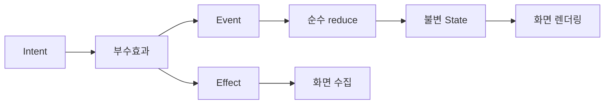
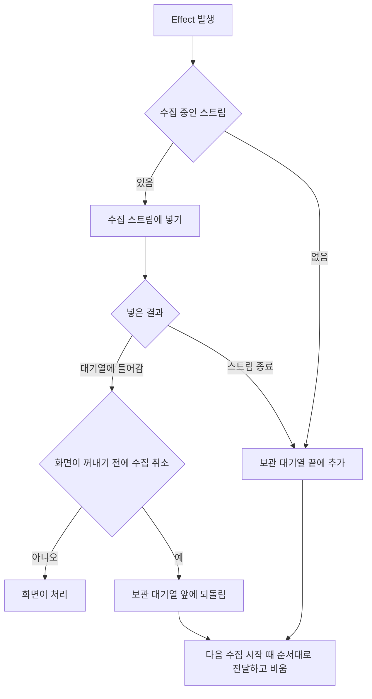

# 2 상태 관리: iOS

기준: [구성](1-COMPONENT-ARCHITECTURE.md).

 

### 2-1 MVI와 작업 수명

`MviStore`는 `ManyakCommon`의 공통 기반이며 `@Observable`과 `@MainActor`를 따른다. State는 값 타입이고 reduce 결과로만 바뀐다. Store 밖이나 비동기 작업에서 State를 직접 바꾸지 않는다. ([I-007](DECISIONS.md#i-007))

| 상태와 작업 | 수명과 처리 |
|---|---|
| Intent와 Event 통로 | 각각 `AsyncStream`과 단일 소비자. Effect 통로는 [2-2](#2-2-효과-수집과-보관). 버퍼 정책은 `unbounded`만 사용하고 넘치면 버리는 정책 금지. 넣은 결과를 확인하지 않고 버리지 않음 |
| Intent 처리 | 도착 순서대로 하나씩 끝냄. 오래 걸리는 작업은 Store가 핸들을 보관하는 `Task`로 시작하고 결과를 Event로 보냄. 이 작업은 Store가 해제돼도 저절로 취소되지 않으므로 화면 이탈에서 Store가 직접 취소 |
| State 쓰기 | Event 소비자 하나가 reduce 결과로만 씀 |
| Effect | 화면이 보이는 동안 단일 수집. 수집이 없는 동안 Store가 순서대로 보관, 전달한 효과는 재생하지 않음, Store 해제 시 사라짐 |
| 필수 결과 | 소비 여부를 확인할 수 있는 State로 모델링 |
| 화면 실행 | Store 수명. 목록 필터, 선택, 로딩과 스트림. 화면이 `@State`로 한 번 만들고 뷰 갱신마다 다시 만들지 않음 |
| 제작과 푸시 등록 | 앱 수명 객체. 프로세스 종료를 넘는 상태는 저장된 행에서 다음 실행에 복구. BackgroundTasks 프레임워크로 실행을 유지하지 않음 |
| 옵션과 시트 열림 | Store 또는 화면 상태. 프로세스 종료 뒤 복원하지 않음 |
| 이미지 뷰어 | 화면 Store의 URL. 저장 상태와 라우트에 넣지 않음. 대상 이미지가 없어지면 닫음 |
| 구성 변경 | Activity 재생성에 해당하는 처리 없음. 테마와 글자 크기 변경은 같은 Store로 화면만 다시 그림 |

필수 저장 상태와 일시 효과를 섞지 않는다. 포커스, 키보드와 장식 애니메이션은 상태 복구 보장에 포함하지 않는다.

 

### 2-2 효과 수집과 보관

`AsyncStream`은 순회하던 `Task`가 취소되면 끝나고 이후에 넣은 값은 전달되지 않는다. 화면의 `.task`는 화면이 사라질 때 취소되므로 Store는 내부 통로를 화면에 그대로 넘기지 않는다. 수집을 시작할 때마다 새 스트림을 만들고 이전 수집 스트림을 닫은 뒤 보관 중인 효과부터 전달한다. ([I-018](DECISIONS.md#i-018))

수집 스트림에 넣은 것은 전달 완료가 아니다. 화면이 꺼내기 전에 수집이 취소되면 스트림에 남은 Effect를 순서를 지켜 보관 대기열 앞에 되돌리고 다음 수집에서 전달한다. 화면이 이미 꺼낸 Effect는 다시 전달하지 않는다. 화면은 Effect를 `.task` 하나에서만 수집한다. 같은 Store를 두 화면이 동시에 수집하지 않는다.

 

### 2-3 백그라운드와 프로세스 종료

앱 타깃이 장면 단계(scene phase) 변화를 받아 앱 수명 객체와 보이는 화면의 Store에 알린다.

| 상황 | 처리 |
|---|---|
| 백그라운드 전환 | 곧 실행이 멈춘다고 보고 진행 중인 스트림을 끊음. 백그라운드에서 실행이 이어진다고 가정하지 않음 |
| 진행 중 일반 요청 | 따로 취소하지 않음. 중단으로 실패하면 `Network`로 처리 |
| 포그라운드 복귀 | 끊은 스트림과 화면 데이터는 서버 상태로 복구. 저장된 보류 작업 재시도 |
| 프로세스 종료 뒤 실행 | 시스템이 종료한 뒤의 실행에서만 선택한 하단 탭을 복원하고 각 탭 루트에서 시작. 사용자가 앱 전환기에서 닫은 뒤에는 홈에서 시작([공통 UI IOS](../../../ui/IOS/2-2-REQUIREMENTS.md)). 저장 완료 데이터와 보류 상태는 저장소에서 복구 |
| 복구하지 않는 것 | 저장 전 입력, 탭 안의 내비게이션 경로, 열린 시트와 뷰어 |

스트림별 끊기와 복구, 보류 작업의 재전송 조건은 각 도메인이 정한다.

 

### 2-4 로컬 저장

| 저장 대상 | 저장소 | 귀속과 정리 |
|---|---|---|
| 기능 데이터베이스 | GRDB(SQLite). 소유 기능 타깃 하나만 엶 | 회원 귀속 행은 회원 ID로 격리. 테이블과 정리 범위는 소유 도메인 |
| 기기 귀속 키와 값 | UserDefaults 기기 suite | 로그아웃에도 유지 |
| 회원 귀속 키와 값 | UserDefaults 회원 suite | 로그아웃 정리에서 suite 전체 삭제 |
| 토큰 | Keychain | 접근 정책과 재설치 처리는 [ACCOUNT iOS](../../../spec/ACCOUNT/CLIENT/IOS/4-3-STATE-MANAGEMENT.md#4-3-1-세션과-토큰) |
| 이미지 캐시 | Nuke 메모리와 디스크 캐시 | 로그아웃 정리에서 삭제 |
| 기기 ID | Application Support의 백업 제외 파일 | 로그아웃 정리에서 새 값으로 교체. UserDefaults에 두지 않음 ([ACCOUNT iOS](../../../spec/ACCOUNT/CLIENT/IOS/4-4-EXECUTION.md#4-4-4-시작과-재설치-판정)) |
| 기기 백업 | 기능 데이터베이스 파일, 기기 ID 파일과 종료 저널 파일은 백업에서 제외. UserDefaults 두 suite는 포함. Keychain 토큰은 기기 전용이라 다른 기기로 복원되지 않음 | 복원한 기기는 토큰과 기기 ID가 없어 새 기기 ID를 만들고 Guest로 시작하며 그 시작에서 복원된 회원 suite를 지움 ([I-024](DECISIONS.md#i-024)) |

회원 데이터를 쓰는 저장소는 `UserScopedStore`를 따르고 앱 타깃의 등록 배열에 등록한다. 로그아웃 정리가 끝날 때까지 필요한 값(세션 종료 저널 등)은 회원 suite에 두지 않는다. 로그아웃 뒤 늦게 도착한 응답이 지운 데이터를 되살리지 않도록 회원 데이터 쓰기는 `SessionGate`의 세대 확인을 거친다. 토큰과 동의 대기 코드 같은 비밀값은 UserDefaults와 데이터베이스에 두지 않는다. ([I-008](DECISIONS.md#i-008))

UserDefaults suite 이름과 키, 데이터베이스 파일 이름과 스키마 버전, Keychain 항목 식별자, 번들 ID와 URL 스킴은 모듈 이동이나 구조 변경을 이유로 바꾸지 않는다. 스키마를 바꾸면 GRDB 마이그레이션을 추가하고 실패 시 데이터를 지우는 대체 동작을 두지 않는다. 구조 변경을 이유로 데이터베이스를 다시 만들거나 저장소를 일괄 삭제하지 않는다.
