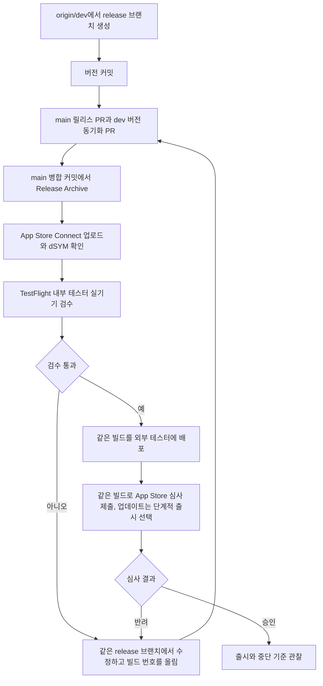

# 5 배포: iOS

기준: [검증](4-VERIFICATION.md).

 

### 5-1 빌드와 환경

현재 기준은 최소 배포 대상 iOS 26, Xcode 27 이상과 Swift 6 언어 모드다. 대상 기기와 화면 방향은 [공통 UI IOS 요구사항](../../../ui/IOS/2-2-REQUIREMENTS.md)을 따른다. 번들 ID는 `app.manyak`이며 바꾸지 않는다. 로컬 패키지가 최소 플랫폼으로 iOS 26을 선언하려면 패키지 도구 버전(`swift-tools-version`)이 6.2 이상이어야 한다(Xcode 27.2에서 확인, 2026-11-28). 라이브러리의 정확한 버전은 구현 저장소의 `Package.resolved`를 따른다.

| 설정 | Debug | Release |
|---|---|---|
| 서버 주소 | `https://dev-api.manyak.app/api/v1/`. 커밋하지 않는 xcconfig로 로컬 서버 덮어쓰기 가능 | `https://api.manyak.app/api/v1/` 고정 |
| 웹 주소 | `https://manyak.app`. 커밋하지 않는 xcconfig로 덮어쓰기 가능 | `https://manyak.app` |
| 평문 통신 | 로컬 주소에만 App Transport Security 예외 | 예외 없음 |
| 제공자와 분석 키 | Debug용 Google iOS 클라이언트 ID와 서버 클라이언트 ID, Kakao 네이티브 앱 키, Amplitude 키 | Release용 같은 네 값 |
| Crashlytics | 수집 끔 | 수집 켬. Archive마다 dSYM 업로드 |
| 포맷과 린트 | 빌드에서 swift-format 검사와 SwiftLint 실행. 위반 시 빌드 실패 | 같음 |

| 값 | 저장과 주입 |
|---|---|
| 공용 빌드 설정과 버전 | 커밋하는 공용 xcconfig |
| 제공자와 분석 키 | 커밋하지 않는 비밀값 xcconfig. 예시 파일만 커밋. 값이 없어도 빌드는 성공하고 해당 기능만 실행 시 실패 |
| Google과 Kakao URL 스킴 | 비밀값 xcconfig의 값을 빌드 설정으로 `Info.plist`에 주입 |
| Firebase 설정 | `GoogleService-Info.plist`를 커밋. 환경 구분 없는 Firebase 프로젝트 하나 ([I-021](DECISIONS.md#i-021)) |
| APNs 인증 키 | Firebase 콘솔에 등록. 저장소와 문서에 두지 않음 |

키 값과 실제 경로는 문서와 저장소에 적지 않는다. 오픈소스 고지 목록은 빌드 단계에서 Swift Package Manager 의존성의 라이선스를 모아 만들고 번들 글꼴 두 종의 OFL은 저장소에 둔 원문을 더한다. 생성 도구는 구현에서 고른다. ([I-027](DECISIONS.md#i-027)) 앱 개인정보 라벨과 개인정보 매니페스트(`PrivacyInfo.xcprivacy`)는 첫 제출 전에 작성하는 점검 항목이며 내용을 이 문서에 미리 적지 않는다. 대상은 Amplitude와 Crashlytics가 보내는 데이터, UserDefaults처럼 사용 이유 신고가 필요한 API이고 연결한 SDK 버전의 공식 문서를 기준으로 쓴 뒤 개인정보 처리방침과 대조한다. ([I-028](DECISIONS.md#i-028))

 

### 5-2 CI

| 항목 | 내용 |
|---|---|
| 실행 계기 | `dev`, `main` 대상 PR과 push |
| 러너 | GitHub Actions macOS 러너. Xcode 27 이상 선택 |
| 단계 | swift-format 검사, SwiftLint, iOS 시뮬레이터 단위 테스트, 시뮬레이터용 Debug 빌드 |
| 판정 | 한 단계라도 실패하면 실패 |
| 제외 | XCUITest, Release Archive, 서명과 업로드 |
| 비밀값 | 두지 않음. 비밀값 xcconfig 없이 빌드 |

러너 이미지의 Xcode 27 제공 여부는 확인하지 않았다(2026-11-26 기준). ([I-013](DECISIONS.md#i-013))

 

### 5-3 버전과 서명

| 항목 | 규칙 |
|---|---|
| 마케팅 버전 | `CFBundleShortVersionString`. 1.0.0부터 시작하고 Android 버전과 별개. 버그 수정은 patch, 기능 추가는 minor |
| 빌드 번호 | `CFBundleVersion`. App Store Connect에 올릴 때마다 1 증가, 재사용 금지. 심사 반려 뒤 같은 내용을 다시 올릴 때도 올림 |
| 정의 위치 | 두 값 모두 공용 xcconfig 한 곳 |
| 서명 | 릴리스 담당자의 Mac에서 수동. CI에 인증서, 프로비저닝 프로파일과 App Store Connect 키를 두지 않음 |
| 서명 방식 | Xcode 자동 서명. 인증서와 프로비저닝 프로파일은 Xcode가 만들고 갱신하며 따로 보관하지 않음. 담당자의 Mac을 쓸 수 없으면 Apple Developer 계정으로 다른 Mac에서 다시 발급 ([I-025](DECISIONS.md#i-025)) |

 

### 5-4 출시

1. `release/v{버전}` 브랜치를 `origin/dev`에서 만들고 공용 xcconfig의 마케팅 버전과 빌드 번호만 커밋한다.
2. 같은 브랜치로 `main` 릴리스 PR과 `dev` 버전 동기화 PR을 낸다.
3. `main` 병합 뒤 그 커밋에서 Release로 Archive한다. Archive 전에 비밀값 xcconfig의 Release 값 네 개가 채워졌는지 확인한다.
4. App Store Connect에 올리고 같은 빌드의 dSYM이 Crashlytics에 올라갔는지 확인한다.
5. TestFlight 내부 테스터로 실기기에서 로그인과 핵심 흐름을 완주한다.
6. 통과하면 같은 빌드를 외부 테스터에 배포하고 같은 빌드로 App Store 심사에 제출한다. 단계마다 다시 빌드하지 않는다. 버전 업데이트는 제출 전에 버전 페이지에서 단계적 출시를 선택한다. 첫 제출 전에는 앱 개인정보 라벨, 개인정보 매니페스트와 심사 전용 계정의 로그인 확인을 마친다.
7. 승인 뒤 출시하고 [중단 기준](../../../operations/DEPLOYMENT.md#9-4-ios-단계적-출시와-중단-기준)을 iOS 앱 버전별로 관찰한다. 기준을 충족하면 단계적 출시를 멈추고 수정판을 준비한다.

검수 실패나 심사 반려 뒤에는 같은 release 브랜치에 수정과 올린 빌드 번호를 커밋하고 2단계부터 다시 한다.

외부 테스터 배포와 App Store 제출은 Apple 심사를 거친다. 단계적 출시는 버전 업데이트에만 쓸 수 있어 첫 버전 1.0.0은 전체 출시이고 두 번째 버전부터 쓴다. 자동 업데이트 대상에게 7일 동안 1%에서 100%까지 정해진 비율로 나가며 합계 30일까지 멈출 수 있다. 수동 업데이트는 단계와 무관하게 받는다. ([I-029](DECISIONS.md#i-029)) 앱은 로그인이 필수이므로 심사 전용 Google 계정을 만들어 운영 환경에서 가입과 로그인을 확인한 뒤 자격 증명을 App Store Connect의 심사 정보에만 적는다. 자격 증명은 문서와 저장소에 두지 않는다. ([I-026](DECISIONS.md#i-026)) 외부 로그인의 앱 전환, 앱 열기 링크와 푸시는 실기기와 설치 빌드를 명시해 검증한다. ([I-014](DECISIONS.md#i-014), [I-015](DECISIONS.md#i-015), [I-023](DECISIONS.md#i-023))
