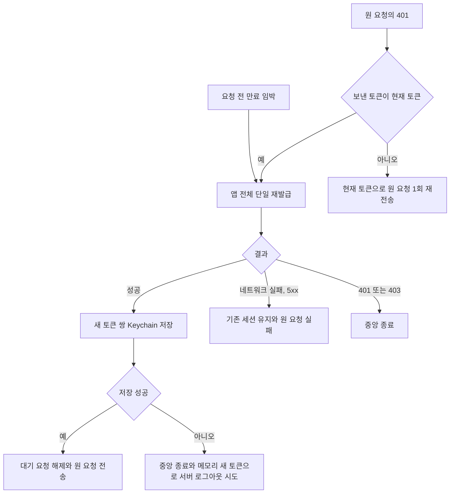
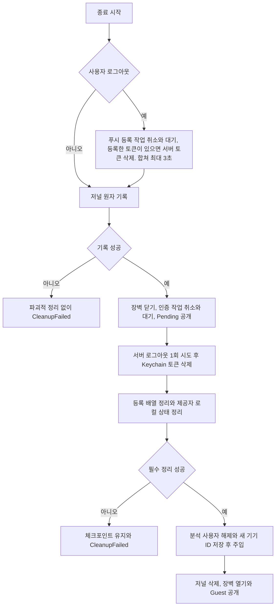
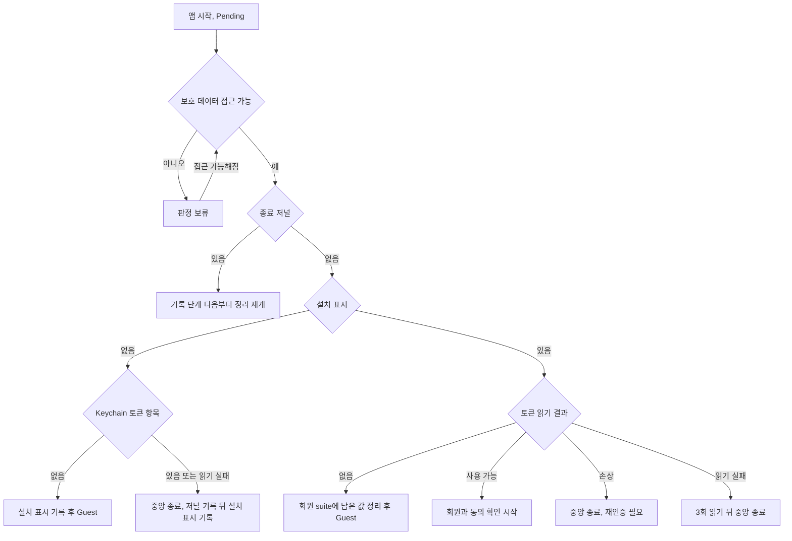

# 4-4 실행: iOS

 

### 4-4-1 인증과 동의

| 단계 | 실행 |
|---|---|
| SDK 초기화 | Kakao SDK는 앱 시작 때 첫 화면과 URL 처리 전에 네이티브 앱 키로 초기화. Google Sign-In은 iOS 클라이언트 ID와 서버 클라이언트 ID로 설정. 키가 비면 SDK를 호출하지 않고 `ProviderNotConfigured` |
| 복귀 URL | 앱 타깃이 받은 URL을 먼저 `ManyakAuth`에 넘겨 제공자 SDK의 복귀인지 판정. 제공자 복귀는 앱 열기 진입으로 해석하지 않음 ([공통 UI 앱 열기 링크](../../../../ui/IOS/4-4-EXECUTION.md#4-4-1-앱-열기-링크와-푸시-진입)) |
| Kakao 인증 | 카카오톡 앱 로그인을 쓸 수 있으면 먼저 시도. 쓸 수 없거나 취소 외 이유로 실패하면 카카오 계정 로그인. 사용자 취소는 `ProviderCancelled`이고 폴백 없음. ID 토큰 없는 성공은 `ProviderFailed` |
| Google 인증 | SDK 로그인 화면에서 ID 토큰 수신. 취소는 `ProviderCancelled`, 그 밖의 SDK 실패는 `ProviderFailed`. SDK의 이전 로그인 복원으로 토큰을 받지 않음 |
| 소셜 인증 | SDK 신원 인증과 서버 로그인 분리. 자동 반복 없음 |
| 가입 대기 | `CONSENT_REQUIRED`이면 토큰 저장 없이 대기 공개. 프로세스 종료 후 인증 진행 표시 복원 금지 |
| 가입 완료 | 서버 완료 → 토큰 저장 → 회원 공개 → 대기 해제 → 서버 회원 동의 재확인 |
| 신규 가입 기록 | `isNewUser`가 참인 토큰을 저장한 같은 인증 작업에서 등록된 `SignupOnboardingWriter`를 모두 호출 |
| 대기 실패 | 401 무효 코드, 400 버전 불일치와 필수 누락은 대기 폐기 및 만료나 갱신 안내. 자동 인증 안 함. 그 밖은 대기 유지 |
| 회원 동의 오류 | 401은 만료 흐름, 403은 이용 제한과 로그아웃. 네트워크 및 5xx는 재시도 |
| 저장 세션 시작 오류 | 시작 화면의 실패 자리에 로그아웃 동작을 넘기지 않음. 재시도만 제공 |
| 동의 완료 | 회원 루트 → 알림 권한 요청 → 선택 광고 동의 저장 → 해당 실행의 초대 안내 → 광고 재질문 |
| 계정 연동 | 현재 제공자 새 인증 → 메모리 연동 코드 → 대상 제공자 새 인증. 두 인증 모두 SDK의 이전 로그인 복원 없이 새로 받음. 403과 409 사유 유지 |

재발급의 403만 정지 사유로 중앙 종료한다. 그 밖의 403은 세션을 끝내지 않는다. ([2-2-1 진입과 동의](2-2-REQUIREMENTS.md#2-2-1-진입과-동의))

 

### 4-4-2 재발급

1. `ManyakAuth`의 재발급 액터가 앱 전체에서 진행 중 재발급 하나만 두고 동시에 들어온 요청은 같은 결과를 기다린다. 재발급은 무인증 요청 계층으로 보낸다.
2. 새 토큰 쌍을 Keychain에 저장한 뒤 대기 요청을 깨운다. 재발급은 `SessionGate`의 인증 작업이며 장벽이 닫힌 뒤 도착한 결과는 저장하지 않는다.
3. 원 요청의 401에는 같은 세대에서 재발급 한 번, 재전송 한 번만 허용한다. 401을 받은 요청이 보낸 access 토큰이 이미 교체됐으면 재발급하지 않고 현재 토큰으로 재전송한다. 재전송의 401은 `Unauthorized`로 돌려준다.

| 결과 | 실행 |
|---|---|
| 재발급 401 | 중앙 종료. 재인증 필요 안내 |
| 재발급 403 | 중앙 종료. 계정 정지 안내 |
| 네트워크 실패, 5xx 등 그 밖의 실패 | 기존 세션 유지. 원 요청은 그 실패로 끝남 ([I-065](DECISIONS.md#i-065)) |
| 회전 토큰 저장 실패 | 토큰 저장 실패로 종료, 메모리 새 토큰으로 서버 로그아웃 시도. 이전 refresh 재사용 금지 |
| 서버 회전 후 저장 전 프로세스 종료 | 다음 실행에서 재로그인 필요 가능 |

토큰 만료와 결과 반영 조건은 상태 관리에 있다. ([4-3-1](4-3-STATE-MANAGEMENT.md#4-3-1-세션과-토큰))

 

### 4-4-3 중앙 로그아웃과 복구

사용자 로그아웃, 탈퇴 성공, 재발급 401과 403, 회전 토큰 저장 실패, 토큰 손상과 읽기 실패, 재설치 판정, 회원 동의 거절과 만료가 모두 `SessionTerminationCoordinator` 하나로 들어온다.

사용자 로그아웃은 푸시 등록 작업을 닫고 취소한 뒤 끝나기를 기다리고, 인증 경계가 열린 동안 현재 FCM 토큰의 서버 삭제를 최대 3초 시도한다. 등록한 토큰이 없으면 생략하며 iOS 토큰 등록은 서버 선행 변경 전까지 없다. 탈퇴, 강제 종료와 재실행 정리에서도 생략하며 탈퇴한 회원의 토큰은 서버가 탈퇴 처리에서 지운다. 삭제 실패는 종료를 막지 않는다. 늦은 등록 요청이 토큰을 되살릴 수 있으므로 이 삭제만으로 계정 격리를 보장하지 않는다. 기기의 FCM 토큰 삭제와 알림 센터 정리는 모든 종료에서 등록 배열의 알림 정리 항목이 맡는다. ([NOTIFICATION iOS 토큰 등록과 삭제](../../../NOTIFICATION/CLIENT/IOS/4-4-EXECUTION.md#4-4-3-토큰-등록과-삭제))

1. 세대, 단계와 새 기기 ID 후보를 저널에 원자 기록한다. 기록 실패면 파괴적 정리를 시작하지 않고 `CleanupFailed`로 두며 재시도는 저널 기록부터 다시 한다. ([I-066](DECISIONS.md#i-066))
2. `SessionGate`의 장벽을 닫고 인증 작업을 취소한 뒤 끝나기를 기다린다. `Pending`을 공개해 루트가 시작 화면으로 바뀐다.
3. 메모리 또는 Keychain의 refresh 토큰으로 서버 로그아웃을 한 번 시도한다. 실패와 오프라인은 무시한다.
4. Keychain 토큰 항목을 삭제한다. 항목 없음도 성공이다.
5. 등록 배열의 모든 `UserScopedStore`를 정리한다. 제작 데이터베이스 행은 지우지 않고 회원 ID로 격리한다. 탈퇴 성공은 종료를 시작하기 전에 그 회원의 제작 데이터베이스 행 삭제를 한 번 시도하며 실패해도 종료를 막지 않는다. ([STORY I-122](../../../STORY/CLIENT/IOS/DECISIONS.md#i-122), [4-3-5](4-3-STATE-MANAGEMENT.md#4-3-5-정리-대상과-기기-귀속))
6. Google Sign-In의 로컬 로그인 상태와 Kakao SDK의 로컬 토큰을 지운다. 두 제공자 모두 매번 실행하며 Kakao 원격 로그아웃 실패는 무시하고 로컬 삭제 결과만 본다.
7. 새 분석 이벤트 발행을 막은 상태에서 Amplitude 사용자와 Crashlytics 사용자 식별을 해제한다. 저널의 새 기기 ID를 기기 suite에 저장한 뒤 다시 읽어 같은 값이면 Amplitude에 주입하고 발행을 다시 연다. 다시 읽은 값이 다르면 이 단계의 실패다. 사용자 로그아웃의 `client_account_logoutButton_clicked`는 종료를 시작하기 전에 기록해 이전 식별자에 남긴다. ([분석 기준](../../../../reference/ANALYTICS.md))
8. 저널을 삭제하고 장벽을 연 뒤 `Guest`와 로그인 그래프를 공개한다.

3단계를 뺀 단계는 필수이며 성공한 단계마다 저널에 체크포인트를 남긴다. 체크포인트, 재시작과 실패 상태는 종료 상태를 적용한다. ([4-3-4](4-3-STATE-MANAGEMENT.md#4-3-4-초대와-종료-상태))

 

### 4-4-4 시작과 재설치 판정

기기의 첫 잠금 해제 전에는 UserDefaults가 비어 보이고 Keychain 항목을 읽지 못하므로 설치 표시와 토큰을 판정하지 않고 `Pending`을 유지한다. 설치 표시가 없는 첫 실행에서 토큰 항목이 남아 있으면 재설치로 보고 종료 안내 없는 중앙 종료로 정리한다. 설치 표시는 저널 기록이 끝난 뒤 남겨 중간에 끝난 실행이 다음 실행에서 같은 판정을 반복하게 한다. 읽기 실패는 100ms와 200ms 간격으로 3회까지 읽는다. ([I-064](DECISIONS.md#i-064))

기기 백업에서 복원한 기기는 설치 표시가 있고 토큰이 없어 `Guest`로 시작한다. 설치 표시가 있는데 토큰이 없는 시작에서는 회원 suite에 남은 값을 지운다. ([IOS 기반 I-024](../../../../platform/CLIENT/IOS/DECISIONS.md#i-024))

기기 ID는 보호 데이터에 접근할 수 있게 된 뒤, 첫 요청과 첫 Amplitude 이벤트 전에 기기 suite에서 읽고 없으면 만들어 저장한다. 접근할 수 없는 동안에는 새 기기 ID를 만들지 않고 요청과 이벤트를 보내지 않는다. 회원 판정 뒤의 동의 확인은 인증과 동의 실행을 따른다. ([4-4-1](#4-4-1-인증과-동의))
