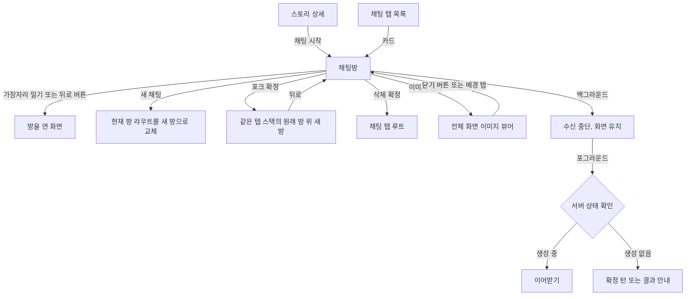

# 3-2 화면 흐름: iOS

 

### 3-2-1 방과 오버레이

| 시작 | 조작 | 결과 |
|---|---|---|
| 스토리 상세 | 채팅 시작 | 상세가 있는 탭 스택에 채팅방. 뒤로가기는 상세 |
| 채팅방 | 새 채팅 | 기본 주인공과 기본 시작 설정으로 현재 방 라우트 교체. 뒤로가기는 방을 연 화면 |
| 채팅방 | 포크 확정 | 알림창을 닫고 같은 탭 스택의 원래 방 위에 새 방. 뒤로가기는 원래 방 |
| 확인 알림창 | 닫기 | 요청 없이 알림창만 닫음. 입력 수정 확인은 편집기로 복귀 |
| 입력 수정 편집기 | 취소 | 요청 없이 원래 입력 표시 |
| 채팅방 | 삭제 확정 | 현재 탭 스택에서 삭제한 방을 걷어내고 채팅 탭을 루트로 선택. 삭제한 방은 복원하지 않음 |
| 목록 카드 | 더보기 또는 길게 누르기 | 공유, 회원 신고, 삭제 옵션 시트. 길게 누르기는 인식 순간 햅틱 한 번 |
| 옵션 시트 | 삭제 또는 신고 | 옵션 시트가 닫힌 뒤 삭제 확인 알림창 또는 신고 시트 |
| 이미지 뷰어 | 닫기 버튼 또는 그림 밖 배경 탭 | 뷰어만 닫기. 그림 위 탭은 닫지 않음 |
| 투어 | 가장자리 밀기 | 방을 떠나지 않음. 투어는 건너뛰기, 다음, 완료로만 종료 |
| 이미지 안내 | 켜기, 확인 또는 딤 탭 | 안내만 닫고 설정 시트 유지. 안내 중 시트 끌어내리기와 바깥 탭 닫기 잠금 |
| 설정 시트 | 안내 종료 후 끌어내리기 또는 바깥 탭 | 시트 닫기 |
| 메뉴의 이프 내역 | 돌아가기 | 시트를 유지한 채 메뉴로 복귀 |
| 메뉴의 이프 내역 | 바깥 탭 또는 끌어내리기 | 시트 닫기. 다시 열면 메뉴부터 |
| 메뉴의 이프 내역 | 새로고침 | 목록 맨 위로 즉시 이동 후 첫 페이지만 다시 조회. 응답까지 기존 목록 유지 |
| 메뉴 | 공유하기 성공 | 메뉴가 닫힌 뒤 시스템 공유 시트 |
| 외부 진입 | 다른 탭 선택 | 방이 탭 스택에 남으면 이탈이 아니며 수신 유지. 스택에서 빠지면 이탈 |
| 앱 복귀 | 서버 상태 확인 | 생성 중이면 이어받고, 끝났으면 확정 턴 또는 요구사항의 결과 |

신고와 새 채팅은 참조 스토리 ID와 공백이 아닌 제목이 있을 때만 제공한다. 시트 위 화면 이동과 시트 사이 순서는 공통 UI IOS 흐름을 따른다. ([공통 2-2-1](../2-2-REQUIREMENTS.md#2-2-1-적용-범위와-목록), [공통 UI IOS 3-2-1](../../../../ui/IOS/3-2-INTERACTION-FLOWS.md#3-2-1-탭과-화면-복귀))
